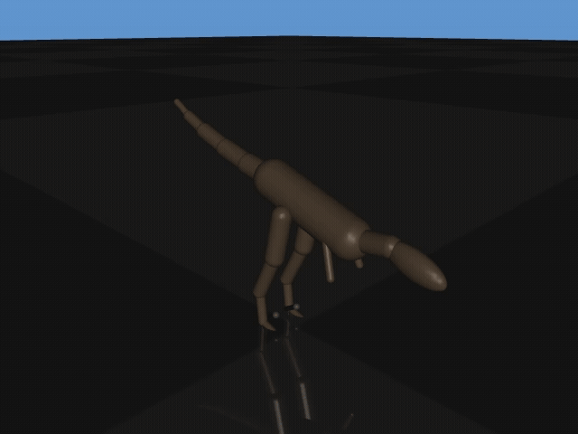

# Mesozoic Labs

[](https://github.com/kuds/mesozoic-labs/actions/workflows/python-ci.yml)
[](LICENSE)
[](pyproject.toml)
[](https://mesozoiclabs.com)

Reinforcement-learning locomotion research on simulated dinosaurs.



*Velociraptor balance from a historical, unverified PPO run. It is not evidence for the current model.*

Mesozoic Labs is a set of [Gymnasium](https://gymnasium.farama.org) environments built on
[MuJoCo](https://mujoco.org), plus a pipeline that trains agents in them with PPO or SAC from
[Stable-Baselines3](https://stable-baselines3.readthedocs.io).

A *model* is one species in one embodiment: `anatomical`, a body with the animal's proportions, or `robot`, a design
for a buildable robot of that species. Most species are dinosaurs. Dibothrosuchus is a crocodylomorph, an early
relative of crocodiles; its upright, long-legged posture moves differently from the sprawl of a modern crocodile.
Compsognathus also has a twelve-servo robot model. The models are simplified for research; they are not validated
anatomical reconstructions.

Each model learns a few behaviors, such as stance (standing balance), recovery from pushes and walk. Each behavior
is a separate policy, judged against its own pass/fail test and published on its own. A behavior that passes its test
is certified, and later stages start from it, so a certified policy is reused, not trained again.

The goals are locomotion controllers for these bodies, walking that follows a commanded direction and speed, and, in
the long run, policies that run on real robots. All work so far is in simulation. Hardware transfer is future work,
and no sim-to-real results are published.

## Species

<!-- BEGIN GENERATED: SPECIES -->
<!-- Generated by `python -m environments.shared.species_catalog` from `configs/species_manifest.toml`
and the executable environments; do not edit by hand. -->

| Model | Description | Gait | Task | Observation / action dim. | Details |
|---|---|---|---|---:|---|
| <a id="velociraptor_mongoliensis-anatomical"></a>**Velociraptor Mongoliensis (Anatomical)** | Swift Bipedal Predator | Bipedal | Fast bipedal running | 71 / 17 | [README](environments/velociraptor_mongoliensis/README.md) · [catalog entry](docs/SPECIES_CATALOG.md#velociraptor_mongoliensis-anatomical) · [model page](https://mesozoiclabs.com/docs/models/velociraptor_mongoliensis/anatomical) |
| <a id="tyrannosaurus_rex-anatomical"></a>**Tyrannosaurus Rex (Anatomical)** | Apex Predator | Bipedal | Heavy-bodied bipedal balance and walking | 63 / 15 | [README](environments/tyrannosaurus_rex/README.md) · [catalog entry](docs/SPECIES_CATALOG.md#tyrannosaurus_rex-anatomical) · [model page](https://mesozoiclabs.com/docs/models/tyrannosaurus_rex/anatomical) |
| <a id="brachiosaurus_altithorax-anatomical"></a>**Brachiosaurus Altithorax (Anatomical)** | Gentle Giant Herbivore | Quadrupedal | Long-necked quadrupedal walking | 86 / 30 | [README](environments/brachiosaurus_altithorax/README.md) · [catalog entry](docs/SPECIES_CATALOG.md#brachiosaurus_altithorax-anatomical) · [model page](https://mesozoiclabs.com/docs/models/brachiosaurus_altithorax/anatomical) |
| <a id="dibothrosuchus_elaphros-anatomical"></a>**Dibothrosuchus Elaphros (Anatomical)** | Gracile Erect-Limbed Crocodylomorph | Quadrupedal | Erect-limbed quadrupedal walking | 80 / 27 | [README](environments/dibothrosuchus_elaphros/README.md) · [catalog entry](docs/SPECIES_CATALOG.md#dibothrosuchus_elaphros-anatomical) · [model page](https://mesozoiclabs.com/docs/models/dibothrosuchus_elaphros/anatomical) |
| <a id="compsognathus_longipes-anatomical"></a>**Compsognathus Longipes (Anatomical)** | Small Bipedal Theropod | Bipedal | Small-bodied bipedal walking | 55 / 14 | [README](environments/compsognathus_longipes/README.md) · [catalog entry](docs/SPECIES_CATALOG.md#compsognathus_longipes-anatomical) · [model page](https://mesozoiclabs.com/docs/models/compsognathus_longipes/anatomical) |
| <a id="compsognathus_longipes-robot"></a>**Compsognathus Longipes (Robot)** | Twelve-Servo Biped Prototype | Bipedal | Servo-driven bipedal walking with fixed head and tail | 46 / 12 | [README](environments/compsognathus_longipes/README.md) · [catalog entry](docs/SPECIES_CATALOG.md#compsognathus_longipes-robot) · [model page](https://mesozoiclabs.com/docs/models/compsognathus_longipes/robot) |
| <a id="allosaurus_fragilis-anatomical"></a>**Allosaurus Fragilis (Anatomical)** | Jurassic Tridactyl Theropod | Bipedal | Level-ground walk to a target | 45 / 10 | [README](environments/allosaurus_fragilis/README.md) · [catalog entry](docs/SPECIES_CATALOG.md#allosaurus_fragilis-anatomical) · [model page](https://mesozoiclabs.com/docs/models/allosaurus_fragilis/anatomical) |

The [species catalog](docs/SPECIES_CATALOG.md) holds each model's full entry: specifications, current stages
with their recipes, budgets and gates, success definitions and run summaries; each model page renders it too.
<!-- END GENERATED: SPECIES -->

Outside the table, the [Stegosaurus reference](examples/stegosaurus_stenops/README.md) is a standalone MuJoCo
reconstruction built from specimen measurements. It stands and walks with a scripted controller, not a trained
policy. To watch it on a machine with a display, run `python -m examples.stegosaurus_stenops` from the repository
root.

## Getting started

You need Python 3.11 or newer. Install from a clone and run the commands below from the repository root:

```bash
git clone https://github.com/kuds/mesozoic-labs.git
cd mesozoic-labs
python -m venv venv
source venv/bin/activate      # Windows: venv\Scripts\activate
pip install -e ".[train]"     # the environments plus PPO/SAC training
```

The other install options are `pip install -e .` for the environments only (MuJoCo, Gymnasium and NumPy) and
`pip install -e ".[all]"` for training plus the visualization and developer tools. Add `-c constraints.txt` to any of
these to get the MuJoCo, Stable-Baselines3 and Gymnasium versions CI tests and Colab trains with.

Step a model with random actions. This needs no GPU and no display:

```python
import gymnasium as gym
import environments  # registers the MesozoicLabs/* environments

print([env_id for env_id in gym.registry if env_id.startswith("MesozoicLabs/")])

env = gym.make("MesozoicLabs/VelociraptorMongoliensis-Anatomical-v0")
obs, info = env.reset(seed=0)
for _ in range(500):
    obs, reward, terminated, truncated, info = env.step(env.action_space.sample())
    if terminated or truncated:
        obs, info = env.reset()
env.close()
```

On a machine with a display, this opens the model in MuJoCo's interactive viewer (on macOS, use `mjpython` instead
of `python`):

```bash
python -m environments.velociraptor_mongoliensis.scripts.view_model --embodiment anatomical
```

### Train a policy

The easiest route is the training notebook, which installs its own dependencies:
[open `notebooks/sb3_training.ipynb` in Colab](https://colab.research.google.com/github/kuds/mesozoic-labs/blob/main/notebooks/sb3_training.ipynb).
Pick a species, its embodiment and a behavior, and set `QUICK_TEST = True` first for a short pipeline check.

<!-- BEGIN GENERATED: NOTEBOOKS -->
| Notebook | Description |
|---|---|
| [`notebooks/sb3_training.ipynb`](notebooks/sb3_training.ipynb) | Train and evaluate species with Stable-Baselines3. |
| [`notebooks/google_drive_summary.ipynb`](notebooks/google_drive_summary.ipynb) | Collect and summarize training artifacts from Google Drive. |
<!-- END GENERATED: NOTEBOOKS -->

On the command line, one command trains a model through its stages, from stance up to walk. Each stage uses the
budget and hyperparameters in its stage config. Stages run for millions of steps, so a full run takes hours:

```bash
python -m environments.shared.train --species velociraptor_mongoliensis --embodiment anatomical \
    curriculum --algorithm ppo
```

Every model trains through this one entry point. `--species` and `--embodiment` are required; for the robot, use
`--species compsognathus_longipes --embodiment robot`. Running `python -m environments.shared.train` without them
prints every model's IDs. The [behavior recipes guide](https://mesozoiclabs.com/docs/training/recipes) covers
stopping at one behavior (`--target`), reusing certified stages from an earlier run (`--trunk-from`), retraining a
stage, the recovery stage and the notebook's settings.

## Repository layout

| Path | Contents |
|---|---|
| [`environments/`](environments) | The Gymnasium environments, one package per species; `shared/` holds training, evaluation and the catalog generator |
| [`configs/`](configs) | The species manifest and each model's stage configs (`configs/<species>/<embodiment>/`) |
| [`notebooks/`](notebooks) | Colab notebooks for training and for summarizing results |
| [`results/`](results) | Published run summaries, metrics and GIFs (none is published at present), and the ledger of judgements made outside training |
| [`docs/`](docs) | The generated species catalog, plans, design records, investigations and reviews |
| [`website/`](website) | Source of [mesozoiclabs.com](https://mesozoiclabs.com) (Docusaurus) |
| [`examples/`](examples) | The standalone Stegosaurus reference |
| [`hardware/`](hardware) | Robot design studies and build plans; no hardware results are published yet |

## Documentation

Start with the guides on [mesozoiclabs.com](https://mesozoiclabs.com) and the generated species catalog.

| To… | Read |
|---|---|
| Install, view a model, train, evaluate and override hyperparameters step by step | [Installation](https://mesozoiclabs.com/docs/getting-started/installation) and [quick start](https://mesozoiclabs.com/docs/getting-started/quick-start) |
| Train stance, recovery and walk, reuse certified stages across runs and read a run directory; the training command's flags and the notebook's settings | [Behavior recipes](https://mesozoiclabs.com/docs/training/recipes) |
| Tune PPO, SAC and the stage configs | [Training guides](https://mesozoiclabs.com/docs/training/ppo) |
| Look up one model: specifications, stages with their budgets and pass/fail tests, success definitions, published run summaries | The generated [species catalog](docs/SPECIES_CATALOG.md), or the model's page on the site; both are linked from the [Species](#species) table |
| Find the published run-summary files and when a summary counts as current | [results/README.md](results/README.md) |
| Add a species or a robot, set up for development and run the tests | [Contributing](CONTRIBUTING.md) |
| See what changed in each release | [Changelog](CHANGELOG.md) |
| Check project status, plans, design records and open problems | [Documentation map](docs/README.md) |
| Read how the project started | [From Zero to Dino-Roar](https://www.findingtheta.com/blog/from-zero-to-dino-roar-teaching-a-t-rex-to-walk-with-mujoco-and-reinforcement-learning) (blog post) |

## Citation

If you use Mesozoic Labs in your research, please cite:

```bibtex
@software{mesozoic_labs,
  title     = {Mesozoic Labs: Dinosaur Locomotion via Reinforcement Learning},
  author    = {Michael Kudlaty},
  year      = {2025},
  url       = {https://github.com/kuds/mesozoic-labs},
  license   = {MIT}
}
```

## License

MIT; see [LICENSE](LICENSE). The Compsognathus robot meshes and inherited leg data are third-party
Apache-2.0 components from Open Duck Mini v2: see their
[notice](environments/compsognathus_longipes/robot/references/NOTICE.md) and the upstream license beside it.
