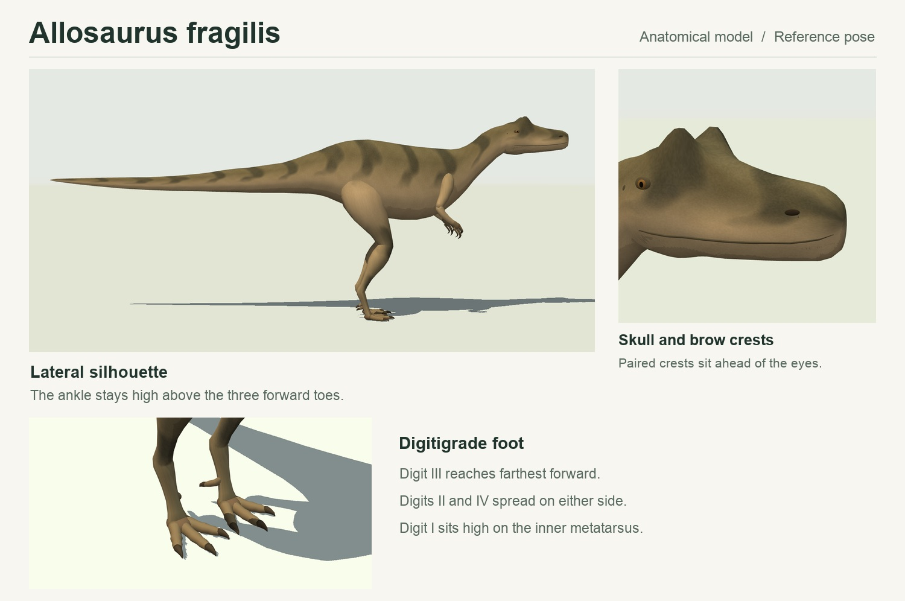
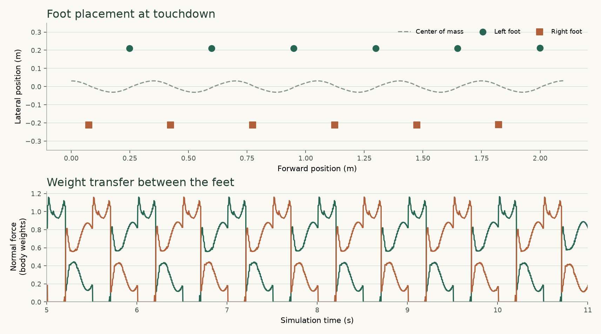

# Allosaurus fragilis anatomy and reference walk

The new anatomical model stands on two digitigrade feet and walks straight ahead on level ground. Its standing center of mass lies about 16.6 cm ahead of the hips. In the 30-second walking trial, it made 54 landings in the measured window, with 53 alternating transitions out of 53. Its speed was 0.349 m/s. The broad track and short steps make this a cautious reference walk.



## Anatomy and design

| Feature | Reconstruction and basis |
|---|---|
| Body proportions | The tail extends 3.88 m behind its root, about 53% of total length. The snout projects 0.85 m beyond the head's attachment to the neck. These are horizontal spans in the neutral pose. For scale, published reconstructions give 7.4 m for USNM 4734 and 7.9 m for UUVP 6000. [Published body-length comparisons](https://doi.org/10.1007/s41513-021-00172-1) |
| Hind-limb proportions | Joint-center distances are 888 mm for the femur, 743 mm for the tibia and 378 mm for the metatarsus. UUVP 6000r measures 880, 730 and 375 mm. All three modeled lengths fall within 2% of that individual's bone lengths. Bone ends and modeled rotation centers are different landmarks. [Persons and Currie, Table 2](https://pmc.ncbi.nlm.nih.gov/articles/PMC4728391/#Tab2) |
| Trunk and balance | The posed outer surface measures 7.27 m from snout to tail. The hips stand 1.90 m above the plane and the full moving animal weighs 1,482 kg. The neutral center of mass is 16.6 cm ahead of and 6.1 cm below the hip. A published *Allosaurus* reconstruction placed it 18.4 cm ahead and 14.1 cm below. That specimen, MOR 693, was later referred to *A. jimmadseni*, so it provides a genus-level comparison. [Bates et al.](https://palaeo-electronica.org/2009_3/186/results.htm) · [Chure and Loewen](https://doi.org/10.7717/peerj.7803) |
| Feet | Digits II, III and IV fan forward, with III reaching farthest. Each has a distinct contact surface. A pad beneath the metatarsophalangeal joints shares their load. Digit I, the hallux, emerges high on the inner metatarsus. [Madsen, pp. 47–48 and plate 55](https://ugspub.nr.utah.gov/publications/bulletins/B-109.pdf) |
| Head, arms and tail | A paired crest rises ahead of the eyes, the three-fingered hands face inward, and the tail tapers from a muscular root. The skin follows the moving limbs and tail. Color, pattern, lip outline and muscle contours are interpretive. [Madsen’s osteology](https://ugspub.nr.utah.gov/publications/bulletins/B-109.pdf) · [Liang et al. on forelimb articulation](https://researchonline.ljmu.ac.uk/id/eprint/24278/) |

## Balance and motion in MuJoCo

A free root connects the pelvis to the world. Ten motors apply torque at hip roll, hip pitch, knee, ankle and the base of each set of toes. Two tail yaw joints move passively against springs and dampers. The three forward toes on a foot pitch together. The head, neck and arms move with the trunk. The controller reads the body state, shifts weight to the stance foot and aims the swing foot at the next foothold. Gravity and floor contact determine the actual motion.

| Measurement | Result |
|---|---|
| Standing | Over seconds 3–20, the feet carried 50.0% left and 50.0% right. The projected center of mass stayed at least 9.0 cm inside the loaded contact polygon. All three digital pads on each foot carried weight. |
| Forward travel | 9.41 m across the 27-second measurement window. Net sideways displacement was 0.2 cm. |
| Foot placement | Median forward step 17.5 cm, left-to-right track width 42.2 cm and same-foot stride 35.0 cm. Median stride period was 1.00 s. |
| Support | The left and right feet were loaded together for 61.9% of measured substeps. Both feet were below the load threshold for 0.0%. The greatest combined floor reaction was 1.19 body weights. |
| Swing and slip | Median peak swing clearance was 6.2 cm left and 6.2 cm right. The mean speed of the loaded contact patches was 0.8 cm/s. The 95th percentile was 1.3 cm/s. |
| Where the load went | The paired MTP pads received 23.1% of the summed normal impulse. Digit II received 24.5%, digit III 15.3%, and digit IV 37.2%. Other body parts received 0.0%. |
| Visible foot surfaces | At their lowest, the forward claws stayed 10.6 mm above the floor and the raised inner claws stayed 92.4 mm above it. The rendered plantar skin extended up to 1.6 mm through the floor under load. |
| Body and joints | Pelvis height varied by 1.8 mm. Roll spanned 0.38° and pitch 0.07°. Head-tip and tail-tip heights varied by 5.1 and 4.6 mm. The left knee moved through -3.1° to +10.0° relative to home and the left ankle through -9.0° to +1.3°. |
| Long run | The 90-second trial covered 30.41 m after startup, with 173 alternating transitions out of 173 and 0.0% of measured substeps without a loaded foot. |



Each plotted point is the position of the MTP pad at touchdown. The contact solver ran every 2 ms and the torque controller updated every 10 ms. A foot counted as loaded above 1% of body weight. Stride events use a 20 ms debounce to avoid counting brief unloading as a new step. The report preserves raw threshold crossings. Double support and airborne fractions use the unfiltered substeps. Slip is the horizontal speed of the pad at its actual point of contact, weighted by normal force within each substep. The standing support margin uses the horizontal convex hull of floor contacts above 1 N.

## Limits of the reconstruction

The measured track is wide relative to the 17.5 cm step, and the trunk rises and falls less than 2 mm. The controller holds the body unusually level, particularly at the head and neck. The grouped toes limit how weight rolls from one digit to the next. The outer digit receives the largest share of walking load. These are limitations of the reconstruction. Fossils constrain segment lengths and foot structure much more directly than soft tissues, muscle torques or walking speed. The tests cover slow, straight travel on level ground.

## Training-environment checks

Using the registered environment with its normal reset noise and actuator limits, the reference controller completed all 40 ten-second standing trials. Both feet stayed loaded throughout every scored interval after the two-second settling period. With reset seeds 0, 1 and 7, the walker crossed the course line, 7.65 m along its spawn heading (the 8 m course less the 0.35 m tolerance), after 23.62 seconds in each trial. That gives 0.324 m/s including startup. (Before policy interface r2 the course ended inside a 35 cm radius around a target 8 m ahead, which the same walk entered one control step later, at 23.63 seconds.) Rotating the whole course by −90°, −45°, +45° or +90° produced the same completion time. The video and these results use the reference controller.

## Reproduce the trials

From the repository root, install the project with `python -m pip install -e .`. The controller uses the ordinary joint torque inputs. The Gymnasium ID is `MesozoicLabs/AllosaurusFragilis-Anatomical-v0`. The audit starts from the MJCF home keyframe.

```bash
python -m environments.allosaurus_fragilis.scripts.audit_motion --mode stand --seconds 20 --warmup 3
python -m environments.allosaurus_fragilis.scripts.audit_motion --mode walk --seconds 30 --warmup 3 --skin-clearance
python -m environments.allosaurus_fragilis.scripts.audit_motion --mode walk --seconds 90 --warmup 3
```

[Full measurement data](../../environments/allosaurus_fragilis/data/reference_validation.json) · [Walking video with foot loads](../../website/static/videos/allosaurus_fragilis_anatomical_reference_walk.mp4) · [Model and training setup](../../environments/allosaurus_fragilis/README.md)
