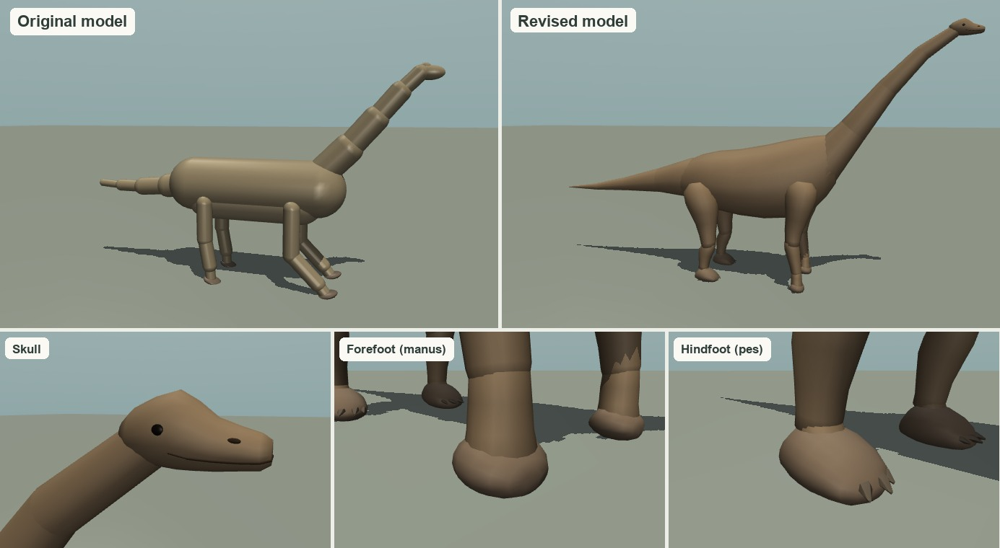

# Brachiosaurus altithorax anatomy and reference walk

**November 21, 2026 · physics r6 · moved from the species README**

Until 2026-11-21 this review was the "Anatomical review" and "Balance, walking and browsing" sections of
[the model's README](../../environments/brachiosaurus_altithorax/README.md). It moved here on that date. The summary
below and the reproduction section are new; the rest is unchanged apart from headings, links and American spelling. It
describes physics revision 6 of the anatomical model.

The revised model stands on all four soles and walks slowly on level ground under its own servos. At neutral stance
the forelimbs carry 56.2% of the settled floor load. Over six measured strides the reference controller advanced at
0.340 m/s with at least two feet loaded throughout, landing left hind, left fore, right hind and right fore on every
stride.

## Anatomy and design

The original model placed both girdles at the same height and bent its elbows 45° to fit the forelimbs on the floor. Its elbows and hind knees folded in the same direction. Both pairs of feet stood on identical pads. Under the neutral command, the unsupported neck flexed to its joint stop and the snout lost 1.44 m of height in 20 s.



| Measurement on the scaled model | Original | Revised |
| --- | ---: | ---: |
| Humerus / femur length | 0.550 / 0.450 m | 0.540 / 0.535 m |
| Shoulder / hip joint height at home | 1.000 / 1.000 m | 1.123 / 1.005 m |
| Elbow flexion at home | 45° | 16° |
| Neck / tail centerline length | 1.63 / 1.46 m | 2.10 / 2.05 m |
| Snout height at home → after 20 s of standing | 2.550 → 1.112 m | 2.977 → 2.974 m |
| Forelimb share of settled floor load | 37.4% | 56.2% |

The holotype supports near-equal humerus and femur lengths and a long, deep trunk. The model uses those proportions and a humerus, radius and metacarpus of 0.54, 0.36 and 0.15 m, following the 3.6 to 2.4 to 1 ratio from the referred Potter Creek material. The reconstructed chest deepens toward the shoulders and the tail tapers from a fleshy base. The skull outline, browsing angle, distal tail and skin contours draw on comparisons with other brachiosaurids. The simulation preserves its original 175.3 kg animal mass. Its absolute loading and speed apply at model scale. [Taylor, 2009](https://www.miketaylor.org.uk/dino/pubs/taylor2009/Taylor2009-brachiosaurus-and-giraffatitan.pdf) · [D’Emic and Carrano, 2020](https://doi.org/10.1002/ar.24198)

The compact forefoot (manus) carries weight through a near-vertical metacarpus with a shallow hollow at the back of the pad. The longer hindfoot (pes) has an inclined metatarsus, a fleshy heel and three outward-directed claws on the inner digits. The claws are mirrored between sides. Each foot has one smooth ellipsoid for sole contact. Its size differs between manus and pes. The sculpted soft tissue and claws are visual geometry, so individual toe pressures cannot be inferred from this model. [Bonnan, 2003](https://doc.rero.ch/record/15172/files/PAL_E2447.pdf) · [Jannel et al., 2022](https://doi.org/10.1126/sciadv.abm8280)

## Balance, walking and browsing

**Standing.** All four soles load at neutral stance. With the center of mass projected onto the floor, its nearest lateral support edge is 0.300 m away and its nearest fore–aft edge is 0.505 m away. All 120 noisy resets in the stage-1 standing panel completed 1,000 control steps. A separate 80-reset stance calibration measured a worst post-landing foot travel of 20.6 mm and a worst turn of 1.8°. These recovery limits are tracked in the [stance tests](../../environments/brachiosaurus_altithorax/tests/test_com_stance_quality.py).

**Walking.** The reference controller asks for a lateral-sequence walk with diagonal couplets. Each foot swings forward, then bears weight while the torso advances over it. Joint servos, gravity and contact forces determine the actual motion. The controller sends ordinary Gymnasium actions and measures each foot's floor force during the physics substeps. Sauropod trackways motivate the phase relationship. The trackmakers' species is uncertain. [Lallensack and Falkingham, 2022](https://pubmed.ncbi.nlm.nih.gov/35240050/)

| Six measured strides after startup, level ground, noise-free reset | Result |
| --- | ---: |
| Touchdown order | Left hind → left fore → right hind → right fore |
| Mean forward speed / median stride period | 0.340 m/s / 1.405 s |
| Median time between same-side hind and fore touchdown | 34.4% of a stride |
| Median stride length across the four individual feet | 0.476–0.484 m |
| Fraction of time loaded, by foot | 62.1–68.0% |
| Median elbow / hind-knee flexion under load | 15° / 21° |
| Peak swing clearance, by foot | 45–51 mm |
| Minimum feet loaded / airborne physics substeps | 2 / 0 |
| 95th-percentile contact slip speed while loaded | 0.019 m/s |
| Torso vertical excursion / maximum absolute roll | 6.5 mm / 2.02° |

All 14 walk trials completed nine strides, including three resets at noise scale 0.01 (seeds 0–2) and ten at 0.05 (seeds 3–12). Each repeated the same four-foot order.

Foot loads above 1% of body weight identify weight-bearing steps. A 50 ms debounce filters brief contact flicker for touchdown timing. Clearance is measured at the bottom of each oriented sole. Slip is the measured tangential contact speed. A quiet stance, a sliding foot and a lifted foot therefore give different readings. The [walking replay](../../website/static/videos/brachiosaurus_altithorax_anatomical_reference_walk.mp4) shows the same nominal run with its contact traces.

**Browsing.** With the neck pitched forward by a 65% residual command for 4 s, the snout lowered from 2.97 to 1.95 m. After release it recovered to within 5 cm of its standing height relative to the neck base in 0.99 s. The eyes, bony narial arch, forward external nostrils and mouth are separate features. [Witmer, 2001](https://pubmed.ncbi.nlm.nih.gov/11486085/)

## Limits

The stage-2 stationary baseline can earn 2,282 reward points without advancing, so reward alone is insufficient evidence of walking. The flat-ground reference walk demonstrates the revised plant's mechanical capacity at one slow speed. The stage-2 PPO graduation threshold is 0.75 m/s. The historical training clips and scores belong to earlier plants, and a new policy requires training and evaluation on physics revision 6.

## Reproduce the trials

From the repository root, install the project with `pip install -e .` (add `".[test]"` for the tests). The reference
controller drives the anatomical environment through its normal actuator actions.

```bash
python -m environments.brachiosaurus_altithorax.scripts.reference_walk
python -m environments.brachiosaurus_altithorax.scripts.reference_walk --seed 3 --reset-noise 0.05
pytest environments/brachiosaurus_altithorax/tests/test_reference_walk.py environments/brachiosaurus_altithorax/tests/test_com_stance_quality.py
```

The first command repeats the noise-free trial in the table and prints its measurements as JSON. `--seed` and
`--reset-noise` repeat one of the perturbed trials. The tests check the reference walk and the standing support
margins and recovery limits.

[Reference controller](../../environments/brachiosaurus_altithorax/scripts/reference_walk.py) · [Walking video with contact traces](../../website/static/videos/brachiosaurus_altithorax_anatomical_reference_walk.mp4) · [Model and training setup](../../environments/brachiosaurus_altithorax/README.md)
