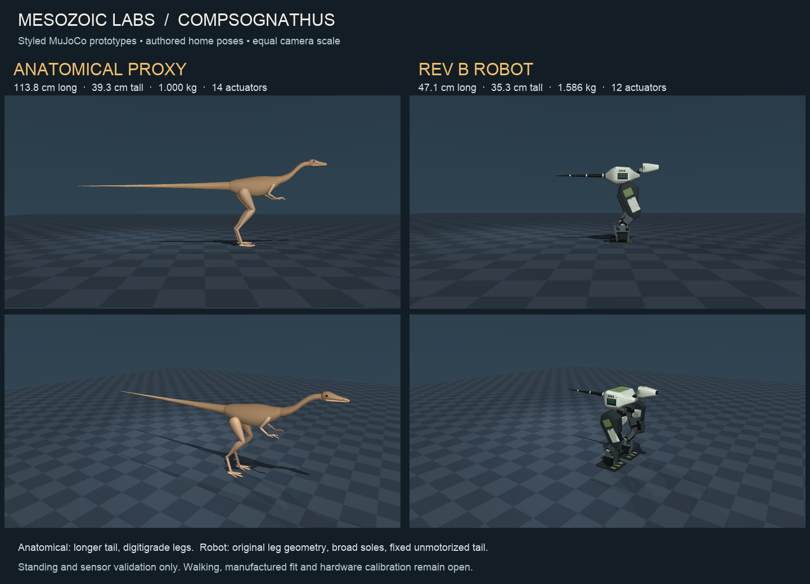
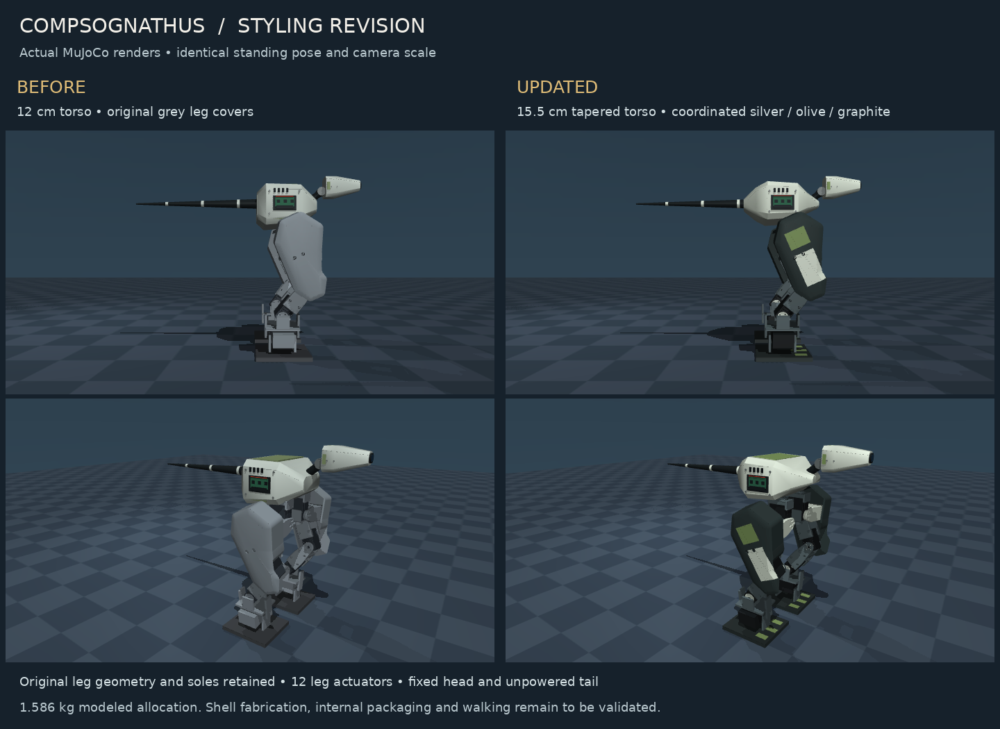

# Compsognathus longipes robot design (Rev B)

**November 21, 2026 · robot physics r1 · anatomical physics r3 · moved from the species README**

Until 2026-11-21 this record was the robot-design material of
[the species README](../../environments/compsognathus_longipes/README.md). It moved here on that date. The text is the
README's as it stood at commit `c1feca12`, kept near-verbatim: the headings are the README's, links are rebased for
this folder, file paths are written from the repository root, and the few notes added on the move are marked
*Note (2026-11-21)*. Several sections also cover the anatomical proxy, because the two models were built, styled and
validated together. The anatomical reconstruction itself is reviewed in
[ANATOMY_AND_BALANCE.md](../../environments/compsognathus_longipes/ANATOMY_AND_BALANCE.md).

## Scope

Two MuJoCo models, added September 7, 2026, with SB3 training integration. Both have a floating base, articulated
legs, working ground contact, joint-angle servos, an IMU, encoders, foot touch sensors and one forward-facing camera.
Both hold a standing pose in forward dynamics. Both have registered Gymnasium environments, PPO/SAC recipes,
evaluation and checkpoint contracts. **A converged walking policy has not yet been demonstrated.**

The repository pins **MuJoCo 3.10.0**, used for these checks. The original Rev B package used 3.12.0.



| Property | Anatomical proxy | Rev B robot |
|---|---|---|
| MJCF | `environments/compsognathus_longipes/anatomical/assets/compsognathus_longipes_anatomical.xml` | `environments/compsognathus_longipes/robot/assets/compsognathus_longipes_robot.xml` |
| Home standing height | 39.3 cm | **35.3 cm** |
| Nose-to-tail envelope | 113.8 cm | **47.1 cm** |
| Maximum visual width | 12.3 cm | 25.8 cm, including leg hardware |
| Pelvis-frame height | 24.4 cm | **21.8 cm** |
| Model mass, excluding target | 1.000 kg, assumed | **1.5856 kg**, preserved Rev B allocation |
| Actuators | 14 | **12, all in the legs** |
| Tail | Two driven base axes and three passive distal hinges | **Fixed, 50 g allocation; no joint or motor** |
| Head | Neck pitch and jaw pitch | Fixed, 45 g allocation |
| Feet | Three loaded digits, a metatarsal cushion and a raised hallux | **100 × 90 × 8 mm** soles |

Dimensions are measured visual bounds at `home`, not manufacturing dimensions. The anatomical proxy has a longer tail
and slimmer legs; the robot preserves the previously screened mechanism.

*Note (2026-11-21):* the README gave the anatomical nose-to-tail envelope as 112.3 cm. Re-measured on the move with
`model.model_bounds` at the `home` keyframe, the current anatomical model (physics r3) spans 113.8 cm, which matches
the 1,138 mm in the anatomy review; the table now gives 113.8 cm. Every other value in the table re-measured as
given.

## Preserved robot design

`environments/compsognathus_longipes/robot/references/compsognathus_longipes_robot_rev_b.xml` preserves the original
September 6 Rev B model. The generator verifies its SHA-256 and uses the original first double-support pose stored in
`environments/compsognathus_longipes/data/model_parameters.json`. Body transforms, joint signs/ranges and leg/core
inertials remain unchanged. The head's 45 g allocation uses the component COM and inertia established in v1. The v3
mechanical enclosures retain those aggregate mass proxies; their panel surfaces are not used to infer the mass of
solid metal blocks. The tapered tail retains its conservative 50 g Rev B aggregate inertial allowance, including its
attachment; this is not a uniform-density tail CAD.

Each leg has hip yaw, hip roll, hip pitch, knee pitch, ankle pitch and ankle roll. **Both thigh and shin parallel
shaft separations are 78.65 mm**. The ankle adapter adds 40 mm from pitch to roll and 38 mm from roll to sole. Home
foot-center spacing is 130 mm. Shaft separation is measured perpendicular to the axis, avoiding the misleading
along-shaft offsets in the source joint origins.

The candidates are **two STS3250-C001 hip-roll servos and ten STS3215-C018 12 V servos**. This supersedes the older
ten-leg-plus-two-neck-axis estimate.

| Mass allocation | Mass |
|---|---:|
| Core: battery, computer, yaw servos, power distribution, wiring and structure | 505 g |
| Fixed head and sensor allowance | 45 g |
| Fixed tail and attachment | 50 g |
| Two complete leg assemblies | 985.6 g |
| **Total** | **1,585.6 g** |
| **15% growth scenario** | **1,823.44 g** |

The head and tail are already included. These are allocated/inherited CAD masses, not weighed hardware. The core
remains an aggregate envelope, not a verified arrangement of the battery, boards and regulator. Decorative mounts
and the camera lens use existing inertial allowances.

The fixed head allocates **22 g rear shell, 8 g nose housing, 5 g lower shell, 6 g camera module/lens and 4 g
mount**. These overlapping primitive envelopes are now hidden mass proxies. A chamfered outer camera housing supplies
the visible shape and external collision envelope. Panels, screws and window details fit the existing head/core
allowances, not additional mass-free hardware. The camera dimensions and 6 g allowance require a real part selection
before fabrication. Recalculate mass/inertia from the selected parts and actual shells before treating this as a
manufacturing model.

## Appearance and sensor layout

The anatomical model has a tapering rib cage and neck, a low 87 mm skull with an articulated jaw, folded
inward-facing hands, and a reconstructed 690 mm tail. The 1 kg mass allocation, colored surfaces and joint impedance
are reconstruction choices. The primary measurements and the force interpretation are in the
[anatomy review](../../environments/compsognathus_longipes/ANATOMY_AND_BALANCE.md).

The robot's v3 styling combines the silver/olive finish of the September 6 **Mesozoic Labs Biped Robot Concept.png**
with lessons from Microduck's visible mechanics and coordinated color accents. The core casing is now **155 mm long,
130 mm wide and 74 mm high**, versus 120 × 130 × 80 mm in v2. Tapered ends and a raised belly preserve a distinct neck
and reduce overlap near the hip mounts. Its six cross-sections are in
`environments/compsognathus_longipes/data/model_parameters.json`.

The original large leg covers remain present, visible and collision-enabled. They now have a graphite finish with
narrow olive/silver color fields clipped to their surfaces. These are surface finishes with an 80 micrometer
rendering offset, not removed brackets, replacement covers or additional structural plates. Servo housings are dark;
selected mounting hardware matches the body. Three painted toe cues sit within each unchanged sole. No weight savings
are credited to these appearance changes.

The tapered camera housing, dark fixed neck and passive tail with rigid collars remain. **All twelve motors are in
the legs.** The camera and IMU poses, joint centers, link lengths, actuator settings and inherited inertials are
unchanged. The 505 g core allocation is a design target, not proof that a fabricated 155 mm casing and selected
electronics meet the budget. Hollow-shell CAD, wall thickness, fasteners, mounting and actual mass/inertia still need
design.



The comparison uses identical poses and camera scale. It is an actual MuJoCo render, not a generated illustration.
To reproduce it or the local envelope screen, recover the previous robot XML from the v2 commit. Run from the
repository root:

```bash
# the path the robot MJCF had at that commit, before the species and embodiment rename moved it
git show 11d8469fb6973fa5638ce9f491f25f739ece3de9:environments/compsognathus/assets/compsognathus_robot.xml > /tmp/robot_v2.xml
python -m environments.compsognathus_longipes.scripts.render_style_comparison --before /tmp/robot_v2.xml --output /tmp/style.png
python -m environments.compsognathus_longipes.scripts.validate_shells --reference /tmp/robot_v2.xml --output /tmp/shell-screen.json
```

`environments/compsognathus_longipes/data/sensor_layout.json` defines the mounting frames and signal contract:

| Signal | Baseline and mounting | Simulation limitations |
|---|---|---|
| Single RGB camera | Fixed snout; 640 × 480, 70° vertical FOV; forward +X | Pinhole camera, no depth; hardware optics and timing not identified |
| Gyroscope + accelerometer | Inside core at pelvis coordinates (−2, 0, 70) mm | Local angular velocity and specific force; no calibrated noise or bias |
| Joint position/velocity | All 12 servos, in actuator order | Ideal feedback; velocity may need estimation from bus positions |
| Foot normal force | Optional, one ideal touch volume per foot | Physical pads, ADC, wiring and their masses still need selection |
| Orientation/world velocity | `diagnostic_*` only | Simulator ground truth, excluded from the onboard adapter |

`sensors.onboard_readings` returns copied SI-unit IMU/encoder readings. Foot forces require
`include_foot_contacts=True`; images are rendered separately through `head_camera`. An accelerometer measures specific
force: about +9.81 m/s² along upright stationary Z, approximately zero in free fall. Orientation on the real robot
requires an estimator. The lens is ahead of the head geometry; tests include its own body when checking optical rays.

This is the single-camera tier. It does not assume an additional depth camera, lidar, perfect pose sensor, or a
motorized sensor head.

The training integration also corrects `diagnostic_pelvis_quat` and `diagnostic_pelvis_velocity` to use MuJoCo's body
frame (`xbody`). The previous `body` quaternion reported the inertial principal axes, making the upright anatomical
pelvis appear tilted by about 1.44 radians. Regression tests compare the quaternion sensor to the body axes at
multiple orientations. This changes diagnostic sensor semantics, not the mass allocation or mechanism. The older
`environments/compsognathus_longipes/data/preflight_v3.json` remains historical model evidence.

*Note (2026-11-21):* the paragraph above was in the README's Training section; it moved here beside the sensor
contract it describes.

## Actuation and contact assumptions

Robot position servos use `kp=25 N·m/rad`, `kv=0.2 N·m·s/rad`, `gear=1` and absolute-radian command limits matching
the joints. These gains are **simulation assumptions**, not identified Feetech parameters. The derivative term is
inside the torque clamp. Passive joint damping is only 0.005 N·m·s/rad; armature is an assumed 0.0001 kg·m².

Both `home` keyframes include **offline gravity preload**: nonnegative vertical foot loads balance weight and COM
moments; contact Jacobians give the nominal joint torques, converted to `tau/kp` position-target offsets. Home joint
angles stay unchanged. No external root force, weld, hidden ballast or online ground-truth balance feedback is added.
This nominal preload is kept unchanged in mass-growth trials.
`environments/compsognathus_longipes/scripts/standing_targets.py` reproduces it and rejects torque or control-limit
violations.

Robot damping was reduced from the original 0.4 to 0.2 to remove transient rocking in the reset trials. The
anatomical leg actuators use 0.2 N·m·s/rad, with 0.18 at the MTP. These are simulation tuning results, not measured
motor responses. Contact time constants are 8 ms for the robot and 6 ms for the anatomical proxy, with a 50 µm contact
margin; neither is a substitute for material testing.

The **robot** caps are manufacturer **rated** torque multiplied by an assumed 11.5/12 voltage factor and 0.9
derating: approximately **±1.3533 N·m at hip roll** and **±0.8458 N·m elsewhere**. They are not stall-torque
allowances.

These are constant torque limits, not an identified torque-speed, electrical or thermal model. No-load speeds are
retained as reference parameters but are not enforced by the MJCF. Backlash, delay, voltage sag and heating remain
open. The model assumes a regulated 11.5 V motor rail: the STS3250 specification stops at 12 V, so a fully charged
12.6 V 3S pack is not qualified for direct connection. Power hardware must fit the core mass allocation or trigger a
revision.

Robot mechanical geoms collide with the floor. Opposite legs collide with one another and with the head/tail
envelopes. **Within-leg mating parts are excluded by masks**, and the aggregate core only collides with the floor.
These exclusions prevent artificial forces at intended mechanical interfaces but preclude a full self-collision
clearance claim. Convex mesh contacts do not establish cable, horn, connector, fastener or bracket fit.

The anatomical hindlimbs use bounded active moments and a passive digital flexor crossing each ankle and MTP. All
three digital pads and the metatarsal cushion belong to the rigid foot body, so the touch sensor includes the entire
supporting surface. The ankle and MTP active stiffnesses are 12 and 8 N·m/rad, respectively. Joint loads, the active
torque caps and a comparative muscle-force calculation are in the
[anatomy review](../../environments/compsognathus_longipes/ANATOMY_AND_BALANCE.md#active-torque-muscle-force-and-passive-recoil).

## Validation scope

The static analysis evaluates all force and torque residuals at the authored pose and again after ten seconds at
fixed targets. The detailed report records both foot contact hulls, the COM projection, individual contact forces
and the contribution of each joint.
[Static balance results](../../environments/compsognathus_longipes/data/static_balance_r3.json)

The 26-trial standing protocol passed on anatomical physics r3 and on the Rev B robot.
`environments/compsognathus_longipes/data/preflight_training_v1.json` retains the earlier r2 results. Previously
certified anatomical policies used earlier dynamics. The push-recovery pilot was remeasured on r3.
[Recovery measurements](../../environments/compsognathus_longipes/RECOVERY_CALIBRATION.md#anatomical-physics-r3) ·
[Current preflight](../../environments/compsognathus_longipes/data/preflight_anatomical_r3.json)

`environments/compsognathus_longipes/data/preflight_v3.json` records the pre-training v3 model/validator hashes,
dimensions, masses, contact loads, torque utilization and explicit acceptance thresholds.
`environments/compsognathus_longipes/data/preflight_v0.json` through
`environments/compsognathus_longipes/data/preflight_v2.json` are historical evidence for earlier revisions.
`environments/compsognathus_longipes/data/validation_summary_v3.json` records **105 passing targeted tests**,
including the existing T-Rex and raptor static-balance suites, plus all 26 preflight trials. This is not a claim that
the entire repository test suite or the training stack was exercised.

| Worst active-trial metric | Anatomical proxy | Robot |
|---|---:|---:|
| Pelvis tilt | 0.98° | 1.00° |
| Horizontal drift | 6.70 mm | 3.54 mm |
| Minimum settled COM support margin | 14.87 mm | 34.82 mm |
| Peak fraction of configured torque cap | 58.5% | 85.9% |

These extrema span the active trials, including perturbed starts and the mass-growth case. The nominal 1 kg
anatomical stance settles to a 30.45 mm support margin on level ground.

- Both stand for **ten seconds** with fixed angle targets, finite state, torque limits respected and support
  exclusively through their feet.
- Each stands after **ten seeded ±1° joint-position perturbations**, five seconds per trial. The floating base is
  translated vertically so noisy feet start 50 µm above the floor, instead of penetrating it. Angles and targets are
  not changed by this reset clearance correction.
- Both stand at **1.15× mass/inertia** with unchanged motor limits and targets.
- Foot sensors account for ground support, and the standing centers of mass lie inside the contact support polygons.
- Both lose the standing pose when motors are disabled: no hidden weld or large passive joint spring supplies the
  posture.
- At 50 Hz after the first 0.5 seconds: COM stays at least 5 mm inside the loaded-contact hull, each foot carries at
  least 20% of support, total load stays within 3% of weight and touch readings account for it within 0.5%. No
  missing or degenerate support polygon is silently skipped.
- Over the whole trial: tilt stays below 5°, pelvis drop below 5 mm, horizontal drift below 10 mm and contact
  penetration below 1 mm. Non-foot floor contact and penetration are checked at every physics step.
- Tests cover knee travel using the existing species' shared test helper, six independent robot foot-control axes,
  original Rev B mechanism inertials and every original leg collision mesh/transform, head mass/COM/inertia, true
  actuator disabling and restoration, per-foot touchdown sensing, IMU units, encoder order and 63 optical rays per
  camera.

`environments/compsognathus_longipes/data/shell_screen_v3.json` separately compares v2 and v3 at **113 local poses**
against **80 original leg geoms**, using direct signed distances that ignore the core-leg contact masks. It finds no
newly introduced overlap exceeding 0.5 mm and no penetration worsened by more than 1 mm in this sample. At home, two
existing solid-envelope overlaps with the upper hip-mount meshes reduce from approximately 11.5 mm to 2.7 mm. The
casing is a convex solid proxy, so these results require interpretation against real hollow-shell and mount CAD. This
is a discrete comparison around home, not a complete range-of-motion clearance proof, and it does not validate
internal component packaging.

There is no demonstrated learned gait, deliberate push test, uneven terrain, battery-runtime result or
fabrication-ready assembly. The earlier Rev B 341-pose clearance/load screen remains historical prescribed-motion
evidence; it is not a forward-dynamics walking result for this model.

*Note (2026-11-21):* no learned policy has been push-tested. The later fixed-command push calibration of both
models, which measures the zero-command and brace controllers, is in
[RECOVERY_CALIBRATION.md](../../environments/compsognathus_longipes/RECOVERY_CALIBRATION.md).

To rerun the standing protocol and the static balance from the repository root:

```bash
python -m environments.compsognathus_longipes.scripts.validate_models --output /tmp/compsognathus_longipes-preflight.json
python -m environments.compsognathus_longipes.scripts.static_balance --embodiment robot --output /tmp/compsognathus-robot-balance.json
```

## Repository integration and next steps

The anatomical model follows the T-Rex/raptor `+X forward, +Y left, +Z up` convention, `pelvis` root, limb names,
mocap prey, sensors and `home` keyframe. The robot retains upstream `left_`/`right_` joint names and mirrored signs
for traceability. Raw MJCF controls are **absolute angles in actuator order**; the Gymnasium wrappers map normalized
residual actions onto those angles.

Both models are in the model inventory, species catalog, SB3 registry, plant contracts and CI suites, with separate
observation/action contracts and three-stage recipes. Next steps are measured training of weight transfer, slow
walking and target reaching, plus loaded-servo identification. Before hardware deployment, replace privileged
simulation state with estimated, onboard-observable quantities and validate transfer with the tail kept fixed.

## Sources

- [T-Rex](../../environments/tyrannosaurus_rex/anatomical/assets/tyrannosaurus_rex_anatomical.xml) and
  [raptor](../../environments/velociraptor_mongoliensis/anatomical/assets/velociraptor_mongoliensis_anatomical.xml):
  repository conventions.
- [Open Duck Mini v2, pinned commit](https://github.com/apirrone/Open_Duck_Mini/tree/b23317a485b3cec7d8417f352478778b3475173c):
  inherited robot material via Rev B; see
  [attribution](../../environments/compsognathus_longipes/robot/references/NOTICE.md).
- [Scott Hartman's Compsognathus reconstruction](https://www.skeletaldrawing.com/theropods/compsognathus-longipes/):
  approximate scale/silhouette reference, including an 85 cm reconstruction. No illustration was copied. The proxy's
  95/114/64 mm leg lengths, mass, joint limits and soft tissues are engineering choices, not measurements from that
  drawing. *Note (2026-11-21):* the anatomical revision lengthened the metatarsus from 64 to 70 mm to match the scaled
  French specimen; see the anatomy review.
- [Bidar, Demay and Thomel (1972), Smithsonian-hosted translation](https://naturalhistory.si.edu/sites/default/files/media/translated_publications/Bidar%26amp%3B%25201972.pdf):
  anatomical context for longer tibiae, slender metatarsals and three functional foot digits; not used for current
  taxonomic or paleoecological claims.
- [Feetech STS3215-C018](https://www.feetechrc.com/525603.html) and [STS3250](https://www.feetechrc.com/562636.html):
  ratings carried forward from the September 6 Rev B research.
- [MuJoCo 3.10 position actuators](https://mujoco.readthedocs.io/en/3.10.0/XMLreference.html#actuator-position):
  servo and force-limit semantics.
- [Pollen Robotics: Meet Microduck](https://pollen-robotics.com/microduck/blog/introducing-microduck/) and
  [official press kit](https://pollen-robotics.com/microduck/press-kit/): character through silhouette, visible
  mechanics and coordinated colors. Styling inspiration only; no Microduck geometry, electronics, proportions or
  walking qualification is transferred to this heavier robot.
