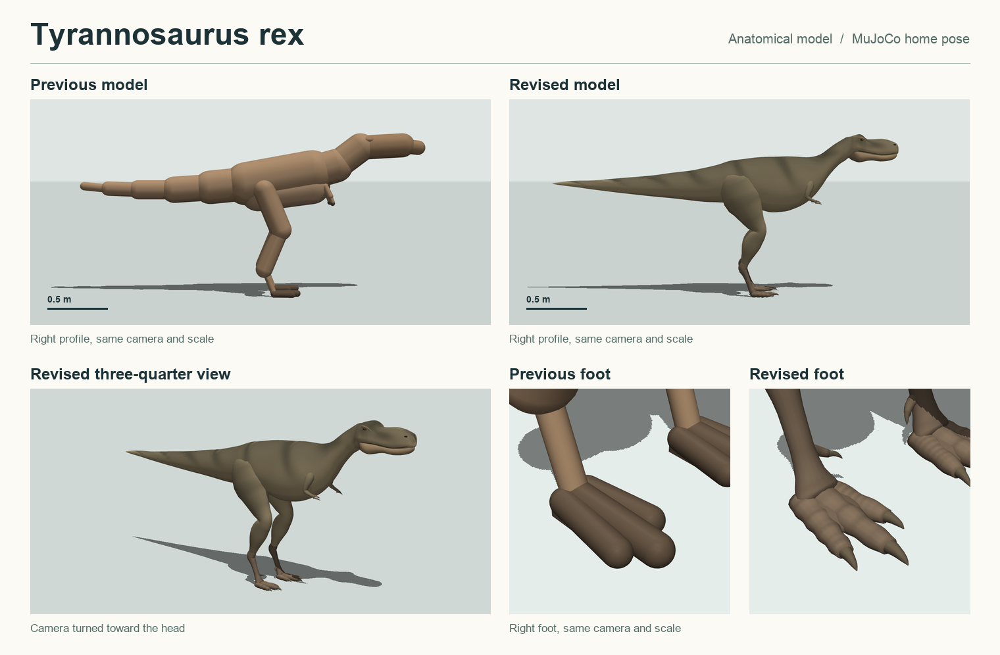
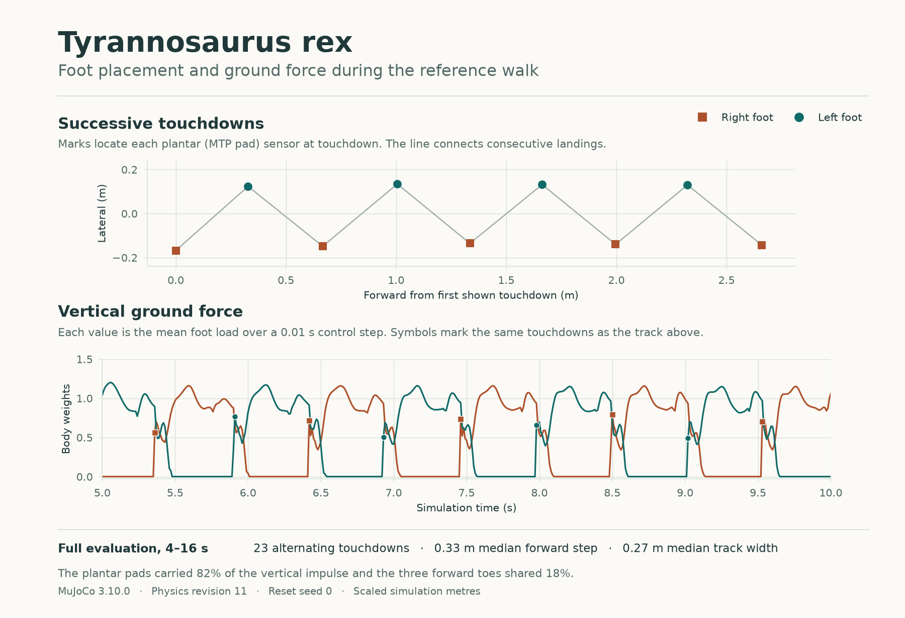

# Anatomical Tyrannosaurus rex

**November 21, 2026 · MuJoCo 3.10.0 · physics r11 · visual r5 · policy interface r16**

> **Status update (2026-11-23):** physics r12 (`configs/plant_versions.toml` note 24, decision D-D59) removed the
> skull's 0.2 kg `head_bite` box with the prey, so the animal is 85.52 kg and weighs 838.95 N. On r12 the
> noise-free statue settles with the pelvis about 0.69° nose-down (was 0.95°), its centre of mass 4.6 mm further back
> and its smallest margin to the loaded contacts 58.5 mm (was 63.1 mm); the derived recovery push at 1.5 times
> capture velocity is 159.7 N (was 165.6 N). Everything below was measured on r11. The Pilot4 replay command below
> runs only in a checkout of `3368abe` or earlier: the current environment refuses the bite arguments and the prey
> range the checkpoints' recorded config passes, and its observation is 59 values wide where theirs is 63.

The revised 85.72 kg model stands on both feet and walks freely under joint control. Its hindlimb segment lengths now reflect measured adult proportions more closely. The original model already had a useful flexed stance, a spring-supported tail and separate touch sensors on three passive toes. Its visible capsule chain obscured the ribcage, skull, hands and feet. The largest remaining gait discrepancies are the wide track, lateral pelvic roll and a push-off that still carries most of the load on the plantar pad.

## Proportions and design



| Landmark | Previous model | Revised model and interpretation |
|---|---|---|
| Femur / tibia | 0.351 / 0.351 m | 0.368 / 0.335 m between physical joint centres. Tibia/femur is 0.910. CM 9380 and MOR 555 give approximately 0.90–0.92. |
| Metatarsus | 0.215 m, 61% of femur | 0.215 m, 59% of femur. The two adult specimens are closer to 52–54%. |
| Home stance | Hip height 0.877 m, knee interior 135°, femur 22.5° forward of vertical | Same hip and knee angle. The femur inclines 21.4° and the ankle interior is 134.6°. The knee moved while the hip, elevated ankle and ball of the foot retained their home positions. |
| Foot | A visible box and three almost parallel capsules. Digit II and IV axes spanned 16.3° and II diverged farther. | Load-bearing axes now span 25.3°. III is longest, IV is next and diverges slightly farther than II. The surface shows padded digits, tapered claw sheaths and a small elevated medial hallux. |
| Trunk and tail | Three overlapping trunk capsules and a stepped, blunt tail | Continuous 2.88 m snout-to-tip surface with deeper ribs, a muscular tail base and a slender taper. Tail base to tip measures 1.44 m, half the animal's length. The last 0.09 m is a visual extension of the rigid distal tail. |
| Head and arms | The head read as a cylinder and the hands as spheres | The back of the skull broadens behind the eyes. A nasal bridge, brows, nares, cheeks and closed jawline define the head. Two fingers emerge from each tucked forearm. The visible skull is about 0.41 m long, roughly 14% of total length. The head-contact task still uses a fixed snout proxy. |

Segment comparisons use measured T. rex femora, tibiae and third metatarsals. Adult whole-body reconstructions vary with specimen completeness and mounting. In the scaled model the femur is about 13% of visible length, compared with roughly 11% in the scanned adults. Mass distribution and shoulder spacing reflect the existing physics model. The soft-tissue surface draws on several adult reconstructions. The pigmentation and facial soft tissue are illustrative. [Persons & Currie, limb measurements](https://doi.org/10.1038/srep19828) · [Hutchinson et al., adult reconstructions](https://doi.org/10.1371/journal.pone.0026037) · [Brochu, adult osteology](https://doi.org/10.1080/02724634.2003.10010947)

Tyrannosaurid tracks support a broad rear pad, tapering forward digits and the prominence of digit III. The printed shapes depend on substrate and movement. The simulation uses one passive hinge per forward digit and a rigid plantar contact box. Each digital touch volume follows its own collision geometry. The hallux and claw sheaths are visual details. The pad and three forward digits supply the walking contacts. [McCrea et al., tyrannosaurid trackways](https://doi.org/10.1371/journal.pone.0103613)

## Balance and foot placement

With zero residual action, the ordinary position servos hold the home targets. After a noise-free 10-second stand, the pelvis was 0.9261 m high and about 0.95° nose-down. The whole-body centre of mass lay 0.153 m ahead of the hip and **63 mm inside the convex hull of the loaded floor contacts**. The two feet split the load equally. Each carried roughly 305 N on the plantar pad and 40/37/39 N on digits II/III/IV. The ankle remained 0.228 m above the floor.

Contact geometry alone gives an incomplete picture of reset. At the home keyframe the sole corners and toes touch, but the initial load is concentrated forward. The centre of mass projects 61 mm behind the hull of contacts with positive normal force at that instant. The rear of the pad takes load during settling. The original model showed the same transient.

- **Standing without a trained policy.** All 40 resets in the standard stance panel (seeds 3042–3081, noise 0.05) reached the 10-second horizon. In a separate level-ground test with the same noise, seed 4 fell forward at 2.15 seconds under zero action. The active walker completed all 30 seconds from that seed. In a separate 80-seed test at reset noise 0.02, all completed 20 seconds. Forty-nine of those 80 exceeded a stringent one-degree heading-change target and 61 exceeded a 2.44 mm foot-travel target. Median settling time under the test's motion criterion was eight seconds.
- **Standing with an archived policy.** The selected Drive stance checkpoint from training seed 44 completed all 240 flat-ground trials across the same 40 reset seeds at six whole-scene headings. Every trial met the per-episode stance criteria. After settling, the lighter foot carried at least 49.3% of the time-integrated load and maximum horizontal pelvis displacement was 12.4 mm. These are evaluation transfers of a policy trained on the preceding revision.
- **Perturbations.** Under the repository’s roughly 166 N shove schedule the zero-action model recovered from 22 of 69 measured shoves. It fell before the horizon in all 40 episodes.

## Walking and overall motion

The new reference walker sends the same 15 normalized joint commands that a policy uses. It places each swing foot with inverse kinematics in a separate reference state and uses measured load and body feedback to transfer weight. MuJoCo integrates the free root, gravity, collisions, foot slip, head and tail. A forward shift in the foot’s target pivot and a late ankle-pitch pulse allow the toes to take more load before lift-off.

On level ground the reference completed ten 30-second trials, one nominal start and nine noisy starts. Measurements below use the last 26 seconds of each trial.

| Measurement | Result |
|---|---|
| Forward speed and stride | 0.636 m/s, 0.660–0.662 m per same-foot stride, 1.04 s stride period |
| Foot placement | Median 0.330–0.334 m forward per opposite-foot step, 0.270–0.271 m wide, pace angle about 101° |
| Contact sequence | Every touchdown alternated, each foot loaded for 60–63% of the cycle, double support about 22%, zero airborne physics substeps |
| Clearance and slip | Median peak swing clearance 66–68 mm. Mean loaded contact-patch slip 0.032–0.033 m/s. Peak vertical ground force 1.93–1.96 body weights. |
| Body motion | Net sideways drift under 29 mm over each measurement window. The pelvis rolls about 15° each way during weight transfer. In the nominal trial its pitch ranged from 3.0° nose-down to 3.4° nose-up. |
| Toe loading | All three forward digits carried measurable vertical impulse. The pads carried about 82% of vertical impulse overall. In the last fifth of stance the toes carried 17–21%, up from roughly 2% before the push-off adjustment. The pads and toes accounted for all floor load. |

Over 13,000 physics substeps in the nominal walking window, all eight actuated leg hinges stayed at least 8.78° inside their joint limits. Peak actuator force reached 51.3% of its cap at the left hip roll. The tail base used its full yaw command on 60.3% of control steps and moved up to 0.22° past its nominal 8° range under the compliant joint limit. Its lateral swing is constrained by that joint.

In the nominal walk the head-tip sensor ranged from 1.07 to 1.24 m above the floor and the tail-tip sensor from 0.83 to 0.96 m. Both moved freely as the pelvis advanced.



The figure and [reference video](../../website/static/videos/tyrannosaurus_rex_anatomical_reference_walk.mp4) show a separate 16-second noisy trial. Each plotted point locates the plantar sensor when the foot takes load. The rear pad and toes share each foot’s force reading. Across its 1,600 sampled poses, the hallux stayed at least 65 mm above the floor and each visible forward claw tip at least 4.3 mm clear. The lowest toe surface penetrated the compliant floor by up to 2.4 mm. The video displays actual ground forces in body weights.

A tail-frequency study estimated a preferred adult speed of 1.28 m/s (0.80–1.64) and a 1.94 m step. With 2.88 m as model length and 12 m as a representative adult length, Froude scaling gives about 0.63 m/s and a geometrically scaled step of about 0.47 m. The model achieves a plausible speed **with shorter, more frequent steps**. The roughly 101° pace angle is substantially wider across the track than the near-inline, nearly 180° steps reported for the related tyrannosaurid trackway Bellatoripes. The simulated pelvis rolls up to 15.4° and the pad still carries most of the load late in stance. A closer fossil track match would require narrower planted feet and a more substantial transfer from the pad onto the digits before lift-off. [Van Bijlert et al., preferred-speed estimate](https://doi.org/10.1098/rsos.201441) · [McCrea et al., trackway geometry](https://doi.org/10.1371/journal.pone.0103613)

## What the training runs established

Three Pilot4 Stage 2 PPO checkpoints and their matching observation normalizers were retrieved from Drive. Each was trained for 2,015,232 steps on physics r10 / interface r15. Both files in each pair were checked against the run's gate-verdict SHA-256. The table gives forward speed during seconds 1–10 of deterministic replay, across reset seeds 42, 43 and 44 at noise 0.05. The recorded command was 1.5 m/s. The four pilot-only reward terms were omitted from replay, and no reward comparison is made.

| PPO training seed | Original forward speed | Revised forward speed | Revised gait |
|---|---:|---:|---|
| 42 | 2.83–2.87 m/s | 2.88–2.89 m/s | Alternating, brief flight, up to 2.63 m lateral displacement |
| 52 | 2.41–2.54 m/s | 2.52–2.79 m/s | Alternating, up to 1.7% of physics substeps airborne and a 6.4-body-weight floor-force peak |
| 60 | 1.86–1.95 m/s | 1.88–1.90 m/s | Alternating, no flight, up to 0.40 m lateral displacement. In the seed-42 clip the skull swings from 31° nose-down to 16° nose-up. |

All nine revised trials completed the horizon. The historical reward-and-length gate established progress and survival while allowing overspeed, slip, yaw and intermittent flight. A candidate with approximately 51° total toe splay put two of nine replays on the floor before two seconds. That sensitivity, and the 40/40 quiet-standing results, motivated retaining the balanced reset and adopting the moderate increase in physical toe spread. A separate slow walker makes the stance-to-swing transition measurable at a more plausible pace.

## Reproduction

Run these commands in the repository root with the simulation dependencies installed.

```bash
python -m environments.tyrannosaurus_rex.scripts.audit_motion --mode stand --seconds 20 --warmup 9
python -m environments.tyrannosaurus_rex.scripts.audit_motion --seconds 30 --warmup 4 --noise 0 --seeds 0 --actuators
python -m environments.tyrannosaurus_rex.scripts.audit_motion --seconds 30 --warmup 4 --noise .05 --seeds 1 2 3 4 5 6 7 8 9
python -m pytest environments/tyrannosaurus_rex/tests
```

For a Pilot4 transfer, use the original Drive stage directory containing the verdict, config and selected model pair under `models/`. The evaluator verifies both hashes and the original runtime plant before running the original and revised environments.

```bash
git show 8618ea7b:environments/tyrannosaurus_rex/anatomical/assets/tyrannosaurus_rex_anatomical.xml > /tmp/trex_r10.xml
python -m environments.tyrannosaurus_rex.scripts.replay_walk "$STAGE_DIR" /tmp/trex_r10.xml --seeds 42 43 44
```

The recentered touch volumes move the policy fingerprint to r16. The action and observation widths remain 15 and 63. Normal training and handoff continue to enforce plant identity. Stage baselines and the mirror map were regenerated for r11. The trial record includes measured static loads, run hashes, seed-level gait metrics, and per-heading stance results. [Review measurements](../../environments/tyrannosaurus_rex/data/anatomical_review.json)
