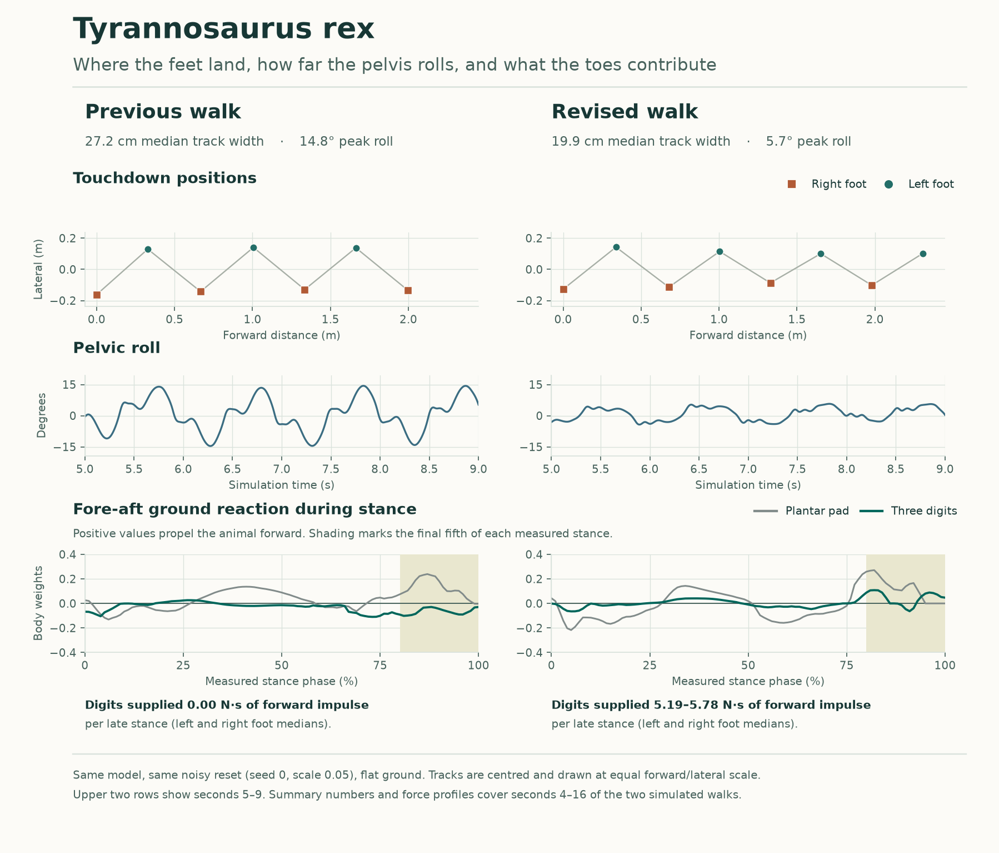

# Anatomical T. rex walk refinement

The level-ground reference walk now lands a median 19.8 cm apart, down from 27.0 cm. Peak pelvic roll fell from 14.8° to 5.8° at the same forward speed. In the last fifth of stance the three forward toes delivered a net forward impulse on both feet. Previously they braked while the plantar pad supplied propulsion.

[Side and rear comparison video](../../website/static/videos/tyrannosaurus_rex_anatomical_walk_refinement.mp4) · [Paired measurements and reset seeds](../../environments/tyrannosaurus_rex/data/walk_refinement.json) · [Earlier anatomical review](TREX_ANATOMICAL_REVIEW_2026_11.md)



## Foot placement and weight transfer

The reference gradually brings each landing 5.5 cm inward from its reset track and reduces the target side-to-side pelvis excursion from 6 to 4 cm. The loaded hips correct roll and roll rate in proportion to their measured support. As the heel rises, the trailing foot target moves up to 10 cm rearward and releases during swing. This loads the passive digits against the floor through the existing ankle and leg servos. MuJoCo integrates the free pelvis and the actual motion of the foot.

## Paired flat-ground walks

Each controller ran 30 trials of 30 seconds on the same anatomical model under MuJoCo 3.10.0. One reset was nominal, and 29 used reset noise 0.05. Eight seeds were selected after controller tuning. Results cover seconds 4–30. Each entry is the median of the per-trial results. Foot measures pool the two feet’s trial values.

| Measurement | Previous | Revised |
|---|---:|---:|
| Forward speed | 0.636 m/s | 0.636 m/s |
| Opposite-foot step length / track width | 33.2 / 27.0 cm | 33.0 / 19.8 cm |
| Peak absolute / RMS pelvic roll | 14.76° / 8.06° | 5.79° / 2.97° |
| Double support | 21.8% | 30.0% |
| Peak swing clearance | 6.66 cm | 8.90 cm |
| Peak vertical floor reaction | 1.94 body weights | 1.62 body weights |
| Late net forward toe impulse per foot | −6.68 N·s | +3.78 N·s |
| Late positive forward impulse from toes / share of foot propulsion | 0.00 N·s / 0.0% | 5.32 N·s / 28.4% |
| Late vertical toe impulse / share of foot support | 9.79 N·s / 19.1% | 9.27 N·s / 28.4% |
| Mean loaded contact-patch slip | 0.0323 m/s | 0.0422 m/s |

Both controllers completed all 30 trials. With the revised controller every touchdown alternated, there were zero airborne physics substeps or leg-to-leg contacts, and the minimum lateral gap between the outer surfaces of the two feet was 20.5 mm. The largest peak roll in any trial was 7.10°. The two-minute noisy run (seed 7013) produced 223 alternating touchdowns and advanced 73.6 m in the 116-second measurement window, with 10.5 cm of net lateral drift. These checks cover straight, level walking.

The toes produced **+3.33 to +3.98 N·s** of signed forward impulse across the 60 revised foot-by-trial medians. The audit locates stance from measured load transitions, sums the fore-aft ground force on digits II–IV at each 2 ms physics substep, and integrates the last fifth of complete stances. Signed impulse includes braking. The positive-only measure accumulates the forward portion of the summed toe force, and its share compares it with the positive-only pad impulse. An independent contact-force calculation reproduced the audit values. The toes took a larger share of late support even as their absolute vertical impulse fell slightly. Across the entire measurement window, the toes carried 10.3% of vertical impulse, down from 18.2%. Loaded contact slipped about 1 cm/s faster.

In the nominal trial, the pelvis pitched from 1.8° nose-down to 2.7° nose-up, and yaw stayed within 2.8° of the initial travel direction. The highest actuator force reached 35.4% of its limit, down from 51.3%. No actuator reached its physical force limit in either nominal trial.

## Standing

On the same 40 fresh stance resets (6201–6240, noise 0.05), both zero residual commands and the archived seed-44 PPO stance policy completed all 40 ten-second runs. With zero residuals the final whole-body centre of mass lay at least 61.2 mm inside the loaded support polygon. The archived policy met the per-episode stance criteria in all 40 cases. The lighter foot carried at least 49.3% of the integrated load, and maximum horizontal pelvis displacement was 13.2 mm.

## Reproduce the walk

Run these commands from the repository root. The JSON includes each foot’s impulses, swing clearance and slip, plus separation, contact sequence and body motion. The comparison uses the previous controller from commit `108dbddf9cc0119c70c88948f65ee8a4d661cadb`.

```bash
# The filmed noisy reset, including the comparison figure’s 4–16 s window.
python -m environments.tyrannosaurus_rex.scripts.audit_motion --mode walk --seconds 16 --warmup 4 --noise 0.05 --seeds 0 --foot-mechanics

# Nominal actuator margins and foot mechanics.
python -m environments.tyrannosaurus_rex.scripts.audit_motion --mode walk --seconds 30 --warmup 4 --noise 0 --seeds 0 --foot-mechanics --actuators

# The eight post-tuning resets and separate duration test.
python -m environments.tyrannosaurus_rex.scripts.audit_motion --mode walk --seconds 30 --warmup 4 --noise 0.05 --seeds 251387 345960 642295 142963 463956 607094 471955 467153 --foot-mechanics
python -m environments.tyrannosaurus_rex.scripts.audit_motion --mode walk --seconds 120 --warmup 4 --noise 0.05 --seeds 7013 --foot-mechanics
```
