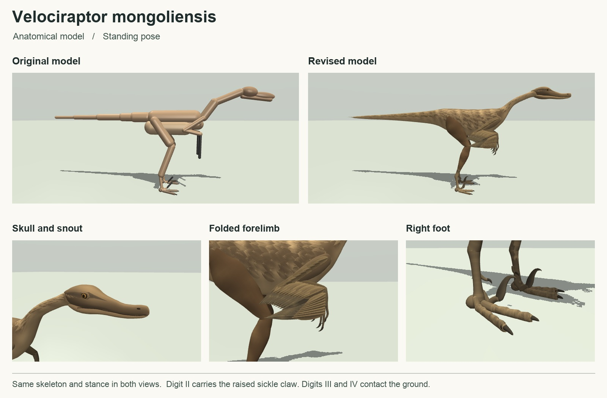
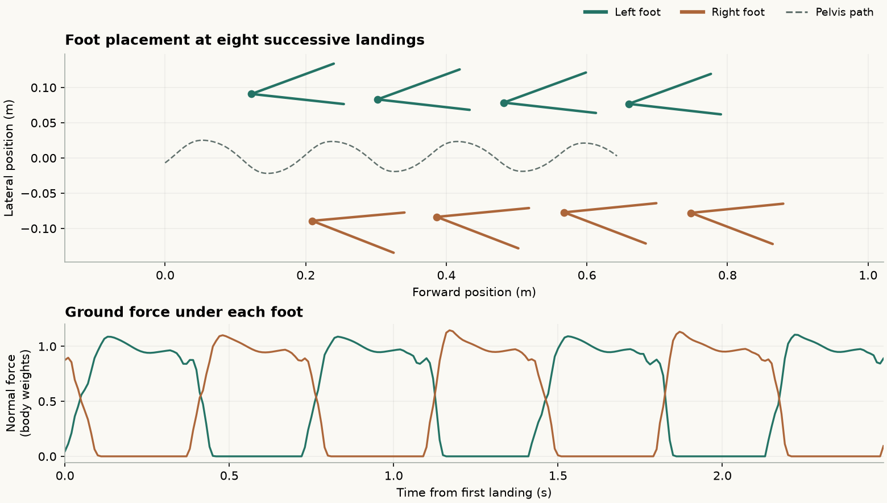

# Velociraptor mongoliensis anatomical review

Reviewed 20 November 2026 against `main` at `758b00f`. The comparisons and walking trials use the anatomical Gymnasium environment and MuJoCo 3.10.0.



## Proportions and design

| Structure | What the original represented | Decision |
| --- | --- | --- |
| Hindlimb | The hip–knee, knee–ankle and ankle–digit III joint distances already measured 238.0, 255.0 and 99.1 mm. | Retain the measured lengths of IGM 100/986, a tibia/femur ratio of 1.071 and a metatarsal/femur ratio of 0.416. Shape the muscular thigh and calf around those joints and taper to the elevated ankle and slender metatarsus. |
| Skull and neck | Two ellipsoids and a capsule described the head. Two straight neck segments met at a visible angle. | Follow the long, low profile of GIN 100/25, whose skull measured 230 mm long, 77 mm across the temples and 66 mm deep. The snout occupied 140 mm ahead of the orbit. Reconstruct the narrowing muzzle, depressed nasal profile, closed jaws, nostrils, eyes and neck contour. |
| Feet | A rounded metatarsophalangeal (MTP) pad and straight pads under III and IV carried the foot. The raised claw on II looked like a straight rod. Digit I had no visible outline. | Distinguish the medially placed, high first toe, recurved second claw and two long, forward-facing walking toes. Keep the existing 24° spread between III and IV. Related two-toed tracks provide comparative evidence for pad placement and a modest spread (19° mean in one assemblage). |
| Trunk, arms and tail | The level trunk and segmented tail had the right general attitude, but their capsule outlines and single-rod hands obscured the silhouette. | Shape the ribcage, belly and tapered counterbalancing tail, and give the folded forelimbs separate fingers and overlapping feathers. Lateral plumage, feather length and colour are reconstruction choices. |

The leg and skull measurements come from different animals. The 15.0 kg model uses a reconstructed mass distribution, including 7.10 kg for the trunk, 2.05 kg for the tail and 1.80 kg per hindlimb. Its nose and tail-tip landmarks span 1.736 m horizontally in the home pose. Including the reconstructed feather tips, the visible model spans 1.793 m. The level sacrum, crouch and elevated heel give it room to flex the knee during stance. The distal tail is rigid in this simulation and the arms are welded. The feet have sprung III/IV toe hinges and a sagittal ankle. Independent roll of the ankle and flexion of every phalanx are outside the model.

The foot skeleton follows Norell and Makovicky’s description of a high, unreversed first digit. Trackways attributed to other deinonychosaurs support loading on III and IV and sometimes the proximal pad of II. Their tracks constrain the general arrangement better than the exact timing, width or speed of this species’ walk. The simulation retains a conservative raised-II setup. [Postcranial measurements, tables 2–3](https://www.biodiversitylibrary.org/item/315425) · [Skull measurements, table 1](https://www.app.pan.pl/archive/published/app44/app44-189.pdf) · [Comparative trackways](https://doi.org/10.4202/app.2011.0115)

Forearm quill knobs in a Mongolian dromaeosaur support feather attachment. The specimen’s original referral to *V. mongoliensis* was subsequently treated as provisional. The model’s plumage therefore uses comparative evidence. [Turner, Makovicky and Norell, 2007](https://doi.org/10.1126/science.1145076) · [Napoli and colleagues, 2021](https://doi.org/10.1206/3982.1)

## Standing balance

With the home controls held for 10 seconds, the 15.0 kg animal settled at a hip height of 0.549 m. The vertical projection of its whole-body center of mass lay **60.1 mm inside the hull of the loaded ground-contact points**. Per-foot normal impulse over the last eight seconds was **29.9% at the MTP pad, 36.5% on III and 33.6% on IV**. The metatarsal shaft cleared the floor by 14.4 mm and the second claw’s collision surface by 19.5 mm.

All eight perturbed starts (seeds 0–7, reset noise 0.05) stayed upright for 10 seconds. Both feet bore weight throughout the final eight seconds, with final support margins of 58.7–61.2 mm. This is a standing balance test on level ground. During walking, the trajectory and the measured ground forces determine whether balance persists through single support.

The repository’s separate 80-start stance calibration (reset noise 0.02) reproduced three known limitations. Although every start met the stillness and lean targets from 3 s onward, 55 of 80 turned more than 1° during landing (maximum 4.25°), 59 of 80 exceeded 1.48 mm of post-landing foot travel (maximum 5.51 mm), and one took 3 s to settle. These are the three expected failures in the stance test suite.

The passive viewer previously opened at zero control and reported a 29.14 kg scene mass and the prey target’s center of mass, 5 m ahead of the animal. It now opens at the calibrated standing keyframe and reports mass and center of mass for the pelvis subtree.

## Walking gait and motion

The reference walk drives the ordinary position servos through normalized Gym actions. It uses measured pelvis motion for feedback, plans alternate foot placements and allocates support to the stance legs. A separate kinematics workspace computes joint targets. The live model has a free root, passive walking toes, and ground reactions from MuJoCo. The catalog’s older PPO videos are historical and lack verified provenance for this model. This trial evaluates a scripted slow walk on a level floor.

| Measured quantity | Nominal trial |
| --- | --- |
| Progress and heading | 8.519 m forward in the final 33 s of a 35 s trial (0.258 m/s), with 11 mm net lateral drift |
| Footfalls and timing | 47 left and 47 right touchdowns, all alternating. Median stride period 0.70 s, 18.0 cm per same-foot stride |
| Support | Left/right median stance duty 59.4% / 58.6%. Both feet supported the animal 19.4% of the window. No airborne substeps |
| Placement | Median alternating step 9.0 cm forward and 15.3 cm across. Median landing 10.7 cm ahead of the pelvis on the left and 10.2 cm on the right |
| Swing and clearance | Median peak clearance of the walking foot 25.3 mm left / 25.6 mm right. The physical second claw cleared the floor by at least 15.5 mm |
| Loading and rollover | 27.0% of total normal impulse on MTP pads, 28.2% on III and 44.8% on IV. The MTP share declined from about 14–15% in the first fifth of stance to 8–9% in the last fifth. Peak total load 2.24 body weights. No unregistered floor load |
| Stance slip | Mean loaded contact-patch speed 2.2 cm/s left / 2.4 cm/s right. The 95th percentiles were 8.3 / 9.4 cm/s |
| Trunk, head and tail | Pelvis height varied by 11.5 mm. Roll ranged from −2.5° to +2.1° and pitch from −2.4° to +1.1° (nose-up positive). The head-tip height varied by 70 mm and the tail-tip height by 98 mm |
| Joint excursions | Knee flexion covered approximately 53–74° on both sides, with ankle angle −46° to −17° on the right and −42° to −17° on the left |



In the figure, a dot marks the MTP pad and the two lines point to digits III and IV at landing. The dashed line traces the pelvis. The figure and video use a 5 N contact threshold to make loaded steps visible. The quantitative table uses the repository’s substep recorder, its 0.1 N threshold and 20 ms contact debounce. Duty is stance time divided by the interval between successive landings of the same foot.

**The main realism limit is foot placement.** The width exceeds the forward step, giving a median pace angle of 61°. For comparison, a Korean trackway tentatively attributed to a walking dromaeosaur recorded a 175° pace angle. The trackmaker, speed and substrate differ, so this is a qualitative check. The sagittal ankle has limited ability to keep a foot level when the hip draws it in. Trials with more medial landings or longer steps produced asymmetric support or falls. The rendered animal clears the floor during swing, but its compliant pads compress at touchdown and the loaded contact patches slide measurably. [Comparative walking trackway](https://doi.org/10.1080/10420940.2012.664054)

A separate 2 ms check of the rendered vertices found minimum clearances of **18.24 mm for the hooked claw, 1.86 mm for the flesh of digit II, and 46.38 mm for the hallux claw**. The III/IV pads penetrated the compliant floor by up to 5.61 mm, and the ends of their small claws by up to 1.38 mm. The underlying toe collision shapes showed comparable pad compression.

## Repeatability

- The nominal controller completed **120 s**. After the first 2 s it advanced **30.38 m**, drifted 2.9 cm sideways and made 337 alternating landings. At least one foot supported it at every sampled physics substep.
- At reset noise 0.01, all **8/8** seeds completed 35 s. At 0.05, **7/8** completed. Seed 2 pitched forward at 4.63 s. These runs used the same controller and level surface.
- With the repository’s locomotion-stage settings and six additional seeds (42, 1042, 2042, 3042, 4042, 5042), all six reached the standard 10 s time limit. The whole-episode forward distance, including startup, was 2.11–2.14 m. The reference pace is below the training stage’s speed gate.
- The revised model’s compiled physics and policy-interface digests match the original. A 5,000-substep replay against the original under the same perturbed commands produced identical states and sensors. Reset and action behavior therefore carry over to the revised surface.

## Reproduce the measurements

From the repository root, install the project’s test dependencies with `python -m pip install -e ".[test]"`. Commands below use the pinned MuJoCo version. The rendering surface can be rebuilt from the checked-in measurements and profiles with `python -m environments.velociraptor_mongoliensis.scripts.build_integument`.

```bash
python -m environments.velociraptor_mongoliensis.scripts.audit_motion --mode stand
python -m environments.velociraptor_mongoliensis.scripts.audit_motion --mode stand --noise 0.05 --seeds 0 1 2 3 4 5 6 7
python -m environments.velociraptor_mongoliensis.scripts.audit_motion --mode walk --seconds 35 --skin-clearance
python -m environments.velociraptor_mongoliensis.scripts.audit_motion --mode walk --seconds 120
python -m environments.velociraptor_mongoliensis.scripts.audit_motion --mode walk --seconds 35 --noise 0.01 --seeds 0 1 2 3 4 5 6 7
python -m environments.velociraptor_mongoliensis.scripts.audit_motion --mode walk --seconds 35 --noise 0.05 --seeds 0 1 2 3 4 5 6 7
python -m environments.shared.tests.com_stance_calibration environments.velociraptor_mongoliensis.tests.test_com_stance_quality:TestComStanceQuality
```

[Measured trial data](../../environments/velociraptor_mongoliensis/data/reference_validation.json) · [Walk video with foot close-up](../../website/static/videos/velociraptor_mongoliensis_anatomical_reference_walk.mp4)
