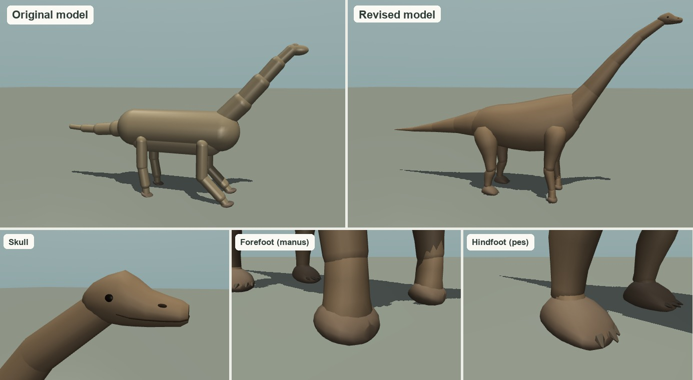

# Brachiosaurus Altithorax Environment

Quadrupedal dinosaur-inspired locomotion and target-reaching environment using MuJoCo and Gymnasium.

## Overview

This Brachiosaurus-inspired model has longer front legs than rear legs and a long articulated neck. The environment trains the agent to walk with a coordinated four-legged gait and move its head toward an elevated food target. "Food reach" succeeds when the head tip enters a configured distance threshold around the target; it does not require contact between physical food and head geoms.

## Generated Specifications, Curriculum, and Results

The authoritative public dimensions, current stage budgets, success criterion, and provenance-labelled historical
results are in the generator-managed [Brachiosaurus Altithorax (Anatomical) catalog entry](../../docs/SPECIES_CATALOG.md#brachiosaurus_altithorax-anatomical). They are derived
from the species manifest, executable environment, compiled MJCF, current TOML stage configs, and result summaries.

## Models

The species has one model, the pair (species, embodiment) of
[docs/SPECIES_NAMING.md](../../docs/SPECIES_NAMING.md):

| | Anatomical |
|---|---|
| Species / embodiment | `brachiosaurus_altithorax` / `anatomical` |
| Environment class | `BrachiosaurusAltithoraxAnatomicalEnv` (`anatomical/env.py`), on the species base `BrachiosaurusAltithoraxEnv` (`base_env.py`) |
| Gymnasium ID | `MesozoicLabs/BrachiosaurusAltithorax-Anatomical-v0` |
| MJCF | `anatomical/assets/brachiosaurus_altithorax_anatomical.xml` |
| Configs | `configs/brachiosaurus_altithorax/anatomical/` |
| Catalog | [Brachiosaurus Altithorax (Anatomical)](../../docs/SPECIES_CATALOG.md#brachiosaurus_altithorax-anatomical) |

## Implementation Notes

### Anatomical review

The original model placed both girdles at the same height and bent its elbows 45° to fit the forelimbs on the floor. Its elbows and hind knees folded in the same direction. Both pairs of feet stood on identical pads. Under the neutral command, the unsupported neck flexed to its joint stop and the snout lost 1.44 m of height in 20 s.



| Measurement on the scaled model | Original | Revised |
| --- | ---: | ---: |
| Humerus / femur length | 0.550 / 0.450 m | 0.540 / 0.535 m |
| Shoulder / hip joint height at home | 1.000 / 1.000 m | 1.123 / 1.005 m |
| Elbow flexion at home | 45° | 16° |
| Neck / tail centreline length | 1.63 / 1.46 m | 2.10 / 2.05 m |
| Snout height at home → after 20 s of standing | 2.550 → 1.112 m | 2.977 → 2.974 m |
| Forelimb share of settled floor load | 37.4% | 56.2% |

The holotype supports near-equal humerus and femur lengths and a long, deep trunk. The model uses those proportions and a humerus, radius and metacarpus of 0.54, 0.36 and 0.15 m, following the 3.6 to 2.4 to 1 ratio from the referred Potter Creek material. The reconstructed chest deepens toward the shoulders and the tail tapers from a fleshy base. The skull outline, browsing angle, distal tail and skin contours draw on comparisons with other brachiosaurids. The simulation preserves its original 175.3 kg animal mass. Its absolute loading and speed apply at model scale. [Taylor, 2009](https://www.miketaylor.org.uk/dino/pubs/taylor2009/Taylor2009-brachiosaurus-and-giraffatitan.pdf) · [D’Emic and Carrano, 2020](https://doi.org/10.1002/ar.24198)

The compact forefoot (manus) carries weight through a near-vertical metacarpus with a shallow hollow at the back of the pad. The longer hindfoot (pes) has an inclined metatarsus, a fleshy heel and three outward-directed claws on the inner digits. The claws are mirrored between sides. Each foot has one smooth ellipsoid for sole contact. Its size differs between manus and pes. The sculpted soft tissue and claws are visual geometry, so individual toe pressures cannot be inferred from this model. [Bonnan, 2003](https://doc.rero.ch/record/15172/files/PAL_E2447.pdf) · [Jannel et al., 2022](https://doi.org/10.1126/sciadv.abm8280)

### Balance, walking and browsing

**Standing.** All four soles load at neutral stance. With the centre of mass projected onto the floor, its nearest lateral support edge is 0.300 m away and its nearest fore–aft edge is 0.505 m away. All 120 noisy resets in the stage-1 standing panel completed 1,000 control steps. A separate 80-reset stance calibration measured a worst post-landing foot travel of 20.6 mm and a worst turn of 1.8°. These recovery limits are tracked in the stance tests.

**Walking.** The reference controller asks for a lateral-sequence walk with diagonal couplets. Each foot swings forward, then bears weight while the torso advances over it. Joint servos, gravity and contact forces determine the actual motion. The controller sends ordinary Gymnasium actions and measures each foot's floor force during the physics substeps. Sauropod trackways motivate the phase relationship. The trackmakers' species is uncertain. [Lallensack and Falkingham, 2022](https://pubmed.ncbi.nlm.nih.gov/35240050/)

| Six measured strides after startup, level ground, noise-free reset | Result |
| --- | ---: |
| Touchdown order | Left hind → left fore → right hind → right fore |
| Mean forward speed / median stride period | 0.340 m/s / 1.405 s |
| Median time between same-side hind and fore touchdown | 34.4% of a stride |
| Median stride length across the four individual feet | 0.476–0.484 m |
| Fraction of time loaded, by foot | 62.1–68.0% |
| Median elbow / hind-knee flexion under load | 15° / 21° |
| Peak swing clearance, by foot | 45–51 mm |
| Minimum feet loaded / airborne physics substeps | 2 / 0 |
| 95th-percentile contact slip speed while loaded | 0.019 m/s |
| Torso vertical excursion / maximum absolute roll | 6.5 mm / 2.02° |

All 14 walk trials completed nine strides, including three resets at noise scale 0.01 (seeds 0–2) and ten at 0.05 (seeds 3–12). Each repeated the same four-foot order.

Foot loads above 1% of body weight identify weight-bearing steps. A 50 ms debounce filters brief contact flicker for touchdown timing. Clearance is measured at the bottom of each oriented sole. Slip is the measured tangential contact speed. A quiet stance, a sliding foot and a lifted foot therefore give different readings. The [walking replay](../../website/static/videos/brachiosaurus_altithorax_anatomical_reference_walk.mp4) shows the same nominal run with its contact traces.

**Browsing.** With the neck pitched forward by a 65% residual command for 4 s, the snout lowered from 2.97 to 1.95 m. After release it recovered to within 5 cm of its standing height relative to the neck base in 0.99 s. The eyes, bony narial arch, forward external nostrils and mouth are separate features. [Witmer, 2001](https://pubmed.ncbi.nlm.nih.gov/11486085/)

The stage-2 stationary baseline can earn 2,282 reward points without advancing, so reward alone is insufficient evidence of walking. The flat-ground reference walk demonstrates the revised plant's mechanical capacity at one slow speed. The stage-2 PPO graduation threshold is 0.75 m/s. The historical training clips and scores belong to earlier plants, and a new policy requires training and evaluation on physics revision 6.

### Reward Components
- **Forward velocity** - Movement toward food target
- **Alive bonus** - Survival reward
- **Energy penalty** - Penalizes excessive actuator use
- **Gait stability** - Penalizes excessive torso angular velocity
- **Food reach bonus** - Large reward when the head tip enters the configured distance threshold around food

## Quick Start

```bash
# Install from the repository root
pip install -e ".[all]"

# Replay the reference walk and print measured contacts, clearance, slip and body motion
python -m environments.brachiosaurus_altithorax.scripts.reference_walk

# Run environment tests
python -m pytest environments/brachiosaurus_altithorax/tests/ -v

# Train stage 1 using its current TOML-configured budget
python -m environments.shared.train --species brachiosaurus_altithorax --embodiment anatomical train --stage 1

# Train the full chain (stance -> locomotion -> food reach), each stage
# warm-started from its declared parent in configs/brachiosaurus_altithorax/anatomical/stages.toml
python -m environments.shared.train --species brachiosaurus_altithorax --embodiment anatomical curriculum --algorithm ppo

# Or reuse an earlier run's certified trunk and train only what is missing above it
python -m environments.shared.train --species brachiosaurus_altithorax --embodiment anatomical \
    curriculum --algorithm ppo --trunk-from <earlier-run-dir> --output-dir <new-run-dir>

# View the model (requires display)
python environments/brachiosaurus_altithorax/scripts/view_model.py --embodiment anatomical
```

Stance, locomotion and food reach are each a published deliverable (`stance`,
`walk`, `hunt`); see [docs/BEHAVIOR_RECIPES_PLAN.md](../../docs/BEHAVIOR_RECIPES_PLAN.md).

## Files

```
brachiosaurus_altithorax/
├── __init__.py
├── base_env.py                  # BrachiosaurusAltithoraxEnv, the species base class
├── anatomical/
│   ├── __init__.py
│   ├── env.py                   # BrachiosaurusAltithoraxAnatomicalEnv and its body data
│   ├── mjx_config.py            # frozen MJX registration (docs/PLANT_CONTRACT.md); never edited
│   └── assets/
│       └── brachiosaurus_altithorax_anatomical.xml   # MuJoCo MJCF model
├── scripts/
│   ├── test_env.py              # Environment validation script
│   └── view_model.py            # MuJoCo passive viewer
├── tests/
│   ├── test_anatomical_env.py      # Model-specific env tests
│   ├── test_anatomical_rewards.py  # Model-specific reward tests
│   ├── test_anatomical_actuator_bounds.py  # Actuator bound tests
│   └── test_anatomical_static_balance.py   # Static balance tests
├── requirements.txt
└── README.md
```

Hyperparameter configs are at `configs/brachiosaurus_altithorax/anatomical/` in the repo root
(`stance.toml`, `locomotion.toml`, `food_reach.toml`, `stages.toml` and `behaviors/`).
