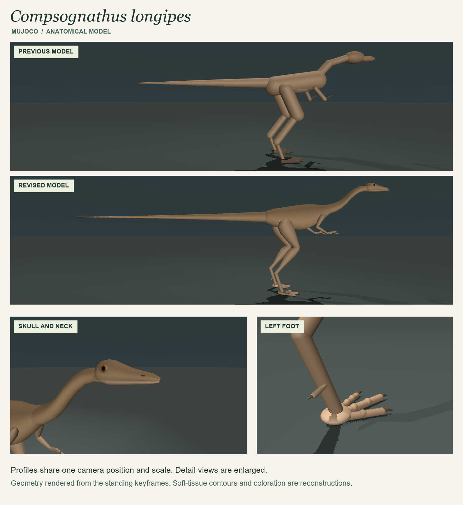
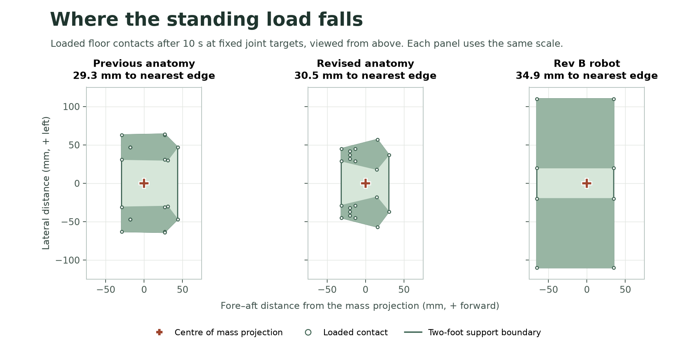

# *Compsognathus longipes* anatomy and standing balance

The revised anatomical model stands 393 mm tall and measures 1,138 mm from snout to tail tip in its home pose. Bone lengths follow the Canjuers specimen CNJ79 scaled to a 95 mm femur. At the assumed mass of 1.00 kg, its three forward digits take 72% of the standing weight. With both feet planted, its settled centre of mass projects 30.5 mm inside the nearest support edge.



## What the fossils constrain

The French specimen supplies one consistent set of long bones, skull and foot measurements. Multiplying its measurements by 95/108.8 gives the working scale. The smaller Bavarian holotype has proportionally longer lower hindlimbs. Its measurements illustrate individual or growth-related variation, so fitting both sets simultaneously would imply a precision the two fossils cannot support. [Peyer 2006, table 1 and figure 11](https://doc.rero.ch/record/16398/files/PAL_E3570.pdf) · [Ostrom 1978, table 2](https://www.zobodat.at/pdf/Zitteliana_4_0073-0118.pdf)

| Structure | French specimen (mm) | Scaled target (mm) | Model (mm) |
|---|---:|---:|---:|
| Femur | 108.8 | 95.0 | 95 |
| Tibia | 131.0–131.8 | 114.4–115.1 | 114 |
| Metatarsal III | 79.6–80.9 | 69.5–70.6 | 70 |
| Reconstructed skull | 100 | 87.3 | 87 |
| Humerus | 51.9–56.3 | 45.3–49.2 | 46 |
| Ulna | 46.4 | 40.5 | 40 |

Hindlimb measurements run between joint centres. The skull measurement is the axial extent of its mesh. The model uses the forearm shaft as an ulna-length proxy. The chosen size represents a scaled reconstruction. The fossil preserves only part of the tail. Its complete length, body mass, flesh outlines, standing posture and colour remain estimates.

## Review of the previous model

| Region | Previous design | Revised design and mechanical effect |
|---|---|---|
| Head, trunk and hands | A cylindrical trunk, two straight neck sections, overlapping skull and muzzle ovals, and a short hand segment. The combined skull and snout spanned about 112 mm. | A fuller rib cage tapers through the shoulder into a curved neck. A low 87 mm skull carries an articulated lower jaw. Folded forelimbs have inward-facing hands, two prominent fingers and a reduced third digit. The arms maintain a fixed pose. [Hand anatomy](https://doi.org/10.1111/j.1096-3642.2007.00269.x) |
| Tail | Four tapering segments totalled 460 mm. The 858 mm animal had little axial reach behind the hips for its scale. | The reconstructed tail extends 690 mm. Distributing the same 178 g over its taper keeps most mass near the pelvis. Two axes drive its base. Three distal pitch hinges deflect under gravity against passive springs. |
| Hindlimb | The 95 mm femur and 114 mm tibia already matched the scaled French proportions. The 64 mm metatarsus was short. The thigh and calf had almost constant-radius profiles. | A 70 mm metatarsus, fuller proximal thigh and tapering calf restore the limb proportions. Slightly more knee flexion maintains the 244 mm hip-frame height. Foot-centre spacing narrows from 94 to 74 mm. |
| Foot | A 56 × 32 mm rectangular pad spanned much of the foot. Three straight capsules shared a common origin. Digit III was longest and digit II was already medial. | Each foot has three separated ground-bearing digits. III is longest, II and IV are similar in length, and their tips end in gently curved claws. A short medial hallux attaches halfway down the metatarsus and clears the floor by 31 mm in quiet stance. An 18 × 16 mm contact patch represents the compressed cushion under the metatarsal heads. |

The regional mass budget also limits realism. The trunk's 370 g is distributed over about 850 cm³ of exterior mesh, while each calf carries 56 g in about 35 cm³. Their effective bulk densities are about 0.44 and 1.59 g/cm³. These envelopes determine the simulated inertias and give a light trunk and relatively heavy calves for their drawn volumes. A volumetric reconstruction that separates body cavities, bone and muscle could refine the mass distribution and joint loads.

Individual toe segments are visible, but digits II–IV rotate together at the metatarsophalangeal (MTP) joint. The claws are visual geometry. The pads determine the footprint and share a rigid foot body with their force sensor. This supports stance and gross push-off studies. Independent toe curling, gripping and differential flexion need additional joints and tissue data.

## Active torque, muscle force and passive recoil

The anatomical actuators apply **bounded net joint moments**. A position error drives a proportional restoring torque, with a damping term for velocity. This approximates the combined effect of recruited muscles and postural control. Each joint can exert real simulated force through its leverage against the floor. There are no anatomical servo housings or electric motor specifications in this model.

| Joint or axis | Torque magnitude in settled stance (N·m) | Active limit (N·m) |
|---|---:|---:|
| Hip pitch, per side | 0.062 | 1.00 |
| Knee, per side | 0.106 | 1.00 |
| Ankle, per side | 0.209 | 0.80 |
| MTP, per side | 0.103 | 0.60 |
| Neck pitch | 0.104 | 0.40 |
| Tail-base pitch | 0.242 | 0.70 |

For a force check, **torque = tendon force × perpendicular moment arm**. Adult guinea fowl in a control group averaged a 9.4 mm Achilles moment arm and 1.7 kg body mass. Applying that lever to this model’s standing ankle moment gives **22 N**. The 0.80 N·m cap corresponds to **85 N**. At the study’s assumed muscle stress of 0.30 MPa, those forces correspond to effective areas of 0.74 and 2.84 cm² respectively. An alternative 7–12 mm lever puts the same standing demand at 17–30 N. These are equivalent forces under a stated lever assumption. Co-contraction can raise actual individual muscle forces. Fossils do not provide this animal’s physiological cross-sectional areas, lever arms throughout motion, recruitment, or maximum muscle forces. [Comparative ankle measurements and stress assumption, table 1 and equation 2](https://doi.org/10.1242/jeb.242694)

The ankle and MTP use lower position stiffnesses of 12 and 8 N·m/rad. A passive flexor spans both joints with assumed moment arms of 6.0 and 3.5 mm and an effective stiffness of 8 kN/m. When both joints dorsiflex by 0.2 rad, it stretches 1.9 mm, develops 15.2 N and stores about 0.014 J. Shortening lets it go slack. This adds load-dependent recoil without a separate toe motor for each digit. Active ankle and MTP moments still carry quiet stance. The spring rate describes the lumped model and the caps bound ideal joint moments. Muscle activation delay, force–length and force–velocity curves, and fatigue would have to be modelled for a physiological sprint or jump prediction. [In vivo avian ankle and digital-flexor measurements](https://pubmed.ncbi.nlm.nih.gov/12878663/)

## Static balance on a level floor

The audit uses MuJoCo 3.10.0, gravity of 9.81 m/s² and the mass of the pelvis subtree. It projects the whole-body centre of mass onto the convex hull of **actual loaded floor contacts**. Each single-foot result holds the body in the same posture and uses just that foot’s contacts. Distances are positive inside the hull and negative outside. Directional clearances follow the forward and lateral axes through the projection.

| After 10 s at fixed home controls | Previous anatomy | Revised anatomy |
|---|---:|---:|
| COM height | 228.3 mm | 234.4 mm |
| Nearest edge, double support | +29.3 mm | **+30.5 mm** |
| Forward / rearward clearance | 43.7 / 29.3 mm | 30.5 / 31.5 mm |
| Left / right clearance | 63.5 / 63.5 mm | 53.0 / 53.0 mm |
| Nearest edge of either foot alone | −30.5 mm | **−20.9 mm** |
| Left / right normal load | 4.905 / 4.905 N | 4.905 / 4.905 N |
| Highest active torque as fraction of cap | 30.1%, tail pitch | 34.5%, tail pitch |

The narrower stance trades lateral clearance for a shorter distance to single-foot support. The revised mass projection is almost centred fore–aft. A stationary one-foot lift from this pose requires a weight shift. At rest, each foot transmits 1.39 N through the metatarsal cushion and 1.11, 1.28 and 1.12 N through digits II, III and IV respectively.



**The authored keyframe and the settled equilibrium differ.** At the keyframe the projection is inside by 30.6 mm, but gravity leaves a maximum residual of 0.435 N in translation and 0.0732 N·m at a passive tail hinge. The model settles under its own weight with fixed joint targets and a free pelvis. At 10 seconds the centre of mass is at (−8.45, 0.00, 234.37) mm in world coordinates. Re-evaluating this posture at zero velocity gives maximum residuals of 2.2 × 10⁻⁷ N and 1.3 × 10⁻⁸ N·m across all coordinates. Each foot supports half the weight, and only the feet touch the floor. [Per-contact loads, per-joint forces and both postures](data/static_balance_r3.json)

**How much does the assumed tail mass matter?** Moving 44.5 g (25% of the tail budget) between the trunk and the four tail links shifts the projection 11.2 mm. A 133.5 g tail leaves 19.2 mm to the nearest edge, the nominal 178.0 g tail leaves 30.5 mm, and a 222.5 g tail leaves 20.3 mm. This calculation keeps total mass at 1 kg and uses the same settled pose and measured footprint. It isolates mass-distribution uncertainty. Loads and joint moments would redistribute in a fresh settling trial.

The 26-trial repository preflight passed, including the anatomical 15% mass-growth case, ten perturbed starts, and loss of stance with active torque disabled. In the powered anatomical trials the worst measured support margin was 14.9 mm and the highest torque reached 58.5% of a cap. In a separate 80-start test all runs stood for 20 seconds. Of those starts, 63 exceeded the 1° end-turn target, 17 took three seconds to settle against a two-second target, and 36 exceeded 1 mm of foot slip. Those limits still matter for precise control. In the stance recipe, all 40 zero-action runs completed 1,000 steps and passed the nominal-heading quality gate (seeds 3042–3081). Walking performance requires a gait tested on this version. [Standing trials](data/preflight_anatomical_r3.json)

## Reproduce

Run from the repository root with the test dependencies installed.

```sh
python -m environments.compsognathus_longipes.scripts.view_model --embodiment anatomical
python -m environments.compsognathus_longipes.scripts.static_balance --embodiment anatomical --output /tmp/compsognathus-balance.json
python -m environments.compsognathus_longipes.scripts.validate_models --output /tmp/compsognathus-standing.json
```

The comparison baseline is `kuds/mesozoic-labs` commit `4b86f5c6fec8d1b427ba86c1c9a7cc11855ec875`, with anatomical MJCF SHA-256 `e588a651d9e16980d9b587b34ffae34555236f95b676451a63502a1c422595c1`. The JSON records the revised XML hash and analysis tolerances. The Rev B robot has its own hardware mass, feet and actuators. Its control case is included in the figure and JSON.
