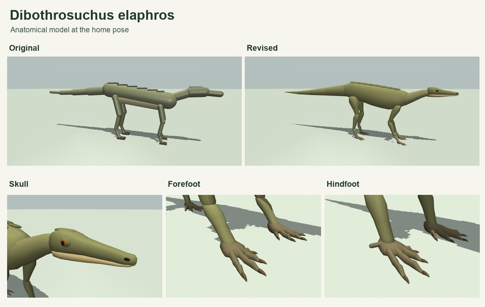

# Dibothrosuchus Elaphros Environment

A small, gracile crocodylomorph locomotion and snout-contact environment built with MuJoCo and Gymnasium.

## Overview

*Dibothrosuchus elaphros* was a small terrestrial crocodylomorph from the Early Jurassic of Yunnan, China.
The anatomical model represents a quadruped with an upright stance and gracile limbs.
[Wu and Chatterjee (1993), description of IVPP V7907](https://doi.org/10.1080/02724634.1993.10011488)

The Stage 3 “Snap” task detects contact between a fixed snout geom and a prey sphere with a 60 mm radius.
The neck and head are actuated. The jaws form a single rigid body.

## Generated Specifications, Curriculum, and Results

The authoritative public dimensions, current stage budgets, success criterion, and provenance-labelled historical
results are in the generator-managed [Dibothrosuchus Elaphros (Anatomical) catalog entry](../../docs/SPECIES_CATALOG.md#dibothrosuchus_elaphros-anatomical). They are derived
from the species manifest, executable environment, compiled MJCF, current TOML stage configs, and result summaries.

No training runs have been published for this species yet, so the catalog entry carries no results table.

## Models

The species has one model, the pair (species, embodiment) of
[docs/SPECIES_NAMING.md](../../docs/SPECIES_NAMING.md):

| | Anatomical |
|---|---|
| Species / embodiment | `dibothrosuchus_elaphros` / `anatomical` |
| Environment class | `DibothrosuchusElaphrosAnatomicalEnv` (`anatomical/env.py`), on the species base `DibothrosuchusElaphrosEnv` (`base_env.py`) |
| Gymnasium ID | `MesozoicLabs/DibothrosuchusElaphros-Anatomical-v0` |
| MJCF | `anatomical/assets/dibothrosuchus_elaphros_anatomical.xml` |
| Configs | `configs/dibothrosuchus_elaphros/anatomical/` |
| Catalog | [Dibothrosuchus Elaphros (Anatomical)](../../docs/SPECIES_CATALOG.md#dibothrosuchus_elaphros-anatomical) |

## Implementation Notes

### Anatomical review

The original stood on four rectangular soles. Its forelimb folded in the same direction as the hindlimb, and the visible skull extended beyond the snout landmark. Revision 3 places the elbow behind the shoulder and the hind knee ahead of the hip. A tapered trunk and tail, a distinct lower jaw, lateral eyes and nares, low frontal ridges and paired dorsal osteoderms give the surface recognizable landmarks. The two profiles below share a camera and scale. [Original MJCF at c096090](https://github.com/kuds/mesozoic-labs/blob/c096090ebe51cf8529f62eb595a6b6659a696d65/environments/dibothrosuchus_elaphros/anatomical/assets/dibothrosuchus_elaphros_anatomical.xml) · [Revised geometry](anatomical/assets/dibothrosuchus_elaphros_anatomical.xml) · [Ruebenstahl et al. (2022), skull reconstructions and osteoderms](https://pmc.ncbi.nlm.nih.gov/articles/PMC9541040/)



| Landmark | Original model | Revised model | Anatomical reference |
| --- | ---: | ---: | --- |
| Snout-tip to tail-tip sites, horizontal span at home | 1.250 m | 1.296 m | Estimated total length of 1.3 m. The tail is reconstructed. [Wu and Chatterjee (1993)](https://doi.org/10.1080/02724634.1993.10011488) |
| Skull, visible anteroposterior span | 200 mm | 164 mm | 164 mm cranial length. The front of the revised skin aligns with the snout site. [Zanno et al. (2015), Methods, Body size](https://www.nature.com/articles/srep09276) |
| Humerus, shoulder to elbow joint centers | 97.1 mm | 112.5 mm | 112.5 mm in IVPP V7907. [Bodenham et al. (2026), table 1](https://doi.org/10.1002/ar.70162) |
| Radius, elbow to wrist joint centers | 88.8 mm | 97.5 mm | 97.5 mm in IVPP V7907. The ulna, including its elbow projection, measures 110 mm. [Bodenham et al. (2026), table 1](https://doi.org/10.1002/ar.70162) |

**Forefoot.** Four compact rays share a toe hinge. The short first ray faces inward, and the third extends farthest forward. Each ray contacts the floor beside a small central sole. The fossil hand supports the absence of digit V. The lengths of the fleshed toes, amount of spread and ground-contact patches are reconstruction choices. The rig combines wrist and metacarpus into one link. [Ruebenstahl et al. (2022), fig. 33b](https://pmc.ncbi.nlm.nih.gov/articles/PMC9541040/) · [Bodenham et al. (2026), table 1, radiale and ulnare](https://doi.org/10.1002/ar.70162)

**Hindfoot.** The longer hindfeet have four supporting rays and a small, raised fifth ray on the outer side. The incomplete *Dibothrosuchus* hindlimb leaves the dimensions uncertain. The arrangement uses the described foot of *Terrestrisuchus gracilis* as a comparison. Colors, soft-tissue contours, the 8.65 kg simulated mass and its distribution are modeling choices. [Spiekman et al. (2024), fig. 30 and description of the pes](https://onlinelibrary.wiley.com/doi/full/10.1002/spp2.1577) · [Bodenham et al. (2026), table 1](https://doi.org/10.1002/ar.70162)

### Standing balance

With neutral joint commands on level ground for 6 s, the four feet carried 84.86 N. Each forefoot bore 11.34 N and each hindfoot 31.09 N. The center of mass projected 58.3 mm inside the nearest edge of the loaded contact polygon, down from 64.1 mm with the original block feet. The central cushions carried about 95% of the standing load. The revised trunk settled at 313 mm with 0.012° tilt, and the tail tip stood 238 mm above the floor. These are simulation measurements. [Home-pose checks](tests/test_anatomical_static_balance.py) · [Whole-episode balance checks](tests/test_com_stance_quality.py)

At the configured Stage 1 reset noise of 0.05, neutral control survived all 40 ten-second episodes (seeds 3082–3121). At the separate stance-calibration noise of 0.02, all 80 starts settled by 2 s. Four turned more than 1° from spawn (worst 1.22°). Eighteen exceeded the 2.63 mm post-landing foot-travel target (worst 3.74 mm). The corresponding revision 2 counts were seven and twenty-four. Both absolute targets remain in the suite. [Stage 1 settings](../../configs/dibothrosuchus_elaphros/anatomical/stance.toml) · [Standing calibration and target definitions](../shared/tests/com_stance_calibration.py)

### Walking mechanics

The level-ground reference places the left hind foot, left forefoot, right hind foot and right forefoot in sequence. Each foot rolls forward over its digits before lifting. Joint servos act on a freely moving body. The chosen sequence is one plausible quadrupedal walk, and living crocodylians exhibit several footfall patterns. Cadence, stride length, tail carriage and the timing of toe-off are assumptions for this reconstruction. [Hutchinson et al. (2019), comparative crocodylian gaits](https://www.nature.com/articles/s41598-019-55768-6) · [Reference controller and measurements](scripts/reference_walk.py)

| Measured over six steady strides on level ground | Result |
| --- | --- |
| Forward speed and stride | 0.161 m/s, 0.128 m per stride, 0.80 s per cycle |
| Landings and support | 24 ordered touchdowns. At least two feet bore weight throughout, with zero airborne substeps and zero non-foot floor load |
| Foot placement | Minimum left–right spacing of 88 mm at the forefeet and 93 mm at the hindfeet |
| Forefoot motion | About 64% stance, 14 mm peak swing clearance and 7.4° loaded heel rise (95th percentile) |
| Hindfoot motion | About 73% stance, 9 mm peak swing clearance and 5.0–5.1° loaded heel rise (95th percentile) |
| Toe loading | The four digital rays carried 70–72% of forefoot impulse and 27–28% of hindfoot impulse. The central cushions carried the balance |
| Slip | 13 mm/s at the 95th percentile of tangential contact speed while loaded |
| Trunk, head and tail | Maximum absolute pitch 0.27° and roll 1.09°. Trunk bob 0.8 mm peak to peak, snout excursion 7.6 mm and tail-tip excursion 7.0 mm |

All eleven nine-stride checks completed in the expected order (one neutral start, five seeds at noise 0.01 and five at 0.05). Two 36-stride trials, a neutral start and seed 3 at noise 0.05, each recorded 132 correctly ordered touchdowns after the three startup strides. The small trunk excursions and repeatable cadence reflect the controller's steady-speed design. [Reproduce the reference walk](scripts/reference_walk.py)

The reference uses floor force above 1% of body weight to identify a loaded foot and measures swing clearance at the lowest of its contact surfaces. The replay overlays four measured contact traces. It demonstrates one straight, slow walk on level ground. The model also exposes reinforcement-learning environments for stance, locomotion and prey contact. [Walk replay](../../website/static/videos/dibothrosuchus_elaphros_anatomical_reference_walk.mp4) · [Gait regression test](tests/test_reference_walk.py)

### Reward Components

- **Forward velocity** — Movement toward the prey target
- **Alive bonus** — Survival reward
- **Energy penalty** — Penalizes excessive actuator use
- **Gait stability** — Penalizes trunk angular velocity
- **Gait symmetry** — Rewards diagonal-pair (FR+RL / FL+RR) touchdown alternation
- **Tail stability** — Penalizes tail-tip angular velocity
- **Snap bonus** — Large reward when the fixed snout contact geom touches prey
- **Approach shaping** — Reward for closing **snout**-to-prey distance. Measured from the snout rather than the trunk:
  the 0.16 m skull rides a mobile neck, so trunk-referenced shaping would keep paying out after the snout had
  already overshot
- **Snout proximity** — Continuous last-mile aiming gradient for snout placement

## Quick Start

```bash
# Install from the repository root
pip install -e ".[all]"

# Reproduce the six-stride gait and its measured footfalls
python -m environments.dibothrosuchus_elaphros.scripts.reference_walk

# Extended walk with a perturbed start
python -m environments.dibothrosuchus_elaphros.scripts.reference_walk --strides 36 --seed 3 --reset-noise 0.05

# Reproduce the standing panel at the configured reset noise
python environments/shared/scripts/zero_action_baseline.py --model-id dibothrosuchus_elaphros anatomical --episodes 40 --seed 3082

# Run environment tests
python -m pytest environments/dibothrosuchus_elaphros/tests/ -v

# Train stage 1 using its current TOML-configured budget
python -m environments.shared.train --species dibothrosuchus_elaphros --embodiment anatomical train --stage 1

# Train the full chain (stance -> locomotion -> snap), each stage warm-started
# from its declared parent in configs/dibothrosuchus_elaphros/anatomical/stages.toml
python -m environments.shared.train --species dibothrosuchus_elaphros --embodiment anatomical curriculum --algorithm ppo

# Or reuse an earlier run's certified trunk and train only what is missing above it
python -m environments.shared.train --species dibothrosuchus_elaphros --embodiment anatomical \
    curriculum --algorithm ppo --trunk-from <earlier-run-dir> --output-dir <new-run-dir>

# View the model (requires display)
python environments/dibothrosuchus_elaphros/scripts/view_model.py --embodiment anatomical
```

Stance, locomotion and snap are each a published deliverable (`stance`,
`walk`, `hunt`); see [docs/BEHAVIOR_RECIPES_PLAN.md](../../docs/BEHAVIOR_RECIPES_PLAN.md).

## Environment Details

Observation and action totals are generated in the catalog entry linked above. The source of the observation layout
and action-to-actuator mapping is `environments/dibothrosuchus_elaphros/base_env.py`; actions are normalized to [-1, 1] residuals, where
zero commands the complete XML `home` control and the endpoints retain access to the full actuator ranges.

### Termination Conditions
- Trunk height outside the healthy range (0.18 m–0.55 m by default; the lower bound is the sprawl-collapse gate)
- Excessive tilt angle
- Nosedive (forward pitch exceeds the measured level neutral plus a threshold)
- Snout tip below 0.04 m (catches snout-propping that geom contact detection can miss)
- Skull, snout, trunk, belly, or distal tail contacts the ground
- Snap success (fixed `snout_snap` geom contacts prey; no jaw articulation)
- Episode length > max_episode_steps

### Actuator loads

The hip pitch, knee and ankle servos have a torque limit of 1.5 times their position gain. The other servos use a limit of 0.7 times their gain. The rear knee uses the opposite physical hinge axis to the fore elbow, so a flexion command folds each joint in its anatomical direction. The 4 Hz full-range stress test clipped the most constrained actuator on 1.65% of steps. To measure clipping under gait excitation, run `python environments/shared/scripts/actuator_saturation_report.py --model-id dibothrosuchus_elaphros anatomical`. [Actuator load checks](tests/test_anatomical_actuator_bounds.py)

## Files

```
dibothrosuchus_elaphros/
├── __init__.py
├── base_env.py                     # DibothrosuchusElaphrosEnv, the species base class
├── anatomical/
│   ├── __init__.py
│   ├── env.py                      # DibothrosuchusElaphrosAnatomicalEnv and its body data
│   ├── mjx_config.py               # Frozen MJX registration (D-D17 digest input)
│   └── assets/
│       └── dibothrosuchus_elaphros_anatomical.xml   # MuJoCo MJCF model
├── scripts/
│   ├── reference_walk.py           # Level-ground actuator walk and measured footfalls
│   ├── view_model.py               # MuJoCo passive viewer
│   ├── test_actuators.py           # Test joint movements
│   └── test_env.py                 # Environment validation script
├── tests/
│   ├── test_anatomical_env.py      # Model-specific env tests
│   ├── test_anatomical_rewards.py  # Model-specific reward tests
│   ├── test_anatomical_static_balance.py          # Home-pose and mass-distribution tests
│   └── test_anatomical_actuator_bounds.py         # Bounded-actuator plant characterization
└── README.md
```

Hyperparameter configs are at `configs/dibothrosuchus_elaphros/anatomical/` in the repo root
(`stance.toml`, `locomotion.toml`, `snap.toml`, `stages.toml` and `behaviors/`).
