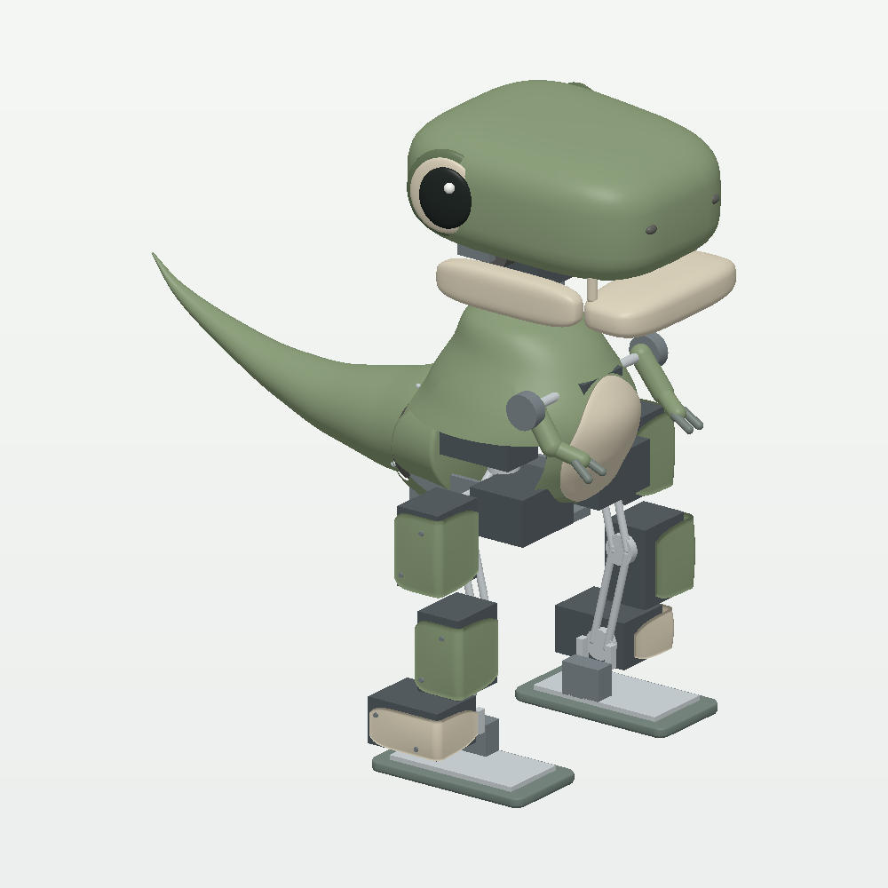
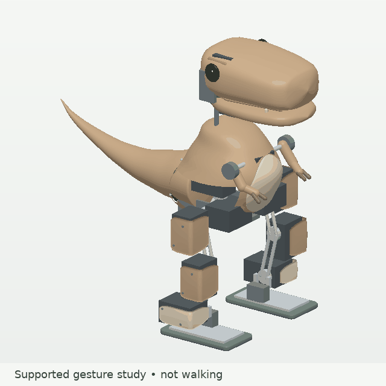

# Mini Tyrannosaurus Rex: silhouette C



The mini now shares the medium T-Rex's **rounded, gently tapered skull, large
side eyes, cream lower jaw and sage/graphite palette**. The eyes remain below
the forehead line. Its exposed hips, tiny linked arms and service panels retain
the mini's mechanical character. This is an adaptation around full-size mini
hardware, not a scaled copy of the medium mechanism.

**800 g is an unweighed allocation.** The optional wagging-tail model is 825 g.
Neither is a fabricated assembly or a validated walking robot. The example is
outside the registered training inventory and cannot reuse a Microduck policy.

[Four views](design_views.png) · [Same-scale mini/medium comparison](family_comparison.png) ·
[Optional tail](WALKING_AND_TAIL.md) · [Previous revision-10 reference](baseline_rev10/README.md)

## Character update and retained mechanism

| Property | Silhouette-C mini |
| --- | --- |
| Home visual envelope, height × width × length | 267.9 × 160.6 × 267.0 mm |
| Optional tail envelope | 267.9 × 160.6 × 295.3 mm |
| Assigned total mass | 800 g; 825 g with tail yaw; 27.9 g reserve retained |
| Moving head-yaw subtree | 91 g: 24 g yaw carrier, 55 g upper assembly, 12 g jaw |
| Active motors | 14: ten legs, head yaw/nod/jaw, shared arms; optional tail adds one |
| Motor cases | All retain full 20 × 34 × 26 mm dimensions |
| Coordinates / velocities / hinges | 22 / 21 / 15 including free root and linked shoulders |
| Sensors | 39 definitions / 59 scalar values |
| Cameras | Cosmetic eyes; virtual snout camera; physical module excluded from mass |

The new exterior is about 10 mm taller than revision 10; the legs, feet, pivot
positions, joint travel, servo dimensions and torque caps are unchanged. The
head uses new surfaces and an open-backed lower jaw, with corresponding convex
collision pieces. Explicit skull/jaw contact pairs prevent MuJoCo's ordinary
parent–child filtering from hiding overlap between those adjacent bodies.

[head_allocation.json](head_allocation.json) decomposes the revised head's
existing mass allocations into shell, jaw pieces and hardware. Surface-weighted
moments and hardware boxes update its centers of mass and inertias; no reserve
is consumed and no motor is added. These are **targets**, not a material,
wall-thickness, printing-cost or fabrication-fit qualification. The ledger's
85 g body/head/leg-guard allowance still needs physical weighing.

## Views and motion



The GIF is an actual simulated rollout with the torso externally held. It shows
expression motion, not balance or walking. Separate ten-second **unsupported**
standing gestures pass for both fixed and wagging tails, as recorded in
[character_validation.json](character_validation.json). The default model has
no external support.

The four-view sheet includes a torso-panel-hidden study. Group 4 shows raw part
proxies, not the larger service envelopes in `components.json`; simultaneous
packing is unverified. Horns, cable exits, mounts, cooling, the unspecified
battery and the ideal jaw/shared-arm linkages still require physical CAD.

## Reproduce

From the repository root:

```bash
pip install -e '.[viz,test]'
python -m examples.mini_tyrannosaurus_rex.head_design
python examples/mini_tyrannosaurus_rex/demo.py --check
python examples/mini_tyrannosaurus_rex/demo.py --view
python examples/mini_tyrannosaurus_rex/demo.py --view --support --gesture
python -m examples.mini_tyrannosaurus_rex.engineering --samples 2000 --points 5 --duration 10 --json examples/mini_tyrannosaurus_rex/validation.json
python -m examples.mini_tyrannosaurus_rex.tail_study --samples 2000
python -m examples.mini_tyrannosaurus_rex.character_checks
python -m examples.mini_tyrannosaurus_rex.render_design --output-dir examples/mini_tyrannosaurus_rex --sheet --gesture --family
python -m examples.mini_tyrannosaurus_rex.render_design --output-dir examples/mini_tyrannosaurus_rex --tail --sheet --gesture
pytest environments/tyrannosaurus_rex/tests/test_mini_tyrannosaurus_rex_*.py
```

Use MuJoCo's `mjpython` launcher for interactive viewing on macOS. The CPU
renderer uses exact compiled meshes/transforms and tessellated primitives,
requires Pillow from the visualization extra, and does not need OpenGL.
`head_design --output DIRECTORY` regenerates the selected model and head
allocation with relative links to retained mesh assets.

## Numerical evidence and limits

[validation.json](validation.json), [tail_validation.json](tail_validation.json)
and [character_validation.json](character_validation.json) identify their source
hashes, seeds and MuJoCo version. The tests run in Python CI on example changes.

| Check | Silhouette-C result |
| --- | --- |
| Motor boxes, home plus 2,000 seeded poses per configuration | No intersections; minimum separating-axis gap 2.5 mm |
| Base head/jaw/arm grid, 625 poses | No internal collision-proxy penetration |
| Combined leg/expression sample, 2,000 poses per configuration | No internal collision-proxy penetration |
| Skull/jaw vertex projections, 101 jaw positions | At least 2.91 mm separation; independent of contact filtering |
| Base home static hip roll / knee | Approximately 0.0369 / 0.0491 Nm |
| Unsupported ten-second home hold | Finite, no warnings; maximum tilt 1.97 degrees |
| Same hold with 0.10 Nm hard leg caps | Finite, no warnings; maximum tilt 2.21 degrees |
| Ten-second free standing gestures, base / tail | Maximum tilt 2.06 / 2.16 degrees; no internal penetration |
| Free gesture head-nod / jaw peak, larger configuration | 0.0357 / 0.0112 Nm, under unchanged 0.10 / 0.025 Nm caps |
| Existing and new mini regression cases | 38 passing locally, including deliberately inadequate motors |

Static load distribution is an assumption, not a guaranteed servo load. The
0.10 Nm hard-cap hold reaches final-second means of about 0.0356 Nm hip roll,
0.0617 Nm knee and 0.0729 Nm ankle on the larger side. None of these short tests
qualifies continuous hardware torque, electrical power or thermal duty.
Sampling does not prove every pose clear; cosmetic meshes do not define hollow
manufactured shells, and most mounting interfaces are still schematic.

**Walking remains unresolved.** Every refreshed 30-second diagnostic trial
falls. At 0.20 Nm, the fixed-tail run lasts 26.922 s, the tail-centered run
23.202 s and the wagging run only 3.680 s. A same-runtime replay of revision 10's
wagging run lasts 21.688 s: this design changes a fragile controller's behavior.
Do not combine walking and tail gestures until a separate gait acceptance gate
passes. [Walking evidence and historical comparison](WALKING_AND_TAIL.md).

## Hardware next steps

The [hardware note](../../docs/hardware/MINI_TYRANNOSAURUS_REX.md) and
[component ledger](components.json) separate specifications from allowances.
Package real horns/idlers, linkages, electronics, battery and wiring; weigh the
head and shells; bench-test loaded motors and power rails. Then identify the
actuator dynamics and develop an observable gait controller with timing, noise,
backlash and voltage variation. The narrow flat-foot lateral probe still needs
a center of pressure about 42 mm inward, outside the sole's 17 mm half-width;
that rejects this transfer strategy, not every dynamic gait.
