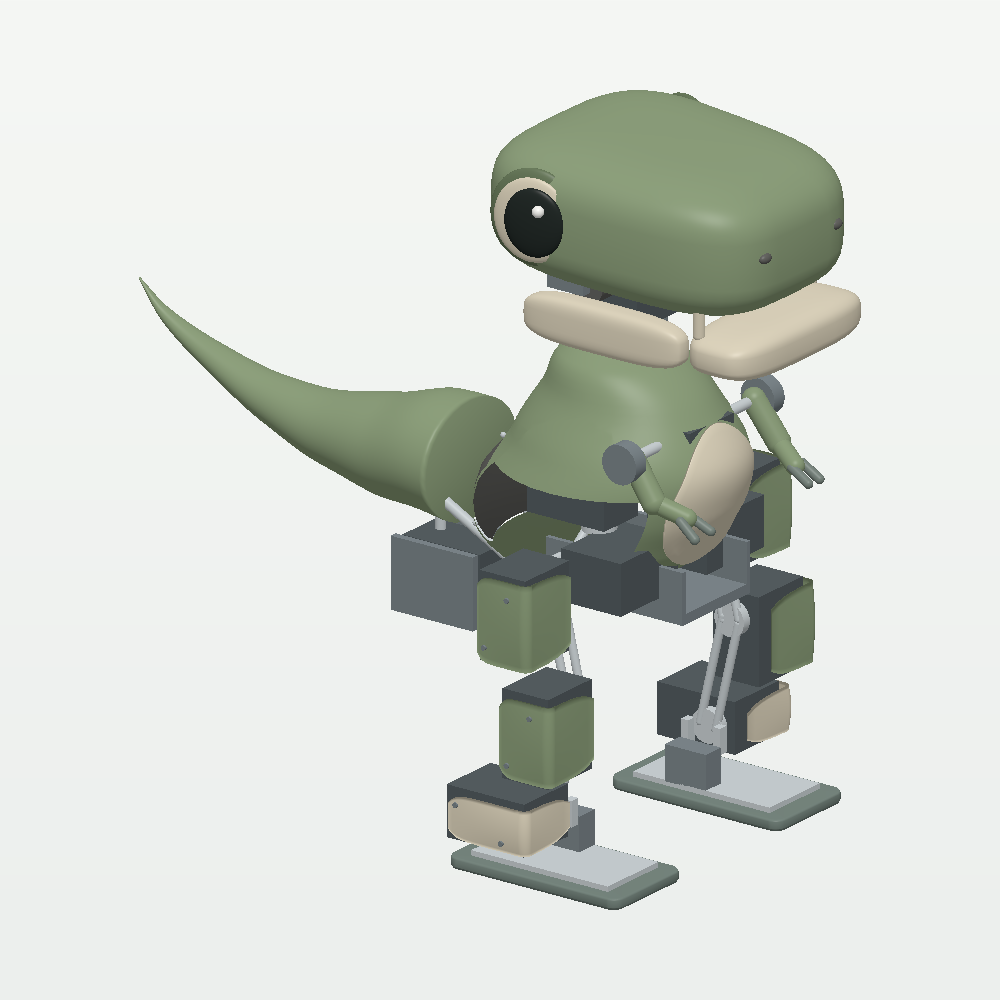

# Walking, optional tail and balance regression study

The selected silhouette-C base remains the **800 g / 14-motor** concept. The optional tail is an
**825 g / 15-motor** configuration generated by `tail_option.py`. These masses
are assigned, not weighed. Neither configuration has demonstrated robust
walking or qualified hardware duty.

## A single character tail joint is plausible



[Four-view tail study](design_views_tail.png) ·
[Supported character animation](supported_gesture_tail.gif) ·
[Numerical tail report](tail_validation.json)

One XL330 drives a vertical yaw pivot through a short shaft extension. A supported
pivot must carry bending loads; the servo should not serve as the only support
for a long cantilever. The module is exposed behind/below the torso for access.
Its 18 g motor plus 7 g mount/bearing/wiring allowance is added to the total;
the base's 27.9 g integration reserve is retained.

The tail shell is 90% of the base geometry, retaining a conservative 15 g mass.
Its root moves rearward 43 mm. The 70 g assigned battery moves 23 mm forward;
both relocations and the new hardware update the inertia. The home exterior is
approximately **267.9 x 160.6 x 295.3 mm** (height, width, length), about 28 mm longer
than the base. The battery remains a sourcing constraint, not a selected pack.

The initial motion is **+/-15 degrees at 0.5 Hz**, within +/-25-degree joint
limits. Nominal yaw torque is small because gravity does not oppose an upright
vertical yaw axis. Body lean, friction and acceleration still matter, and the
root bearing must resist the tail's weight and external bumps.

| Measurement | Optional-tail result |
| --- | ---: |
| Moving tail mesh against component service boxes, 101 yaw positions | Minimum separating-axis gap 4.85 mm, at the computer envelope |
| All 15 full motor cases, home + 2,000 seeded poses | No box intersections; minimum separating-axis gap 2.5 mm |
| Combined legal leg/expression commands, 2,000 poses | No non-floor proxy penetration |
| Upper-body command grid, 243 poses | No non-floor proxy penetration |
| Ten-second unsupported standing wag | Maximum torso tilt 1.99 degrees; minimum height ratio 0.9946 |
| Tail torque during that wag | Peak 0.00101 Nm; RMS 0.000735 Nm |
| Home static hip roll / knee | 0.0388 / 0.0544 Nm, versus base 0.0369 / 0.0491 Nm |

The mesh/service-box check is independent of parent-child collision exclusions.
It checks selected tail/component pairs, **not** simultaneous electronics fit,
shell/collar manufacturing, bearings, tolerances, wiring or structural strength.
Clearance samples are not exhaustive. Actual prototype measurements must replace
the assigned masses and ideal actuator behavior.

The fifteenth servo raises the sum of published stall currents to **22.05 A at
5 V**. This is a fault envelope, not normal consumption. Gentle simulated wagging
does not establish electrical draw or reserve on the candidate regulator. Measure
concurrent gait/gesture current, voltage drop and temperatures before approval.

## Dynamic stepping is possible; reliable walking is unresolved

The [current walking report](walking_validation.json) preserves twelve refreshed
30-second trials for silhouette C, plus a same-runtime replay of the previous
mini's wagging case. The sinusoidal targets and orientation-feedback parameters
are unchanged, but leg position gains are half and velocity gains one quarter
of revision 10 to repair standing creep. Positive translation alone
is not counted as stepping: the swing sole must clear the floor by 2 mm with
low contact force, while the other foot supports over half the weight,
sustained for at least 40 ms.

| Silhouette C, revised servo gains and 0.20 Nm leg caps | Duration reached | Support alternations | Forward travel |
| --- | ---: | ---: | ---: |
| Fixed tail | 30 s | 150 | 564 mm |
| Tail centered | 30 s | 142 | 470 mm |
| Tail wagging | 3.592 s, then fall | 7 | -59 mm |

Five of twelve cases reach the requested horizon: fixed and centered tails at
0.20/0.30 Nm, plus wagging at 0.30 Nm. All 0.10/0.15 Nm cases fall. Even the
completed runs have internal hip-link/motor-case contacts and joint-limit
overshoot; at 0.20 Nm the fixed-tail run records about 6.55 N peak internal
contact force and 0.0242 rad maximum joint overshoot. They are not accepted
walking. Keep tail motion as a stationary character gesture until a separately
qualified controller can accommodate it with legal contact and effort margins.

The [historical revision-10 report](baseline_rev10/walking_validation.json)
recorded base/tail-centered/tail-wag falls at 21.304 / 8.514 / 29.616 s. A replay
of that old wagging model **in the current runtime** falls at 21.688 s. It retains
the old head and servo gains. The difference from its historical recording also
shows runtime sensitivity. These single trajectories are diagnostic evidence,
not a robust comparison of gait quality or a validated balance tail.

The policy uses exact simulated orientation. Hardware needs an IMU estimator,
identified actuator dynamics, timing/noise handling, and measured torque-speed,
power and thermal limits. No gait training or hardware deployment driver is
included. Similar leg joint counts do not make Microduck's controller transferable.

Keep the retained revision-10 model available as a controller reference. Next establish repeatable
weight transfer and stepping under identified actuator limits, then re-evaluate
the optional mass and gestures. Bench-test the loaded hip-roll, knee and ankle
axes; stronger motors or a bracket/ankle redesign may be needed. Simply widening
the current hip-roll limits is not acceptable because prior sweeps found link
and opposite-foot interference. The character tail is optional until these
comparisons meet a defined gait acceptance test.

The historical [revision-10 static-support study](baseline_rev10/static_support_validation.json) searched
coupled leg and head configurations rather than only torso lean. Its best found
base posture still required a lateral center of pressure 37.37 mm from the sole
center, outside the 17 mm half-width. The finite search did not converge; this is
not a proof that every static posture is impossible. A 60 mm-wide contact sole
did not contain that point. An 80 mm sole did, but the same posture still required
approximately 0.194 Nm hip-roll effort. Wider feet alone are therefore not a
demonstrated remedy.

Virtual additional ankle-roll axes found feasible static support, but omitted
their motor/mount mass and physical packaging. About 35 degrees of torso lean
was needed to bring all leg loads below 0.10 Nm in the recorded candidate;
limiting lean to about 26 degrees left peak load around 0.137 Nm. This supports
further mechanism research, not immediate adoption. The report distinguishes
the original exploratory measurements from the consolidated replay script.

## Cameras and eyes

The two eyes are cosmetic. `onboard` is one virtual forward-facing snout camera,
ahead of the visual snout, with no physical lens carrier. Its
75-degree vertical field of view is a simulation setting, not a selected lens.

For a first build, retain the expressive side eyes and use one camera in a dark
snout insert. Radxa lists IMX219 Camera V2 support for ZERO 3, making it a bring-up
candidate. The stock Camera Module 2 is approximately 25 x 24 x 9 mm and 3 g bare,
with 48.8-degree vertical / 62.2-degree horizontal FOV. Budget an **unmeasured
8–12 g installed assembly** for board, ribbon, mount and protection; it is excluded
from both current totals. Tail plus camera would therefore target roughly
**833–837 g** before any further revisions, retaining the reserve.

The lower camera height favors torso/lower-body tracking. Upward mount cant or a
qualified wider lens may be needed for close adult-face interaction. Side eyes
do not automatically provide stereo: forward overlap, synchronization,
calibration and a compatible capture interface would need a separate design.
See the [hardware note](../../docs/hardware/MINI_TYRANNOSAURUS_REX.md) for sources.

## What the build now protects

An example-only model or asset change previously did not match the Python CI
path filter. The shared trigger now includes `examples/mini_tyrannosaurus_rex/**`;
lint, formatting and both mypy checks also include this example. A workflow
contract test rejects removal of those paths. Existing species jobs run the
mini-robot tests on Python 3.11, 3.12 and 3.13.

Fast deterministic checks cover both the base and optional-tail configurations:

- Assigned mass/actuator interfaces, inertia validity and component budgets.
- Full motor boxes, sampled legal poses, coupled arms and tail service envelopes.
- Deterministic C generation, retained motor/pivot/limit geometry, explicit head
  inertia allocations and skull/jaw separation independent of collision filtering.
- Actual unsupported head/jaw/arm gestures for both tail configurations, including
  motion excursion, torso height/tilt, torque caps and internal-contact bounds.
- Thirty-second unsupported holds and small roll/pitch angular-velocity kicks,
  with leg force caps at **at most** 0.10 Nm; a weaker model cap is never raised.
- Height retention, tilt, drift, both-foot support, unexpected ground contact,
  finite state, warnings, settled RMS effort and cap contact.
- Deliberately weakened 0.025 Nm legs must fail the balance gate. Active world
  or fixture constraints, gravity compensation, disabled gravity/contact physics
  and missing force limits are rejected. A half-timestep replay protects against
  a balance result that depends on the default 2 ms timestep.

The stance bounds are regression thresholds: minimum height 90%, maximum tilt
10 degrees, maximum root drift 20 mm, final-second leg RMS below 0.09 Nm and cap
contact below 10%. The revised hold has no settled clipping; the previous
silhouette-C gains clipped and crept 4–8 cm in 30 seconds. The longer check now
catches that failure. The thresholds do not qualify continuous hardware duty.
These bounds should change only with reviewed evidence, not to hide a regression.

The longer walking pilot reports success/failure evidence separately. It is not
used as a passing walking gate. Once a repeatable gait exists, add explicit
duration, distance, slip, foot-clearance, effort and multi-seed disturbance bounds
under identified actuators. Passing these mini-robot checks does not establish
equivalent physical balance checks for every other registered species.

## Reproduce from repository root

```bash
python examples/mini_tyrannosaurus_rex/demo.py --tail --check
python examples/mini_tyrannosaurus_rex/demo.py --tail --view --support --gesture
python -m examples.mini_tyrannosaurus_rex.tail_study --samples 2000
python -m examples.mini_tyrannosaurus_rex.balance_checks --duration 30
python examples/mini_tyrannosaurus_rex/render_design.py --tail --output-dir examples/mini_tyrannosaurus_rex --sheet --gesture
pytest environments/tyrannosaurus_rex/tests/test_mini_tyrannosaurus_rex_*.py
python -m examples.mini_tyrannosaurus_rex.walking_pilot --duration 30 --output /tmp/mini-base-walking.json
python -m examples.mini_tyrannosaurus_rex.walking_pilot --tail --tail-mode center --duration 30 --output /tmp/mini-tail-centered.json
python -m examples.mini_tyrannosaurus_rex.walking_pilot --tail --tail-mode wag --duration 30 --output /tmp/mini-tail-wagging.json
# Optional, longer static search; needs SciPy from the test extra:
python -m examples.mini_tyrannosaurus_rex.support_search --output /tmp/mini-static-support.json
```

The recorded studies use MuJoCo 3.10.0. Numerical outcomes can change with solver
or library versions; reports record them and source hashes. Use `mjpython` for
interactive macOS viewing. The CPU renderer does not require OpenGL.
