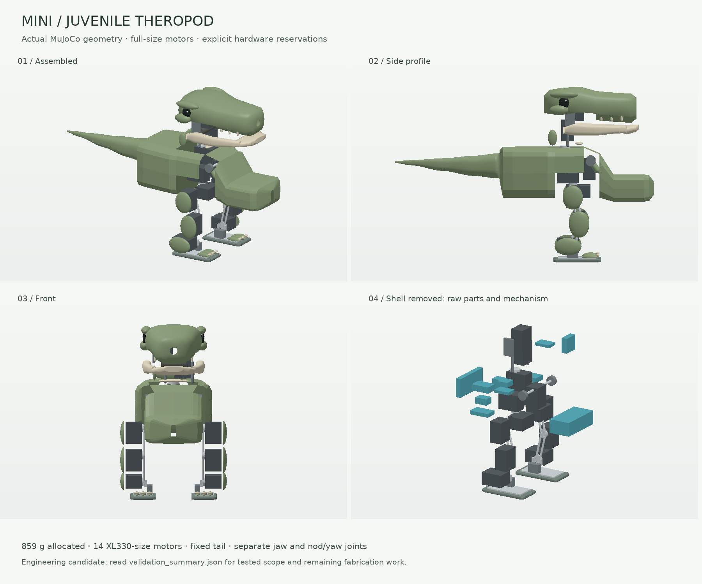
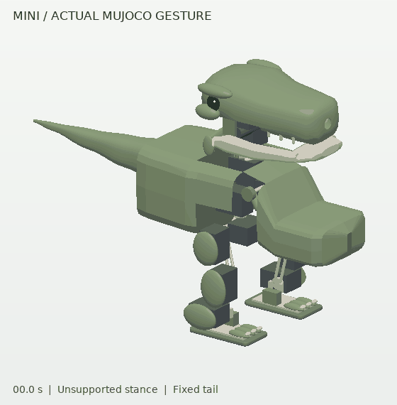

# Juvenile mini T. rex: hardware-sized MuJoCo candidate

This separate candidate translates the approved prehistoric styling into the
mini's articulated MuJoCo model: longer browed skull, recessed eyes, open jaw,
two-finger arms, partial leg fairings, three-toed broad feet, and a straight fixed
tail. Full-size hardware requires a broader torso than the visual mockup. The
reviewed model in the parent directory remains unchanged.



## Use and reproduce

From the repository root, with the project's dependencies installed:

```sh
python -m examples.mini_tyrannosaurus_rex.juvenile.build
python -m examples.mini_tyrannosaurus_rex.juvenile.validate --samples 1024 --compact --output examples/mini_tyrannosaurus_rex/juvenile/validation_summary.json
python -m examples.mini_tyrannosaurus_rex.juvenile.render
python -m examples.mini_tyrannosaurus_rex.juvenile.animate
```

Load `examples/mini_tyrannosaurus_rex/juvenile/model.xml` in MuJoCo. The model uses
the parent example's `assets` directory; keep the directory structure when
copying it. Inline candidate meshes are generated deterministically by
`build.py`, `appearance.py`, and `torso.py`.

The validator returns **1 for a known failure** and **2 for incomplete hardware
qualification**, including a successful scoped simulation screen. Read
`scoped_simulation_pass` and the detailed counts rather than treating exit 2 as
a hidden success. Omit `--compact` to reproduce every pair and witness; that
report can be large. The compact report retains all failures/uncertainties and
the closest passing witnesses, plus complete counts, acceptance results, source
hashes, runtime versions, and the exact invocation.

## Mechanical and packaging choices

The home-pose exterior is approximately **408 × 168 × 275 mm** (nose-to-tail
length × width × height). The explicit mass allocation is **858.6 g**, including
the camera and the enlarged hollow torso. These are model dimensions and design
allocations, not measurements from a fabricated robot.

- All **14 XL330-size cases remain 20 × 34 × 26 mm**. Joint axes, ranges, motor
  positions, actuator limits/gains, coupled shoulders, leg lengths, and contact
  soles are retained. The tail is fixed.
- The rear bay holds a transverse computer and side-mounted interfaces/power
  electronics. The battery lies across the front chest to balance the computer
  and tail, with finger and opening-jaw clearance checked together.
- Raw part bodies are **group 4**; larger installation allowances are **group
  5**. These inspection boxes are nonphysical. Full motor cases and true shell
  walls are checked independently of MuJoCo contact masks.
- The torso and skull have actual hollow geometry. Their collision walls are
  normal-extruded **1.2 mm triangular prisms**, not enclosing convex solids.
  Neck, shoulder and hip apertures preserve moving space. The nose has a real
  camera opening; field of view remains to be qualified.
- `hardware.py` records manufacturer references, selected dimensions, and
  explicitly identified allowances. `manifest.json` records every installation
  box, checked pair, exact mounting exception, and cavity reference.
- `mass_ledger.json` includes motor, computer, power, battery, harness, camera,
  structure and integration reserves. The torso skin replaces its old mass
  allowance using surface area × 1.2 mm × assumed 1,050 kg/m³. Skull/jaw/tail
  masses remain design allocations. Nothing is represented as weighed hardware.

| Part | Installed space, body-local XYZ | Mass allowance |
|---|---:|---:|
| Radxa ZERO3 computer | 22 × 85 × 50 mm | 35 g |
| Battery, SKU not selected | 43 × 80 × 30 mm | 70 g |
| U2D2 | 60 × 20 × 25 mm | 9 g |
| Motor regulator | 50 × 30 × 15 mm | 4.8 g |
| Logic regulator | 25 × 25 × 12 mm | 2.3 g |
| Power distribution/cutoff | 35 × 25 × 15 mm | 28 g |
| Body/head IMU, each | 30 × 25 × 8 mm | 3 g |
| Camera V2 reference | 17 × 30 × 29 mm | 8 g installed |

Dimensions include unverified plug, cooling, mounting or lead allowances; they
are larger than the underlying board dimensions. The battery raw-body maximum
is 70 × 35 × 22 mm, reoriented into the declared installation space. A 35 g
whole-robot harness allocation is represented at its torso gathering point;
this does not model every moving cable. The camera needs an approximately
300 mm compatible ribbon with strain relief and neck service loops.

## What is checked

The committed MuJoCo 3.10.0 report passes the scoped simulation checks:
**145,855 geometry pairs across 1,662 poses**, with zero failing or inconclusive
clearances; all 11 part/envelope and 11 exterior containment checks pass.
All three 30-second standing trials and the 10-second gesture trial pass, with
zero unexpected ground support and zero internal gesture penetration. Maximum
tilt is 1.46° and standing drift is 1.28 mm. All 18 recorded source hashes were
verified unchanged during the run. The 81 targeted mini tests also pass.



The reproducible screen covers home, individual joint endpoints/interiors,
full three-point combinations of all five joints of each leg, expression
combinations, and seeded simultaneous full-body poses. It checks installation
boxes against one another, all motor cases and mechanism parts, shell walls,
moving shells, and the declared exterior cavities. Cavity checks establish
that entire boxes are inside the intended body, not merely distant from walls.

The ordinary separation target is **2 mm outside installation allowances**.
Exact fixed mounting interfaces are documented exclusions, including toe covers
seated on their own baseplates and the fixed tail attachment. Sampled joint
checks are not a mathematical proof over every possible continuous trajectory.
Zero/uncertain native distances are retained as incomplete, never silently
converted to passing clearance.

Dynamic checks use the original unsupported acceptance criteria: three
30-second standing trials (hold, roll kick, pitch kick) at a 0.10 Nm leg cap,
and a 10-second gesture trial at the existing actuator settings. Root support,
gravity compensation, torque-limit relaxation and a hidden floor prop are not
used. Tests also guard retained joint/motor/actuator dimensions, mass
reconciliation, wall thickness, containment, and known collision failures.

## Work remaining before fabrication

This is an engineering candidate, not fabrication CAD or a hardware-qualified
robot. Horns/idlers, bearings, mounting frame, ribs, panel flanges, screws,
connector-specific bend radii, moving harness routes, battery restraint, and
service-panel openings require detailed design and measurement. Panel removal
corridors are powered-off proposals and do not establish tool access.

Battery SKU, fuse/wire ratings, servo regeneration, voltage sag, cooling,
continuous torque, backlash and servo response require physical validation.
The selected camera is a documented Radxa-supported reference, but driver
setup, ribbon routing and optical field of view are not validated here.

No learned walking policy, robust locomotion claim, or MicroDuck-equivalent
training/deployment pipeline is introduced. Revalidate walking separately on
this changed mass distribution and shell geometry.
