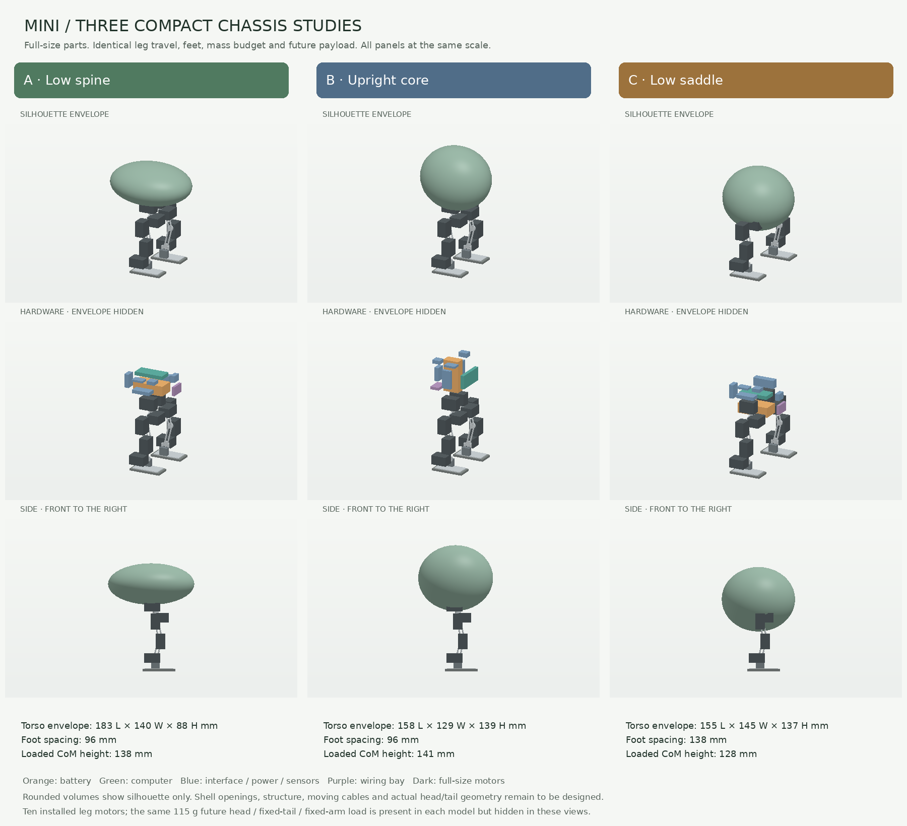

# Three compact mini chassis layouts

**Start the next mechanical iteration from A, the low spine.** Its lengthwise
electronics arrangement leaves the lowest oval torso of the three at the narrow
96 mm foot spacing. The battery sits within the torso rather than in a front
pod. B is a useful shorter-body alternative. C lowers the centre of mass, but
requires a wider stance and drifts in the bare-chassis standing screen.

These are hardware packing studies and runnable MuJoCo chassis models, not
finished character designs or fabrication CAD. The green rounded volumes are
proposed silhouette envelopes. They enclose the electronics installation boxes,
but are **not qualified shells**: joint openings, wall sections, fasteners and
moving cables still need design. In particular, C needs substantial hip relief.
The volumes do not provide invisible contact support during the standing tests.



[Dimensioned hardware projections](packing.png) · [Machine-readable evidence](comparison.json)

## Comparison

Dimensions are rounded, in millimetres. Torso dimensions describe only the green
envelope. Width includes the full exposed motor cases. Height is to the top of
the headless torso at home, with the sole on the floor.

| | A: Low spine | B: Upright core | C: Low saddle |
|---|---:|---:|---:|
| Torso envelope, length × width × height | 183 × 140 × 88 | 158 × 129 × 139 | 155 × 145 × 137 |
| Overall chassis width | 151 | 151 | 193 |
| Height, without a head | 228 | 267 | 220 |
| Foot centre spacing | 96 | 96 | 138 |
| Loaded centre-of-mass height | 138 | 141 | 128 |
| Declared hardware clearance screen | Pass | Pass | Pass |
| Bare chassis, unsupported 30-second stand | Pass | Pass | **Fail: 68 mm drift** |
| With future payload, same standing test | Pass | Pass | Pass |
| Assessment | **Develop first** | Shorter, but tall silhouette | Keep as an exploratory comparison |

The standing result is for the same simple position controller and ideal
actuator model in each case. C's drift does not prove it cannot balance with a
better controller; it does prevent calling the present bare chassis validated.
The evidence retains that failure and the validator exits **1**. A and B remain
overall **incomplete** because fabrication and locomotion are unqualified.

All three have **639.1 g allocated chassis mass**, or **754.1 g with the same
115 g future payload**. These are planning allocations, not measured weights.
The common load avoids selecting an appealing empty chassis that becomes
rear- or front-heavy after adding character hardware. It is not a physical
head/tail design, nor evidence that their moving geometry fits.

## Parts actually represented

All ten leg motors retain their full **20 × 34 × 26 mm XL330 case dimensions**
and 18 g motor allocation. Each has hip yaw, hip roll, hip pitch, knee pitch and
ankle pitch. The knee/ankle cases, bracket proxies and links derive from the
reference mini at `28a6bcd52c07d8381e18e5947bdb40afbb7151a7`. C moves each hip
assembly 21 mm outboard; A and B retain the reference spacing.

The first sweep found only 0.84 mm motor-to-sole clearance in the reference
geometry at extreme ankle poses. Every candidate therefore has a **3 mm longer
ankle pedestal** and a revised 25 g foot allocation. Foot length and width,
motor case sizes and joint travel were retained. No motor was miniaturized to
make the packing pass.

| Torso item | Raw envelope, unordered axes / mm | Installed reserve, unordered axes / mm | Allocated mass / g |
|---|---|---|---:|
| Radxa ZERO 3 computer | 65 × 30 × 8 | 85 × 50 × 22 | 35 |
| Battery, SKU not yet selected | 70 × 35 × 22 | 80 × 43 × 30 | 70 |
| ROBOTIS U2D2 | 48 × 14.9 × 18 | 60 × 20 × 25 | 9 |
| Pololu D24V90F5 motor regulator | 40.64 × 20.32 × 7.62 | 50 × 30 × 15 | 4.8 |
| Pololu D24V22F5 logic regulator | 17.78 × 17.78 × 7.874 | 25 × 25 × 12 | 2.3 |
| Power distribution/protection allowance | 30 × 20 × 10 | 35 × 25 × 15 | 28 |
| Body IMU | 25.4 × 17.78 × 4.5 | 30 × 25 × 8 | 3 |
| Audio/LED/button allowance | 20 × 15 × 10 | 25 × 20 × 15 | 10 |
| Harness gathering bay | 32 × 20 × 6 | 39 × 25 × 10 | 35 |

The permutations in each `layout.json` rotate raw and installed envelopes
together. Selected part footprints come from manufacturer references; assembly
thicknesses, installed masses and plug/cooling reserves include assumptions.
Battery, power distribution, audio and harness rows are procurement requirements,
not verified products. The harness box represents a gathering bay, not every
wire's route. Servo horns, connector service loops and load-bearing mounts are
not included in the clearance pass. Thus “full size” does not mean a complete
electrically or thermally qualified assembly.

The common future budget is:

- Head/neck: **90 g**, including two 18 g XL330 motors, 8 g camera/mount, 3 g
  head IMU and 43 g for the neck, shell, frame, fasteners and cable.
- Fixed tail: **15 g**. No tail actuator or tail joint is introduced.
- Fixed arms: **10 g**. An actuated jaw is a later, additional budget decision.

Only the ten leg motors are installed as articulated geometry in these models.
The future modules are fixed inertial surrogates at the same positions in all
three candidates. An eventual two-axis head would bring the motor count to twelve.
No camera view, jaw grasping, head clearance or expression behavior is claimed.

## Movement and evidence limits

Each candidate checks **162,805 pair evaluations across 1,050 poses**: home,
a symmetric flat-foot crouch configuration, five samples per individual joint,
243 configurations per leg, and 512 seeded simultaneous configurations.
All pairs among the ten motor cases, nine installed electronics reserves and
two soles are screened directly, bypassing collision masks. Fixed/fixed pairs
are checked once. The margin is 2 mm with a 1e-9 m numerical comparison allowance.
There are no failed or inconclusive checks in the final declared hardware set.
The result is a finite sample, not proof for every continuous configuration.

MuJoCo's native distances and conservative separating-plane evidence are kept
in the closest witnesses. A native zero without a proven gap is incomplete,
not a pass. Negative-control tests verify that overlapping parts cannot pass,
undersized motors are detected, gravity assistance cannot pass an unsupported
stand, and source hashes match the evidence.

The shell, mounting interfaces, cables and future modules are explicitly
outside this packing screen. The joint sweep tests self-clearance; it is not a
foot/terrain trajectory. Standing uses raw component contacts and the reference
leg collision proxies, a free base, gravity and 0.10 Nm actuator caps. It rejects
unexpected floor support, fixtures, excessive drift, tilt, height loss and self
penetration. The visible envelope has no contact and adds no extra mass beyond
the common 30 g skin allocation.

**The inherited leg motion is not yet sufficient evidence for MicroDuck-like
behaviors.** With both feet flat, the symmetric knee-limit pose lowers the
pelvis only **12.0 mm**: hip pitch −0.35, knee +0.70, ankle −0.35 radians.
This is a kinematic calculation, not a dynamic crouch demonstration. Deep sit,
get-up, ground reach and robust stepping need a new leg travel/reach study and
training. These layouts intentionally hold travel constant to compare packing;
they do not settle the final leg architecture.

## Is this a useful starting point for a 100 cm robot?

**Yes as a development platform; the mechanical design and trained policy will
need separate large-robot versions.** Here 100 cm means standing height, as in
the repository's [one-metre concept](../../tyrannosaurus_rex_100cm/README.md).

Carry forward the joint naming/configuration scheme, measured sensor and actuator
interfaces, timestamped logging, state estimation, behavior commands, task and
reward definitions, training/evaluation tooling and fault-handling architecture.
Train against each robot's own geometry, mass, contacts, limits and actuator
response. Pollen's [MicroDuck RL](https://github.com/pollen-robotics/microduck_rl)
is a useful reference for actuator identification, domain randomization and
deployment validation. Adopting those lessons does not require replacing this
repository's selected Stable-Baselines3 backend with MicroDuck's training stack.

Do not scale XL330 plastic cases, bearing supports, feet, wiring, battery or
cooling directly. For an illustrative same-density enlargement from 25 to
100 cm, length increases 4×, mass 64×, and gravity torque 256× because
`torque ~ mass × gravity × length`. That is a scaling illustration, not a mass
or motor prediction. The existing 1 m concept already allocates **33.21 kg** and
uses much larger drives. Its documented standing results do not qualify walking.

There is also an architectural mismatch to resolve deliberately: the mini has
**five powered axes per leg**; the large concept has **six, adding ankle roll**.
Keep software joint maps configurable. Compare a six-axis leg in simulation
before committing the large robot's architecture; broad mini soles should not
be taken as proof that a larger robot can omit ankle roll. Likewise, mini
recovery tricks should not become requirements for a 33 kg robot by default.

The next useful sequence is:

1. Take A into a leg-and-pelvis revision with greater useful crouch/step reach,
   explicit motor horns, idlers, cable loops, removable battery/compute trays
   and actual shell openings. Preserve the future payload test cases.
2. Identify the real servos and validate standing, weight transfer, stepping,
   turning and modest crouching on the mini. Add the lightweight head after
   these work with representative loads. Keep the tail fixed.
3. In parallel with the software work, develop an **instrumented full-size leg**
   for the intended large mass, speed and floor conditions. Measure sustained
   torque/temperature, transmission compliance, bearing loads and foot forces.
4. Use that evidence for a supported large chassis and then controlled stepping.
   The large chassis needs its own power, braking, load paths and stop behavior.

## Files and reproduction

- [A model](a_low_spine/model.xml) / [part placements](a_low_spine/layout.json)
- [B model](b_upright_core/model.xml) / [part placements](b_upright_core/layout.json)
- [C model](c_saddle/model.xml) / [part placements](c_saddle/layout.json)

Each generated MJCF is self-contained. From the repository root:

```bash
python -m pip install -e ".[test]" pillow
python -m examples.mini_tyrannosaurus_rex.layout_study.build
python -m examples.mini_tyrannosaurus_rex.layout_study.validate
# Exit 1 is intentional while C retains its recorded bare-chassis drift failure.
python -m examples.mini_tyrannosaurus_rex.layout_study.render
python -m pytest environments/tyrannosaurus_rex/tests/test_mini_tyrannosaurus_rex_layout_study.py
```

The report records source hashes and runtime versions. The seven focused
regression tests pass; scoped Ruff and mypy checks pass. Full-repository CI is
not claimed. These remain checkout-only examples and do not modify registered
training plants, policy interfaces, the original mini, or the previous juvenile
model. The previous juvenile is retained as a reference, not the recommended
appearance.

Primary hardware references: [XL330-M288](https://robotis.us/products/dynamixel-xl330-m288-t),
[Radxa ZERO 3](https://docs.radxa.com/en/zero/zero3),
[U2D2](https://docs.robotis.com/docs/parts/interface/u2d2/),
[motor regulator](https://www.pololu.com/product/2866/specs),
[logic regulator](https://www.pololu.com/product/2858/specs).
The earlier [hardware assumptions](../juvenile/hardware.py) document provenance
and qualifications for the retained part allowances.
