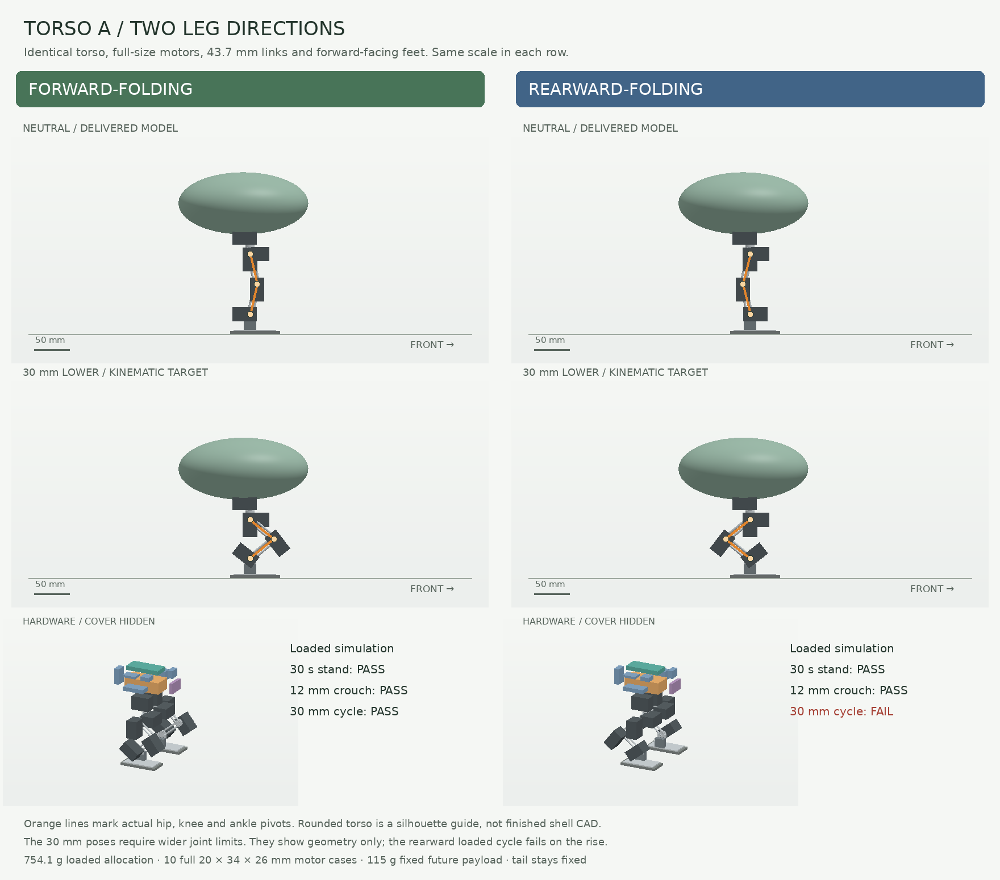
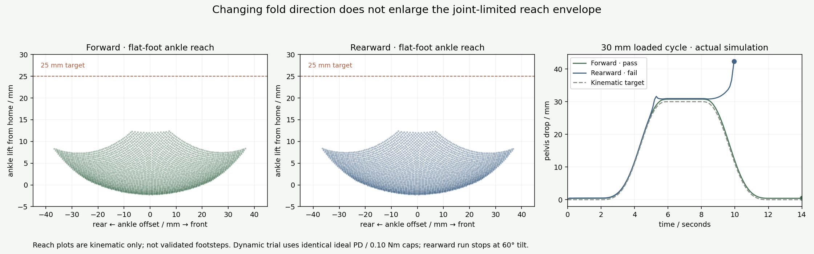

# Torso A: forward- and rearward-folding legs

Keep **A low spine** and compare two lower-leg arrangements with the same
hardware. The current recommendation is to retain **forward-folding legs as
the baseline under this torso**. Reversing the legs changes the knee silhouette,
but does not increase the reach or reduce the body size in this controlled
comparison. It also does not automatically reproduce MicroDuck's capabilities.



## What stays fixed

Both standalone MuJoCo models retain torso A's exact hardware positions,
installed-space reserves, hip mounts, forward-facing feet, mass allocations,
actuator gains and torque caps. No battery, computer or motor is shrunk or moved
to help one variant. See [A's full hardware ledger](../layout_study/a_low_spine/layout.json)
and the [torso study](../layout_study/README.md) for dimensions, sources and
unselected component allowances.

- Ten full **20 × 34 × 26 mm XL330 case envelopes**, five axes per leg.
- Two **43.6606 mm** pivot-to-pivot links per leg; **96 mm** foot-center spacing.
- Same torso envelope: **182.7 × 140.3 × 87.5 mm** (length × width × height).
- **639.1 g** chassis allocation; **754.1 g** with the same **115 g** future load.
- Future load: 90 g head/neck, 15 g fixed tail, 10 g fixed arms. These are rigid
  mass/inertia surrogates, not finished modules. There is no tail actuation.

`forward/model.xml` is physically identical to A. `rearward/model.xml` reflects
the thigh and shin primitive geometry and aggregate inertias in the sagittal
direction. It moves the neutral knee from **10 mm ahead** of the hip to
**10 mm behind** it. The ankle remains under the hip; the feet still point
forward. Pitch command signs and the knee's asymmetric range are reflected
together. The torso and upper hip assembly are not reflected.

This proposes revised mounting brackets around full-size cases, not mirrored
commercial motors. Actual plug orientation, horn/idler interfaces, mounting
holes and moving wire routes still need CAD. The rounded torso is a visual
envelope, not a collision-qualified manufactured cover.

## Measured comparison

MuJoCo 3.10.0; results and input hashes are in [comparison.json](comparison.json).
These are engineering screens, not trained walking or hardware qualification.

| Screen | Forward-folding | Rearward-folding |
|---|---:|---:|
| Loaded mass allocation | 754.1 g | 754.1 g |
| Hardware packing at current limits | Pass | Pass |
| Unsupported 30 s stand, bare and loaded | Pass / pass | Pass / pass |
| Symmetric flat-foot lowering at current limits | 12.01 mm | 12.01 mm |
| 12 mm crouch-and-rise, bare and loaded | Pass / pass | Pass / pass |
| Experimental 30 mm cycle, bare | Pass | Pass |
| Experimental 30 mm cycle, loaded | **Pass** | **Fail on rise** |
| Last sampled clear deeper-fold pose, 2 mm box margin | 35.00 mm lower | 35.00 mm lower |
| First sampled pose below the 2 mm margin | 35.36 mm lower | 35.36 mm lower |
| First limiting hardware pair in deeper fold | Hip-pitch / ankle motor | Hip-pitch / ankle motor |

The roughly 35 mm result is **not a usable design stroke**. It only brackets
the first failure of this particular symmetric box-envelope path at a 0.005 rad
sampling interval. Other movements, cable sweeps, brackets, joint stops and a
finished shell can impose tighter limits. No expanded range is silently enabled
in the delivered models.

Current limits are hip yaw/roll ±0.20 rad, hip pitch/ankle ±0.45 rad, and knee
−0.35…+0.70 rad forward or −0.70…+0.35 rad rearward. The 12 mm crouch uses
hip/knee/ankle magnitudes **20.05° / 40.11° / 20.05°**. The experimental 30 mm
crouch requires **37.72° / 75.44° / 37.72°** and therefore wider limits.

### What the motion failure means

The loaded rearward model reaches the 30 mm target, but loses balance during
the rise; the run stops at **9.942 s** on the **60° tilt** cutoff. Its knee
actuators saturate at the imposed **0.10 Nm** cap. The forward model completes
the 14 s cycle without saturating. The rearward version completes the same
cycle with the 115 g future payload removed.

This is evidence about **these mounts, these mass positions and this identical
simple controller**. It does not establish that rearward knees cannot work,
that their required torque is always greater, or that the physical motor is
incapable. Controller tuning, active balance, a different trajectory or altered
mass placement could change the result. Those changes were not made to favor
either candidate. The models use ideal position servos, without an identified
motor, voltage, speed, backlash or thermal model.

[Watch the recorded loaded 30 mm trial](loaded_30mm.gif). This replays actual
free-root simulation poses. The rearward image freezes at its failure cutoff;
it is not animated back to a successful stand. The illustration above shows
the target geometry, which is distinct from a successful dynamic cycle.

### Reach and clearance



The flat-foot kinematic grid samples **2,903 poses per variant** with the pelvis
fixed. Both have a maximum sampled ankle lift of **12.38 mm**, and about
**36.5–36.8 mm** fore/aft ankle offset. The envelopes mirror one another.
The 25 mm line is an illustrative desired foot-lift reference, not a certified
obstacle requirement. These plots do not establish collision-free stepping,
single-support stability or a walking gait.

For each candidate, the independent packing screen checks **1,050 matched
poses**, **210 hardware-pair combinations** and **162,805 evaluations**. The
poses include neutral, crouched, individual joint sweeps, each leg's Cartesian
endpoint/midpoint grid and 512 seeded simultaneous samples. Every pitch
coordinate is sign-mapped from the same forward pose; yaw/roll coordinates are
unchanged. All current-range evaluations pass the **2 mm** margin.

The declared set is ten motor-case boxes, nine installed electronics envelopes
and two sole boxes. Fixed torso pairs are checked once; moving pairs are checked
at every pose. Queries bypass contact masks and parent-body collision filtering.
The shared clearance helper uses a positive separating-plane lower bound when
native distance output is unreliable. Unresolved zero distances never pass.
The symmetric fold scan also checks exact box support height above the floor.
Detailed mating bracket/shaft interfaces, wires and outer covers are outside
this packing screen. Dynamic trials additionally report unexpected floor
contacts and self-penetration in the model's existing contact geometry.

Standing uses the torso study's unchanged 30 s unsupported screen. Each motion
trial uses **2 s settle, 4 s lower, 2 s hold, 4 s rise and 2 s settle**, with a
smooth fifth-order joint command and the same PD gains. A pass requires complete
duration, tilt under 10°, horizontal drift under 10 mm, sole slip under 5 mm,
no unexpected ground contact, self-penetration under 1 mm, hold-height error
under 3 mm, hold joint error under 0.07 rad, and return-height error under 3 mm.
No fixed base, support constraint, mocap or gravity assistance is permitted.

## Design decision and next mechanical step

There is **no demonstrated compactness advantage from reversing these legs**.
Under the unchanged A torso, forward folding is the stronger tested baseline
and leaves the more literal theropod-knee silhouette available. Rearward folding
remains a legitimate silhouette alternative, but its loaded balance needs work
before it becomes the preferred arrangement.

The next useful redesign is the **motor and bracket arrangement around the
short links**: obtain useful hip/knee/ankle travel, then verify flat-foot reach,
cable paths, load-bearing mounts and single-support weight transfer. The 30 mm
forward trial makes that a reasonable target to investigate; it does not yet
authorize a 30 mm physical stroke. Finish that work before adding head styling.

For the eventual 100 cm+ robot, this comparison helps define tasks and tests,
not a geometrically scaled mechanical design. Keep the mini's actuator
identification, logging, balance/stepping evaluations and behavior interfaces
reusable. Larger drives, bearings, structure and cooling still need a separate
load analysis; the existing large example's sixth leg axis (ankle roll) remains
an architecture decision to test early. See the [larger-robot path in the torso
study](../layout_study/README.md).

## Reproduce

From the repository root:

```bash
python -m examples.mini_tyrannosaurus_rex.leg_study.build
python -m examples.mini_tyrannosaurus_rex.leg_study.validate
python -m examples.mini_tyrannosaurus_rex.leg_study.render
python -m pytest environments/tyrannosaurus_rex/tests/test_mini_tyrannosaurus_rex_leg_study.py environments/tyrannosaurus_rex/tests/test_mini_tyrannosaurus_rex_layout_study.py
python -m ruff check examples/mini_tyrannosaurus_rex/leg_study environments/tyrannosaurus_rex/tests/test_mini_tyrannosaurus_rex_leg_study.py
python -m mypy examples/mini_tyrannosaurus_rex/leg_study --follow-imports=silent
```

The validator intentionally exits **1** because the expanded loaded rearward
trial fails. Its report preserves the failure; `hardware_ready` remains false.
`samples.json` contains the compact numerical trajectories and reach grids.

**16 focused regression cases pass** (nine new leg-study cases plus seven
existing torso-study cases), including hardware invariance, command-sign
mapping, hidden-contact overlap, interference and gravity-assistance controls.
Scoped Ruff and mypy pass. Full-repository CI is not claimed. The public species
catalog check could not run in this sparse checkout because its module is not
present; these standalone study models are not registered catalog plants, and
no manifest, registered environment, training configuration or catalog input
is changed by this study.
