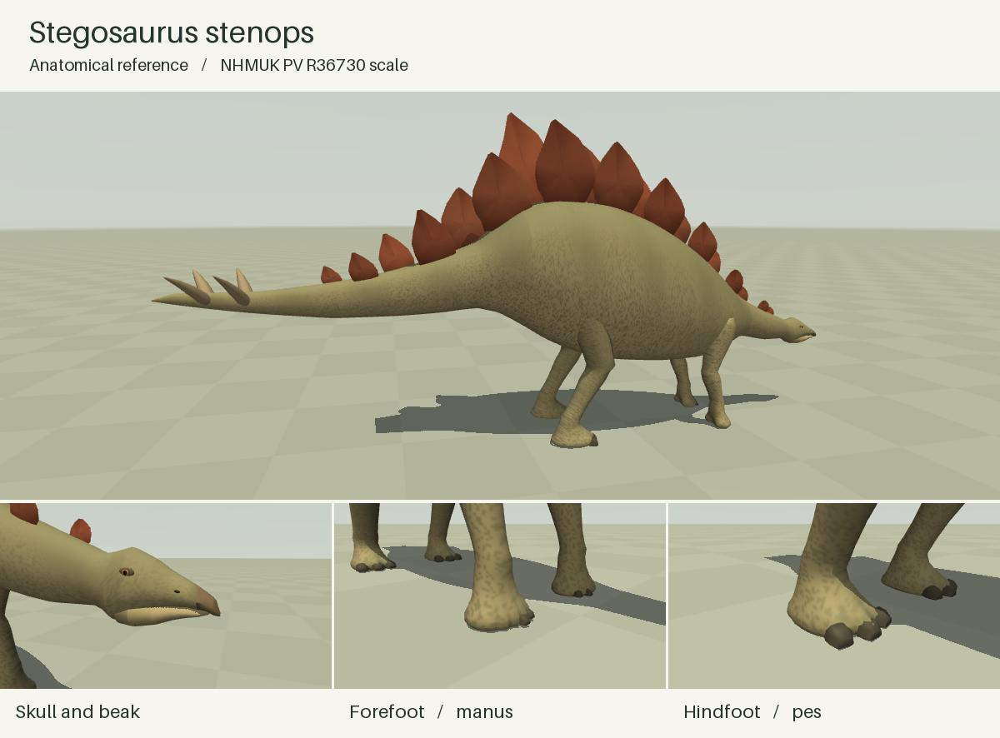
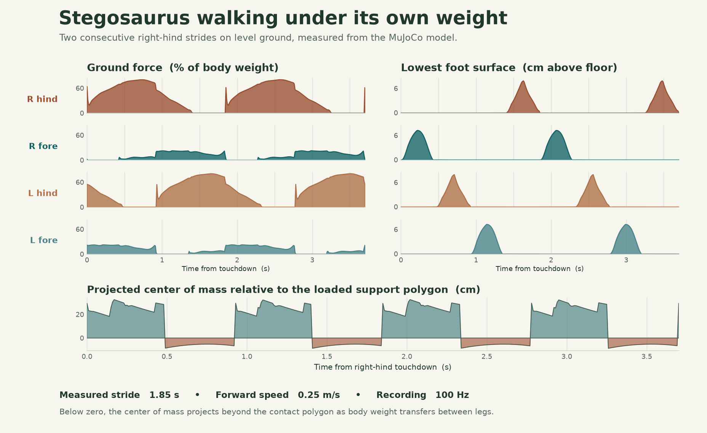

# Stegosaurus stenops

This free-standing, 5.79 m MuJoCo reconstruction represents a young adult at the scale of NHMUK PV R36730 (“Sophie”). It takes a slow, four-beat walk on level ground. The feet propel and support the floating body through contact with the floor.



## Review of the starting point

At revision `c096090`, the repository described Stegosaurus in its Phase 3 roadmap. Its species registry tests treated the name as unregistered. There was no existing Stegosaurus mesh, collision model, controller or recorded gait to measure. This example supplies a reference for anatomy and locomotion. The roadmap entry for the trainable environment remains open. [Original roadmap](https://github.com/kuds/mesozoic-labs/blob/c096090ebe51cf8529f62eb595a6b6659a696d65/docs/ROADMAP.md#L412)

The roadmap also attributed the main balance challenge to a high center of mass from the plates. A published volumetric reconstruction of Sophie assigns only 34 kg of its estimated 1,560 kg to dermal armour. A separate Stegosaurus reconstruction places roughly four-fifths of the standing load on the hindlimbs. The mass distribution here follows that posterior bias. Soft-tissue volumes and segment inertias are estimates. [Brassey et al., 2015](https://pmc.ncbi.nlm.nih.gov/articles/PMC4387493/) · [Mallison, 2014](https://fr.copernicus.org/articles/17/33/2014/)

## Anatomy and foot structure

| Feature | Model | Basis |
| --- | --- | --- |
| Snout to tail tip | 5.79 m in horizontal projection at rest | Sophie’s estimated length is 5.5–6 m |
| Head | 0.375 m, about 6.5% of model length | CT-measured skull length used as an external modeling target |
| Humerus / radius | 0.450 / 0.312 m | Right forelimb long-bone measurements |
| Femur / tibia | 0.868 / 0.498 m | Right hindlimb long-bone measurements |
| Shoulder / hip joint height | 0.95 / 1.49 m | Reconstructed posture, with a caudally directed elbow and forward knee |
| Armour | 19 staggered plates, tallest nominal blade 0.785 m, two pairs of distal tail spikes | 18 plates preserved and one inferred in the reconstructed series |
| Forefoot / hindfoot | Sole contact envelopes of approximately 0.16 × 0.25 m and 0.39 × 0.28 m, length × width | Forefoot bounding area about 37% of the hindfoot area |

The skull, long bones and armour dimensions come from the associated skeleton. Plate spacing, the precise left-right assignment, soft contours, pigmentation and keratin coverage are reconstruction choices. The total model mass is set to the preferred volumetric estimate for this individual, whose published 95% prediction interval is 1,082–2,256 kg. [Postcranial skeleton and armour](https://journals.plos.org/plosone/article?id=10.1371/journal.pone.0138352) · [CT skull study](https://pmc.ncbi.nlm.nih.gov/articles/PMC4873811/) · [Body mass estimate](https://pmc.ncbi.nlm.nih.gov/articles/PMC4387493/)

The forefoot has an upright metacarpal arcade and a short, broad pad. The hindfoot has a long heel cushion and three blunt anterior hooves. The two small medial forefoot nails are a reconstruction choice. Each foot has several points of contact, so its load can move across the sole. The size and shape comparison comes from *Deltapodus* trackways, for which the trackmaking species is uncertain. Soft sediment can also change apparent footprint length. [Metacarpal articulation](https://www.app.pan.pl/archive/published/app55/app20091105.pdf) · [Stegosaur track variation](https://www.nature.com/articles/s41598-024-64298-9)

## Mechanics

Each limb has four torque-driven rotational degrees of freedom. The controller places feet in world coordinates, transfers load toward planted feet, pitches the ankle during swing and solves the leg geometry for each step. A neutral body is free to translate, pitch, roll and yaw. Gravity and solved floor reactions determine the resulting motion. The neck and four tail segments respond passively through damped joints. The collision model resolves ground contacts. Joint torque limits and springs approximate active and passive support without modeling individual muscles or inter-limb collisions. The walk order and speed are engineering choices. Fossil tracks constrain foot proportions and track placement more directly than they constrain timing.

## Measured balance and walking

MuJoCo 3.10.0 integrated the free body at 500 Hz. A separate copy of the physics state supplied measurements at 100 Hz. The standing trial lasted 5 s, with measurements over 2.00–4.99 s after settling. The walk lasted 60 s, with strides scored over 4.00–59.99 s. [Full nominal measurements](validation.json)

| Measurement | Result |
| --- | --- |
| Standing balance | All four feet loaded. Hindfeet carried 80.49% of the weight. The center of mass projected at least 36.3 cm inside the polygon of loaded contact points. Maximum foot drift was 0.56 mm. |
| Forward walk | 13.94 m at 0.249 m/s in the scored window. Across 121 touchdowns, the order repeated right hind → right fore → left hind → left fore. |
| Stride and foot placement | Median stride of about 0.46 m per foot in 1.85 s. Minimum center-to-center track widths were 0.502 m fore and 0.568 m hind. The tracks stayed on their respective sides. |
| Swing and stance | The lowest foot surface cleared at least 7.23 cm in every complete forefoot swing and 7.86 cm in every complete hindfoot swing. Contact duty factors across the four feet were 75.8–77.8%. |
| Grip and support | The largest per-foot 95th-percentile slip speed under load was 1.46 cm/s. Three feet bore weight for 94.25% of scored samples and four feet for the remaining 5.75%. |
| Body motion | Peak pitch 0.17° and roll 0.66° over the full walk. The root moved 5.7 mm vertically and 22.3 cm from side to side over the scored window. The snout stayed at least 0.620 m high and the tail tip at least 1.111 m high in that window. |
| Joint and surface checks | No sampled joint exceeded its limit. Motor demand peaked at 97% of the configured limit during startup and 81% in the scored window. Only feet loaded the ground. The lowest visible sole stayed about 0.4 mm above it during steady walking. The compliant collision pads compressed into the floor by up to 3.6 mm. |



**The walk uses dynamic balance.** During weight transfer, the projected center of mass lay outside the instantaneous contact-point polygon in 47.8% of scored samples, by up to 8.8 cm. Limb torque, ground reactions and sideways acceleration kept the animal upright. The standing support margin describes quiet stance only.

Two further 24 s walks began with the body rolled 2° left or right and the lowest pad touching the floor. Both passed the same 21 checks and advanced about 4.98 m in their 20 s scoring windows. Separate level-ground trials with sliding friction coefficients of 0.65 and 0.85 also passed. Uneven terrain, turning and muscle capacity fall outside these trials. Colour, stride timing and torso sway remain hypotheses about a living animal.

A foot counts as load-bearing above 1% of body weight. Touchdown also requires a preceding swing with more than 5 mm of measured clearance, so unloading and reloading a planted foot counts once. Slip is the tangential speed at the ground contact point, including foot rotation, weighted by contact force. The support polygon uses individual floor contact points with more than 1 N of normal force.

## Run from a source checkout

Install the project with `python -m pip install -e .`, then use these commands from the repository root.

```bash
python -m examples.stegosaurus_stenops                       # live walk
python -m examples.stegosaurus_stenops --stand               # live stance
python -m examples.stegosaurus_stenops.validate              # headless checks and JSON measurements
python -m examples.stegosaurus_stenops.validate --walk-seconds 60
python -m examples.stegosaurus_stenops.validate --roll-deg 2
```

Close the live window or press Escape to stop. To inspect the neutral geometry in another MuJoCo application, open `model.xml` with `limb_skins.xml` beside it. The Python entry point drives the joint motors. After editing the anatomy, regenerate both files with `python -m examples.stegosaurus_stenops.build`.

For an image or MP4, install the project’s visualization extra with `python -m pip install -e ".[viz]"`.

```bash
python -m examples.stegosaurus_stenops.render --image anatomy.jpg --video walk.mp4
```
