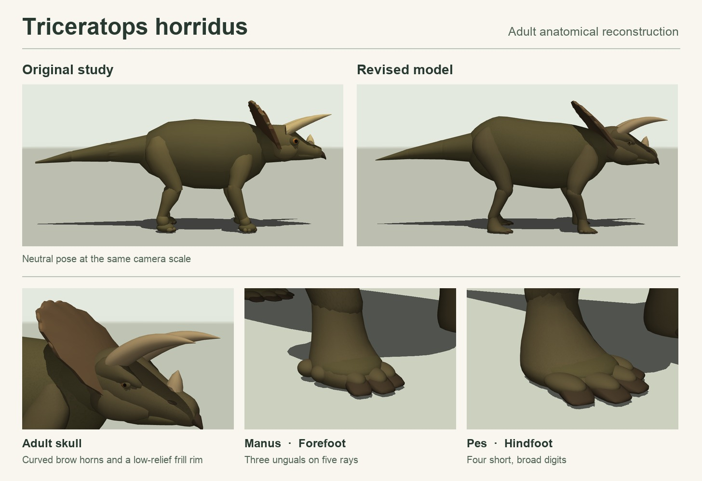
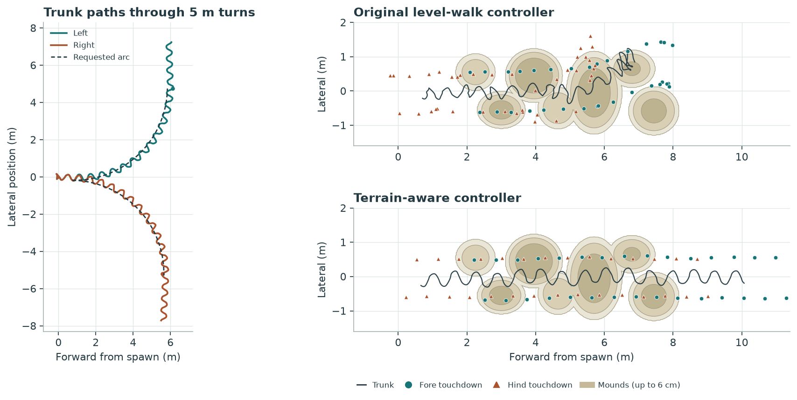

# Triceratops horridus · Anatomical

This adult *Triceratops horridus* measures 7.13 m from beak to tail in neutral pose. It stands under gravity and walks on four differentiated feet. In the level-ground reference trial it covered 7.47 m in 28.8 seconds. The clip shows four strides at actual speed, with ground contact measured at each foot. [Watch the walk](../../website/static/videos/triceratops_horridus_anatomical_reference_walk.mp4) · [Open the MuJoCo model](anatomical.xml)



## Review of the original adult

The animal linked from the species page was the full-size adult from design study #669. It already had an articulated jaw, a solid frill, five forefoot rays, four hindfoot rays, 26 torque controls and four foot-load sensors. The study exercised three seconds of standing and jaw opening. In a fresh ten-second passive stance, its forefeet supported 56.4% of body weight and its center of mass projected 0.604 m inside the contact polygon. The walking trials on the species page belonged to a separate 60 cm robot. [Original adult and study guide](https://github.com/kuds/mesozoic-labs/tree/84a13e1e7729ff4e92f1376db6464975836b3bcc/hardware/triceratops_design_study/models) · [Original regression](https://github.com/kuds/mesozoic-labs/blob/84a13e1e7729ff4e92f1376db6464975836b3bcc/hardware/triceratops_design_study/models/check_models.py)

Three features warranted revision. The shoulder and hip pivots lay close together relative to the long tail. The forearm spanned more than the upper arm, and the short femur gave the lower hindlimb almost the same length as the thigh. Finally, all four feet used the same three-pad footprint despite their different visible digits. The revised model moves the limb pivots, reshapes the trunk and tail around them, and gives the manus and pes distinct physical soles.

## Proportions and design

Measurements below use the neutral pose. Body and skull lengths are horizontal projections between visible landmarks. Limb measurements are distances between joint centers. The contact-pad dimensions enclose the three pressure pads in plan view and include the effect of foot rotation. [Measurement script](measure_proportions.py)

| Landmark | Original | Revised |
| --- | ---: | ---: |
| Beak to tail tip | 7.299 m | 7.129 m |
| Beak to rear of frill | 1.941 m | 2.216 m |
| First caudal pivot to tail tip | 2.960 m | 2.664 m |
| Shoulder to hip, socket centers | 1.976 m | 2.260 m |
| Greatest width of the fleshed ribcage | 1.680 m | 1.580 m |
| Humerus / forearm pivot spans | 0.766 / 0.810 m | 0.740 / 0.670 m |
| Femur / lower hindlimb pivot spans | 0.929 / 0.801 m | 1.045 / 0.712 m |
| Fore pad envelope, length × width | 0.425 × 0.304 m | 0.445 × 0.357 m |
| Hind pad envelope, length × width | 0.425 × 0.304 m | 0.529 × 0.400 m |

**Trunk and tail.** The torso now extends between more widely separated girdles. Three overlapping tail sections taper from a thick base above the hip. Erickson’s *T. prorsus* composite supplies a useful cross-check with a 2.46 m shoulder–hip distance, 2.77 m caudal series, 2.21 m skull and 1.50 m skeletal thorax width. Its 7.92 m body length follows the curvature of the skeleton. It combines multiple individuals of a different species and includes restored feet. The articulated *T. horridus* specimen P 256878 provides a separate visual reference. [Erickson, 1966, pp. 9–10](https://assets.ctfassets.net/x2t7lek2vf7h/77vRqtPqnjM1sVlcFhKLRF/2d2bca550c9f2d379549e929cfaedc74/paleontology-publications-mounted-skeleton-of-triceratops-propsus.pdf) · [Museums Victoria specimen P 256878](https://collections.museumsvictoria.com.au/specimens/2491830)

**Limbs.** The associated *T. horridus* skeleton RGM.1332500 has a 1.038 m femur, 0.720 m tibia, 0.708 m humerus, 0.628 m ulna and 0.408 m radius. The model’s lower-hindlimb-to-femur ratio changes from 0.86 to 0.68, close to the specimen’s 0.69. The skeletal view depicts a short radial shaft beside the longer ulna. Both move with one rigid forearm. The glenoid, elbow and wrist placements allow flexion with slight lateral elbow projection. [De Rooij et al., 2024](https://research-portal.uu.nl/en/publications/exploring-the-ceratopsid-growth-record-a-comprehensive-osteohisto/) · [Associated limb measurements, Table S1](https://dspace.library.uu.nl/bitstream/handle/1874/437182/phd_thesis_jimmy_de_rooij_naturalis-utrecht_university_2024_uses_307_-_65e85ade07002.pdf?isAllowed=y&sequence=1) · [Fujiwara & Hutchinson, 2012](https://pmc.ncbi.nlm.nih.gov/articles/PMC3350707/)

**Skull and skin.** Curved, forward-directed brow horns rise from a broader orbital region. The long muzzle carries a short nasal horn and a separate beak and lower jaw. A swept-back solid frill with low marginal ossifications overlaps the neck. An adult growth series supports the brow-horn curvature and the flattening of the frill rim. Skull shape varies within *Triceratops*, including differences between *T. horridus* and *T. prorsus*. The model’s full neutral span, including the horn sheaths, is 7.19 m. The frill plate reaches 3.20 m. The skin grain, pigmentation, horn sheath outlines and muscle volumes are artistic reconstructions. [Horner & Goodwin, 2006](https://pmc.ncbi.nlm.nih.gov/articles/PMC1635501/) · [Scannella et al., 2014](https://pmc.ncbi.nlm.nih.gov/articles/PMC4104892/) · [Museums Victoria, skin evidence](https://museumsvictoria.com.au/melbournemuseum/whats-on/triceratops-fate-of-the-dinosaurs/play/horridus-revealed/)

**Feet.** The compact forefeet carry broad unguals on digits I–III with reduced outer digits IV–V. The hindfeet have four short, broad toes and a wider heel contact. Fujiwara’s articulated manus supports a partly outward-facing hand. Ceratopsid trackways support outward-facing forefeet near the shoulders and a somewhat narrower hind track. The four short hind digits fit *Ceratopsipes* impressions, whose maker can be identified at the family level. A CT reconstruction of the ceratopsid hindfoot UALVP 42 also shows a reduced fifth metatarsal without an articular surface for a toe bone. The model uses 22° of outward rotation at each forefoot and 5° at each hindfoot. Those angles, the thickness of the heel cushion and the three-pad contact approximation are reconstruction choices. [Fujiwara, 2009](https://doi.org/10.1671/039.029.0406) · [Paul & Christiansen, 2000](https://gspauldino.com/Forelimb.pdf) · [Bell et al., 2025](https://doi.org/10.1371/journal.pone.0324913) · [Theurer et al., 2026](https://doi.org/10.1371/journal.pone.0353362)

## Balance and walking

The adult retains the study’s assigned mass of 5,936 kg. Cranial enlargement can shift ceratopsian mass forward, but the exact forelimb load depends on the reconstructed head, trunk and tail. Published volumetric estimates change with assumed soft-tissue volume and density. The load split here is a result of the specified simulation masses. [Maidment, Henderson & Barrett, 2014](https://pubmed.ncbi.nlm.nih.gov/25228349/) · [Dempsey et al., 2025, fig. 5D](https://doi.org/10.1111/brv.70026)

The check runs two independent trials on a level floor at Earth gravity. The first releases the animal at zero motor command for ten seconds. The second starts fresh and drives the sixteen limb axes with bounded torques. The root moves freely, and the neck, head and tail respond through their springs and dampers. MuJoCo advances the body at 500 Hz. Contacts and pose are sampled at 100 Hz. The walking window covers twelve 2.4 s strides after a 5.6 s start-up. [Controller](reference_walk.py) · [Executable checks](check_anatomy.py) · [Measured results](validation.json)

| Measurement | Simulation result |
| --- | --- |
| Quiet stance | All four feet loaded. Forefeet carried 54.8% of weight. The center of mass projected 0.691 m inside the hull of loaded pad contacts. |
| Footfall order | Left hind → left fore → right hind → right fore, repeating. Each foot completed 12 swings. Three or four feet carried weight at every sample. |
| Forward motion | 7.47 m in 28.8 s (0.259 m/s). Net sideways displacement 3.9 cm. Median stride 0.622–0.623 m per foot. |
| Placement | Mean left–right sole spacing 1.210 m in front and 1.103 m behind. Each foot stayed on its own side. |
| Swing and stance | Forefeet cleared the floor by a median 3.87 cm at peak swing and hindfeet by 3.31–3.32 cm. Feet were loaded for 79.5–80.5% of the stride. |
| Sliding and compliance | Load-weighted tangential speed at pad contacts averaged 1.43 cm/s. The deepest penetration of a compliant contact pad was 4.2 mm. |
| Body motion | Trunk height varied by 5.1 mm, maximum tilt was 0.23°, and heading deviated by at most 1.54°. Neck pitch varied by 0.62°, skull pitch by 0.59° and tail-base yaw by 3.87°. |
| Dynamic balance | The projected center of mass stayed in the instantaneous contact hull for 97.9% of samples. Its greatest excursion beyond an edge was 1.33 cm. |

The checker counts a foot as loaded above 1% of body weight. A touchdown requires a preceding swing with more than 5 mm of pad clearance. This separates a step from a foot briefly unloading on the floor. Contact slip includes the velocity due to foot rotation. It also checks the closed surfaces of all 27 meshes, including the thin outer rim of the frill. The checker verifies the four touch sensors against the forces at the floor, detects ground strikes by other body parts, and exercises the articulated jaw. [MuJoCo contact and constraint forces](https://mujoco.readthedocs.io/en/stable/computation/index.html#contact)

Two further runs changed the sliding friction of the floor and all twelve pads from the default 0.90. At 0.65, the model walked at 0.257 m/s with three or four feet loaded at every sample. At 1.05, it walked at 0.259 m/s with three or four feet loaded at 99.7% of samples and two at the rest. Both runs preserved the four-beat sequence. Each had two brief unloadings without a new swing. The average pad slip was 1.38 and 1.59 cm/s, respectively. Repeat with `--friction 0.65` or `--friction 1.05`.

The trial validates a slow straight walk for this model. The timing, ground friction, motor limits and passive stiffness are chosen inputs. Limb torque commands reached their modeled limits in 3.15% of limb-motor samples. The very small trunk excursions reflect those settings.

## Turns, slopes and uneven ground

**Turning.** The earlier level-walk controller continued straight through either turn request. Its heading changed just 1.3° in 31.2 s. The revised controller eases into a turn, directs each foot along its own arc, and transfers more weight sideways before lifting the inner foot. Each test has a 5.6 s straight entry, 13 strides at a requested 5 m radius and four straight strides along the exit tangent. The reference circle is fixed by the entry position and heading. [Turn controller](reference_walk.py) · [Turn checks](check_turns.py) · [Before-and-after measurements](course_validation.json)

| Requested turn | Heading change | RMS radial error, original → revised | Inside / outside stride | Straight exit distance |
| --- | ---: | ---: | ---: | ---: |
| Left | +91.1° | 2.08 → 0.158 m | 0.558 / 0.699 m | 2.48 m |
| Right | −90.1° | 2.34 → 0.156 m | 0.561 / 0.694 m | 2.51 m |

Each foot completed 13 swings through either arc in the four-beat order. At least three feet bore weight at every sample from turn entry through exit. Each sole stayed at least 35 cm on its own side of the trunk. The smallest peak swing clearance was 2.87 cm, and mean slip was 1.89 cm/s in both directions. The center of mass briefly projected up to 3.53 cm beyond the loaded contact hull.

**Slopes and uneven ground.** The original controller repeatedly unloaded planted feet on the slopes. On the seven-mound course it briefly had only one loaded foot, drifted 1.24 m sideways and finished with its hind feet 2.43 m short of the last mound's far edge. The terrain-aware controller samples the known ground height under the planned sole, toe and heel. It adjusts foot height and pitch, shifts weight across a bank, and uses each sole's measured load to extend a prematurely unloaded stance leg by up to 1.6 cm. Only the sixteen existing leg motors drive the walk. The model starts aligned with the slope and the root moves freely throughout each trial. [Terrain controller](terrain_walk.py) · [Course geometry](courses.py) · [Terrain checks](check_terrain.py)

| Course | Progress | Samples with ≥3 loaded feet | Mean pad slip | Shallow reloads, original → revised | Worst center-of-mass margin |
| --- | ---: | ---: | ---: | ---: | ---: |
| 5° ascent | 7.04 m | 100% | 1.94 cm/s | 50 → 0 | −4.68 cm |
| 5° descent | 7.73 m | 100% | 2.33 cm/s | 16 → 0 | −6.86 cm |
| 3° bank, left side high | 7.43 m | 100% | 1.87 cm/s | 41 → 0 | −8.39 cm |
| 3° bank, right side high | 7.42 m | 100% | 1.88 cm/s | 27 → 0 | −8.30 cm |
| Seven staggered mounds | 9.41 m | 99.94% | 2.08 cm/s | 118 → 4 | −5.28 cm |
| Same mounds mirrored left–right | 9.26 m | 99.92% | 2.14 cm/s | 121 → 5 | −7.64 cm |

The slopes use 12 scored strides (28.8 s). The trunk rose 0.612 m uphill and dropped 0.674 m downhill. Each uneven route uses 15 scored strides (36 s) over rounded features 3.5–6.0 cm high. All seven bore weight on both routes. Both hind sole centers finished beyond the last mound, by at least 0.84 m on the original layout and 0.73 m on its mirror. Two feet supported the body during the remaining uneven-ground samples. The smallest peak swing clearance was 3.09 cm across both layouts. Every consecutive touchdown followed the intended sequence on all six courses, and no other body part contacted the ground under load.



A shallow reload is a drop below 1% of body weight followed by reloading without a swing that clears the terrain by more than 5 mm. Clearance uses the nearest physical ground surface, and slip uses the contact's local tangent plane. A negative margin measures how far the center of mass projects outside the horizontal hull of pad contacts carrying more than 1 N. This instantaneous geometric measure can be negative during a step while the animal remains upright. [Shared measurements](../shared/README.md) · [MuJoCo geometry distance and contact force](https://mujoco.readthedocs.io/en/stable/APIreference/APIfunctions.html#mj-geomdistance)

Additional 12-stride trials passed at 8° uphill and downhill and on both 5° banks. The 8° descent approached the test limit most closely. Its center of mass moved 11.82 cm beyond the instantaneous support hull, against a 12 cm limit. These results apply to a slow walk with a known height map and fixed friction. Faster gaits, turns on slopes, terrain sensing and biological muscle capacity remain untested. [Full course results](course_validation.json)

## Reproduce from the repository root

```sh
python -m pip install mujoco==3.10.0 numpy
python -m examples.triceratops_horridus.measure_proportions
python -m examples.triceratops_horridus.check_anatomy
python -m examples.triceratops_horridus.check_turns
python -m examples.triceratops_horridus.check_terrain
python -m examples.triceratops_horridus.reference_walk --course uneven
```

All measurement commands run headlessly. Add `--baseline` to either course checker to reproduce the original controller comparison. Use `check_turns --case left --trace-dir /tmp/turns` or `check_terrain --course uneven --trace /tmp/uneven.npz` with the same module prefixes to save timed traces. For the extended slopes, run `check_terrain --course uphill_8deg --course downhill_8deg --course cross_left_5deg --course cross_right_5deg`.

The last command opens a desktop viewer. Use `--course turn_left`, `--course downhill` or another course name to watch that trial. On macOS, start the viewer with `mjpython` in place of `python`. To inspect the resting model, open `anatomical.xml` directly in MuJoCo. In the viewer’s geom groups, hide group 2 and show group 4 to inspect the skeletal landmarks. The validation command accepts `--trace walk.npz` to save timed poses and measured foot loads.

Other species can supply their own foot geoms, controller and acceptance limits to the same measurements. The shared regression runs the existing Stegosaurus controller over a raised mound. [Reuse the walking courses](../shared/README.md) · [Cross-species tests](../../environments/shared/tests/test_locomotion_courses.py) · [Triceratops regression matrix](../../environments/shared/tests/test_triceratops_reference.py)
