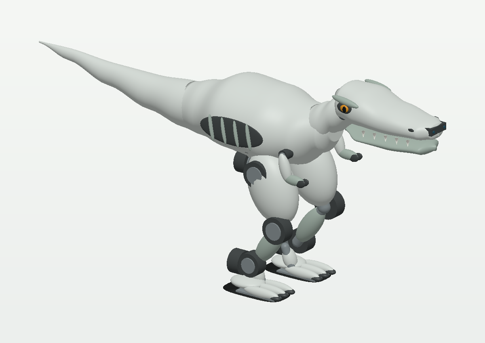

# One-metre T-Rex character concept

A stocky, head-led T-Rex-inspired robot with the rounded, tapered **silhouette C** skull, side eyes, cream jaw, short arms and a removable wagging tail. The visible motor covers and removable torso panels make the mechanism part of the character.

**Concept only:** the generated MJCF contains assigned component masses and ideal torque-bounded actuators. It is not fabrication CAD, a trained walking policy, a measured power model, or a physically qualified robot.



## Design envelope

| Item | Current design |
|---|---|
| Height, at the home pose | 1.000 m to the top of the skull |
| Nose-to-tail length | 0.901 m |
| Maximum width, including arms | 0.542 m |
| Hip pitch height | 0.445 m |
| Thigh / shin pivot distance | 182.5 / 185.5 mm |
| Sole footprint, each | 280 × 140 mm |
| Foot centre spacing | 270 mm |
| Assigned mass, including reserve | 25.144 kg; unweighed |
| Explicit integration reserve | 1.800 kg near the pelvis |
| Degrees of freedom | 12 leg + 6 expression joints, with a free base |
| Expression | Head yaw/nod, jaw, one lift joint per arm, tail yaw |

Height alone is not the design requirement. The generous torso and hip volume accommodate a battery, power distribution, controller, cooling and cable access. The head is a hollow cosmetic assembly with a light frame; computing and battery mass remain in the body. The tail is for expression, not a heavy balancing counterweight.

The source of mass is [components.json](components.json). Decorative meshes do not determine inertia. Each component has an assigned mass, location and box inertia surrogate, aggregated with the parallel-axis theorem. A nominal supplier motor mass does not make the assembled robot's mass measured.

## Mechanical layout

Each leg has hip yaw, hip roll, hip pitch, knee pitch, ankle pitch and ankle roll. Integrated motor cases are represented at the joints; no motor is hidden in a zero-volume joint. Bearings, output brackets, shafts, cable bend radii and screw access still need supplier-CAD integration.

The home pose has modest knee bend rather than a deep crouch. Large toes cover a flat rubber sole. Ankle hardware remains accessible. The battery slides out through a rear service opening in the intended construction; the simulation's service view only hides panels and does not prove the extraction path.

The head uses a short two-axis neck and a U-shaped jaw that leaves room around it. Arms have one powered shoulder each; forearms and hands are rigid lightweight shells. Tail yaw is driven at its root, with a light spar and shell extending rearward. The demonstrated gesture amplitudes are deliberately smaller than the joint limits. Full simultaneous joint-range clearance is not established by a standing demonstration.

## Sensors and control

The forward depth camera is in the **chest, not the eyes**. Its fixed position avoids sweeping the main perception view during head gestures. The eyes are cosmetic; a future head camera must be added to the mass ledger and budget.

A pelvis IMU, joint encoders and four load/contact locations per foot provide the intended proprioception. MuJoCo's ideal gyro, accelerometer, orientation, joint and touch channels do not model sensor bias, noise, time synchronization, load-cell calibration or electrical interfaces. The ground-support tests sum actual foot–floor contact forces rather than relying on touch readings alone.

See [hardware.md](hardware.md) and [bom.csv](bom.csv) for proposed parts, dated budget, power architecture and procurement uncertainties.

## Run from a checkout

Install the repository's test dependencies, which include MuJoCo and the CPU renderer dependencies:

```bash
python -m pip install -e ".[test]"
python -m examples.tyrannosaurus_rex_100cm.build_model
python -m examples.tyrannosaurus_rex_100cm.validate
python -m examples.tyrannosaurus_rex_100cm.render_design
python -m examples.tyrannosaurus_rex_100cm.demo --view --gesture
pytest environments/tyrannosaurus_rex/tests/test_tyrannosaurus_rex_100cm.py -v
```

Open `model.xml` in a MuJoCo viewer, with `assets/` beside it, or use the example's `demo` module. The generated model and assets are committed so generation is optional.

## What the checks establish

[validation.json](validation.json) records the actual run, software versions and source hashes. The checks reject an active torso fixture, gravity compensation, external applied forces and support through anything except the two soles. They measure actual floor loads, torso tilt, drift, self-contact, joint limits and actuator effort during short stance, gesture and small angular-disturbance trials.

These are basic assembly and stance regressions. They do **not** establish stepping, single-support transitions, walking speed, recovery from falls, public-operation readiness, motor temperature or battery runtime. No walking controller is delivered with this concept.

The home-pose motor-case distance query bypasses parent–child contact filtering. It checks the case envelopes only; it does not prove clearance for connector backshells, brackets, cooling plates or every combination of joint angles.

Before fabrication, resolve the exact actuator SKU and supplier drawings, structural load paths, bearings, stops and wiring. Before walking, validate a tethered single leg under representative loads, measure the actuator response and power system, then develop weight transfer and stepping against those measured limits.

## Repository placement

This remains a checkout-only example alongside the mini and medium concepts. It does not replace any registered plant, change a registered policy interface, or create a new registered embodiment. A future variant-aware catalog can name this the `large` build while retaining the species identity.
