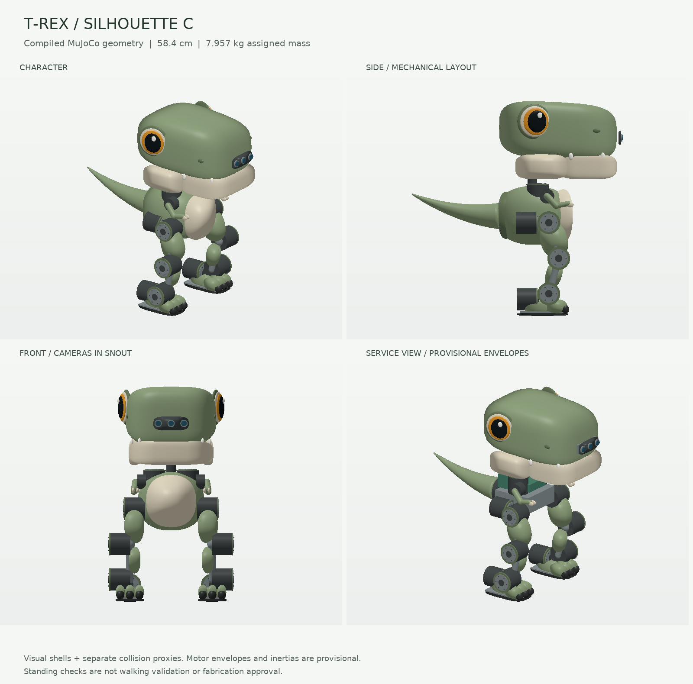
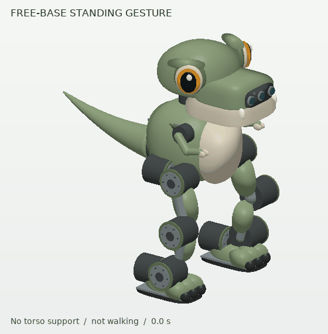

# 50 cm Tyrannosaurus Rex — MuJoCo concept

An articulated interpretation of the sage-green cartoon concept, with cosmetic
amber eyes, three snout-camera apertures, a cream jaw/belly, tiny independent
arms, exposed joint housings, broad three-toed feet and a tapered wagging tail.
This is a **separate standalone example**; the mini and registered training
plants/checkpoints are unchanged.



The [latest character study](head_study/README.md) makes a broad skull and jaw
the main feature, with a compact torso underneath. It compares rounded-box,
long-oval and soft-wedge skulls at roughly 58–59 cm, retaining the earlier round
heads for context. It records head mass, proportions and gesture effort.
This supersedes the aesthetic recommendation in the earlier
[torso-size study](proportion_study/README.md), whose geometry, simulations and
budget calculations remain available for context. These are exploratory models;
the default below remains unchanged.

| Property | Current model |
| --- | --- |
| Home height | **515 mm** including brow shells |
| Home width / nose-to-tail length | **341.4 / 511.5 mm** |
| Assigned mass | **7.617 kg**, including the 600 g integration reserve |
| Base | Free joint, gravity and ground contact; no default external support |
| Leg joints | 12: hip yaw/roll/pitch, knee, ankle pitch/roll on each side |
| Character joints | 6: independent arms, head yaw/nod, jaw and tail yaw |
| State / controls | `nq=25`, `nv=24`, `nu=18`; 48 sensor entries |
| Actuation approximation | Ideal PD position drives; ±4 Nm legs, ±0.6 Nm head, ±0.1 Nm arms/jaw/tail |
| Sensors | Joint position/velocity, pelvis IMU, ideal orientation/CoM, four touch regions per foot |
| Cameras | `snout_left`, `snout_rgb`, `snout_right`; illustrative poses/FOV, not hardware calibration |

Dimensions are measured from the compiled home geometry. The resulting length
is shorter than the earlier 550–650 mm sketch reservation; this is a first
layout, not a requirement to enlarge the robot. Legs and visible actuator cases
are intentionally more exposed than in the concept art so the proposed joint
layout can be inspected.

## Open and use it

From a repository checkout with the project dependencies installed:

```bash
python -m examples.tyrannosaurus_rex_50cm.demo --view
python -m examples.tyrannosaurus_rex_50cm.demo --view --gesture
```

On macOS, use `mjpython` in place of `python` for the interactive viewer.
Both commands use a free base. `--support` explicitly enables a display-only
torso weld; the viewer prints that mode. It must not be mistaken for balance
control. The XML can also be opened directly in MuJoCo with its `assets/`
directory alongside it:

```python
import mujoco

model = mujoco.MjModel.from_xml_path("examples/tyrannosaurus_rex_50cm/model.xml")
data = mujoco.MjData(model)
mujoco.mj_resetDataKeyframe(model, data, model.key("home").id)
mujoco.mj_forward(model, data)
```

The `home` keyframe holds all hinge targets at zero; the bent-leg geometry is
built into the link offsets. Controls are joint-angle targets in radians, in
the named actuator order in [validation.json](validation.json). They are not
direct hardware torque commands or a trained policy interface.

CPU rendering does not need an OpenGL connection. It reuses the mini example's
renderer, which reads MuJoCo's compiled mesh vertices and geom transforms. The
repository `viz` extra provides Pillow through matplotlib:

```bash
python -m examples.tyrannosaurus_rex_50cm.demo --render /tmp/trex50.png
python -m examples.tyrannosaurus_rex_50cm.demo --render /tmp/trex50_service.png --service
python -m examples.tyrannosaurus_rex_50cm.render_design \
  --gif examples/tyrannosaurus_rex_50cm/standing_gesture.gif
```



This animation samples an actual 4.8-second MuJoCo rollout with the torso weld
disabled. It shows head, jaw, arms and tail motion; the feet do not take steps.
The first and last frames are not an identical state, so the GIF loop resets.

## Mass, geometry and hardware assumptions

The [65-component ledger](components.json) reconciles every mass category with
the [detailed parts budget](../../docs/hardware/studies/trex_50cm/parts_budget.json).
It includes the camera, electronics, battery, wiring and reserve. Component
positions and box-surrogate inertias are assigned estimates; the generator
combines them with the parallel-axis theorem. Decorative shell volumes do not
silently add solid-plastic mass. The head-yaw subtree is 350 g, including the
nod motor, camera, jaw drive and head structure/shells.

The twelve **60 mm diameter × 55 mm** leg motor cases are provisional packaging
envelopes for the proposed RMD class, **not verified supplier drawings**. The
larger external disks are cosmetic rims. Actual output bearings, mounting
patterns, wiring exits, bracket strength and actuator versions remain unresolved.
The service view's electronics boxes are schematic allocations, not a packed
and interference-checked electronics bay. In particular, hiding the panels
does not demonstrate that all internal parts fit together.

Visual geometry is separate from collision proxies:

- Group 0: floor.
- Groups 1–2: rounded shells, cosmetic eyes/teeth, links, actuator housings and feet.
- Group 3: collision proxies and foot-contact regions; hidden by the example viewer.
- Group 4: schematic electronics/battery envelopes, shown by `--service`.

Foot soles, structural links, motor-case proxies, torso, head, jaw, arms and tail
have collision geometry. The usual MuJoCo exclusion between directly connected
bodies still applies. Zero reported internal contact is a statement about the
active collision proxies, not a CAD clearance certificate for every decorative
surface, attached bearing or component inside a rigid body.

The ±4 Nm leg caps deliberately avoid treating 10 Nm peak as continuous output.
Nevertheless, these are ideal PD actuators: torque-speed curves, heating,
electrical supply/regeneration, bus delay, gearbox compliance/backlash and
friction calibration have not been implemented. Joint limits are preliminary
motion ranges, not proof that every simultaneous combination is collision-free.
Camera optics, stereo baseline and touch sensors also require real calibration.

## Validation and build regressions

Run the committed checks:

```bash
python -m examples.tyrannosaurus_rex_50cm.validate
pytest environments/tyrannosaurus_rex/tests/test_tyrannosaurus_rex_50cm.py
```

The recorded MuJoCo 3.10.0 result has:

| Trial | Duration | Minimum root-height ratio | Maximum torso tilt | Maximum internal penetration |
| --- | ---: | ---: | ---: | ---: |
| Free stance | 10 s | 0.9913 | 2.55° | 0 |
| Free standing gestures | 10 s | 0.9913 | 2.55° | 0 |
| Explicitly supported gestures | 10 s | 0.9992 | 0.10° | 0 |

No numerical warnings occurred. In free stance, the largest leg RMS/peak effort
was approximately **1.74 / 2.28 Nm**. These are double-support standing results,
not substitutes for the earlier walking similarity calculation. Home has eight
sole/ground contacts and no active internal contacts. The full result records
actuator effort, sensor loads, joint excursions, model version and source hashes.

The 24 model tests cover mass/inertia reconciliation, dimensions and motor
envelopes, forward knees, legal joint ranges, camera/foot-sensor attachment,
gravity/free-base/no-hidden-support conditions, unsupported stance/gestures,
bounded effort, canonical numeric serialization and deterministic regeneration. A deliberately underpowered
0.1 Nm leg configuration must fail the stance check. CI path filters and both
typing jobs include this example; the two workflow-contract tests protect the
mini and medium examples from becoming untested when only assets change.

**This model has not demonstrated walking, push recovery or hardware viability.**
The supported trial is display-only. The unsupported trials use broad soles,
ideal feedback and a flat floor. Next work is to resolve real component CAD and
joint travel, measure actuator response, and develop a gait with single-support,
friction, delay and disturbance tests.

## Regenerate

```bash
python -m examples.tyrannosaurus_rex_50cm.build_model
```

This deterministically writes `model.xml`, `components.json` and the three OBJ
visual assets. Edit the generator rather than those outputs, then rerun tests,
validation and rendering. The model remains outside the species/plant registry
until the [variant architecture](../../docs/hardware/ROBOT_VARIANTS_AND_BUILD_PLAN.md)
and its policy/artifact compatibility rules are implemented.
