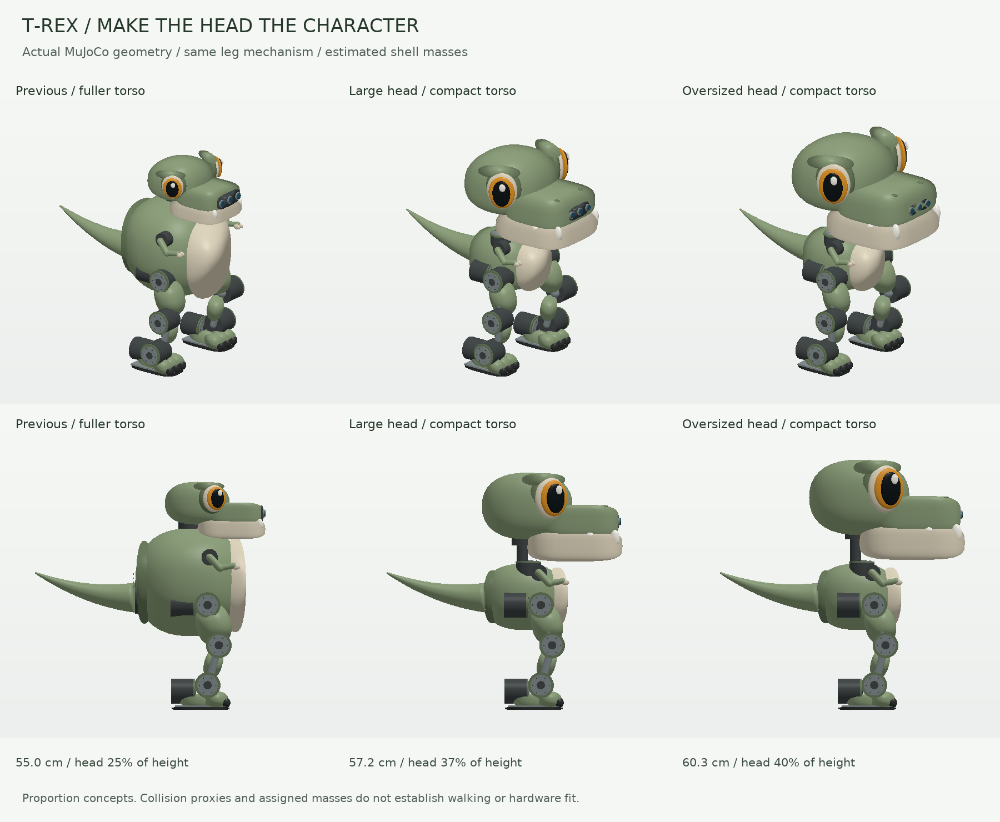

# T-Rex character study: the head is the main feature

**Current design direction, 2026-10-24:** an oversized T-Rex skull and jaw
above a compact torso. Enlarging the torso made the previous design's head
less prominent. This study changes that relationship directly, instead of
continuing to grow the chest. The **57.2 cm option** is the preferred next
direction; the **60.3 cm option** explores a more exaggerated head.



Both alternatives retain the existing leg mechanism, feet, actuators, tail
and camera hardware. They use a 200 × 180 × 160 mm torso shell, a recessed
neck support, fuller upper-thigh covers and tiny arms. The broad skull,
deep cream jaw, inset amber eyes, small teeth and nostrils carry the character.
The head should read as a friendly T-Rex from its silhouette; the torso is
a small equipment pod underneath. This takes the idea of a recognizable
head as the main feature without copying Microduck's duck-shaped face.

## Measured proportions

These dimensions come from the compiled visual geometry at the home pose.
Head measurements include skull, snout, jaw, eyes and teeth, excluding the
neck motors. Vertical regions overlap, so their heights are not additive.

| Property | Previous fuller torso | Large head | Oversized head |
| --- | ---: | ---: | ---: |
| Overall height | 550 mm | 572.1 mm | 603.5 mm |
| Head length × width × height | 242.5 × 220.3 × 138.0 mm | 338.8 × 296.0 × 213.9 mm | 375.1 × 326.6 × 241.5 mm |
| Head height / total height | 25.1% | 37.4% | 40.0% |
| Head width / torso-shell width | 0.96× | 1.64× | 1.81× |
| Assigned total mass | 8.067 kg | 7.957 kg | 8.062 kg |
| Moving head-yaw subtree | 350 g | 530 g | 635 g |
| Home center-of-mass height | 236.9 mm | 236.5 mm | 240.6 mm |

The middle option has the more restrained proportions and lower neck/jaw
demand. The 60 cm option now gains height in the head, which contributes to
its character, instead of a tall barrel-shaped torso. Neither choice requires
making the legs longer. These remain alternatives for one medium build.

## Mass and mechanism assumptions

The larger head is a hollow lightweight assembly. The 57 cm case assigns
220 g to the upper shell, 60 g to the jaw, 50 g to head structure and 39 g
to head bearings. The camera, jaw motor and head-nod motor keep their actual
baseline allocations. Together these form the 530 g moving yaw subtree;
the fixed yaw motor and a 50 g neck support allowance are outside that sum.
The 60 cm case increases upper shell/jaw/structure to 300/75/60 g, producing
a 635 g moving yaw subtree. These are **unweighed design allocations**.

The torso shell is 130 g, pelvic structure 300 g and each thigh cover 35 g.
The 600 g integration reserve remains intact. Battery placement stays low;
the existing compute tray moves down 20 mm. Box-surrogate inertias are
recomputed from the component ledger. Enlarged visual surfaces do not silently
add solid-plastic mass, nor are head motors or the camera scaled with the shell.

The camera package translates forward inside the deeper snout; its dimensions,
three aperture sizes and nominal 70 mm stereo-camera separation stay fixed.
The eyes remain cosmetic. Optical calibration and the actual package's fit
are not established by the virtual camera placement.

The neck support is represented by a visible and collidable strut connecting
the body to the head mounting region. Its fasteners, output bearings and
bracket strength still need design. The head should remain close to the neck
pivot and lightweight; a large display, battery or computer in the head would
require a new mass and inertia study.

## Short simulation checks

[Recorded results](results.json) cover ten seconds of free stance and ten
seconds of standing gestures per model. They use the same ideal drives,
gravity, floor friction and actuator caps as the baseline. There is **no
external torso support** and no increased torque cap to accommodate the head.
All six trials pass without numerical warnings or internal proxy contacts.

| Gesture measurement | Previous fuller torso | Large head | Oversized head |
| --- | ---: | ---: | ---: |
| Largest neck-axis peak torque | 0.134 Nm | 0.315 Nm | 0.425 Nm |
| Head-nod RMS torque | 0.111 Nm | 0.241 Nm | 0.314 Nm |
| Jaw peak torque | 0.017 Nm | 0.054 Nm | 0.079 Nm |
| Largest leg-joint RMS effort | 1.929 Nm | 1.763 Nm | 1.749 Nm |

The provisional neck limit is ±0.6 Nm and jaw limit ±0.1 Nm. Both heads yaw,
nod and open their jaws through the programmed gesture; tests assert actual
motion rather than checking only whether clipped outputs stay within caps.
The oversized jaw already reaches about 79% of its simulated cap in this
gentle sequence. The head-nod drive also has gravity deflection: maximum
stance excursions from its zero target are about 2.5° and 3.4° for the two
new heads. Feed-forward compensation and measured motor behavior remain work
for a real controller.

Lower leg RMS is not proof of better walking or recovery: the new torso has
less assigned mass, the fore/aft load distribution changes and head rotational
inertia rises. **No walking, single-support, push-recovery, torque-speed,
power, temperature or durability qualification is claimed.** Collision proxies
are simplified and MuJoCo's default parent/child filtering remains active.
The small gesture does not establish clearance across every joint's range.

No new motor or computer is selected in this study. The prior parts budget
provides context, but this is not a fresh fabrication quote or evidence of
cost savings. Confirm the character proportions before refining supplier CAD,
shell construction, packing, bearings and the head weight budget.

## Files and reproduction

- [57.2 cm model](large_head/model.xml) and [component ledger](large_head/components.json).
- [60.3 cm model](oversized_head/model.xml) and [component ledger](oversized_head/components.json).
- [Recorded trials and source hashes](results.json).
- [Earlier torso-size comparison](../proportion_study/README.md), retained for context.

Keep the repository directory structure: the XMLs share `../../assets`.
Open an XML in MuJoCo and reset to the `home` keyframe. Regenerate with:

```bash
python -m examples.tyrannosaurus_rex_50cm.head_design --render
python -m pytest environments/tyrannosaurus_rex/tests/test_tyrannosaurus_rex_50cm.py
```

The model test module now has 21 cases. The two new cases check the dominant
head proportions, retained reserve, unchanged leg anchors/motor caps/camera
dimensions and actual free-standing head/jaw motion. The original default
model, registered training plants and their interfaces are unchanged.
