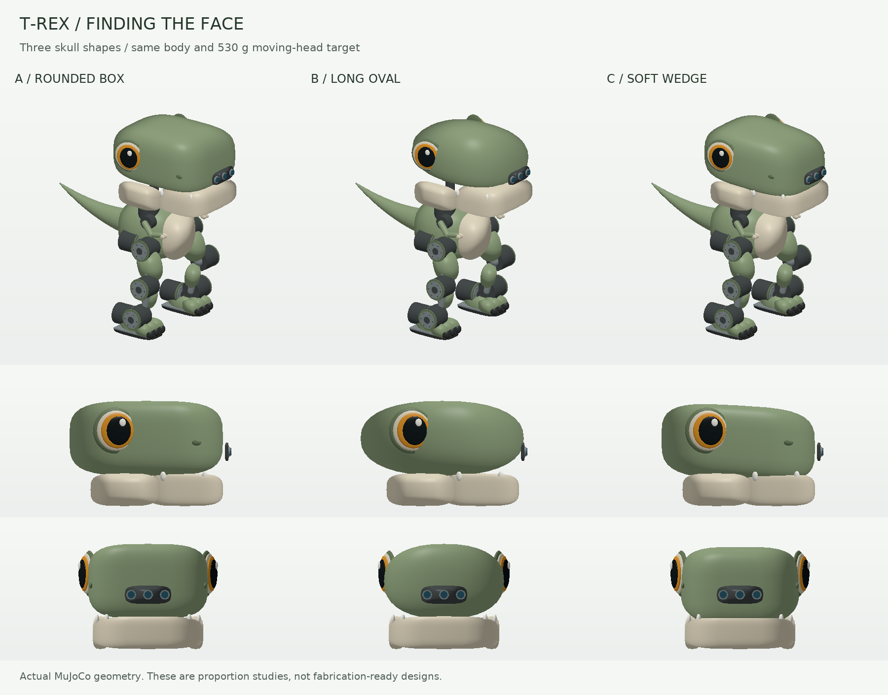

# T-Rex character study: finding the face

The head carries the character above a compact equipment torso. The current
exploration compares **a rounded box, a long oval and a soft wedge**. Each uses
one upper-skull volume, side eyes below its top outline, a deep cream jaw,
small teeth and a snout camera. This removes the separate round cranium,
raised brows and broad shallow muzzle that made the earlier design read as
frog-like. These are alternatives for one medium build, not three robots to
manufacture. No final character shape has been selected by the user.



## Design choices

| Option | Character | Consideration |
| --- | --- | --- |
| A: rounded box | Strong toy-like silhouette; flat forehead and soft corners | Avoid a featureless rectangular block; keep generous corner radii |
| B: long oval | Softest, friendliest expression; continuous curved skull | Keep it elongated front-to-back and retain a deep jaw to avoid the amphibian look |
| C: soft wedge | Deeper rear skull and a gently tapering blunt snout | Best starting point for a more recognizable dinosaur; keep the taper gentle |

The current design recommendation is to compare **C's mild taper with A's
rounded rectangular structure**. B remains a useful softer alternative.
Expression, eye recesses and jaw seams still need surface design. The MJCF
uses simple overlapping visual surfaces rather than fabricated panel CAD;
an artistic concept rendering must not be mistaken for those exact surfaces.

All three share a 200 × 180 × 160 mm torso shell, existing leg dimensions,
feet, actuators and caps. The battery remains low and compute remains in the
torso. The eyes are cosmetic; the camera package remains in the snout, with
unchanged aperture sizes, package dimensions and nominal 70 mm stereo baseline.
Its physical fit and optical calibration remain unqualified.

## Dimensions and assigned masses

Measurements use the compiled visual geometry at the home pose. Head bounds
include skull, eyes, teeth and jaw, excluding neck motors. Vertical regions
overlap; their heights are not additive.

| Property | A: rounded box | B: long oval | C: soft wedge |
| --- | ---: | ---: | ---: |
| Overall height | 590.0 mm | 590.0 mm | 583.6 mm |
| Head length × width × height | 337.5 × 291.2 × 219.0 mm | 347.5 × 275.2 × 219.0 mm | 337.5 × 291.2 × 212.6 mm |
| Head height / total height | 37.1% | 37.1% | 36.4% |
| Assigned total mass | 7.957 kg | 7.957 kg | 7.957 kg |
| Moving head-yaw subtree | 530 g | 530 g | 530 g |
| Retained integration reserve | 600 g | 600 g | 600 g |

The 530 g target includes a 220 g upper shell, 60 g jaw, 50 g head structure,
39 g bearings, 61 g camera, 18 g jaw motor and 82 g nod motor. The fixed yaw
motor and a 50 g neck-support allowance are outside that sum. These are
**unweighed allocations**, not measured assemblies. Component positions and
box-surrogate inertias follow each shape; the oval and wedge do not silently
inherit identical upper-shell inertias. Enlarged shells are not solid plastic.

Compared with the earlier 57.2 cm head, the yaw mount is 23 mm higher and the
shoulders are 6 mm lower. The deeper jaw is **U-shaped around the neck**, with
front and side portions represented in both visual and collision geometry.
Its pivot is near the rear of the skull and its motor allocation follows the
new pivot. These adjustments remove interference in the short gesture trial;
they do not establish full-range clearance. Motor dimensions and torque caps
are not increased to accommodate the shape change.

## Short simulation checks

[Recorded results](results.json) contain ten seconds of free stance and ten
seconds of standing gestures for each of the six compared configurations.
All twelve trials pass, with no numerical warnings or internal proxy contact
penetration. There is no external torso support or gravity compensation.

| Gesture measurement | A: rounded box | B: long oval | C: soft wedge |
| --- | ---: | ---: | ---: |
| Largest neck-axis peak torque | 0.276 Nm | 0.277 Nm | 0.259 Nm |
| Jaw peak torque | about 0.081 Nm | about 0.081 Nm | about 0.081 Nm |
| Largest leg-joint RMS effort | 1.791 Nm | 1.791 Nm | 1.797 Nm |

The provisional caps remain ±0.6 Nm at the neck and ±0.1 Nm at the jaw. The
jaw reaches roughly 81% of its cap in this gentle sequence, leaving limited
margin for heavier shells or faster gestures. Tests assert actual head yaw,
nod and jaw opening, not only that clipped torque remains within its cap.
The ideal PD drives still show gravity deflection; physical control and
thermal performance need separate qualification.

**No walking, single-support, push recovery, torque-speed, electrical power,
temperature, durability or fabrication qualification is claimed.** Collision
proxies remain simplified and MuJoCo's default parent/child filtering remains
active. No guarantee is made across every joint's range or against complete
visual-shell surfaces. Hollow jaw construction, bearings, brackets, wiring and
eye recesses still require actual CAD and measured masses.

No motor, computer or procurement change is selected here. The prior parts
budget is context, not a new shell fabrication quote or evidence of savings.

## Models and reproduction

- A: [rounded-box model](rounded_box/model.xml) and [ledger](rounded_box/components.json).
- B: [long-oval model](long_oval/model.xml) and [ledger](long_oval/components.json).
- C: [soft-wedge model](soft_wedge/model.xml) and [ledger](soft_wedge/components.json).
- [Old/new rounded-box comparison](rounded_box_comparison.png).
- [Recorded trials and source hashes](results.json).

The earlier [57.2 cm round head](large_head/model.xml), [60.3 cm round head](oversized_head/model.xml)
and [their comparison with the fuller torso](comparison.png) remain for context.
The [earlier torso-size study](../proportion_study/README.md) retains its geometry
and budget scenarios, whose aesthetic recommendation is superseded here.

Keep the repository directory structure: all XMLs share `../../assets`.
The wedge's transformed skull mesh is embedded in its XML; shared assets are
not overwritten. Reset to the `home` keyframe when opening a model.

```bash
python -m examples.tyrannosaurus_rex_50cm.head_design --render
python -m pytest environments/tyrannosaurus_rex/tests/test_tyrannosaurus_rex_50cm.py
```

The test module has 24 cases. Head-study cases retain checks for head prominence,
reserve, leg anchors, camera dimensions, motor caps, lack of hidden support,
home contacts and actual standing character motion. The default baseline,
registered training plants and their interfaces remain unchanged.
