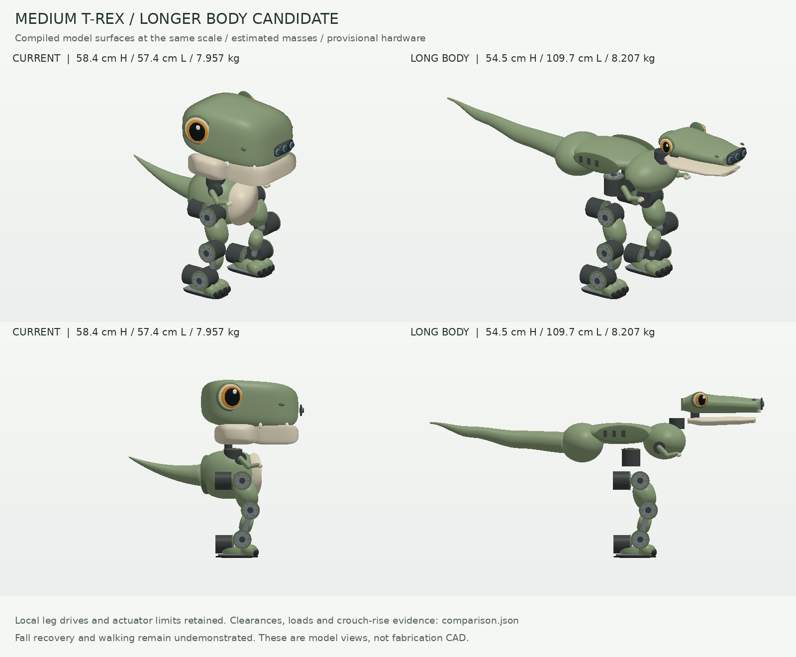
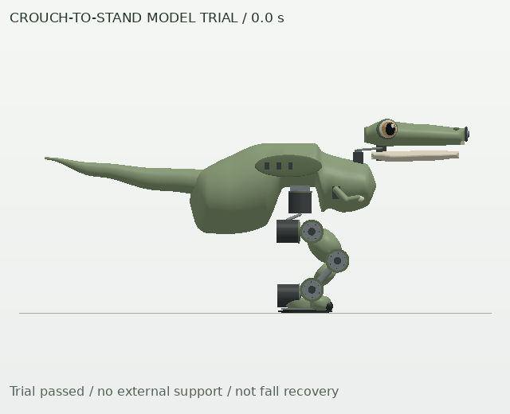

# Longer medium T-Rex candidate

This candidate develops a lower head, horizontal torso and longer tail while
retaining the current medium's leg mechanism, joint ranges and actuator limits.
The [silhouette-C model](../README.md) remains the reference for comparison.
The intended progression is crouch-to-stand first, then recovery after a fall;
fall recovery has not been demonstrated.



| Home measurement | Current reference | Longer candidate |
| --- | ---: | ---: |
| Height | 583.6 mm | 545.0 mm |
| Nose-to-tail length | 574.5 mm | 1,097.0 mm |
| Width | 341.4 mm | 341.4 mm |
| Assigned mass | 7.957 kg | 8.207 kg |
| Head-yaw moving mass | 530 g | 530 g |
| Whole-body CoM height | 238.7 mm | 263.3 mm |
| Integration reserve | 600 g | 600 g |

The lower silhouette does not imply a lower center of mass: the revised torso
and component placement raise the modeled CoM. All 66 component names are
retained. The additional 250 g is explicit: 80 g pelvis structure, 100 g torso
shells, 40 g tail and 30 g neck support. Component locations and box inertias
follow the new layout; the masses remain unweighed allocations. No revised
supplier quote or fabrication specification is claimed.

## Geometry and mechanical evidence

Three occupied torso volumes leave an open lower hip bay. Head, jaw, arms and
tail have revised collision envelopes; actual attachment exclusions are listed
in the generator. The snout camera package retains its mass, and all three
home center rays clear the visual geometry. That check does not establish a
clear full field of view or calibrated optics.

The [mechanical report](mechanical_validation.json) checks **790 poses and 245
selected pairs** under the same 2 mm clearance and 80% gravity-torque criteria:

- All selected candidate pairs pass. The unchanged reference has 15 failing
  pairs under the corrected distance measurement.
- All 66 leg motor-case pairs retain at least 2.5 mm clearance.
- All six expression gravity-torque checks pass. Head nod reaches 51.2% of its
  0.6 Nm cap; jaw reaches 61.9% of its 0.1 Nm cap.
- Head-yaw transverse gravity moment rises from 0.400 to **0.619 Nm**; tail
  moment rises from 0.0746 to **0.223 Nm**. Their bearing supports need design
  and ratings. All six bearing capacities remain unknown.

MuJoCo 3.10 sometimes returns zero distance for separated convex shapes with
a large search radius. The shared pipeline now uses an independent positive
support-plane gap as a conservative lower bound in those cases. Reports keep
the raw distance and the plane proof. Bounds below the criterion are incomplete
evidence; a known failure at another sampled pose remains a failure. This also
removes one false head/jaw failure from the reference's earlier 16-pair result.

Coverage is limited to the declared pair set and samples. Decorative surfaces,
electronics packing, wiring, foot and leg-link clearance pairs, brackets,
manufacturing tolerances, intermediate poses and dynamic bearing loads still
need review. Passing this screen is not assembly qualification.

## Standing and crouch-to-stand

The [comparison report](comparison.json) runs both models through the same four
10-second free-base trials: stance, standing gestures, and separate small
roll/pitch angular kicks. All pass. Candidate maximum torso tilt is about 2.54°;
the largest settled leg RMS effort is about 1.74 Nm across these trials.

Each eight-second rise trial starts in a constructed symmetric, flat-foot
crouch, holds for two seconds, raises joint targets smoothly for four seconds,
then settles for two seconds. There are no root resets, torso constraints or
applied external forces during the rollout. Held and final windows must have
low velocity and height variation, with both feet supporting simultaneously.
All tested actuators must be direct unit-gear position drives; unsupported
transmissions are rejected rather than misreporting actuator force as joint
torque.

| Knee offset | Candidate measured rise | Peak actuator effort | Time at ≥99% of cap |
| --- | ---: | ---: | ---: |
| 0.3 rad | 10.7 mm | 2.61 Nm | 0 ms |
| 0.6 rad | 25.6 mm | 3.09 Nm | 0 ms |
| 0.9 rad | 44.3 mm | 4.00 Nm | 24 ms maximum per actuator |

All three rise trials pass. The strongest trial reaches the existing 4 Nm cap,
so its short success should not be interpreted as ample dynamic or thermal
margin. The declared pair set also passes at the recorded rollout poses;
unsampled times remain unchecked.



The animation replays recorded simulation poses at fixed scale. Its loop resets
from standing to the initial crouch; that reset is not a simulated descent.
These are modest upright crouches. The trials do not demonstrate entering a
crouch, kneeling, getting off the floor, walking or recovering from a fall.

## Leg motor placement and getting up

Retain the current **joint-mounted geared actuators** for this candidate. The
hip-yaw motors already sit on the torso, with roll/pitch drives in the compact
hip stack. The knee motor is carried by the thigh; the ankle motors are carried
by the shin/ankle assembly. This limits transmission complexity while the
recovery workspace and loads are established.

[leg_load_screen.py](../leg_load_screen.py) compares this layout against moving
the six knee/ankle motor masses, totaling 1.98 kg, to abstract torso locations.
It assumes equal vertical foot loads, feasible centers of pressure and a static
upright torso. The alternative adds no transmission mass, losses, backlash or
compliance and does not attempt to package six motors in the torso.

| Candidate gravity estimate | Current motor placement | Ideal torso relocation |
| --- | ---: | ---: |
| Home knee torque | 1.568 Nm | 1.975 Nm |
| Deep-crouch knee torque at 1.1 rad | 2.888 Nm | 3.750 Nm |
| Deep-crouch fraction of 4 Nm cap | 72.2% | 93.7% |

Torso mounting can reduce leg swing inertia, but it moves more mass above the
knees and can increase the torque needed to support and raise the body. A real
belt, cable or linkage system also needs space, bearing support, tensioning,
joint-range accommodation and maintenance. The result is specific to these
mass locations and poses, not a universal ranking of actuator architectures.

For future fall recovery, first establish useful contact surfaces, reachable
prone/side/supine recovery poses, and load paths through the body, tail and legs.
The 0.1 Nm expression arms are not qualified lifting supports. The present
joint limits permit only about 57 mm of symmetric pelvis lowering at the knee
limit, so motor location alone cannot provide a ground-recovery workspace.

## Reproduce and review

From the repository root, with the test/viz dependencies installed:

```bash
python -m examples.tyrannosaurus_rex_50cm.redesign
python -m examples.tyrannosaurus_rex_50cm.redesign_review --duration 10 --render
pytest environments/tyrannosaurus_rex/tests/test_tyrannosaurus_rex_redesign.py \
  environments/tyrannosaurus_rex/tests/test_tyrannosaurus_rex_recovery.py \
  environments/tyrannosaurus_rex/tests/test_tyrannosaurus_rex_leg_loads.py
```

`redesign.Layout` exposes the neck position, nod reach, skull/tail lengths,
battery position and structural mass allowances. Build a changed layout into a
separate directory before comparing it; the ledger records the actual values.
The review command exits **2** for this candidate because bearing qualification
and fall recovery remain incomplete. Known mechanical or motion failures exit
1. Reports identify model inputs, implementation sources and runtime versions.
The clearance, rise and static-support calculations have independent negative
controls for interference, insufficient torque, unsupported drive mappings,
unstable support and invalid component evidence.
