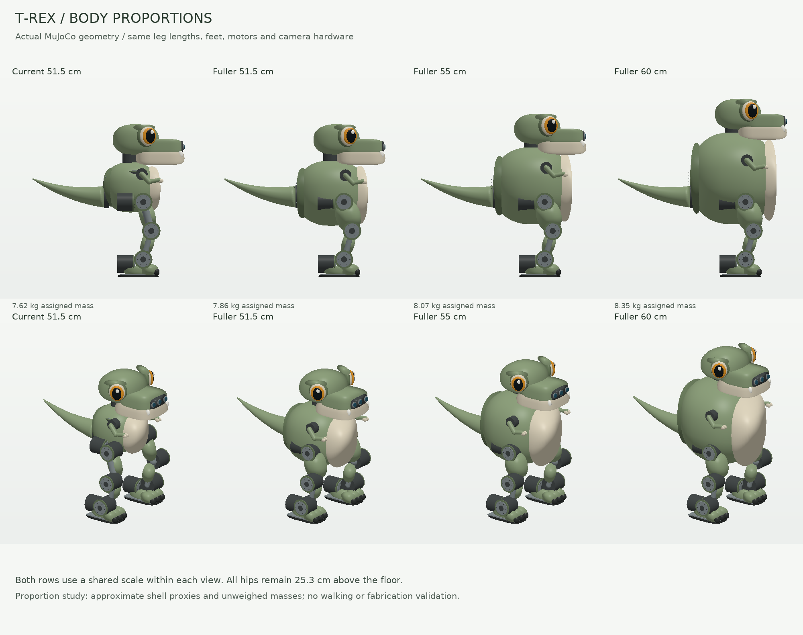

# T-Rex body proportions: 51.5, 55 and 60 cm

**Later design direction:** the [head-focused character study](../head_study/README.md)
supersedes the fuller-torso recommendation below. It makes the skull and jaw
dominant over a compact body. This earlier controlled comparison and its
budget calculations remain recorded; they are not a final design selection.

Study dated **2026-10-24**. Recommendation: develop the **55 cm fuller-body
direction**, with roughly 53–57 cm available during packaging refinement. A
fuller 51.5 cm body is also credible. These are alternatives for the same
medium T-Rex, not three additional builds. The original model remains the
default while this study is reviewed.



## Why the current robot looks leggy

The current hip-pitch axis is 253 mm above the floor, but the torso shell is
only 178 mm front-to-back, 168 mm wide and 170 mm high. Its bottom is 218 mm
above the ground. The robot is 341 mm wide across its motor cases, so the body
occupies only about half that width. Thin thigh covers, a separate neck and
the visible hip/knee/ankle housings emphasize the leg stack. The mechanical
thigh and shin lengths themselves are only about 101 and 100 mm.

Fill out the chest, lower the belly visually over the upper thighs, broaden
the thigh fairings and integrate the neck into the body silhouette. Retain
the tiny arms, amber eyes, snout cameras, three-toed feet and light tapered
tail. Keep motor faces and a removable rear panel accessible. A larger torso
should not become a solid printed block.

The [official Microduck photographs][duck-photo] show how a strong head/face,
broad feet and thigh covers can make an exposed mechanism read as one
character. This is a qualitative visual interpretation, not a measured claim
about its CAD proportions. Pollen describes Microduck as a 25 cm, sub-800 g
robot with 15 motors [1]. Our medium robot uses a different mass and actuator
class; its gait cannot simply be copied or scaled from Microduck.

## Controlled comparison

All alternatives retain the same leg links, joint anchors, feet, stance
width, head geometry, camera hardware, battery, compute placement and actuator
limits. Only upper-body proportions, shoulder/tail mounts, thigh fairings and
explicit structural/shell/wiring mass allowances change.

| Property | Current | Fuller 51.5 cm | Fuller 55 cm | Fuller 60 cm |
| --- | ---: | ---: | ---: | ---: |
| Total height | 515 mm | 515 mm | 550 mm | 600 mm |
| Torso depth × width × height | 178 × 168 × 170 mm | 240 × 220 × 220 mm | 265 × 230 × 260 mm | 290 × 245 × 310 mm |
| Hip-pitch height / overall height | 49.1% | 49.1% | 46.0% | 42.2% |
| Torso-shell bottom above floor | 218 mm | 173 mm | 178 mm | 178 mm |
| Overall nose-to-tail length | 511.5 mm | 542.5 mm | 555.0 mm | 567.5 mm |
| Overall width | 341.4 mm | 341.4 mm | 341.4 mm | 341.4 mm |
| Assigned mass, including reserve | 7.617 kg | 7.857 kg | 8.067 kg | 8.347 kg |
| Home center-of-mass height | 231.1 mm | 232.2 mm | 236.9 mm | 243.6 mm |

The 55 cm torso is about **49% deeper, 37% wider and 53% taller** than the
original shell. Overall height rises only 6.8%. Its outline makes the exposed
legs look shorter without changing their mechanical leverage. The 60 cm case
has more room and presence, but the unchanged head becomes small relative to
its torso. Enlarging that head would require another mass/neck/clearance study.

Uniform enlargement preserves the original ratios. Under idealized
same-density scaling, enlarging everything from 515 to 600 mm multiplies mass
by about 1.58 and gravity moments by about 1.84. That calculation does **not**
describe these alternatives: their hardware and legs remain the same, with
only the specified mass allowances added.

## Simulation evidence and its limits

[Recorded results](results.json) use MuJoCo 3.10.0, gravity, a free root and
the same ideal position drives with a **4 Nm leg cap**. Every case completes
ten seconds of unsupported stance and ten seconds of standing arm/head/jaw/
tail gestures. There are no numerical warnings or internal contacts in the
implemented proxies during those trials.

| Free-stance measurement | Current | Fuller 51.5 cm | Fuller 55 cm | Fuller 60 cm |
| --- | ---: | ---: | ---: | ---: |
| Largest leg-joint RMS effort | 1.740 Nm | 1.829 Nm | 1.927 Nm | 2.059 Nm |
| Largest leg-joint peak effort | 2.277 Nm | 2.394 Nm | 2.518 Nm | 2.677 Nm |
| Maximum torso tilt | 2.55° | 2.70° | 2.89° | 3.17° |

The 55 cm case adds **450 g**, raises the home CoM by **5.8 mm** and increases
the largest standing RMS effort by **10.7%**. At 60 cm those changes are
**730 g**, **12.5 mm** and **18.3%**. These are encouraging standing results,
not walking, single-support, recovery, low-speed thermal or runtime validation.
Output below a torque cap alone does not prove sufficient actuation: posture
retention and a deliberately underpowered baseline are checked separately.

Two sensitivity trials add **500 g beyond the retained 600 g reserve** to the
55 cm case. Near the pelvis, home CoM height becomes 239.0 mm; in the head,
it becomes 251.0 mm. Both pass the short stance/gesture trials. The head
addition raises its yaw subtree from 350 to 850 g and roughly doubles the
largest head-axis gesture peak to 0.285 Nm. Leg RMS does not rank those two
payload cases in the same order: fore/aft placement also changes load
distribution and settled pose. One effort number is not a complete balance
score. Keep an oversized-looking head lightweight.

The larger shells retain the compact core collision proxy and add approximate
front/rear and upper-side panel proxies, leaving hip openings below. These
are **not complete surface coverage or an interference-checked shell**. The
thigh fairings remain visual surfaces, and MuJoCo's default parent/child
collision filtering remains active. Full hip, head, arm and tail clearance,
cooling, cabling and tool access still need CAD and motion-envelope checks.
The extra body volume is not a verified usable electronics bay.

## First-build budget

USD planning ranges use the existing [35-line parts plan][bom]. Motor prices
were rechecked on 2026-10-24; other retained prices come from the same-day
baseline study. Added fabrication costs are **estimates**, not quotes. All
rows keep the compute, camera, battery and 18 motors from that plan.

| Direction | Installed parts | First-build funding |
| --- | ---: | ---: |
| Current 51.5 cm | $8,576.52 | $13,891.99 |
| Fuller 51.5 cm | $8,726.52–8,926.52 | $14,141.99–14,616.99 |
| **Fuller 55 cm** | **$8,926.52–9,276.52** | **$14,554.49–15,166.99** |
| Fuller 60 cm | $9,226.52–9,776.52 | $15,154.49–16,191.99 |

For 55 cm the installed additions are $175–350 for structure/brackets,
$125–250 for shells/guards and $50–100 for harness changes. Add $100–200 for
development fixtures/reprints and $100–150 to the freight/tax reserve. For
60 cm those five ranges are $350–650, $200–350, $100–200, $200–400 and
$200–300 respectively. Added mass and cost are independent planning allowances.

The calculation is `(installed parts + existing development/spares + added
development) × 1.25 + $900 + additional freight/tax reserve`. This retains
the existing 25% contingency and equipment/spares. Labor, major workshop
equipment, outside engineering and public-event operations are excluded.
These are alternative total budgets, not the cost of building every size.
No larger battery or extra AI computer is assumed.

### Motor option if walking needs more margin

| Catalog item | Unit price | Rated torque / speed | Mass | Drawing envelope |
| --- | ---: | --- | ---: | --- |
| Current RMD-X4-P12.5-10 [2] | $399 | 4 Nm / 238 rpm | 330 g | Ø55 × 55.5 mm [3] |
| Candidate RMD-X4-P36-36 [4] | $449 | 10.5 Nm / 83 rpm | 360 g | Ø55 × 61 mm [5] |

For new procurement, six pitch-axis substitutions add **$300 and 180 g** in
actuator totals; twelve add **$600 and 360 g**. This assumes purchasing the
substitutes instead of discarding already-bought motors. Both catalog versions
are nominally 24 V. The 36:1 candidate is longer, has a different output
interface, and its drawing lists greater back-drive torque (1.14 versus
0.8 Nm) and lower efficiency. It is **not a qualified drop-in replacement**.
Neither drawing envelope proves cable, bracket or tool clearance. Exact
revision, 6S voltage compatibility, bearings, bus/torque control and heating
must be qualified before selecting a full set.

For this controlled comparison, the models retain their provisional
Ø60 × 55 mm cases. The supplier's 55.5 mm length means this allowance is not
conservative in every direction. Measured back-drive friction and reflected
gear dynamics are not modeled. Catalog torque is not a gait qualification.

Keep approximately **$1,000–2,000 extra at project level** available if testing
leads to a motor-ratio change, including a comparison unit, bracket revisions,
spares, testing and contingency. This is outside the table and does not mean
the 55 or 60 cm designs already need an upgrade. A separately listed low-profile
revision has a different price; its specification is not mixed into this table.

## Practical recommendation

Develop the **55 cm direction** and plan on roughly **$15,000 for the first
build**, with the motor-change reserve available. This refines the medium
build in the mini → medium T-Rex → later full-size raptor progression.

A fuller torso offers room to arrange rear access, cooling ducts and cables,
and a stronger silhouette for photographs or educational demonstrations.
Those are opportunities, not verified packing or audience-response results.
Reliable movement and visible character are more useful than another 5 cm
of height. Retain 60 cm if actual packaging or viewing-distance needs justify
it. Taller does not automatically add compute capability, and greater upper
mass can reduce runtime and recovery margin.

Before promoting an alternative: import exact motor CAD and brackets; resolve
hip/neck/ankle packaging; enforce a weighed **8.0–8.5 kg target** for the 55 cm
build including reserve; check full motion envelopes; then develop walking
and weight transfer with measured actuator limits, latency and thermal tests.
Shortening the visible legs by deeper knee crouch is not a free fix: it changes
load levers and can raise holding effort. Physical link shortening deserves
a separate packaging/gait study.

## Reproduce

From the repository root:

```bash
python -m examples.tyrannosaurus_rex_50cm.proportions --render
python -m pytest environments/tyrannosaurus_rex/tests/test_tyrannosaurus_rex_50cm.py
```

Generated XML and component ledgers are provided for the [baseline](baseline/model.xml),
[fuller 51.5 cm](compact/model.xml), [fuller 55 cm](balanced/model.xml) and
[fuller 60 cm](tall/model.xml). Retain the directory structure: each XML
references `../../assets` within this example. Open the XML in MuJoCo and
reset to `home`. [results.json](results.json) records effort, dimensions,
payload cases, cost additions and source hashes. The model test module now
had 19 cases at this study's original revision, including the three alternate
bodies, budget and payload checks; later head alternatives and the selected-C
default extend it to 25. The original baseline remains available separately.

The hardware-study path is owned by the standalone example package, avoiding
a retired species identifier in environment tests. Baseline geometry/control
limits, registered plants and training interfaces are unchanged.

## Sources

1. [Pollen Robotics: Meet Microduck](https://pollen-robotics.com/microduck/blog/introducing-microduck/).
2. [MYACTUATOR U.S.: RMD-X4-P12.5-10](https://myactuator.us/products/rmd-x-series/rmd-x4-p12-5-10).
3. [RMD-X4-P12.5-10 drawing, A0, stamped 2026-04-22](https://cdn.sanity.io/files/7rgy42zg/production/ffd33eeff32d690a22a5c22867dd9a1af97d6e8a.pdf).
4. [MYACTUATOR U.S.: RMD-X4-P36-36](https://myactuator.us/products/rmd-x-series/rmd-x4-p36-36); [manufacturer page](https://www.myactuator.com/x4-36details).
5. [RMD-X4-P36-36 drawing, A0, stamped 2026-04-22](https://cdn.sanity.io/files/7rgy42zg/production/47bc0ed2a3597d1a7f6e11586168b4cd7ab5950d.pdf).

[duck-photo]: https://pollen-robotics.com/assets/microduck/squad.webp
[bom]: ../../../docs/hardware/studies/trex_50cm/parts_budget.csv
