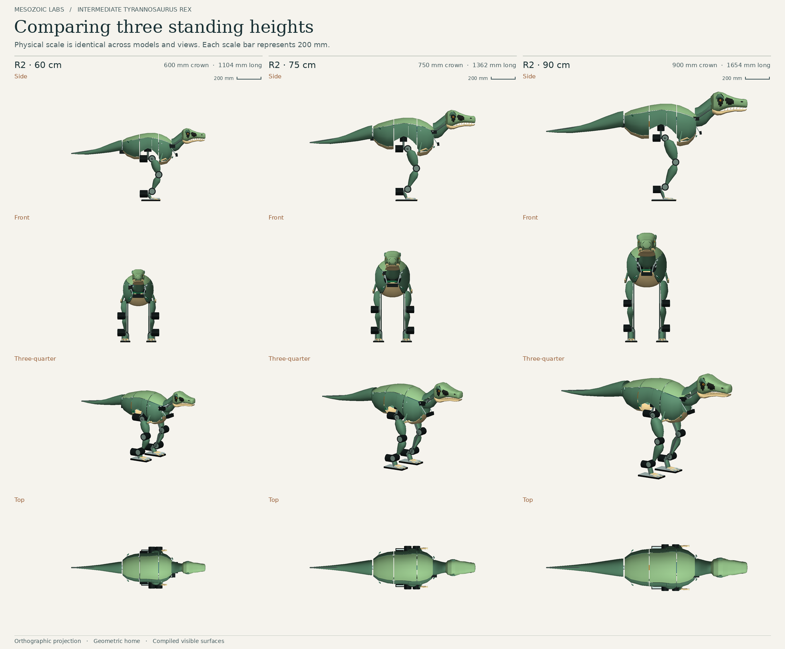

# Intermediate T. rex simulation findings

Advance the 60 cm R3 to the next engineering iteration. Repackaging the components inside the shaped 60 cm body increased the filled area of the fixed side-view hip window from 48% to 84%. Only the 60 cm candidate completed the initial walking screen on both surfaces. On the subsequent paired stance study, reducing sole spacing from 214 to 175 mm reduced lateral sway by 14.4%. Hip spacing stayed at 214 mm.

[Original and redesigned robots at the same 60 cm height](visual/redesign-at-60cm.png) · [Partner brief](Partner-brief.pdf)

| Specimen | Outer crown | Installed mass | Estimated walk runtime | Nominal prototype cost |
| --- | ---: | ---: | ---: | ---: |
| Redesigned R2 | 599.8 mm | 10.282 kg | 18.6 min | $16,117 |
| Mid-size study | 749.8 mm | 11.130 kg | 13.8 min | $16,817 |
| Large study | 899.7 mm | 12.131 kg | 9.8 min | $17,667 |
| Narrow-stance R3 | 599.8 mm | 10.370 kg | 18.4 min | $16,447 |

## Walking and turning

The R3 controller with revised start/stop control passed the complete gait criteria in 13/20 fresh trials across two surfaces and both turn directions. The same reference trajectory with the learned residual disabled passed 2/20. All 20 paired trials showed lower transition acceleration with PPO. Median forward speed was 0.104 m/s and median weaker-foot clearance was 16.4 mm. Five trials missed the acceleration limit and two missed the tilt limit. Mean normalized speed/yaw error increased from 0.114 to 0.185. The original R3 walking actor and this governed actor require different policy interfaces and matching observation statistics.

## Following a selected person

An external operator selected a visitor once. Robot-side software used rendered RGB-D, inertial and ranging measurements to track the selected visitor and control the simulated free-standing robot.

| Held-out scenario | Outcome |
| --- | --- |
| Original R3 raw PPO, stationary pedestal, two fresh seeds on each floor | 3/4 passed, equal to the reference. The recorded hard-floor trial advanced 2.80 m with 137 mm minimum sampled clearance and 2.10 m final following distance. |
| Original R3 with fitted corrections, same four pedestal trials | 2/4 passed. No robot-gallery contact or resolved identity switch occurred across the 12 paired raw, fitted and reference trials. |
| Governed R3 raw PPO, crossing cart | 1/4 passed. The successful robot stopped, resumed and finished 1.96 m from its selected visitor. |
| Governed R3 raw PPO, stationary pedestal | 0/4 passed. All four terminated on excessive tilt. |

## Hardware qualification

R3 needs approximately 9 N·m at the hip during a prescribed single-support hold against an assumed 6 N·m sustainable output. Some combined joint positions still collide. The nominal cost includes outsourced fabrication, integration and spares. The high estimate is $21,817. Joint thermal tests, wiring and connector access, runtime measurements, and a Jetson perception benchmark remain prerequisites for fabrication decisions.

## Evidence and reproduction status

This findings snapshot draws from the full simulation handoff at Git commit `f7d9857791e0b75d388118fd38fac2d2ce2c0794`, based on #662 at `e103f7ff2609fa1d7eb08507fb50ed9bb410b632`. The earlier PR's later local archive could not be verified. The full handoff contains the executable source, input models, matched checkpoints, normalization, raw logs and videos. Its clean-checkout test reproduced all 450 recorded control/tracking frames and the original 45-second pedestal video byte-for-byte.

[Baseline audit](baseline/source.json) · [Gait outcomes](gait/governed/panel-summary.json) · [Paired pedestal trials](autonomy/successor/raw-policy/summary.json) · [Governed transfer trials](autonomy/governed/index.json) · [Clean-checkout verification](provenance/release-checks.json)
