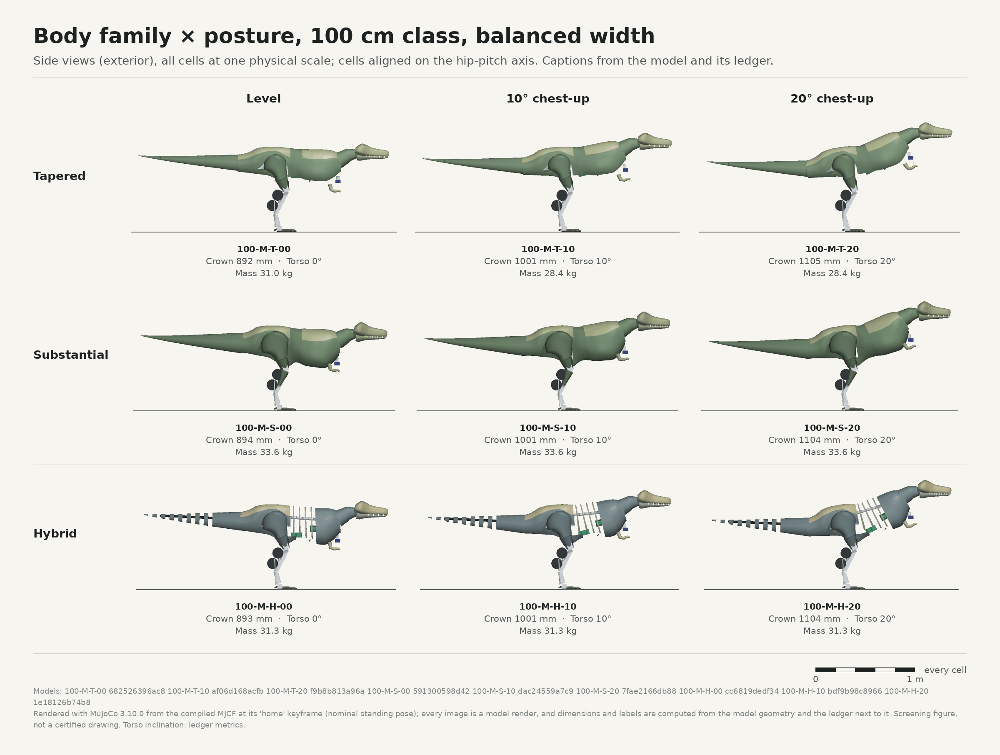

# Round-one design review

**Status:** awaiting the owner's answers to the questions in §6. Nothing here is a final design, and
no controller training has started.

The illustrated version of this review is the review page, which is published separately and
linked in the delivery message. It uses the same numbers and plates. The tables below are compiled
by hand from the generated tables in `round1/TABLES.md` (§1–3, §6 and §11; covers are class C),
rounded for display and with catalog part names shortened; the "What is covered" column is
descriptive. Every plate is a render of a compiled model in `round1/review/mjcf/` (the plates are in
`round1/review/plates/`).

## How round one was run

1. **Stage A sweep:** 132 candidates. Every combination of 4 heights × 3 widths × 3 body families ×
   3 postures, plus, per height, a belly-battery variant, three proportion variants (anatomical
   tail, compact, large skull) and two leg layouts (side-by-side hip roll, and a serial leg like PR
   #662). Each candidate was built with real component envelopes, then sized iteratively: loads,
   then drives and battery, then rebuild. 120 reached a stable selection, and in 6 of them the
   final load check then stepped up an ankle or tail drive. In the other 12 the selection cycled;
   each joint group then kept the stronger of the parts it alternated between, and the larger
   battery was kept. Each candidate then got power, runtime and cost estimates.
2. **Review set:** 24 candidates spanning sizes, families, postures, widths, proportions and
   layouts. Each was rebuilt from its Stage A selection (the model's SHA-256 matches the sweep
   record), then screened for clearance and sensor coverage and drawn as plates.
3. **Fixes during the round:** each screen found problems, and the generator was corrected before
   these results were produced. The fixes covered:
   * the sizing method;
   * the sensor layout;
   * the trunk shapes;
   * six packaging defects (F6).
   The failing versions are recorded in `SCREENING.md` §2 and the decision log (F3–F6).

## 1. Findings

1. **Size sets the drive class, and the drive class sets mass and cost.** Reference robots (balanced
   width, Substantial body, 10°):

   | Class | Crown / hip axis / length | Mass | Hip-pitch hold | Hip-pitch drive | Bus, battery | Walking power | Runtime | Cost nominal / high |
   |---|---|---|---|---|---|---|---|---|
   | 60 cm | 60 / 40 / 153 cm | 11.4 kg | 4.5 N·m | MyActuator X4-36-L (incumbent class) | 24 V, 6S 3.3 Ah | 96 W | 34 min | $15.6k / $21.6k |
   | 75 cm | 75 / 50 / 185 cm | 15.7 kg | 9.9 N·m | RobStride 03 | 24 V, 6S 3.3 Ah | 113 W | 29 min | $18.0k / $25.4k |
   | 100 cm | 100 / 66 / 247 cm | 33.6 kg | 27.0 N·m | MyActuator X12-320 | 24 V, 6S 5 Ah | 171 W | 29 min | $30.1k / $41.5k |
   | 120 cm | 120 / 80 / 297 cm | 46.1 kg | 51.2 N·m | MyActuator X12-320, past its planning limit (1.06) | 48 V, 2 × 6S 3.3 Ah | 209 W | 31 min | $38.0k / $52.7k |

   * The 60 and 75 cm classes share the bus, the battery and the hip-roll, thigh-twist, knee and tail
     drives. At 75 cm the hip pitch steps up to a RobStride 03 (9.9 N·m hold against the X4-36-L's
     6.0 N·m sustained limit), the ankles to the X4-36-L and the neck to the XM540-W270. The earlier
     "9 N·m vs 6 N·m" gap was single-support hip roll, and the tandem layout resolves it
     geometrically (finding 4).
   * The step from 75 to 100 cm more than doubles the mass (2.1×). The hip-pitch load grows 2.7× and moves the
     hips into a heavier drive class, while structure and coverings scale with size.
   * Per the owner's note (P8), the larger sizes stay in as full options. Their cost is reported, not
     used to rule them out.
   * Every high-side estimate is above $20k, including 60 cm at $20.4–23.3k.

2. **Hip pitch sets the drive class.** In the tandem layout it carries the largest joint load at every
   size. The exceptions are at 60 cm, where thigh twist is slightly larger at broad width and in the
   anatomical-tail variant. At 120 cm the hip-pitch requirement exceeds the strongest single catalog
   drive (MyActuator X12-320) in 17 of the 33 bodies:
   * The Tapered body fits (0.81–0.98 of the limit; 0.91–0.98 at narrow and balanced width).
   * At narrow and balanced width the Substantial and Hybrid bodies exceed it by 1–7 %. At broad width
     only `120-W-S-10` does (1.03): the broad Hybrid fits at 0.92–0.97, and the broad Substantial fits
     at 0° and 20° (0.997, 0.963).
   * The large-skull, belly-battery and compact variants (balanced width) exceed it by 11–39 %, and
     the serial leg by 3 %.

   Round-two options, in `SCREENING.md` §3:
   * two drives per hip;
   * a reduction stage;
   * the Tapered body;
   * the anatomical tail;
   * bench data on the sustained-torque fraction.
3. **The tail is a counterweight.** The anatomical-length tail moves the centre of mass back from
   0.12–0.15 H to 0.085–0.11 H and cuts the hip-pitch hold by 24–26 %. That is 27.0 → 20.2 N·m at
   100 cm, which drops the hip drive class (X12-320 to RobStride 04) and saves $3.9k nominal. The
   cost is 0.3–0.6 m more length and turning sweep. The compact variant does the opposite: +25–40 %
   hip-pitch load.
4. **The hip layout decides single-support feasibility.** With both hip-roll motors on the centreline
   (tandem, the default), the 60 cm single-support hip roll is 2.9 N·m. The serial PR #662-like leg
   needs 12.8 N·m and a CubeMars AK60-39 hip roll: the earlier gap returns (PR #662's own, lighter
   model needed 9.6–9.9 N·m). The side-by-side layout has no balanced single-support pose at
   60–100 cm.
5. **The tail-base battery is worth keeping.** Moving the battery to the belly raises the hip-pitch
   hold by 18–80 % (4.5 → 8.0 N·m at 60 cm). It also pushes the centre of mass forward to 0.17–0.18 H.
   In the 60 cm review model the belly cassette also overlaps the compute tray and has no clear
   removal path.
6. **Width is mostly a hip-roll and stability trade.**
   * Hip-roll hold grows with hip spacing: narrow / balanced / broad is 2.5 / 2.9 / 3.5 N·m at 60 cm and
     15.2 / 18.5 / 33.0 N·m at 120 cm.
   * At 120 cm the broad variant costs +8.9 kg and 11 min of runtime, and its reference walk is
     marginal (CoP −4 mm).
   * At 100 cm the narrow variant fails clearance: the pelvis plates meet the thighs.
   * Every width variant (narrow to broad, all sizes, families and postures) stands about 3–7 × wider
     than tyrannosaurid trackways (0.24–0.49 H vs about 0.07 H). Only the side-by-side leg layout
     (0.54–0.68 H) and the 60 cm serial leg (0.55 H) stand wider.
7. **Body family changes the coverings, and through their mass the hip loads and drives.** Against
   Substantial, the Tapered body cuts the hip-pitch hold by 9–16 % at every size (4.5 → 3.7 N·m at
   60 cm, 51.2 → 46.7 N·m at 120 cm).
   * At 100 cm this drops the Tapered hip pitch to an X8-150 (0.99 of its limit) and its pack to
     6S 3.3 Ah (21 min). Substantial needs an X12-320 and a 6S 5 Ah pack (29 min).
   * At 120 cm the Tapered body stays inside the X12-320's limit (0.96) on 24 V. Substantial and
     Hybrid exceed it (1.06 / 1.05) on either bus, so the sizer falls back to 48 V.
   * At balanced width and 10°, Tapered is the cheapest at every size and the lightest at 60–100 cm.
     It saves 0.6 kg / $0.8k at 60 cm and 2.5 kg / $2.6k at 120 cm against Substantial.
   * Hybrid sits in between on cost at every size, and on mass up to 100 cm. At 120 cm it is the
     lightest (43.1 kg vs 43.6 kg Tapered), mainly because its knees take RobStride 03 drives where
     the Tapered body's take RobStride 04s. It carries its mass furthest forward (CoM 0.162 H vs
     0.148 H) and shows the machine.
   * All three pass clearance at 60 and 100 cm.
8. **Posture is cheap mechanically and changes height.** On the same body, 0° / 10° / 20° moves the
   crown by about ±10 % (53.7 / 60.1 / 66.2 cm at 60 cm). Hip-pitch hold changes by under 4 % on the
   Substantial reference bodies (2.7–3.5 %) and by under 5 % on most bodies. It reaches 5–7 % on 9
   of the 36: the 60 and 120 cm Tapered bodies (5.1–6.1 %), `120-W-S` (6.7 %), and `100-W-S` and
   `100-N-T` (6.2 % and 7.3 %), where the 20° version drops to a smaller hip drive. Raising the chest
   also raises the head camera.
9. **Sensors moved.** The head camera sees a person's torso at 1.5–3 m at every size, with only about 3–4 % of
   its view blocked by the robot. The snout hides the floor ahead of the feet to 1.9–3.3 m, so near-field
   sensing relies on the two ToF sensors (45–71 % of the foot path covered).
10. **Packaging is tight at 60 cm.** The 60 cm reference passes every clearance gate but has near-contacts
    within 3 mm while walking, and knee flexion usable to 0.62 rad. 75–120 cm have room to spare.

## 2. Body families, posture and proportions

| Family | What is covered | 60 cm mass / covers / cost | 120 cm mass / covers / cost |
|---|---|---|---|
| Tapered | Back and flanks; open ventral abdomen; exposed lower legs | 10.8 kg / 0.99 kg / $14.8k | 43.6 kg / 5.7 kg / $35.4k |
| Substantial | Full outline: chest, gastral belly, pubic boot, thighs, calves, tail root | 11.4 kg / 1.42 kg / $15.6k | 46.1 kg / 8.1 kg / $38.0k |
| Hybrid | Skull, neck, chest front, pelvis, thighs; exposed rib hoops and spine; segmented tail | 10.9 kg / 1.08 kg / $14.9k | 43.1 kg / 5.9 kg / $36.3k |

What each family keeps and avoids from the earlier forms:
* All three keep a deep chest, a waist behind the ribs and muscular thighs. The Substantial and
  Hybrid bodies also cover a distinct pubic keel between the thighs; the Tapered body leaves it open
  with the rest of its ventral abdomen.
* They avoid the earlier rejected forms: no rectangular chassis, and no barrel torso with a hanging belly.
* The head still reads small against the trunk in side view. The large-skull variant (+15 % skull
  length relative to the body; +13 % in absolute length at the same crown height) is shown for
  comparison. Its mechanical cost is small but not zero: hip-pitch hold rises 1.5–5 % and neck hold
  11–17 %. At 75 cm the neck servo reaches 0.99 of its rating, and at 100 cm the neck steps up from
  the AK45-36 to the X4-36-L. At 120 cm it takes the hip pitch further past the X12-320's limit
  (1.11 vs 1.06) and raises walking power from 209 to 230 W.

Plates:
* `sizes_common_scale.png`, `sizes_height_normalized.png`, `sizes_silhouettes.png`
* `families_60.png`, `postures_75.png`, `widths_100_front.png`, `widths_100_top.png`, `proportions_100.png`
* `silhouettes_family_posture.png`
* one four-view plate per review candidate: `<id>_four_views.png`
* cutaways: `60-M-S-10`, `100-M-S-10`, `120-M-S-10`, `100-M-H-10`, `100-M-T-10`, `60-M-S-10-serial`
* `layouts_60_cutaway.png`

## 3. Hardware compromises, by size

* **60 cm:** the incumbent-class X4-36-L drives the hip pitch and knee, and the lighter CubeMars
  AK45-36 the hip roll and thigh twist. Packaging is tight: while walking, the thigh fairings pass within
  3 mm of the power-distribution board (0.16 mm) and of the pelvis plates and shells, and in the
  brisk walk of the upper ankle motors (0.63 mm). The tail pivot moves back 43 mm to fit the
  battery cassette. The head camera is an OAK-D Lite (no lidar).
* **75 cm:** the 60 cm drives at hip roll, thigh twist, knee and tail. The hip pitch steps up to a
  RobStride 03, the ankles to the X4-36-L and the neck to the XM540-W270. It has more room inside
  and the same battery class.
* **100 cm:** larger drives everywhere (CubeMars AK60-39 hip roll and twist, RobStride 03 knee and
  ankles, MyActuator X12-320 hip pitch), a 6S 5 Ah pack on 24 V, OAK-D Pro W, and a lidar under the
  throat. Arrangement mass (ledger class B: structure, bearings, linkages, cover supports and
  fasteners, harness, battery cassette, compute tray and the integration reserve) reaches 13.2 kg
  and coverings 5.0 kg.
* **120 cm:** the hip-pitch load exceeds the strongest catalog drive, so the sizer falls back to the
  48 V bus (2 × 6S 3.3 Ah), and the X12-320 runs past its planning limit (1.06). Structure and
  arrangement mass (ledger class B) is 19.1 kg. The 100 and 120 cm cutaways show the layout.

## 4. Compute

The owner asked (P9) whether onboard compute beyond the Jetson makes sense. The survey, the per-size
runtime, mass and price effect, and the recommendation per size are in `COMPUTE.md`; the review page
summarises them.

## 5. What this round does not show

* No controller has walked any of these models. The reference walks size the loads only.
* Carpet, turning loads, slips, impacts and thermal limits are not screened (`SCREENING.md` §7).
* All masses, powers, runtimes and costs are model estimates from sourced part data and stated
  rules. None is measured.

## 6. Questions for the owner (round one)

1. **Size** for round two: 60, 75, 100 or 120 cm, or two side by side.
2. **Body family:** Tapered, Substantial, Hybrid, or a mix (which parts of each).
3. **Posture:** level, 10° or 20° chest-up.
4. **Proportions to carry forward:** anatomical tail, larger skull, narrower or broader stance,
   compact proportions (shorter legs and tail, larger skull).
5. **Compute direction:** see `COMPUTE.md`.

The answers go into `DECISION_LOG.md` as P-entries, and round two refines the chosen direction and
repeats every screen.
