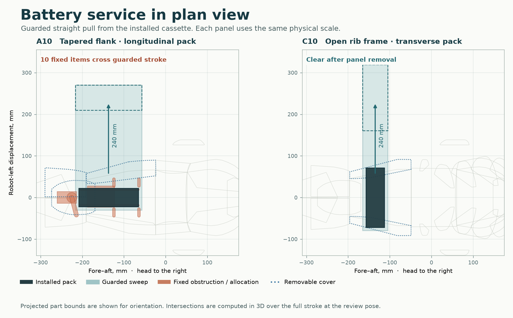

# Installation and service screen

The review uses real skin triangles and vendor-sized cases, including hardware at its upper declared dimensional tolerance. The companion ledger lists the center, dimensions and rotation of each installed case and each reservation in the flat-foot review pose. Coordinate changes relative to the executable source are in millimetres. The source row in the data is named `model`. Consult the package source record for its revision.

## Standing geometry

| Model | Case / skin hits¹ | Reserve / skin hits¹ | Fixed blockers on left battery stroke² | Fixed blockers on top compute lift² | Upward fan rays open | Shortest clear height³ |
| --- | ---: | ---: | ---: | ---: | ---: | ---: |
| Source | n/a | n/a | 1 | 0 | 100/100 | >300 mm |
| A00 | 0 | 5 | 10 | 0 | 60/100 | 32.1 mm |
| A10 | 0 | 5 | 10 | 0 | 60/100 | 32.1 mm |
| A20 | 0 | 5 | 10 | 0 | 60/100 | 32.1 mm |
| B00 | 0 | 7 | 0 | 0 | 60/100 | 55.0 mm |
| B10 | 0 | 7 | 0 | 0 | 60/100 | 55.0 mm |
| B20 | 0 | 3 | 0 | 0 | 60/100 | 55.0 mm |
| C00 | 0 | 3 | 0 | 0 | 60/100 | 28.3 mm |
| C10 | 0 | 3 | 0 | 0 | 60/100 | 28.3 mm |
| C20 | 0 | 3 | 0 | 0 | 60/100 | 28.3 mm |

¹ Count of intersecting hardware–skin pairs at zero added margin. The JSON also retains near hits inside a 2 mm axis-wise guard. A reservation intersecting a cover means its allocated installation or access space has been consumed. A solid intersection is a physical fit failure. Original-source skin pairs are omitted from this column because their thin-wall geometry is unspecified.

² Beyond the installed pack plus its 6 mm all-around sleeve, the guard adds 2 mm on all faces. On the straight 240 mm robot-left stroke the entire swept volume is tested continuously. Crossing the far-side skin at the initial guarded pose also counts. The pack case is tolerance-max, and the plug and balance lead are assumed restrained. For the processor, raising the tolerance-max kit by 50 mm is a partial service lift. A full 250 mm top pull, two 200 mm side pulls and four hypothetical 30 mm midpoint plug-approach boxes are reported in `screen.json`. Placement of actual USB, barrel and Ethernet ports and the board-removal sequence need a detailed layout. A removal route may require a removable bridge or tray.

³ Smallest first-hit distance from a 40 × 40 mm assumed central fan face, ten-by-ten grid. The lateral grid uses 50 rays per direction 3–15 mm above the kit. A clear sightline shows a geometrically open path. Airflow, static pressure and cable blockage are unmeasured.

## Assembly evidence

**A10**. Left battery withdrawal crosses 3 skin pieces (iliac port, caudal collar port, caudal drive undertray) and 10 fixed items. The 50 mm and 250 mm processor lifts cross 0 and 0 fixed items respectively after skin removal. Remaining static structural contacts for non-optical boxes: none in the checked frame members.

**B10**. Left battery withdrawal crosses 2 skin pieces (iliac port, iliac starboard) and 0 fixed items. The 50 mm and 250 mm processor lifts cross 0 and 0 fixed items respectively after skin removal. Remaining static structural contacts for non-optical boxes: none in the checked frame members.

**C10**. Left battery withdrawal crosses 2 skin pieces (iliac port, iliac starboard) and 0 fixed items. The 50 mm and 250 mm processor lifts cross 0 and 0 fixed items respectively after skin removal. Remaining static structural contacts for non-optical boxes: none in the checked frame members.

The JSON records case–case intersections, contacts with frame members and parent-reserve containment margins separately. The two OAK braces and ToF struts terminate at their optical case/board by design. Sensor carrier brackets, board standoffs and strain relief require detailed load paths. A mount represented by a strut penetrating a supplier envelope needs a real mounting interface.

## Supported joints and manufacturing

The C10 neck has an 8 mm shaft between bearing centers 86 mm apart. The tail has an 8 mm shaft with a 60 mm span. Both shaft and bearing axes match their modeled hinge within 0.000 mm radial offset. These checks establish coaxial model datums. The bearing types, shaft stress, hub fits and retention remain to be specified.

Specify real motor and bearing part numbers/revisions, face offsets, service tool sides and cable paths in a 1:1 mock-up. Fit a tolerance-max battery, dummy EC5 harness, working latch and removable flank; measure extraction force and tool clearance with the frame supported. Gauge kit-to-member clearance using the actual cooler, plugs, M.2 standoff and hose/duct or grille. Run the closed-cover thermal test under design duty. Verify each selector, fuse, hard stop and disconnect through the service opening.

## Reproduction

Use the reference model and the nine generated candidate XMLs. From the study package directory, run `python hardware/screen.py /path/to/reference/model.xml model/generated/*.xml`, then `python hardware/report.py`. Use `python hardware/service_figure.py` for the plan-view plate. Python with MuJoCo 3.10 and NumPy is sufficient for screening. The plate additionally uses SciPy and Matplotlib. Results bind each row to the SHA-256 of the XML that produced it.

The solver checks actual mesh triangles against oriented tolerance boxes via the separating-axis theorem. Capped motor cylinders use triangle clipping to their axial interval followed by a circular test. Battery and kit strokes against capsules use exact segment-to-box distance. Other cylinder obstacles use a 96-sided circumscribed prism. For the 30 mm case radius its maximum radial overestimate is below 0.017 mm. Ellipsoid obstacles use enclosing boxes. Left/right battery strokes are parallel to a pack-local axis for the distributed fixtures. The JSON labels any other non-axis-aligned stroke that needed a conservative enclosing box. Dynamic leg/sensor checks are in the mechanics appendix.

See [part sizes, sources, cooling target and validation sequence](component_basis.md), [complete numeric results](screen.json), and [compiled component layout and deltas](installed_layout.csv).
