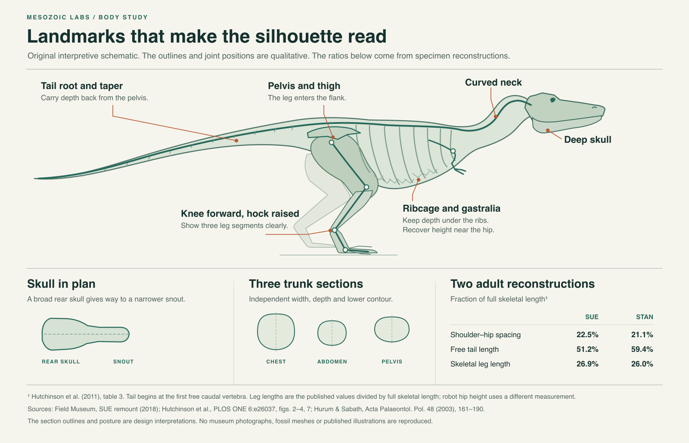

# Anatomical reference notes

The Field Museum’s 2018 SUE mount makes a good local reference for this robot. The gastralia form a ventral basket below the ribs. Incorporating them widened the chest and filled out the belly. The adjusted shoulder girdle places the diminutive arms lower and farther forward. The museum’s side photograph also shows a continuous neck rising into the back of the skull, a thick proximal thigh beside the flank, a raised ankle and an elevated, tapering tail. Where the thigh obscures the waist in side view, the plan view becomes especially useful. [Field Museum, *A Fresh Science Makeover for SUE*, including the 2018 mount photograph](https://www.fieldmuseum.org/blog/fresh-science-makeover-sue)

Hutchinson and colleagues compared skeletal scans and soft-tissue models of four large specimens. Their front, side and dorsal views show how well very different outlines can fit the same bones. They identify unusually wide reconstructed chests for SUE and Carnegie and unusually short shoulder-to-hip spacing in MOR. Their SUE reconstruction predates the museum’s remount. Use the reconstructions to place landmarks and test alternate sections. A single chest width, center of mass or torso pitch cannot be recovered for this robot from those mounts. [Hutchinson et al., 2011, figs. 1–4 and 7, table 3](https://doi.org/10.1371/journal.pone.0026037)

Hurum and Sabath describe a skull that is deep in profile. In plan, the rear of the *T. rex* skull broadens markedly relative to its muzzle. These are distinct design decisions. A robot can carry a strong brow and deep rear cheek while narrowing toward a still substantial muzzle. Camera height and viewing aperture are engineering decisions. The geometric head need not follow a fossil jaw line where optics require otherwise. [Hurum and Sabath, 2003, *Acta Palaeontologica Polonica* 48, 161–190](https://www.app.pan.pl/article/item/app48-161.html)

## Two specimens as scale references

| Published skeletal measure | SUE, FMNH PR 2081 | Stan, BHI 3033 |
| --- | ---: | ---: |
| Head-to-tail body length | 12.29 m | 11.78 m |
| Shoulder socket to hip socket / body length | 22.5% | 21.1% |
| Tail from first free caudal vertebra / body length | 51.2% | 59.4% |
| Reported leg length / body length | 3.300 / 12.29 = 26.9% | 3.068 / 11.78 = 26.0% |

Source: table 3 of Hutchinson et al. The two examples illustrate variation among published reconstructions. Distal tail length is uncertain. Comparing the robot with this table requires a shoulder analogue, a hip axis, a first-free-caudal analogue and the same definition of leg length. The start of a powered tail hinge can be aft of the anatomical tail root, and leg length differs from standing hip height. [Published table](https://doi.org/10.1371/journal.pone.0026037.t003)

## Translation into robot form

| Anatomical observation | Engineering adaptation | Artistic choice and review cue |
| --- | --- | --- |
| A deep ribcage continues into a substantial ventral belly and ends against the thigh. | Use different height, width and vertical position at the shoulder, chest, rear abdomen and pelvis. Preserve room for the battery, fan and removal path. | Choose where the belly line recovers toward the hip. Compare black lateral profiles and transverse cuts. |
| The skull has depth in side view and expands at the rear in plan. A curved neck spans shoulder to occiput. | Make the neck and head independent of the chassis angle, preserve head-travel clearance and give the optics a clear aperture. | Use the brow and rear cheek to carry head depth. Check the same head from above and three-quarter front. |
| The upper leg occupies the side of the flank. The knee is forward of the hip, the hock sits above the ground, and the toes meet the floor. | Expose the actual joint axes. A short side fairing may move with the thigh. Ground contact and stability determine toe-pad dimensions. | Let the upper thigh overlap the flank in side view while a visible joint gap explains how it moves. |
| The caudal column leaves the pelvis with a substantial root and narrows progressively. | A light fixed proximal fairing can extend the pelvic contour around the powered hinge. Mass and clearance must use the real powered assembly. | Use a diminishing sequence of sections that still reads in plan and silhouette. Distal sweep is a posture choice. |
| Fixed arms can sit low at the front edge of the chest. | Anchor arms near the shoulder landmark where they clear the thigh swing and service openings. | Modest two-finger forms and visible fastenings suit the robot’s scale. |

The figure is an original explanatory drawing. Its section curves, pose and color are illustrative engineering interpretations, and no animal or robot dimensions can be measured from them. The three cited sources are linked for inspection. No museum photograph, paper figure, mesh, scan or traced silhouette is redistributed. The Field labels its mount photographs all rights reserved. The two journals publish their articles under attribution licences. See the source pages for terms governing reuse of their content.

To regenerate the vector drawing, run `python3 draw_reference.py` from any directory with the script path adjusted accordingly. From the reference directory, rasterize it with `inkscape reference.svg --export-filename=reference.png --export-width=1600` or `node -e "require('sharp')('reference.svg').png().toFile('reference.png')"`.
