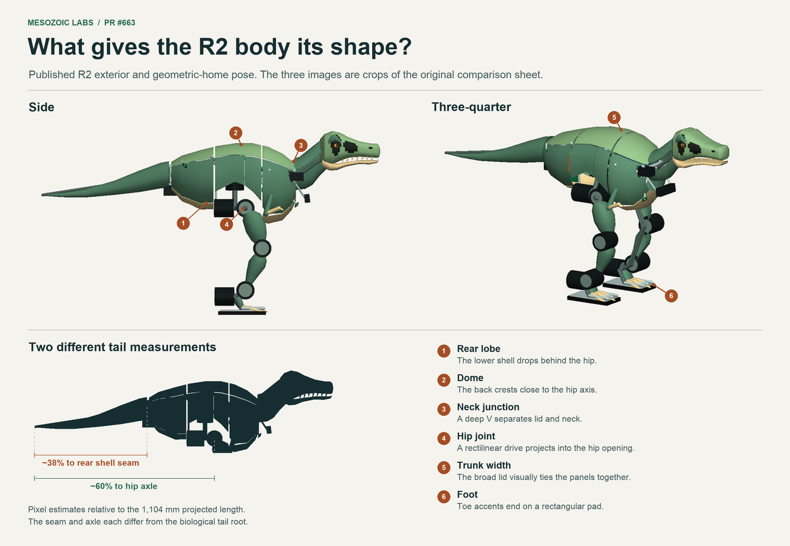

# Silhouette review

## The published comparison

PR #663 shows the PR #662 nominal and R2 compact models at a common scale in side, three-quarter and black silhouette views. The nominal exposes the rectangular equipment frame. The R2 hardware is easier to read as a dinosaur, particularly at its tapering tail, knee and raised ankle. Its broad top forms one dome, and the abrupt hip cutout divides the lower body into a pair of deep lobes. In three-quarter view, most of the forward-facing area reads as one continuous lid. The skull is identifiable, but the dark mechanism at the base of the neck interrupts the transition into the chest. The thigh fairing begins below the hip and the toe pieces sit on a rectangular pad.

The R2 side image contains about 503 pixels from tail tip to snout. The visible tail-to-shell seam lies about 190 pixels from the tip, while the hip-pitch axle lies about 303 pixels ahead of the tip. Those landmarks give 38% and 60% of the same projected length. Much of the apparent shortness comes from where the rear body covering ends. Neither is the biological first free caudal vertebra. PR #663's R3 partner view independently shows a similar domed lid, concentric motor/shaft openings and short toe pieces on broad soles; it is a different model and view. The four-view nominal baseline in the study is the identified #662 model.

## Comparing the candidate renders

| 10° candidate | Side and black profile | Front, plan and three-quarter | Limitation or useful role |
| --- | --- | --- | --- |
| A, tapered flank | The shallow belly behind the chest keeps the hip and its drive visible. The chest still ends steeply above the thigh and the lower leg is thin. | The broad back of the skull and its narrower muzzle remain legible from above. The chest spans much less width than the lateral motors when viewed head-on. | A practical comparison for mass and clearance. A swept rear edge to the chest could connect its silhouette to the upper thigh while preserving articulation. |
| B, deep ribcage | The belly is deepest ahead of the hip. The brow and deep rear jaw give the skull enough visual weight to balance this chest. The skull faces forward above the small rise in the neck. | Both the widest ribcage and the broad rear skull are visible in plan. From the front the chest sits between the leg drives; from three-quarter the thigh and short fixed arms identify the hip and shoulder. | Preferred whole-animal appearance. The lower edge at the hip is still abrupt, the shin is narrow, and the ankle motor and rectangular sole still draw attention. Confirm swept joint clearance before refining that edge. |
| C, open rib frame | The roof, tail and skull give a coherent dorsal line. Open ribs reveal a box-shaped payload, and daylight separates several rib ends in black profile. | Front and three-quarter views show the ribs bending toward the body centre around the exposed machinery. In plan the roof still spans much of the back. | Strongest as a cutaway or service demonstrator. Access, cleaning and the strength of the unsupported rib ends matter if it will be handled. |

The fixed collar bridges the pelvis and the powered tail in the side view. The plan view reveals its extra width and the three-quarter view shows the removable tray below it. All three still expose a dark sensor/mechanism at the base of the skull and retain long lower legs, lateral motor drums and rectangular feet. At 0° the chest-to-neck rise is quiet; 10° separates the shoulder, neck and forward-looking skull, while 20° accentuates the change of direction at the shoulder. This is one reviewer’s judgment. A blind recognition test across the three views could change the appearance ranking.

## Measured visual proportions

The measurements use the visible compiled neutral geometry. “Head” includes all visible geometry on the moving head body. Trunk covers include the named iliac, saddle, shoulder/scapular and rib sheets. The separately mounted fixed tail collar, its lower tray, cervical coverings and moving tail are excluded so measurements use the same anatomical stations across the three families. Each area is the union of side-projected trunk-cover triangles on a 0.5 mm grid. Overlapping near and far sheets count once. This quantifies the visual continuity of the coverings; the sections and inertial ledger give their spatial and mass distributions.

| 10° candidate | Head L × W × D, mm | Trunk cover width, mm | Side area of trunk covers, cm² | Area forward of hip | Hip–tip / full projected length | Powered hinge–tip / full projected length |
| --- | ---: | ---: | ---: | ---: | ---: | ---: |
| A | 251 × 134 × 111 | 183 | 423 | 48.1% | 59.6% | 35.7% |
| B | 273 × 155 × 141 | 227 | 601 | 51.3% | 60.9% | 37.7% |
| C | 264 × 142 × 116 | 198 | 239 | 38.2% | 60.4% | 38.1% |

The nine model hashes and unrounded-to-whole figures are in [proportions.json](proportions.json). Reproduce from the directory above `study/` with `python study/reference/proportions.py --out study/reference/proportions.json study/model/generated/*.xml`. The script reuses the same compiled visible surfaces as the render plates. Regenerate the R2 annotation with `python study/reference/audit_r2.py source/pr663/visual/redesign-at-60cm.png`.
