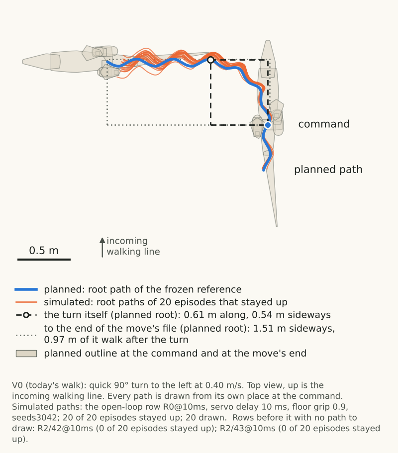
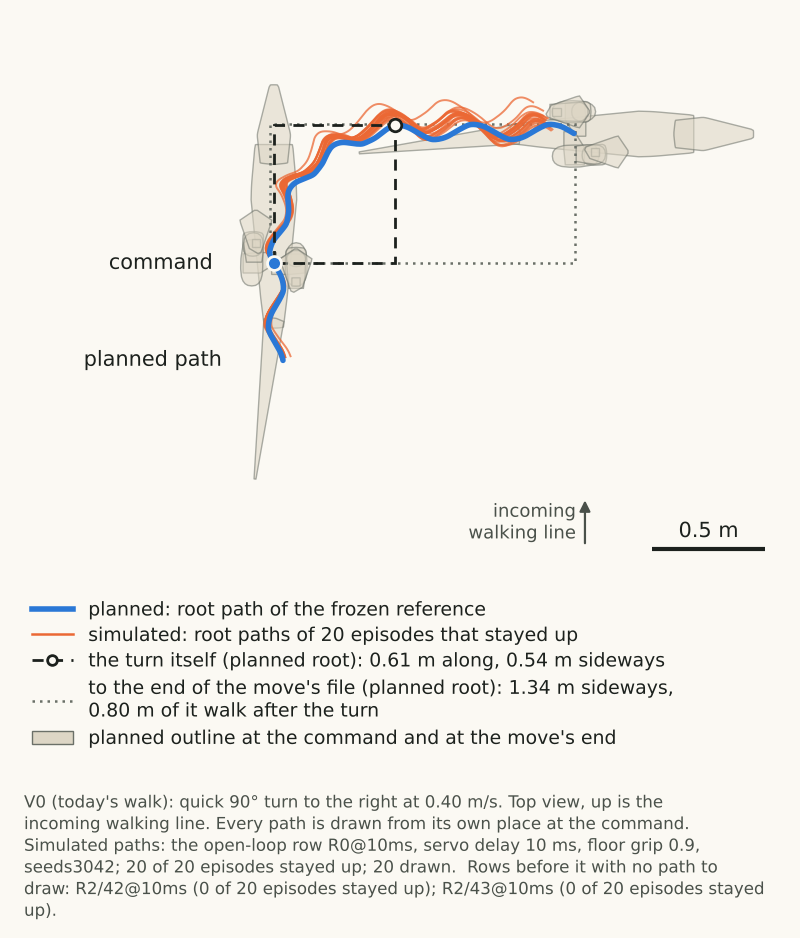
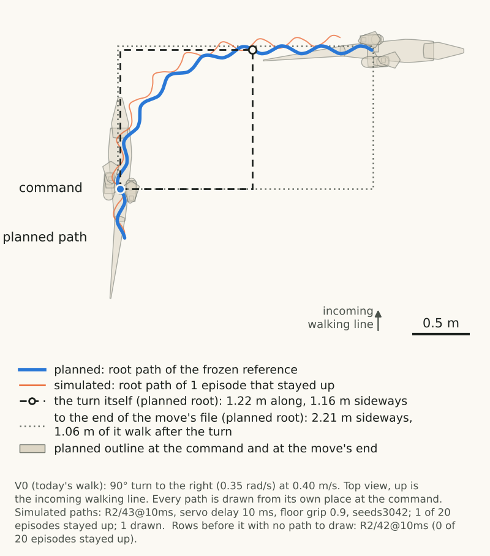
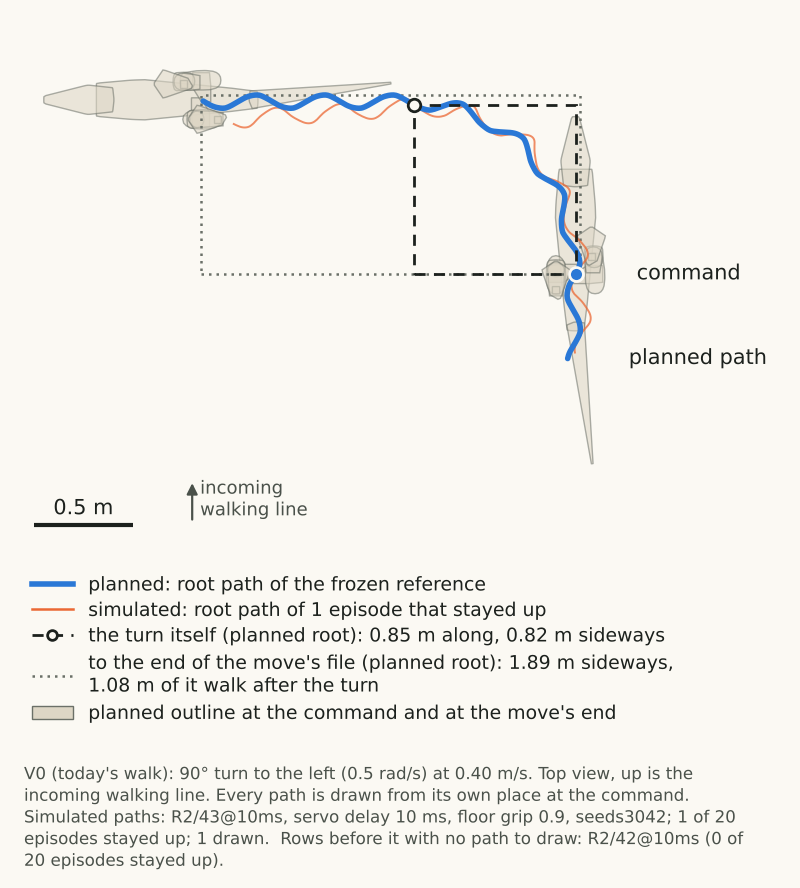

# The room a turn needs: V0 (today's walk) on 75-M-H-10

A view of the frozen reference and of the committed records. It gives no verdict and adopts nothing.

Two words are kept apart. **Planned** is read from the frozen reference, played kinematically at the bar's commanded clock, with no physics. **Simulated** is read from an episode's trace. No number mixes the two.

Lengths are in metres and in body lengths (BL). One body length is 1.759 m: the model's overall length at its home keyframe, from tail: cover_tail_seg_20 (the tail tip) to head: cover_skull (the snout tip).

Records are read from `stage2/runs/2026-11-15-75cm` and cited by their path under it; it held 60 turn records of this set when this file was written (2026-11-15T23:44:49Z). Set freeze 0, manifest `34a820e550b6`.

## turn/q90_left: quick 90° turn to the left at 0.40 m/s

Top view of quick 90° turn to the left at 0.40 m/s on V0 (today's walk); up is the incoming walking line. Blue, thick: the PLANNED path of the root (the frozen reference, kinematic), from 1 s before the command to the end of the move's file; the grey shapes are the PLANNED outline of the robot at the command and at the end of the move's file. The dashed box is the turn itself: the PLANNED root is 0.61 m along its incoming line and 0.54 m sideways (the ring) when the trunk has turned 90°, 2.16 s after the command. The dotted box is the PLANNED root's corner box to the end of the move's file, 4.45 s after the command: 0.62 m along and 1.51 m sideways (0.97 m of it after the turn); its sideways side is mostly the walk after the turn and depends on the file's length. Orange, thin: SIMULATED root paths of the 20 episodes that stayed up in `V0/75-M-H-10/seeds3042/eval/R0@10ms/turn/q90_left.json` (the open-loop row R0@10ms, servo delay 10 ms; 20 of 20 episodes stayed up).  Rows before it with no path to draw: R2/42@10ms (0 of 20 episodes stayed up); R2/43@10ms (0 of 20 episodes stayed up). Every path is drawn from its own position at the command. The scale bar is 0.5 m.

### Planned

From `transitions/turn90_pi4_left.npz` (sha256 `e8ad177483b9`), played at 1.05 times its own clock.

| reading (planned) | value |
|---|---|
| path speed commanded | 0.40 m/s on the reference's clock; 0.42 m/s on the bar's clock (the reference is played 1.05 times faster) |
| turn rate commanded | 45.0 deg/s on the reference's clock; 47.2 deg/s on the bar's clock |
| path radius commanded (speed over rate) | 0.51 m (0.29 BL) |
| radius fitted to the root's path, steady part | 0.50 m (0.28 BL), RMS 18 mm off the circle (the root sways) |
| **the turn itself**: until the trunk has turned 90° (to within 0.5°) | 2.16 s after the command |
| the turn itself, root: where it is then | 0.61 m (0.35 BL) along the incoming line, 0.54 m (0.31 BL) sideways |
| the turn itself, whole robot: along | -0.96 m (-0.55 BL) to 1.02 m (0.58 BL) |
| the turn itself, whole robot: sideways | -0.59 m (-0.34 BL) to 1.34 m (0.76 BL) |
| corner box to the end of the move's file, 4.45 s after the command; includes 0.97 m of walk after the turn; root: advance along the incoming line | largest 0.62 m (0.35 BL), at the move's end 0.59 m (0.34 BL) |
| corner box to the end of the move's file; root: sideways | largest 1.51 m (0.86 BL), at the move's end 1.51 m (0.86 BL) |
| corner box to the end of the move's file; whole robot: along | -0.96 m (-0.55 BL) to 1.02 m (0.58 BL) |
| corner box to the end of the move's file; whole robot: sideways | -0.59 m (-0.34 BL) to 2.31 m (1.31 BL) |
| swept radius over the steady part of the turn (the turning circle uses this one) | 1.11 m (0.63 BL), set by tail: cover_tail_seg_20 |
| largest distance from the turn's centre, from the command until the trunk has turned 90° | 1.19 m (0.68 BL), set by tail: cover_tail_seg_20, at the command |
| turning circle (twice the swept radius of the steady part) | 2.22 m (1.26 BL) |
| corridor for the 90° corner | 0.81 m (0.46 BL), inner corner set by left leg: cover_left_thigh_upper |
| turned 2 s after the command | 85.5° |
| turned at the end of the move (4.45 s after the command) | 90.0° |

Farthest point from the turn's centre, by part (planned): tail 1.11 m; head 0.96 m; trunk 0.80 m; right foot 0.68 m; right leg 0.67 m; left leg 0.53 m; left foot 0.51 m.

### Simulated

**`V0/75-M-H-10/seeds3042/eval/R0@0ms/turn/q90_left.json`: controller row R0@0ms, servo delay 0 ms, floor grip 0.9, block seeds3042.**

20 of 20 episodes stayed up; 0 fell.

Of the 20 read (median, then smallest to largest; the last column counts the episodes that have the reading: the turn itself is read only where the trunk turned the commanded angle to within 0.5° before the end of the move):

| reading (simulated) | median (smallest to largest) | episodes |
|---|---|---|
| radius fitted to the root's path, steady part | 0.50 m (0.43 to 0.51); 0.29 BL (0.25 to 0.29) | 20 |
| the turn itself, root: along the incoming line when the trunk has turned 90° | 0.65 m (0.60 to 0.68); 0.37 BL (0.34 to 0.39) | 20 |
| the turn itself, root: sideways when the trunk has turned 90° | 0.49 m (0.47 to 0.76); 0.28 BL (0.27 to 0.43) | 20 |
| the turn itself, whole robot: farthest along | 1.04 m (1.02 to 1.07); 0.59 BL (0.58 to 0.61) | 20 |
| the turn itself, whole robot: farthest sideways | 1.29 m (1.27 to 1.55); 0.73 BL (0.72 to 0.88) | 20 |
| walk after the turn, to the end of the move's file (root) | 0.90 m (0.61 to 0.92); 0.51 BL (0.35 to 0.52) | 20 |
| corner box to the end of the move's file, root: largest advance | 0.67 m (0.63 to 0.71); 0.38 BL (0.36 to 0.41) | 20 |
| corner box to the end of the move's file, root: advance at the end | 0.57 m (0.50 to 0.64); 0.33 BL (0.28 to 0.37) | 20 |
| corner box to the end of the move's file, root: largest sideways | 1.39 m (1.36 to 1.42); 0.79 BL (0.77 to 0.80) | 20 |
| corner box to the end of the move's file, root: sideways at the end | 1.39 m (1.36 to 1.42); 0.79 BL (0.77 to 0.80) | 20 |
| swept radius over the steady part | 1.13 m (1.08 to 1.14); 0.64 BL (0.62 to 0.65) | 20 |
| largest distance from the turn's centre, from the command until the trunk has turned 90° | 1.21 m (1.20 to 1.24); 0.69 BL (0.68 to 0.70) | 20 |
| turning circle (twice the swept radius of the steady part) | 2.27 m (2.17 to 2.28); 1.29 BL (1.23 to 1.30) | 20 |
| corridor for the 90° corner | 0.81 m (0.79 to 0.84); 0.46 BL (0.45 to 0.48) | 20 |
| the turn itself: seconds from the command until the trunk has turned 90° (to within 0.5°) | 2.18 s (2.14 to 2.94) | 20 |
| turn rate over the steady part | 45.6 deg/s (44.9 to 49.9) | 20 |
| path speed over the steady part | 0.40 m/s (0.38 to 0.41) | 20 |
| turned at the bar's judged instant | 79.6° (76.3 to 82.2) | 20 |
| turned at the end of the move | 88.7° (85.5 to 92.7) | 20 |
| turned at the end of the trace | 88.5° (84.7 to 93.6) | 20 |

**`V0/75-M-H-10/seeds3042/eval/R0@0ms/turn/q90_left_mu0.54.json`: controller row R0@0ms, servo delay 0 ms, floor grip 0.54, block seeds3042.**

19 of 20 episodes stayed up; 1 fell: 1 after the command (seed 3050, at 19.04 s).

Of the 19 read (median, then smallest to largest; the last column counts the episodes that have the reading: the turn itself is read only where the trunk turned the commanded angle to within 0.5° before the end of the move):

| reading (simulated) | median (smallest to largest) | episodes |
|---|---|---|
| radius fitted to the root's path, steady part | 0.53 m (0.51 to 0.54); 0.30 BL (0.29 to 0.31) | 19 |
| the turn itself, root: along the incoming line when the trunk has turned 90° | 0.71 m (0.68 to 0.73); 0.40 BL (0.39 to 0.42) | 18 |
| the turn itself, root: sideways when the trunk has turned 90° | 0.72 m (0.48 to 0.75); 0.41 BL (0.27 to 0.42) | 18 |
| the turn itself, whole robot: farthest along | 1.10 m (1.06 to 1.10); 0.62 BL (0.60 to 0.63) | 18 |
| the turn itself, whole robot: farthest sideways | 1.51 m (1.28 to 1.54); 0.86 BL (0.73 to 0.88) | 18 |
| walk after the turn, to the end of the move's file (root) | 0.61 m (0.59 to 0.85); 0.35 BL (0.33 to 0.48) | 18 |
| corner box to the end of the move's file, root: largest advance | 0.74 m (0.69 to 0.81); 0.42 BL (0.39 to 0.46) | 19 |
| corner box to the end of the move's file, root: advance at the end | 0.66 m (0.60 to 0.75); 0.38 BL (0.34 to 0.43) | 19 |
| corner box to the end of the move's file, root: largest sideways | 1.33 m (1.29 to 1.37); 0.76 BL (0.73 to 0.78) | 19 |
| corner box to the end of the move's file, root: sideways at the end | 1.33 m (1.29 to 1.37); 0.76 BL (0.73 to 0.78) | 19 |
| swept radius over the steady part | 1.14 m (1.11 to 1.16); 0.65 BL (0.63 to 0.66) | 19 |
| largest distance from the turn's centre, from the command until the trunk has turned 90° | 1.25 m (1.24 to 1.25); 0.71 BL (0.71 to 0.71) | 18 |
| turning circle (twice the swept radius of the steady part) | 2.28 m (2.23 to 2.32); 1.30 BL (1.27 to 1.32) | 19 |
| corridor for the 90° corner | 0.80 m (0.79 to 0.81); 0.46 BL (0.45 to 0.46) | 19 |
| the turn itself: seconds from the command until the trunk has turned 90° (to within 0.5°) | 2.92 s (2.30 to 2.98) | 18 |
| turn rate over the steady part | 43.9 deg/s (43.1 to 45.1) | 19 |
| path speed over the steady part | 0.40 m/s (0.39 to 0.41) | 19 |
| turned at the bar's judged instant | 72.0° (68.3 to 75.0) | 19 |
| turned at the end of the move | 85.2° (80.4 to 89.4) | 19 |
| turned at the end of the trace | 86.5° (80.3 to 92.7) | 19 |

**`V0/75-M-H-10/seeds3042/eval/R0@10ms/turn/q90_left.json`: controller row R0@10ms, servo delay 10 ms, floor grip 0.9, block seeds3042.**

20 of 20 episodes stayed up; 0 fell.

Of the 20 read (median, then smallest to largest; the last column counts the episodes that have the reading: the turn itself is read only where the trunk turned the commanded angle to within 0.5° before the end of the move):

| reading (simulated) | median (smallest to largest) | episodes |
|---|---|---|
| radius fitted to the root's path, steady part | 0.50 m (0.47 to 0.51); 0.28 BL (0.27 to 0.29) | 20 |
| the turn itself, root: along the incoming line when the trunk has turned 90° | 0.66 m (0.59 to 0.69); 0.38 BL (0.34 to 0.39) | 20 |
| the turn itself, root: sideways when the trunk has turned 90° | 0.48 m (0.47 to 0.78); 0.27 BL (0.27 to 0.44) | 20 |
| the turn itself, whole robot: farthest along | 1.06 m (1.01 to 1.08); 0.60 BL (0.58 to 0.62) | 20 |
| the turn itself, whole robot: farthest sideways | 1.28 m (1.27 to 1.57); 0.73 BL (0.72 to 0.89) | 20 |
| walk after the turn, to the end of the move's file (root) | 0.89 m (0.59 to 0.92); 0.51 BL (0.33 to 0.52) | 20 |
| corner box to the end of the move's file, root: largest advance | 0.68 m (0.63 to 0.72); 0.38 BL (0.36 to 0.41) | 20 |
| corner box to the end of the move's file, root: advance at the end | 0.57 m (0.45 to 0.66); 0.33 BL (0.26 to 0.37) | 20 |
| corner box to the end of the move's file, root: largest sideways | 1.37 m (1.35 to 1.42); 0.78 BL (0.77 to 0.81) | 20 |
| corner box to the end of the move's file, root: sideways at the end | 1.37 m (1.35 to 1.42); 0.78 BL (0.77 to 0.81) | 20 |
| swept radius over the steady part | 1.13 m (1.09 to 1.14); 0.64 BL (0.62 to 0.65) | 20 |
| largest distance from the turn's centre, from the command until the trunk has turned 90° | 1.21 m (1.21 to 1.23); 0.69 BL (0.69 to 0.70) | 20 |
| turning circle (twice the swept radius of the steady part) | 2.26 m (2.19 to 2.27); 1.29 BL (1.24 to 1.29) | 20 |
| corridor for the 90° corner | 0.81 m (0.80 to 0.82); 0.46 BL (0.45 to 0.47) | 20 |
| the turn itself: seconds from the command until the trunk has turned 90° (to within 0.5°) | 2.20 s (2.10 to 2.98) | 20 |
| turn rate over the steady part | 45.8 deg/s (44.9 to 47.1) | 20 |
| path speed over the steady part | 0.40 m/s (0.38 to 0.41) | 20 |
| turned at the bar's judged instant | 78.3° (76.1 to 84.8) | 20 |
| turned at the end of the move | 88.9° (83.1 to 94.6) | 20 |
| turned at the end of the trace | 89.1° (82.0 to 96.2) | 20 |

**`V0/75-M-H-10/seeds3042/eval/R0@10ms/turn/q90_left_mu0.54.json`: controller row R0@10ms, servo delay 10 ms, floor grip 0.54, block seeds3042.**

20 of 20 episodes stayed up; 0 fell.

Of the 20 read (median, then smallest to largest; the last column counts the episodes that have the reading: the turn itself is read only where the trunk turned the commanded angle to within 0.5° before the end of the move):

| reading (simulated) | median (smallest to largest) | episodes |
|---|---|---|
| radius fitted to the root's path, steady part | 0.52 m (0.49 to 0.54); 0.30 BL (0.28 to 0.30) | 20 |
| the turn itself, root: along the incoming line when the trunk has turned 90° | 0.71 m (0.68 to 0.75); 0.40 BL (0.39 to 0.42) | 20 |
| the turn itself, root: sideways when the trunk has turned 90° | 0.71 m (0.47 to 0.74); 0.40 BL (0.27 to 0.42) | 20 |
| the turn itself, whole robot: farthest along | 1.10 m (1.06 to 1.13); 0.63 BL (0.61 to 0.64) | 20 |
| the turn itself, whole robot: farthest sideways | 1.51 m (1.27 to 1.53); 0.86 BL (0.72 to 0.87) | 20 |
| walk after the turn, to the end of the move's file (root) | 0.60 m (0.58 to 0.87); 0.34 BL (0.33 to 0.49) | 20 |
| corner box to the end of the move's file, root: largest advance | 0.74 m (0.69 to 0.78); 0.42 BL (0.40 to 0.44) | 20 |
| corner box to the end of the move's file, root: advance at the end | 0.67 m (0.56 to 0.74); 0.38 BL (0.32 to 0.42) | 20 |
| corner box to the end of the move's file, root: largest sideways | 1.32 m (1.30 to 1.35); 0.75 BL (0.74 to 0.77) | 20 |
| corner box to the end of the move's file, root: sideways at the end | 1.32 m (1.30 to 1.35); 0.75 BL (0.74 to 0.77) | 20 |
| swept radius over the steady part | 1.14 m (1.11 to 1.15); 0.65 BL (0.63 to 0.66) | 20 |
| largest distance from the turn's centre, from the command until the trunk has turned 90° | 1.25 m (1.24 to 1.26); 0.71 BL (0.70 to 0.72) | 20 |
| turning circle (twice the swept radius of the steady part) | 2.28 m (2.22 to 2.31); 1.30 BL (1.26 to 1.31) | 20 |
| corridor for the 90° corner | 0.80 m (0.79 to 0.81); 0.46 BL (0.45 to 0.46) | 20 |
| the turn itself: seconds from the command until the trunk has turned 90° (to within 0.5°) | 2.93 s (2.24 to 3.00) | 20 |
| turn rate over the steady part | 44.2 deg/s (43.3 to 45.4) | 20 |
| path speed over the steady part | 0.40 m/s (0.39 to 0.41) | 20 |
| turned at the bar's judged instant | 71.4° (69.6 to 74.5) | 20 |
| turned at the end of the move | 85.1° (82.5 to 94.2) | 20 |
| turned at the end of the trace | 87.0° (83.1 to 95.3) | 20 |

**`V0/75-M-H-10/seeds3042/eval/R0@4ms/turn/q90_left.json`: controller row R0@4ms, servo delay 4 ms, floor grip 0.9, block seeds3042.**

19 of 20 episodes stayed up; 1 fell: 1 after the command (seed 3042, at 15.42 s).

Of the 19 read (median, then smallest to largest; the last column counts the episodes that have the reading: the turn itself is read only where the trunk turned the commanded angle to within 0.5° before the end of the move):

| reading (simulated) | median (smallest to largest) | episodes |
|---|---|---|
| radius fitted to the root's path, steady part | 0.50 m (0.47 to 0.52); 0.29 BL (0.27 to 0.29) | 19 |
| the turn itself, root: along the incoming line when the trunk has turned 90° | 0.64 m (0.59 to 0.70); 0.37 BL (0.34 to 0.40) | 18 |
| the turn itself, root: sideways when the trunk has turned 90° | 0.49 m (0.47 to 0.78); 0.28 BL (0.27 to 0.44) | 18 |
| the turn itself, whole robot: farthest along | 1.05 m (1.02 to 1.08); 0.60 BL (0.58 to 0.62) | 18 |
| the turn itself, whole robot: farthest sideways | 1.29 m (1.27 to 1.58); 0.73 BL (0.72 to 0.90) | 18 |
| walk after the turn, to the end of the move's file (root) | 0.90 m (0.58 to 0.92); 0.51 BL (0.33 to 0.52) | 18 |
| corner box to the end of the move's file, root: largest advance | 0.67 m (0.62 to 0.78); 0.38 BL (0.35 to 0.44) | 19 |
| corner box to the end of the move's file, root: advance at the end | 0.57 m (0.45 to 0.73); 0.32 BL (0.25 to 0.41) | 19 |
| corner box to the end of the move's file, root: largest sideways | 1.38 m (1.34 to 1.41); 0.78 BL (0.76 to 0.80) | 19 |
| corner box to the end of the move's file, root: sideways at the end | 1.38 m (1.34 to 1.41); 0.78 BL (0.76 to 0.80) | 19 |
| swept radius over the steady part | 1.13 m (1.09 to 1.14); 0.64 BL (0.62 to 0.65) | 19 |
| largest distance from the turn's centre, from the command until the trunk has turned 90° | 1.21 m (1.21 to 1.24); 0.69 BL (0.69 to 0.70) | 18 |
| turning circle (twice the swept radius of the steady part) | 2.26 m (2.19 to 2.28); 1.29 BL (1.24 to 1.30) | 19 |
| corridor for the 90° corner | 0.81 m (0.79 to 0.83); 0.46 BL (0.45 to 0.47) | 19 |
| the turn itself: seconds from the command until the trunk has turned 90° (to within 0.5°) | 2.18 s (2.12 to 3.00) | 18 |
| turn rate over the steady part | 45.8 deg/s (44.6 to 47.3) | 19 |
| path speed over the steady part | 0.40 m/s (0.39 to 0.41) | 19 |
| turned at the bar's judged instant | 79.5° (73.5 to 83.0) | 19 |
| turned at the end of the move | 88.5° (81.7 to 93.9) | 19 |
| turned at the end of the trace | 89.5° (80.4 to 95.5) | 19 |

**`V0/75-M-H-10/seeds3042/eval/R0@4ms/turn/q90_left_mu0.54.json`: controller row R0@4ms, servo delay 4 ms, floor grip 0.54, block seeds3042.**

19 of 20 episodes stayed up; 1 fell: 1 after the command (seed 3044, at 19.23 s).

Of the 19 read (median, then smallest to largest; the last column counts the episodes that have the reading: the turn itself is read only where the trunk turned the commanded angle to within 0.5° before the end of the move):

| reading (simulated) | median (smallest to largest) | episodes |
|---|---|---|
| radius fitted to the root's path, steady part | 0.52 m (0.49 to 0.53); 0.30 BL (0.28 to 0.30) | 19 |
| the turn itself, root: along the incoming line when the trunk has turned 90° | 0.71 m (0.69 to 0.73); 0.40 BL (0.39 to 0.42) | 19 |
| the turn itself, root: sideways when the trunk has turned 90° | 0.71 m (0.50 to 0.74); 0.40 BL (0.28 to 0.42) | 19 |
| the turn itself, whole robot: farthest along | 1.09 m (1.06 to 1.11); 0.62 BL (0.60 to 0.63) | 19 |
| the turn itself, whole robot: farthest sideways | 1.50 m (1.30 to 1.54); 0.85 BL (0.74 to 0.87) | 19 |
| walk after the turn, to the end of the move's file (root) | 0.64 m (0.60 to 0.84); 0.36 BL (0.34 to 0.48) | 19 |
| corner box to the end of the move's file, root: largest advance | 0.73 m (0.69 to 0.76); 0.42 BL (0.39 to 0.43) | 19 |
| corner box to the end of the move's file, root: advance at the end | 0.67 m (0.60 to 0.71); 0.38 BL (0.34 to 0.40) | 19 |
| corner box to the end of the move's file, root: largest sideways | 1.33 m (1.31 to 1.36); 0.75 BL (0.74 to 0.77) | 19 |
| corner box to the end of the move's file, root: sideways at the end | 1.33 m (1.31 to 1.36); 0.75 BL (0.74 to 0.77) | 19 |
| swept radius over the steady part | 1.14 m (1.11 to 1.15); 0.65 BL (0.63 to 0.65) | 19 |
| largest distance from the turn's centre, from the command until the trunk has turned 90° | 1.25 m (1.24 to 1.26); 0.71 BL (0.70 to 0.71) | 19 |
| turning circle (twice the swept radius of the steady part) | 2.28 m (2.22 to 2.30); 1.30 BL (1.26 to 1.30) | 19 |
| corridor for the 90° corner | 0.80 m (0.79 to 0.81); 0.46 BL (0.45 to 0.46) | 19 |
| the turn itself: seconds from the command until the trunk has turned 90° (to within 0.5°) | 2.92 s (2.32 to 2.96) | 19 |
| turn rate over the steady part | 44.2 deg/s (43.3 to 46.2) | 19 |
| path speed over the steady part | 0.40 m/s (0.39 to 0.41) | 19 |
| turned at the bar's judged instant | 71.4° (70.2 to 74.3) | 19 |
| turned at the end of the move | 85.5° (83.2 to 88.8) | 19 |
| turned at the end of the trace | 86.0° (81.9 to 109.5) | 19 |

**`V0/75-M-H-10/seeds3042/eval/R0@6ms/turn/q90_left.json`: controller row R0@6ms, servo delay 6 ms, floor grip 0.9, block seeds3042.**

20 of 20 episodes stayed up; 0 fell.

Of the 20 read (median, then smallest to largest; the last column counts the episodes that have the reading: the turn itself is read only where the trunk turned the commanded angle to within 0.5° before the end of the move):

| reading (simulated) | median (smallest to largest) | episodes |
|---|---|---|
| radius fitted to the root's path, steady part | 0.50 m (0.48 to 0.51); 0.28 BL (0.27 to 0.29) | 20 |
| the turn itself, root: along the incoming line when the trunk has turned 90° | 0.65 m (0.62 to 0.68); 0.37 BL (0.35 to 0.38) | 20 |
| the turn itself, root: sideways when the trunk has turned 90° | 0.48 m (0.47 to 0.56); 0.27 BL (0.27 to 0.32) | 20 |
| the turn itself, whole robot: farthest along | 1.05 m (1.02 to 1.07); 0.60 BL (0.58 to 0.61) | 20 |
| the turn itself, whole robot: farthest sideways | 1.28 m (1.27 to 1.35); 0.73 BL (0.72 to 0.77) | 20 |
| walk after the turn, to the end of the move's file (root) | 0.90 m (0.82 to 0.91); 0.51 BL (0.46 to 0.52) | 20 |
| corner box to the end of the move's file, root: largest advance | 0.67 m (0.64 to 0.70); 0.38 BL (0.36 to 0.40) | 20 |
| corner box to the end of the move's file, root: advance at the end | 0.59 m (0.51 to 0.63); 0.33 BL (0.29 to 0.36) | 20 |
| corner box to the end of the move's file, root: largest sideways | 1.37 m (1.36 to 1.41); 0.78 BL (0.77 to 0.80) | 20 |
| corner box to the end of the move's file, root: sideways at the end | 1.37 m (1.36 to 1.41); 0.78 BL (0.77 to 0.80) | 20 |
| swept radius over the steady part | 1.13 m (1.11 to 1.14); 0.64 BL (0.63 to 0.65) | 20 |
| largest distance from the turn's centre, from the command until the trunk has turned 90° | 1.21 m (1.21 to 1.23); 0.69 BL (0.69 to 0.70) | 20 |
| turning circle (twice the swept radius of the steady part) | 2.26 m (2.22 to 2.28); 1.28 BL (1.26 to 1.30) | 20 |
| corridor for the 90° corner | 0.81 m (0.79 to 0.82); 0.46 BL (0.45 to 0.47) | 20 |
| the turn itself: seconds from the command until the trunk has turned 90° (to within 0.5°) | 2.20 s (2.14 to 2.38) | 20 |
| turn rate over the steady part | 45.9 deg/s (45.0 to 46.7) | 20 |
| path speed over the steady part | 0.40 m/s (0.39 to 0.41) | 20 |
| turned at the bar's judged instant | 78.3° (75.8 to 82.2) | 20 |
| turned at the end of the move | 88.4° (84.6 to 91.8) | 20 |
| turned at the end of the trace | 88.4° (83.6 to 93.9) | 20 |

**`V0/75-M-H-10/seeds3042/eval/R0@6ms/turn/q90_left_mu0.54.json`: controller row R0@6ms, servo delay 6 ms, floor grip 0.54, block seeds3042.**

20 of 20 episodes stayed up; 0 fell.

Of the 20 read (median, then smallest to largest; the last column counts the episodes that have the reading: the turn itself is read only where the trunk turned the commanded angle to within 0.5° before the end of the move):

| reading (simulated) | median (smallest to largest) | episodes |
|---|---|---|
| radius fitted to the root's path, steady part | 0.52 m (0.50 to 0.54); 0.30 BL (0.28 to 0.31) | 20 |
| the turn itself, root: along the incoming line when the trunk has turned 90° | 0.70 m (0.65 to 0.75); 0.40 BL (0.37 to 0.43) | 19 |
| the turn itself, root: sideways when the trunk has turned 90° | 0.71 m (0.48 to 0.75); 0.40 BL (0.27 to 0.42) | 19 |
| the turn itself, whole robot: farthest along | 1.09 m (1.04 to 1.12); 0.62 BL (0.59 to 0.64) | 19 |
| the turn itself, whole robot: farthest sideways | 1.50 m (1.28 to 1.54); 0.85 BL (0.73 to 0.88) | 19 |
| walk after the turn, to the end of the move's file (root) | 0.61 m (0.58 to 0.89); 0.34 BL (0.33 to 0.50) | 19 |
| corner box to the end of the move's file, root: largest advance | 0.73 m (0.67 to 0.79); 0.41 BL (0.38 to 0.45) | 20 |
| corner box to the end of the move's file, root: advance at the end | 0.66 m (0.49 to 0.73); 0.38 BL (0.28 to 0.42) | 20 |
| corner box to the end of the move's file, root: largest sideways | 1.33 m (1.30 to 1.37); 0.75 BL (0.74 to 0.78) | 20 |
| corner box to the end of the move's file, root: sideways at the end | 1.33 m (1.30 to 1.37); 0.75 BL (0.74 to 0.78) | 20 |
| swept radius over the steady part | 1.14 m (1.12 to 1.15); 0.65 BL (0.64 to 0.65) | 20 |
| largest distance from the turn's centre, from the command until the trunk has turned 90° | 1.25 m (1.24 to 1.26); 0.71 BL (0.71 to 0.71) | 19 |
| turning circle (twice the swept radius of the steady part) | 2.29 m (2.24 to 2.30); 1.30 BL (1.27 to 1.31) | 20 |
| corridor for the 90° corner | 0.80 m (0.79 to 0.81); 0.46 BL (0.45 to 0.46) | 20 |
| the turn itself: seconds from the command until the trunk has turned 90° (to within 0.5°) | 2.92 s (2.20 to 3.00) | 19 |
| turn rate over the steady part | 44.1 deg/s (43.2 to 45.7) | 20 |
| path speed over the steady part | 0.40 m/s (0.39 to 0.41) | 20 |
| turned at the bar's judged instant | 72.1° (69.4 to 77.3) | 20 |
| turned at the end of the move | 85.0° (81.7 to 96.0) | 20 |
| turned at the end of the trace | 86.1° (81.9 to 94.5) | 20 |

**`V0/75-M-H-10/seeds3042/eval/R2/42@0ms/turn/q90_left.json`: controller row R2/42@0ms, servo delay 0 ms, floor grip 0.9, block seeds3042.**

20 of 20 episodes stayed up; 0 fell.

Of the 20 read (median, then smallest to largest; the last column counts the episodes that have the reading: the turn itself is read only where the trunk turned the commanded angle to within 0.5° before the end of the move):

| reading (simulated) | median (smallest to largest) | episodes |
|---|---|---|
| radius fitted to the root's path, steady part | 0.49 m (0.47 to 0.52); 0.28 BL (0.27 to 0.30) | 20 |
| the turn itself, root: along the incoming line when the trunk has turned 90° | 0.64 m (0.59 to 0.68); 0.36 BL (0.34 to 0.39) | 14 |
| the turn itself, root: sideways when the trunk has turned 90° | 0.51 m (0.48 to 0.83); 0.29 BL (0.27 to 0.47) | 14 |
| the turn itself, whole robot: farthest along | 1.03 m (1.01 to 1.05); 0.59 BL (0.57 to 0.60) | 14 |
| the turn itself, whole robot: farthest sideways | 1.31 m (1.28 to 1.63); 0.74 BL (0.73 to 0.93) | 14 |
| walk after the turn, to the end of the move's file (root) | 0.91 m (0.58 to 0.97); 0.52 BL (0.33 to 0.55) | 14 |
| corner box to the end of the move's file, root: largest advance | 0.66 m (0.60 to 0.70); 0.38 BL (0.34 to 0.40) | 20 |
| corner box to the end of the move's file, root: advance at the end | 0.61 m (0.48 to 0.69); 0.35 BL (0.27 to 0.39) | 20 |
| corner box to the end of the move's file, root: largest sideways | 1.44 m (1.38 to 1.50); 0.82 BL (0.78 to 0.85) | 20 |
| corner box to the end of the move's file, root: sideways at the end | 1.44 m (1.38 to 1.50); 0.82 BL (0.78 to 0.85) | 20 |
| swept radius over the steady part | 1.12 m (1.11 to 1.14); 0.63 BL (0.63 to 0.65) | 20 |
| largest distance from the turn's centre, from the command until the trunk has turned 90° | 1.21 m (1.20 to 1.26); 0.69 BL (0.68 to 0.72) | 14 |
| turning circle (twice the swept radius of the steady part) | 2.23 m (2.23 to 2.28); 1.27 BL (1.27 to 1.30) | 20 |
| corridor for the 90° corner | 0.82 m (0.81 to 0.84); 0.46 BL (0.46 to 0.48) | 20 |
| the turn itself: seconds from the command until the trunk has turned 90° (to within 0.5°) | 2.17 s (2.10 to 2.97) | 14 |
| turn rate over the steady part | 46.4 deg/s (44.3 to 47.3) | 20 |
| path speed over the steady part | 0.40 m/s (0.37 to 0.41) | 20 |
| turned at the bar's judged instant | 81.6° (76.9 to 86.2) | 20 |
| turned at the end of the move | 88.9° (83.1 to 95.6) | 20 |
| turned at the end of the trace | 88.5° (82.3 to 95.9) | 20 |

**`V0/75-M-H-10/seeds3042/eval/R2/42@0ms/turn/q90_left_mu0.54.json`: controller row R2/42@0ms, servo delay 0 ms, floor grip 0.54, block seeds3042.**

20 of 20 episodes stayed up; 0 fell.

Of the 20 read (median, then smallest to largest; the last column counts the episodes that have the reading: the turn itself is read only where the trunk turned the commanded angle to within 0.5° before the end of the move):

| reading (simulated) | median (smallest to largest) | episodes |
|---|---|---|
| radius fitted to the root's path, steady part | 0.53 m (0.49 to 0.56); 0.30 BL (0.28 to 0.32) | 20 |
| the turn itself, root: along the incoming line when the trunk has turned 90° | 0.69 m (0.67 to 0.73); 0.39 BL (0.38 to 0.42) | 13 |
| the turn itself, root: sideways when the trunk has turned 90° | 0.74 m (0.51 to 0.81); 0.42 BL (0.29 to 0.46) | 13 |
| the turn itself, whole robot: farthest along | 1.05 m (1.03 to 1.09); 0.60 BL (0.59 to 0.62) | 13 |
| the turn itself, whole robot: farthest sideways | 1.54 m (1.31 to 1.61); 0.87 BL (0.75 to 0.91) | 13 |
| walk after the turn, to the end of the move's file (root) | 0.58 m (0.55 to 0.87); 0.33 BL (0.31 to 0.49) | 13 |
| corner box to the end of the move's file, root: largest advance | 0.73 m (0.67 to 0.81); 0.42 BL (0.38 to 0.46) | 20 |
| corner box to the end of the move's file, root: advance at the end | 0.68 m (0.57 to 0.76); 0.39 BL (0.33 to 0.43) | 20 |
| corner box to the end of the move's file, root: largest sideways | 1.36 m (1.32 to 1.42); 0.77 BL (0.75 to 0.81) | 20 |
| corner box to the end of the move's file, root: sideways at the end | 1.36 m (1.32 to 1.42); 0.77 BL (0.75 to 0.81) | 20 |
| swept radius over the steady part | 1.15 m (1.13 to 1.16); 0.65 BL (0.64 to 0.66) | 20 |
| largest distance from the turn's centre, from the command until the trunk has turned 90° | 1.23 m (1.23 to 1.25); 0.70 BL (0.70 to 0.71) | 13 |
| turning circle (twice the swept radius of the steady part) | 2.29 m (2.25 to 2.32); 1.30 BL (1.28 to 1.32) | 20 |
| corridor for the 90° corner | 0.81 m (0.80 to 0.82); 0.46 BL (0.45 to 0.47) | 20 |
| the turn itself: seconds from the command until the trunk has turned 90° (to within 0.5°) | 3.00 s (2.28 to 3.09) | 13 |
| turn rate over the steady part | 43.0 deg/s (42.4 to 44.5) | 20 |
| path speed over the steady part | 0.40 m/s (0.37 to 0.42) | 20 |
| turned at the bar's judged instant | 73.2° (69.4 to 77.0) | 20 |
| turned at the end of the move | 84.4° (81.4 to 89.9) | 20 |
| turned at the end of the trace | 84.9° (81.0 to 90.6) | 20 |

**`V0/75-M-H-10/seeds3042/eval/R2/42@10ms/turn/q90_left.json`: controller row R2/42@10ms, servo delay 10 ms, floor grip 0.9, block seeds3042.**

0 of 20 episodes stayed up; 20 fell: 20 before the command (seeds 3042-3061, between 4.33 and 10.50 s).

No episode of this record stayed up with a trace that can be read: nothing is read.

**`V0/75-M-H-10/seeds3042/eval/R2/42@10ms/turn/q90_left_mu0.54.json`: controller row R2/42@10ms, servo delay 10 ms, floor grip 0.54, block seeds3042.**

0 of 20 episodes stayed up; 20 fell: 20 before the command (seeds 3042-3061, between 4.36 and 10.91 s).

No episode of this record stayed up with a trace that can be read: nothing is read.

**`V0/75-M-H-10/seeds3042/eval/R2/42@4ms/turn/q90_left.json`: controller row R2/42@4ms, servo delay 4 ms, floor grip 0.9, block seeds3042.**

20 of 20 episodes stayed up; 0 fell.

Of the 20 read (median, then smallest to largest; the last column counts the episodes that have the reading: the turn itself is read only where the trunk turned the commanded angle to within 0.5° before the end of the move):

| reading (simulated) | median (smallest to largest) | episodes |
|---|---|---|
| radius fitted to the root's path, steady part | 0.49 m (0.48 to 0.49); 0.28 BL (0.27 to 0.28) | 20 |
| the turn itself, root: along the incoming line when the trunk has turned 90° | 0.63 m (0.60 to 0.64); 0.36 BL (0.34 to 0.36) | 16 |
| the turn itself, root: sideways when the trunk has turned 90° | 0.52 m (0.51 to 0.62); 0.30 BL (0.29 to 0.35) | 16 |
| the turn itself, whole robot: farthest along | 1.03 m (1.01 to 1.04); 0.59 BL (0.58 to 0.59) | 16 |
| the turn itself, whole robot: farthest sideways | 1.31 m (1.30 to 1.42); 0.75 BL (0.74 to 0.81) | 16 |
| walk after the turn, to the end of the move's file (root) | 0.96 m (0.85 to 0.98); 0.55 BL (0.48 to 0.56) | 16 |
| corner box to the end of the move's file, root: largest advance | 0.64 m (0.61 to 0.67); 0.36 BL (0.35 to 0.38) | 20 |
| corner box to the end of the move's file, root: advance at the end | 0.61 m (0.54 to 0.65); 0.35 BL (0.31 to 0.37) | 20 |
| corner box to the end of the move's file, root: largest sideways | 1.48 m (1.46 to 1.51); 0.84 BL (0.83 to 0.86) | 20 |
| corner box to the end of the move's file, root: sideways at the end | 1.48 m (1.46 to 1.51); 0.84 BL (0.83 to 0.86) | 20 |
| swept radius over the steady part | 1.11 m (1.11 to 1.12); 0.63 BL (0.63 to 0.63) | 20 |
| largest distance from the turn's centre, from the command until the trunk has turned 90° | 1.20 m (1.19 to 1.20); 0.68 BL (0.68 to 0.68) | 16 |
| turning circle (twice the swept radius of the steady part) | 2.23 m (2.22 to 2.23); 1.27 BL (1.26 to 1.27) | 20 |
| corridor for the 90° corner | 0.82 m (0.81 to 0.82); 0.46 BL (0.46 to 0.47) | 20 |
| the turn itself: seconds from the command until the trunk has turned 90° (to within 0.5°) | 2.14 s (2.08 to 2.41) | 16 |
| turn rate over the steady part | 47.2 deg/s (46.9 to 47.8) | 20 |
| path speed over the steady part | 0.41 m/s (0.40 to 0.41) | 20 |
| turned at the bar's judged instant | 84.1° (82.5 to 86.8) | 20 |
| turned at the end of the move | 89.3° (87.6 to 92.1) | 20 |
| turned at the end of the trace | 89.6° (87.6 to 92.4) | 20 |

**`V0/75-M-H-10/seeds3042/eval/R2/42@4ms/turn/q90_left_mu0.54.json`: controller row R2/42@4ms, servo delay 4 ms, floor grip 0.54, block seeds3042.**

20 of 20 episodes stayed up; 0 fell.

Of the 20 read (median, then smallest to largest; the last column counts the episodes that have the reading: the turn itself is read only where the trunk turned the commanded angle to within 0.5° before the end of the move):

| reading (simulated) | median (smallest to largest) | episodes |
|---|---|---|
| radius fitted to the root's path, steady part | 0.49 m (0.49 to 0.50); 0.28 BL (0.28 to 0.28) | 20 |
| the turn itself, root: along the incoming line when the trunk has turned 90° | 0.65 m (0.62 to 0.67); 0.37 BL (0.35 to 0.38) | 17 |
| the turn itself, root: sideways when the trunk has turned 90° | 0.51 m (0.50 to 0.52); 0.29 BL (0.28 to 0.30) | 17 |
| the turn itself, whole robot: farthest along | 1.05 m (1.02 to 1.06); 0.60 BL (0.58 to 0.60) | 17 |
| the turn itself, whole robot: farthest sideways | 1.30 m (1.29 to 1.32); 0.74 BL (0.74 to 0.75) | 17 |
| walk after the turn, to the end of the move's file (root) | 0.95 m (0.94 to 0.97); 0.54 BL (0.53 to 0.55) | 17 |
| corner box to the end of the move's file, root: largest advance | 0.66 m (0.63 to 0.70); 0.37 BL (0.36 to 0.40) | 20 |
| corner box to the end of the move's file, root: advance at the end | 0.63 m (0.55 to 0.68); 0.36 BL (0.31 to 0.38) | 20 |
| corner box to the end of the move's file, root: largest sideways | 1.46 m (1.44 to 1.49); 0.83 BL (0.82 to 0.85) | 20 |
| corner box to the end of the move's file, root: sideways at the end | 1.46 m (1.44 to 1.49); 0.83 BL (0.82 to 0.85) | 20 |
| swept radius over the steady part | 1.12 m (1.11 to 1.12); 0.63 BL (0.63 to 0.64) | 20 |
| largest distance from the turn's centre, from the command until the trunk has turned 90° | 1.21 m (1.21 to 1.23); 0.69 BL (0.69 to 0.70) | 17 |
| turning circle (twice the swept radius of the steady part) | 2.23 m (2.22 to 2.24); 1.27 BL (1.26 to 1.27) | 20 |
| corridor for the 90° corner | 0.81 m (0.81 to 0.82); 0.46 BL (0.46 to 0.47) | 20 |
| the turn itself: seconds from the command until the trunk has turned 90° (to within 0.5°) | 2.17 s (2.12 to 2.23) | 17 |
| turn rate over the steady part | 46.8 deg/s (46.6 to 47.6) | 20 |
| path speed over the steady part | 0.40 m/s (0.40 to 0.41) | 20 |
| turned at the bar's judged instant | 81.9° (80.0 to 84.5) | 20 |
| turned at the end of the move | 89.9° (87.9 to 92.6) | 20 |
| turned at the end of the trace | 89.6° (87.3 to 92.2) | 20 |

**`V0/75-M-H-10/seeds3042/eval/R2/42@6ms/turn/q90_left.json`: controller row R2/42@6ms, servo delay 6 ms, floor grip 0.9, block seeds3042.**

20 of 20 episodes stayed up; 0 fell.

Of the 20 read (median, then smallest to largest; the last column counts the episodes that have the reading: the turn itself is read only where the trunk turned the commanded angle to within 0.5° before the end of the move):

| reading (simulated) | median (smallest to largest) | episodes |
|---|---|---|
| radius fitted to the root's path, steady part | 0.49 m (0.49 to 0.50); 0.28 BL (0.28 to 0.29) | 20 |
| the turn itself, root: along the incoming line when the trunk has turned 90° | 0.62 m (0.60 to 0.65); 0.35 BL (0.34 to 0.37) | 14 |
| the turn itself, root: sideways when the trunk has turned 90° | 0.52 m (0.51 to 0.85); 0.30 BL (0.29 to 0.49) | 14 |
| the turn itself, whole robot: farthest along | 1.03 m (1.01 to 1.04); 0.59 BL (0.57 to 0.59) | 14 |
| the turn itself, whole robot: farthest sideways | 1.32 m (1.31 to 1.65); 0.75 BL (0.74 to 0.94) | 14 |
| walk after the turn, to the end of the move's file (root) | 0.95 m (0.62 to 0.98); 0.54 BL (0.35 to 0.56) | 14 |
| corner box to the end of the move's file, root: largest advance | 0.65 m (0.61 to 0.68); 0.37 BL (0.34 to 0.39) | 20 |
| corner box to the end of the move's file, root: advance at the end | 0.62 m (0.55 to 0.67); 0.35 BL (0.31 to 0.38) | 20 |
| corner box to the end of the move's file, root: largest sideways | 1.47 m (1.45 to 1.50); 0.84 BL (0.82 to 0.85) | 20 |
| corner box to the end of the move's file, root: sideways at the end | 1.47 m (1.45 to 1.50); 0.84 BL (0.82 to 0.85) | 20 |
| swept radius over the steady part | 1.11 m (1.11 to 1.12); 0.63 BL (0.63 to 0.64) | 20 |
| largest distance from the turn's centre, from the command until the trunk has turned 90° | 1.19 m (1.19 to 1.27); 0.68 BL (0.68 to 0.72) | 14 |
| turning circle (twice the swept radius of the steady part) | 2.23 m (2.23 to 2.24); 1.27 BL (1.27 to 1.27) | 20 |
| corridor for the 90° corner | 0.81 m (0.81 to 0.82); 0.46 BL (0.46 to 0.47) | 20 |
| the turn itself: seconds from the command until the trunk has turned 90° (to within 0.5°) | 2.17 s (2.09 to 3.01) | 14 |
| turn rate over the steady part | 46.9 deg/s (46.4 to 47.1) | 20 |
| path speed over the steady part | 0.40 m/s (0.40 to 0.41) | 20 |
| turned at the bar's judged instant | 83.1° (81.3 to 86.1) | 20 |
| turned at the end of the move | 88.6° (87.0 to 91.8) | 20 |
| turned at the end of the trace | 89.1° (87.9 to 92.4) | 20 |

**`V0/75-M-H-10/seeds3042/eval/R2/42@6ms/turn/q90_left_mu0.54.json`: controller row R2/42@6ms, servo delay 6 ms, floor grip 0.54, block seeds3042.**

20 of 20 episodes stayed up; 0 fell.

Of the 20 read (median, then smallest to largest; the last column counts the episodes that have the reading: the turn itself is read only where the trunk turned the commanded angle to within 0.5° before the end of the move):

| reading (simulated) | median (smallest to largest) | episodes |
|---|---|---|
| radius fitted to the root's path, steady part | 0.50 m (0.49 to 0.50); 0.28 BL (0.28 to 0.29) | 20 |
| the turn itself, root: along the incoming line when the trunk has turned 90° | 0.66 m (0.62 to 0.68); 0.37 BL (0.35 to 0.39) | 11 |
| the turn itself, root: sideways when the trunk has turned 90° | 0.52 m (0.50 to 1.16); 0.30 BL (0.29 to 0.66) | 11 |
| the turn itself, whole robot: farthest along | 1.05 m (1.02 to 1.06); 0.60 BL (0.58 to 0.60) | 11 |
| the turn itself, whole robot: farthest sideways | 1.32 m (1.30 to 1.95); 0.75 BL (0.74 to 1.11) | 11 |
| walk after the turn, to the end of the move's file (root) | 0.94 m (0.28 to 0.97); 0.53 BL (0.16 to 0.55) | 11 |
| corner box to the end of the move's file, root: largest advance | 0.68 m (0.63 to 0.72); 0.39 BL (0.36 to 0.41) | 20 |
| corner box to the end of the move's file, root: advance at the end | 0.66 m (0.56 to 0.71); 0.37 BL (0.32 to 0.40) | 20 |
| corner box to the end of the move's file, root: largest sideways | 1.44 m (1.42 to 1.49); 0.82 BL (0.81 to 0.85) | 20 |
| corner box to the end of the move's file, root: sideways at the end | 1.44 m (1.42 to 1.49); 0.82 BL (0.81 to 0.85) | 20 |
| swept radius over the steady part | 1.12 m (1.12 to 1.12); 0.64 BL (0.63 to 0.64) | 20 |
| largest distance from the turn's centre, from the command until the trunk has turned 90° | 1.22 m (1.21 to 1.56); 0.69 BL (0.69 to 0.88) | 11 |
| turning circle (twice the swept radius of the steady part) | 2.24 m (2.23 to 2.24); 1.27 BL (1.27 to 1.28) | 20 |
| corridor for the 90° corner | 0.81 m (0.80 to 0.82); 0.46 BL (0.46 to 0.46) | 20 |
| the turn itself: seconds from the command until the trunk has turned 90° (to within 0.5°) | 2.22 s (2.13 to 3.82) | 11 |
| turn rate over the steady part | 46.3 deg/s (45.9 to 47.2) | 20 |
| path speed over the steady part | 0.40 m/s (0.40 to 0.41) | 20 |
| turned at the bar's judged instant | 79.7° (77.9 to 83.8) | 20 |
| turned at the end of the move | 88.2° (85.8 to 91.8) | 20 |
| turned at the end of the trace | 88.7° (86.4 to 92.4) | 20 |

**`V0/75-M-H-10/seeds3042/eval/R2/43@0ms/turn/q90_left.json`: controller row R2/43@0ms, servo delay 0 ms, floor grip 0.9, block seeds3042.**

20 of 20 episodes stayed up; 0 fell.

Of the 20 read (median, then smallest to largest; the last column counts the episodes that have the reading: the turn itself is read only where the trunk turned the commanded angle to within 0.5° before the end of the move):

| reading (simulated) | median (smallest to largest) | episodes |
|---|---|---|
| radius fitted to the root's path, steady part | 0.50 m (0.49 to 0.51); 0.28 BL (0.28 to 0.29) | 20 |
| the turn itself, root: along the incoming line when the trunk has turned 90° | 0.63 m (0.60 to 0.69); 0.36 BL (0.34 to 0.39) | 15 |
| the turn itself, root: sideways when the trunk has turned 90° | 0.54 m (0.51 to 1.31); 0.31 BL (0.29 to 0.74) | 15 |
| the turn itself, whole robot: farthest along | 1.03 m (1.01 to 1.05); 0.59 BL (0.58 to 0.60) | 15 |
| the turn itself, whole robot: farthest sideways | 1.33 m (1.30 to 2.10); 0.76 BL (0.74 to 1.19) | 15 |
| walk after the turn, to the end of the move's file (root) | 0.91 m (0.17 to 0.95); 0.52 BL (0.10 to 0.54) | 15 |
| corner box to the end of the move's file, root: largest advance | 0.65 m (0.63 to 0.74); 0.37 BL (0.36 to 0.42) | 20 |
| corner box to the end of the move's file, root: advance at the end | 0.63 m (0.59 to 0.72); 0.36 BL (0.34 to 0.41) | 20 |
| corner box to the end of the move's file, root: largest sideways | 1.46 m (1.36 to 1.47); 0.83 BL (0.77 to 0.84) | 20 |
| corner box to the end of the move's file, root: sideways at the end | 1.46 m (1.36 to 1.47); 0.83 BL (0.77 to 0.84) | 20 |
| swept radius over the steady part | 1.12 m (1.11 to 1.14); 0.63 BL (0.63 to 0.65) | 20 |
| largest distance from the turn's centre, from the command until the trunk has turned 90° | 1.21 m (1.19 to 1.67); 0.69 BL (0.68 to 0.95) | 15 |
| turning circle (twice the swept radius of the steady part) | 2.23 m (2.22 to 2.27); 1.27 BL (1.26 to 1.29) | 20 |
| corridor for the 90° corner | 0.81 m (0.80 to 0.82); 0.46 BL (0.46 to 0.47) | 20 |
| the turn itself: seconds from the command until the trunk has turned 90° (to within 0.5°) | 2.20 s (2.14 to 4.04) | 15 |
| turn rate over the steady part | 46.2 deg/s (44.0 to 47.3) | 20 |
| path speed over the steady part | 0.40 m/s (0.39 to 0.41) | 20 |
| turned at the bar's judged instant | 82.7° (75.5 to 84.1) | 20 |
| turned at the end of the move | 88.1° (82.9 to 89.4) | 20 |
| turned at the end of the trace | 88.1° (80.8 to 90.1) | 20 |

**`V0/75-M-H-10/seeds3042/eval/R2/43@0ms/turn/q90_left_mu0.54.json`: controller row R2/43@0ms, servo delay 0 ms, floor grip 0.54, block seeds3042.**

19 of 20 episodes stayed up; 1 fell: 1 after the command (seed 3049, at 18.84 s).

Of the 19 read (median, then smallest to largest; the last column counts the episodes that have the reading: the turn itself is read only where the trunk turned the commanded angle to within 0.5° before the end of the move):

| reading (simulated) | median (smallest to largest) | episodes |
|---|---|---|
| radius fitted to the root's path, steady part | 0.52 m (0.51 to 0.54); 0.30 BL (0.29 to 0.31) | 19 |
| the turn itself, root: along the incoming line when the trunk has turned 90° | 0.68 m (0.65 to 0.73); 0.39 BL (0.37 to 0.41) | 12 |
| the turn itself, root: sideways when the trunk has turned 90° | 0.78 m (0.51 to 1.14); 0.44 BL (0.29 to 0.65) | 12 |
| the turn itself, whole robot: farthest along | 1.05 m (1.02 to 1.06); 0.60 BL (0.58 to 0.60) | 12 |
| the turn itself, whole robot: farthest sideways | 1.58 m (1.31 to 1.94); 0.90 BL (0.74 to 1.10) | 12 |
| walk after the turn, to the end of the move's file (root) | 0.58 m (0.25 to 0.89); 0.33 BL (0.14 to 0.50) | 12 |
| corner box to the end of the move's file, root: largest advance | 0.72 m (0.66 to 0.80); 0.41 BL (0.38 to 0.45) | 19 |
| corner box to the end of the move's file, root: advance at the end | 0.68 m (0.57 to 0.77); 0.39 BL (0.32 to 0.44) | 19 |
| corner box to the end of the move's file, root: largest sideways | 1.37 m (1.33 to 1.41); 0.78 BL (0.76 to 0.80) | 19 |
| corner box to the end of the move's file, root: sideways at the end | 1.37 m (1.33 to 1.41); 0.78 BL (0.76 to 0.80) | 19 |
| swept radius over the steady part | 1.13 m (1.12 to 1.15); 0.65 BL (0.64 to 0.66) | 19 |
| largest distance from the turn's centre, from the command until the trunk has turned 90° | 1.23 m (1.22 to 1.54); 0.70 BL (0.69 to 0.88) | 12 |
| turning circle (twice the swept radius of the steady part) | 2.27 m (2.25 to 2.31); 1.29 BL (1.28 to 1.31) | 19 |
| corridor for the 90° corner | 0.80 m (0.80 to 0.81); 0.46 BL (0.45 to 0.46) | 19 |
| the turn itself: seconds from the command until the trunk has turned 90° (to within 0.5°) | 2.99 s (2.20 to 3.86) | 12 |
| turn rate over the steady part | 43.9 deg/s (42.4 to 44.8) | 19 |
| path speed over the steady part | 0.40 m/s (0.39 to 0.41) | 19 |
| turned at the bar's judged instant | 75.4° (71.7 to 79.2) | 19 |
| turned at the end of the move | 84.2° (78.7 to 88.2) | 19 |
| turned at the end of the trace | 83.8° (78.4 to 90.1) | 19 |

**`V0/75-M-H-10/seeds3042/eval/R2/43@10ms/turn/q90_left.json`: controller row R2/43@10ms, servo delay 10 ms, floor grip 0.9, block seeds3042.**

0 of 20 episodes stayed up; 20 fell: 19 before the command (seeds 3042-3055, 3057-3061, between 4.37 and 8.17 s); 1 after the command (seed 3056, at 15.62 s).

No episode of this record stayed up with a trace that can be read: nothing is read.

**`V0/75-M-H-10/seeds3042/eval/R2/43@10ms/turn/q90_left_mu0.54.json`: controller row R2/43@10ms, servo delay 10 ms, floor grip 0.54, block seeds3042.**

0 of 20 episodes stayed up; 20 fell: 17 before the command (seeds 3043-3051, 3053-3058, 3060-3061, between 4.34 and 9.51 s); 3 after the command (seeds 3042, 3052, 3059, between 15.43 and 15.69 s).

No episode of this record stayed up with a trace that can be read: nothing is read.

**`V0/75-M-H-10/seeds3042/eval/R2/43@4ms/turn/q90_left.json`: controller row R2/43@4ms, servo delay 4 ms, floor grip 0.9, block seeds3042.**

20 of 20 episodes stayed up; 0 fell.

Of the 20 read (median, then smallest to largest; the last column counts the episodes that have the reading: the turn itself is read only where the trunk turned the commanded angle to within 0.5° before the end of the move):

| reading (simulated) | median (smallest to largest) | episodes |
|---|---|---|
| radius fitted to the root's path, steady part | 0.49 m (0.48 to 0.50); 0.28 BL (0.28 to 0.28) | 20 |
| the turn itself, root: along the incoming line when the trunk has turned 90° | 0.62 m (0.57 to 0.64); 0.35 BL (0.33 to 0.36) | 17 |
| the turn itself, root: sideways when the trunk has turned 90° | 0.52 m (0.51 to 0.63); 0.30 BL (0.29 to 0.36) | 17 |
| the turn itself, whole robot: farthest along | 1.03 m (1.00 to 1.04); 0.59 BL (0.57 to 0.59) | 17 |
| the turn itself, whole robot: farthest sideways | 1.31 m (1.31 to 1.42); 0.75 BL (0.74 to 0.81) | 17 |
| walk after the turn, to the end of the move's file (root) | 0.96 m (0.84 to 1.00); 0.55 BL (0.48 to 0.57) | 17 |
| corner box to the end of the move's file, root: largest advance | 0.64 m (0.59 to 0.69); 0.36 BL (0.34 to 0.39) | 20 |
| corner box to the end of the move's file, root: advance at the end | 0.61 m (0.50 to 0.67); 0.35 BL (0.28 to 0.38) | 20 |
| corner box to the end of the move's file, root: largest sideways | 1.48 m (1.45 to 1.52); 0.84 BL (0.82 to 0.86) | 20 |
| corner box to the end of the move's file, root: sideways at the end | 1.48 m (1.45 to 1.52); 0.84 BL (0.82 to 0.86) | 20 |
| swept radius over the steady part | 1.11 m (1.11 to 1.12); 0.63 BL (0.63 to 0.63) | 20 |
| largest distance from the turn's centre, from the command until the trunk has turned 90° | 1.20 m (1.19 to 1.21); 0.68 BL (0.68 to 0.69) | 17 |
| turning circle (twice the swept radius of the steady part) | 2.23 m (2.22 to 2.23); 1.27 BL (1.26 to 1.27) | 20 |
| corridor for the 90° corner | 0.81 m (0.81 to 0.82); 0.46 BL (0.46 to 0.47) | 20 |
| the turn itself: seconds from the command until the trunk has turned 90° (to within 0.5°) | 2.13 s (2.03 to 2.41) | 17 |
| turn rate over the steady part | 47.4 deg/s (47.0 to 48.5) | 20 |
| path speed over the steady part | 0.41 m/s (0.40 to 0.41) | 20 |
| turned at the bar's judged instant | 84.1° (81.8 to 88.5) | 20 |
| turned at the end of the move | 89.4° (86.9 to 93.6) | 20 |
| turned at the end of the trace | 89.8° (87.2 to 94.1) | 20 |

**`V0/75-M-H-10/seeds3042/eval/R2/43@4ms/turn/q90_left_mu0.54.json`: controller row R2/43@4ms, servo delay 4 ms, floor grip 0.54, block seeds3042.**

20 of 20 episodes stayed up; 0 fell.

Of the 20 read (median, then smallest to largest; the last column counts the episodes that have the reading: the turn itself is read only where the trunk turned the commanded angle to within 0.5° before the end of the move):

| reading (simulated) | median (smallest to largest) | episodes |
|---|---|---|
| radius fitted to the root's path, steady part | 0.49 m (0.48 to 0.53); 0.28 BL (0.28 to 0.30) | 20 |
| the turn itself, root: along the incoming line when the trunk has turned 90° | 0.65 m (0.59 to 0.68); 0.37 BL (0.34 to 0.38) | 17 |
| the turn itself, root: sideways when the trunk has turned 90° | 0.51 m (0.50 to 0.82); 0.29 BL (0.28 to 0.47) | 17 |
| the turn itself, whole robot: farthest along | 1.05 m (1.01 to 1.06); 0.60 BL (0.58 to 0.60) | 17 |
| the turn itself, whole robot: farthest sideways | 1.30 m (1.29 to 1.62); 0.74 BL (0.73 to 0.92) | 17 |
| walk after the turn, to the end of the move's file (root) | 0.95 m (0.62 to 0.98); 0.54 BL (0.35 to 0.55) | 17 |
| corner box to the end of the move's file, root: largest advance | 0.66 m (0.61 to 0.79); 0.38 BL (0.35 to 0.45) | 20 |
| corner box to the end of the move's file, root: advance at the end | 0.62 m (0.50 to 0.79); 0.36 BL (0.29 to 0.45) | 20 |
| corner box to the end of the move's file, root: largest sideways | 1.45 m (1.40 to 1.50); 0.83 BL (0.79 to 0.85) | 20 |
| corner box to the end of the move's file, root: sideways at the end | 1.45 m (1.40 to 1.50); 0.83 BL (0.79 to 0.85) | 20 |
| swept radius over the steady part | 1.12 m (1.11 to 1.13); 0.63 BL (0.63 to 0.64) | 20 |
| largest distance from the turn's centre, from the command until the trunk has turned 90° | 1.21 m (1.21 to 1.25); 0.69 BL (0.69 to 0.71) | 17 |
| turning circle (twice the swept radius of the steady part) | 2.23 m (2.22 to 2.27); 1.27 BL (1.26 to 1.29) | 20 |
| corridor for the 90° corner | 0.81 m (0.80 to 0.82); 0.46 BL (0.45 to 0.47) | 20 |
| the turn itself: seconds from the command until the trunk has turned 90° (to within 0.5°) | 2.15 s (2.07 to 2.97) | 17 |
| turn rate over the steady part | 47.2 deg/s (44.1 to 47.8) | 20 |
| path speed over the steady part | 0.41 m/s (0.40 to 0.41) | 20 |
| turned at the bar's judged instant | 82.4° (74.2 to 86.9) | 20 |
| turned at the end of the move | 90.1° (81.3 to 94.8) | 20 |
| turned at the end of the trace | 89.7° (81.2 to 94.7) | 20 |

**`V0/75-M-H-10/seeds3042/eval/R2/43@6ms/turn/q90_left.json`: controller row R2/43@6ms, servo delay 6 ms, floor grip 0.9, block seeds3042.**

20 of 20 episodes stayed up; 0 fell.

Of the 20 read (median, then smallest to largest; the last column counts the episodes that have the reading: the turn itself is read only where the trunk turned the commanded angle to within 0.5° before the end of the move):

| reading (simulated) | median (smallest to largest) | episodes |
|---|---|---|
| radius fitted to the root's path, steady part | 0.50 m (0.49 to 0.50); 0.28 BL (0.28 to 0.28) | 20 |
| the turn itself, root: along the incoming line when the trunk has turned 90° | 0.63 m (0.60 to 0.66); 0.36 BL (0.34 to 0.37) | 8 |
| the turn itself, root: sideways when the trunk has turned 90° | 0.52 m (0.52 to 1.19); 0.30 BL (0.29 to 0.67) | 8 |
| the turn itself, whole robot: farthest along | 1.03 m (1.01 to 1.04); 0.59 BL (0.57 to 0.59) | 8 |
| the turn itself, whole robot: farthest sideways | 1.31 m (1.31 to 1.98); 0.75 BL (0.74 to 1.13) | 8 |
| walk after the turn, to the end of the move's file (root) | 0.95 m (0.28 to 0.97); 0.54 BL (0.16 to 0.55) | 8 |
| corner box to the end of the move's file, root: largest advance | 0.66 m (0.62 to 0.74); 0.37 BL (0.35 to 0.42) | 20 |
| corner box to the end of the move's file, root: advance at the end | 0.64 m (0.52 to 0.70); 0.36 BL (0.29 to 0.40) | 20 |
| corner box to the end of the move's file, root: largest sideways | 1.47 m (1.35 to 1.49); 0.83 BL (0.77 to 0.85) | 20 |
| corner box to the end of the move's file, root: sideways at the end | 1.47 m (1.35 to 1.49); 0.83 BL (0.77 to 0.85) | 20 |
| swept radius over the steady part | 1.12 m (1.11 to 1.12); 0.63 BL (0.63 to 0.64) | 20 |
| largest distance from the turn's centre, from the command until the trunk has turned 90° | 1.20 m (1.20 to 1.58); 0.68 BL (0.68 to 0.90) | 8 |
| turning circle (twice the swept radius of the steady part) | 2.23 m (2.23 to 2.24); 1.27 BL (1.27 to 1.28) | 20 |
| corridor for the 90° corner | 0.81 m (0.81 to 0.82); 0.46 BL (0.46 to 0.47) | 20 |
| the turn itself: seconds from the command until the trunk has turned 90° (to within 0.5°) | 2.15 s (2.11 to 3.79) | 8 |
| turn rate over the steady part | 47.1 deg/s (45.1 to 47.3) | 20 |
| path speed over the steady part | 0.41 m/s (0.39 to 0.41) | 20 |
| turned at the bar's judged instant | 83.0° (76.4 to 85.5) | 20 |
| turned at the end of the move | 87.9° (82.0 to 91.1) | 20 |
| turned at the end of the trace | 88.3° (79.8 to 91.6) | 20 |

**`V0/75-M-H-10/seeds3042/eval/R2/43@6ms/turn/q90_left_mu0.54.json`: controller row R2/43@6ms, servo delay 6 ms, floor grip 0.54, block seeds3042.**

20 of 20 episodes stayed up; 0 fell.

Of the 20 read (median, then smallest to largest; the last column counts the episodes that have the reading: the turn itself is read only where the trunk turned the commanded angle to within 0.5° before the end of the move):

| reading (simulated) | median (smallest to largest) | episodes |
|---|---|---|
| radius fitted to the root's path, steady part | 0.50 m (0.49 to 0.51); 0.28 BL (0.28 to 0.29) | 20 |
| the turn itself, root: along the incoming line when the trunk has turned 90° | 0.65 m (0.62 to 0.68); 0.37 BL (0.35 to 0.38) | 9 |
| the turn itself, root: sideways when the trunk has turned 90° | 0.52 m (0.51 to 1.17); 0.30 BL (0.29 to 0.66) | 9 |
| the turn itself, whole robot: farthest along | 1.05 m (1.03 to 1.05); 0.59 BL (0.59 to 0.60) | 9 |
| the turn itself, whole robot: farthest sideways | 1.32 m (1.30 to 1.96); 0.75 BL (0.74 to 1.11) | 9 |
| walk after the turn, to the end of the move's file (root) | 0.94 m (0.28 to 0.96); 0.53 BL (0.16 to 0.54) | 9 |
| corner box to the end of the move's file, root: largest advance | 0.69 m (0.65 to 0.74); 0.39 BL (0.37 to 0.42) | 20 |
| corner box to the end of the move's file, root: advance at the end | 0.67 m (0.60 to 0.73); 0.38 BL (0.34 to 0.42) | 20 |
| corner box to the end of the move's file, root: largest sideways | 1.44 m (1.41 to 1.47); 0.82 BL (0.80 to 0.83) | 20 |
| corner box to the end of the move's file, root: sideways at the end | 1.44 m (1.41 to 1.47); 0.82 BL (0.80 to 0.83) | 20 |
| swept radius over the steady part | 1.12 m (1.12 to 1.13); 0.64 BL (0.64 to 0.64) | 20 |
| largest distance from the turn's centre, from the command until the trunk has turned 90° | 1.22 m (1.21 to 1.55); 0.69 BL (0.69 to 0.88) | 9 |
| turning circle (twice the swept radius of the steady part) | 2.24 m (2.23 to 2.25); 1.27 BL (1.27 to 1.28) | 20 |
| corridor for the 90° corner | 0.81 m (0.80 to 0.82); 0.46 BL (0.46 to 0.46) | 20 |
| the turn itself: seconds from the command until the trunk has turned 90° (to within 0.5°) | 2.21 s (2.15 to 3.79) | 9 |
| turn rate over the steady part | 46.6 deg/s (45.7 to 47.2) | 20 |
| path speed over the steady part | 0.40 m/s (0.40 to 0.41) | 20 |
| turned at the bar's judged instant | 79.7° (77.2 to 82.8) | 20 |
| turned at the end of the move | 87.4° (85.4 to 90.4) | 20 |
| turned at the end of the trace | 87.1° (85.2 to 90.7) | 20 |

## turn/q90_right: quick 90° turn to the right at 0.40 m/s

Top view of quick 90° turn to the right at 0.40 m/s on V0 (today's walk); up is the incoming walking line. Blue, thick: the PLANNED path of the root (the frozen reference, kinematic), from 1 s before the command to the end of the move's file; the grey shapes are the PLANNED outline of the robot at the command and at the end of the move's file. The dashed box is the turn itself: the PLANNED root is 0.61 m along its incoming line and 0.54 m sideways (the ring) when the trunk has turned 90°, 2.15 s after the command. The dotted box is the PLANNED root's corner box to the end of the move's file, 4.04 s after the command: 0.62 m along and 1.34 m sideways (0.80 m of it after the turn); its sideways side is mostly the walk after the turn and depends on the file's length. Orange, thin: SIMULATED root paths of the 20 episodes that stayed up in `V0/75-M-H-10/seeds3042/eval/R0@10ms/turn/q90_right.json` (the open-loop row R0@10ms, servo delay 10 ms; 20 of 20 episodes stayed up).  Rows before it with no path to draw: R2/42@10ms (0 of 20 episodes stayed up); R2/43@10ms (0 of 20 episodes stayed up). Every path is drawn from its own position at the command. The scale bar is 0.5 m.

### Planned

From `transitions/turn90_pi4_right.npz` (sha256 `83762a582d9d`), played at 1.05 times its own clock.

| reading (planned) | value |
|---|---|
| path speed commanded | 0.40 m/s on the reference's clock; 0.42 m/s on the bar's clock (the reference is played 1.05 times faster) |
| turn rate commanded | 45.0 deg/s on the reference's clock; 47.2 deg/s on the bar's clock |
| path radius commanded (speed over rate) | 0.51 m (0.29 BL) |
| radius fitted to the root's path, steady part | 0.50 m (0.28 BL), RMS 18 mm off the circle (the root sways) |
| **the turn itself**: until the trunk has turned 90° (to within 0.5°) | 2.15 s after the command |
| the turn itself, root: where it is then | 0.61 m (0.35 BL) along the incoming line, 0.54 m (0.31 BL) sideways |
| the turn itself, whole robot: along | -0.96 m (-0.55 BL) to 1.02 m (0.58 BL) |
| the turn itself, whole robot: sideways | -0.59 m (-0.34 BL) to 1.33 m (0.76 BL) |
| corner box to the end of the move's file, 4.04 s after the command; includes 0.80 m of walk after the turn; root: advance along the incoming line | largest 0.62 m (0.35 BL), at the move's end 0.58 m (0.33 BL) |
| corner box to the end of the move's file; root: sideways | largest 1.34 m (0.76 BL), at the move's end 1.34 m (0.76 BL) |
| corner box to the end of the move's file; whole robot: along | -0.96 m (-0.55 BL) to 1.02 m (0.58 BL) |
| corner box to the end of the move's file; whole robot: sideways | -0.59 m (-0.34 BL) to 2.13 m (1.21 BL) |
| swept radius over the steady part of the turn (the turning circle uses this one) | 1.11 m (0.63 BL), set by tail: cover_tail_seg_20 |
| largest distance from the turn's centre, from the command until the trunk has turned 90° | 1.19 m (0.68 BL), set by tail: cover_tail_seg_20, at the command |
| turning circle (twice the swept radius of the steady part) | 2.22 m (1.26 BL) |
| corridor for the 90° corner | 0.80 m (0.46 BL), inner corner set by right leg: cover_right_thigh_upper |
| turned 2 s after the command | 85.4° |
| turned at the end of the move (4.04 s after the command) | 90.0° |

Farthest point from the turn's centre, by part (planned): tail 1.11 m; head 0.96 m; trunk 0.80 m; left foot 0.68 m; left leg 0.67 m; right leg 0.53 m; right foot 0.51 m.

### Simulated

**`V0/75-M-H-10/seeds3042/eval/R0@0ms/turn/q90_right.json`: controller row R0@0ms, servo delay 0 ms, floor grip 0.9, block seeds3042.**

19 of 20 episodes stayed up; 1 fell: 1 after the command (seed 3061, at 16.24 s).

Of the 19 read (median, then smallest to largest; the last column counts the episodes that have the reading: the turn itself is read only where the trunk turned the commanded angle to within 0.5° before the end of the move):

| reading (simulated) | median (smallest to largest) | episodes |
|---|---|---|
| radius fitted to the root's path, steady part | 0.50 m (0.48 to 0.51); 0.28 BL (0.27 to 0.29) | 19 |
| the turn itself, root: along the incoming line when the trunk has turned 90° | 0.65 m (0.62 to 0.68); 0.37 BL (0.35 to 0.39) | 19 |
| the turn itself, root: sideways when the trunk has turned 90° | 0.49 m (0.48 to 0.73); 0.28 BL (0.27 to 0.42) | 19 |
| the turn itself, whole robot: farthest along | 1.04 m (1.03 to 1.07); 0.59 BL (0.58 to 0.61) | 19 |
| the turn itself, whole robot: farthest sideways | 1.29 m (1.27 to 1.52); 0.73 BL (0.72 to 0.87) | 19 |
| walk after the turn, to the end of the move's file (root) | 0.73 m (0.45 to 0.75); 0.41 BL (0.25 to 0.42) | 19 |
| corner box to the end of the move's file, root: largest advance | 0.67 m (0.64 to 0.71); 0.38 BL (0.37 to 0.41) | 19 |
| corner box to the end of the move's file, root: advance at the end | 0.63 m (0.59 to 0.69); 0.36 BL (0.33 to 0.40) | 19 |
| corner box to the end of the move's file, root: largest sideways | 1.22 m (1.18 to 1.25); 0.70 BL (0.67 to 0.71) | 19 |
| corner box to the end of the move's file, root: sideways at the end | 1.22 m (1.18 to 1.25); 0.70 BL (0.67 to 0.71) | 19 |
| swept radius over the steady part | 1.13 m (1.11 to 1.14); 0.64 BL (0.63 to 0.65) | 19 |
| largest distance from the turn's centre, from the command until the trunk has turned 90° | 1.21 m (1.20 to 1.22); 0.69 BL (0.68 to 0.69) | 19 |
| turning circle (twice the swept radius of the steady part) | 2.27 m (2.22 to 2.28); 1.29 BL (1.26 to 1.30) | 19 |
| corridor for the 90° corner | 0.81 m (0.79 to 0.83); 0.46 BL (0.45 to 0.47) | 19 |
| the turn itself: seconds from the command until the trunk has turned 90° (to within 0.5°) | 2.19 s (2.13 to 2.91) | 19 |
| turn rate over the steady part | 45.5 deg/s (45.3 to 47.2) | 19 |
| path speed over the steady part | 0.40 m/s (0.39 to 0.41) | 19 |
| turned at the bar's judged instant | 79.3° (76.2 to 81.9) | 19 |
| turned at the end of the move | 94.3° (92.3 to 98.4) | 19 |
| turned at the end of the trace | 88.1° (81.4 to 92.5) | 19 |

**`V0/75-M-H-10/seeds3042/eval/R0@0ms/turn/q90_right_mu0.54.json`: controller row R0@0ms, servo delay 0 ms, floor grip 0.54, block seeds3042.**

20 of 20 episodes stayed up; 0 fell.

Of the 20 read (median, then smallest to largest; the last column counts the episodes that have the reading: the turn itself is read only where the trunk turned the commanded angle to within 0.5° before the end of the move):

| reading (simulated) | median (smallest to largest) | episodes |
|---|---|---|
| radius fitted to the root's path, steady part | 0.53 m (0.50 to 0.54); 0.30 BL (0.28 to 0.31) | 20 |
| the turn itself, root: along the incoming line when the trunk has turned 90° | 0.70 m (0.68 to 0.75); 0.40 BL (0.38 to 0.42) | 19 |
| the turn itself, root: sideways when the trunk has turned 90° | 0.72 m (0.48 to 0.75); 0.41 BL (0.28 to 0.43) | 19 |
| the turn itself, whole robot: farthest along | 1.09 m (1.04 to 1.12); 0.62 BL (0.59 to 0.64) | 19 |
| the turn itself, whole robot: farthest sideways | 1.52 m (1.28 to 1.55); 0.86 BL (0.73 to 0.88) | 19 |
| walk after the turn, to the end of the move's file (root) | 0.44 m (0.41 to 0.70); 0.25 BL (0.23 to 0.40) | 19 |
| corner box to the end of the move's file, root: largest advance | 0.73 m (0.69 to 0.79); 0.42 BL (0.39 to 0.45) | 20 |
| corner box to the end of the move's file, root: advance at the end | 0.71 m (0.64 to 0.77); 0.40 BL (0.37 to 0.44) | 20 |
| corner box to the end of the move's file, root: largest sideways | 1.17 m (1.14 to 1.21); 0.66 BL (0.65 to 0.69) | 20 |
| corner box to the end of the move's file, root: sideways at the end | 1.17 m (1.14 to 1.21); 0.66 BL (0.65 to 0.69) | 20 |
| swept radius over the steady part | 1.15 m (1.12 to 1.16); 0.65 BL (0.63 to 0.66) | 20 |
| largest distance from the turn's centre, from the command until the trunk has turned 90° | 1.25 m (1.24 to 1.25); 0.71 BL (0.70 to 0.71) | 19 |
| turning circle (twice the swept radius of the steady part) | 2.29 m (2.23 to 2.32); 1.30 BL (1.27 to 1.32) | 20 |
| corridor for the 90° corner | 0.80 m (0.79 to 0.81); 0.45 BL (0.45 to 0.46) | 20 |
| the turn itself: seconds from the command until the trunk has turned 90° (to within 0.5°) | 2.91 s (2.27 to 3.01) | 19 |
| turn rate over the steady part | 43.9 deg/s (43.1 to 45.3) | 20 |
| path speed over the steady part | 0.40 m/s (0.39 to 0.42) | 20 |
| turned at the bar's judged instant | 72.1° (69.5 to 75.5) | 20 |
| turned at the end of the move | 91.3° (87.5 to 96.7) | 20 |
| turned at the end of the trace | 86.6° (82.3 to 88.7) | 20 |

**`V0/75-M-H-10/seeds3042/eval/R0@10ms/turn/q90_right.json`: controller row R0@10ms, servo delay 10 ms, floor grip 0.9, block seeds3042.**

20 of 20 episodes stayed up; 0 fell.

Of the 20 read (median, then smallest to largest; the last column counts the episodes that have the reading: the turn itself is read only where the trunk turned the commanded angle to within 0.5° before the end of the move):

| reading (simulated) | median (smallest to largest) | episodes |
|---|---|---|
| radius fitted to the root's path, steady part | 0.50 m (0.47 to 0.52); 0.28 BL (0.27 to 0.30) | 20 |
| the turn itself, root: along the incoming line when the trunk has turned 90° | 0.65 m (0.62 to 0.71); 0.37 BL (0.35 to 0.40) | 20 |
| the turn itself, root: sideways when the trunk has turned 90° | 0.49 m (0.47 to 0.76); 0.28 BL (0.27 to 0.43) | 20 |
| the turn itself, whole robot: farthest along | 1.05 m (1.03 to 1.10); 0.60 BL (0.59 to 0.62) | 20 |
| the turn itself, whole robot: farthest sideways | 1.28 m (1.27 to 1.56); 0.73 BL (0.72 to 0.88) | 20 |
| walk after the turn, to the end of the move's file (root) | 0.73 m (0.44 to 0.75); 0.41 BL (0.25 to 0.43) | 20 |
| corner box to the end of the move's file, root: largest advance | 0.67 m (0.64 to 0.74); 0.38 BL (0.36 to 0.42) | 20 |
| corner box to the end of the move's file, root: advance at the end | 0.63 m (0.59 to 0.71); 0.36 BL (0.34 to 0.41) | 20 |
| corner box to the end of the move's file, root: largest sideways | 1.21 m (1.16 to 1.24); 0.69 BL (0.66 to 0.71) | 20 |
| corner box to the end of the move's file, root: sideways at the end | 1.21 m (1.16 to 1.24); 0.69 BL (0.66 to 0.71) | 20 |
| swept radius over the steady part | 1.13 m (1.11 to 1.15); 0.64 BL (0.63 to 0.65) | 20 |
| largest distance from the turn's centre, from the command until the trunk has turned 90° | 1.21 m (1.21 to 1.23); 0.69 BL (0.69 to 0.70) | 20 |
| turning circle (twice the swept radius of the steady part) | 2.26 m (2.21 to 2.29); 1.29 BL (1.26 to 1.30) | 20 |
| corridor for the 90° corner | 0.81 m (0.79 to 0.82); 0.46 BL (0.45 to 0.47) | 20 |
| the turn itself: seconds from the command until the trunk has turned 90° (to within 0.5°) | 2.19 s (2.15 to 2.93) | 20 |
| turn rate over the steady part | 45.8 deg/s (44.7 to 46.9) | 20 |
| path speed over the steady part | 0.40 m/s (0.39 to 0.41) | 20 |
| turned at the bar's judged instant | 79.4° (73.9 to 80.8) | 20 |
| turned at the end of the move | 95.8° (91.6 to 100.0) | 20 |
| turned at the end of the trace | 89.2° (85.1 to 96.0) | 20 |

**`V0/75-M-H-10/seeds3042/eval/R0@10ms/turn/q90_right_mu0.54.json`: controller row R0@10ms, servo delay 10 ms, floor grip 0.54, block seeds3042.**

19 of 20 episodes stayed up; 1 fell: 1 after the command (seed 3061, at 18.60 s).

Of the 19 read (median, then smallest to largest; the last column counts the episodes that have the reading: the turn itself is read only where the trunk turned the commanded angle to within 0.5° before the end of the move):

| reading (simulated) | median (smallest to largest) | episodes |
|---|---|---|
| radius fitted to the root's path, steady part | 0.53 m (0.51 to 0.54); 0.30 BL (0.29 to 0.31) | 19 |
| the turn itself, root: along the incoming line when the trunk has turned 90° | 0.71 m (0.68 to 0.74); 0.40 BL (0.38 to 0.42) | 18 |
| the turn itself, root: sideways when the trunk has turned 90° | 0.72 m (0.48 to 0.74); 0.41 BL (0.28 to 0.42) | 18 |
| the turn itself, whole robot: farthest along | 1.10 m (1.08 to 1.13); 0.62 BL (0.61 to 0.64) | 18 |
| the turn itself, whole robot: farthest sideways | 1.51 m (1.28 to 1.53); 0.86 BL (0.73 to 0.87) | 18 |
| walk after the turn, to the end of the move's file (root) | 0.43 m (0.42 to 0.68); 0.25 BL (0.24 to 0.38) | 18 |
| corner box to the end of the move's file, root: largest advance | 0.74 m (0.71 to 0.79); 0.42 BL (0.40 to 0.45) | 19 |
| corner box to the end of the move's file, root: advance at the end | 0.72 m (0.68 to 0.78); 0.41 BL (0.38 to 0.44) | 19 |
| corner box to the end of the move's file, root: largest sideways | 1.16 m (1.12 to 1.18); 0.66 BL (0.64 to 0.67) | 19 |
| corner box to the end of the move's file, root: sideways at the end | 1.16 m (1.12 to 1.18); 0.66 BL (0.64 to 0.67) | 19 |
| swept radius over the steady part | 1.15 m (1.12 to 1.16); 0.65 BL (0.64 to 0.66) | 19 |
| largest distance from the turn's centre, from the command until the trunk has turned 90° | 1.25 m (1.25 to 1.26); 0.71 BL (0.71 to 0.71) | 18 |
| turning circle (twice the swept radius of the steady part) | 2.29 m (2.25 to 2.32); 1.30 BL (1.28 to 1.32) | 19 |
| corridor for the 90° corner | 0.80 m (0.80 to 0.81); 0.45 BL (0.45 to 0.46) | 19 |
| the turn itself: seconds from the command until the trunk has turned 90° (to within 0.5°) | 2.93 s (2.33 to 2.97) | 18 |
| turn rate over the steady part | 43.9 deg/s (43.0 to 45.3) | 19 |
| path speed over the steady part | 0.41 m/s (0.40 to 0.41) | 19 |
| turned at the bar's judged instant | 71.6° (68.7 to 72.6) | 19 |
| turned at the end of the move | 91.1° (88.7 to 95.4) | 19 |
| turned at the end of the trace | 85.6° (82.3 to 88.3) | 19 |

**`V0/75-M-H-10/seeds3042/eval/R0@4ms/turn/q90_right.json`: controller row R0@4ms, servo delay 4 ms, floor grip 0.9, block seeds3042.**

19 of 20 episodes stayed up; 1 fell: 1 after the command (seed 3042, at 15.61 s).

Of the 19 read (median, then smallest to largest; the last column counts the episodes that have the reading: the turn itself is read only where the trunk turned the commanded angle to within 0.5° before the end of the move):

| reading (simulated) | median (smallest to largest) | episodes |
|---|---|---|
| radius fitted to the root's path, steady part | 0.50 m (0.45 to 0.51); 0.28 BL (0.26 to 0.29) | 19 |
| the turn itself, root: along the incoming line when the trunk has turned 90° | 0.65 m (0.61 to 0.72); 0.37 BL (0.35 to 0.41) | 19 |
| the turn itself, root: sideways when the trunk has turned 90° | 0.49 m (0.47 to 0.75); 0.28 BL (0.27 to 0.43) | 19 |
| the turn itself, whole robot: farthest along | 1.05 m (1.02 to 1.09); 0.60 BL (0.58 to 0.62) | 19 |
| the turn itself, whole robot: farthest sideways | 1.29 m (1.27 to 1.55); 0.73 BL (0.72 to 0.88) | 19 |
| walk after the turn, to the end of the move's file (root) | 0.74 m (0.43 to 0.75); 0.42 BL (0.24 to 0.43) | 19 |
| corner box to the end of the move's file, root: largest advance | 0.67 m (0.64 to 0.75); 0.38 BL (0.36 to 0.43) | 19 |
| corner box to the end of the move's file, root: advance at the end | 0.62 m (0.57 to 0.73); 0.35 BL (0.33 to 0.41) | 19 |
| corner box to the end of the move's file, root: largest sideways | 1.21 m (1.16 to 1.25); 0.69 BL (0.66 to 0.71) | 19 |
| corner box to the end of the move's file, root: sideways at the end | 1.21 m (1.16 to 1.25); 0.69 BL (0.66 to 0.71) | 19 |
| swept radius over the steady part | 1.13 m (1.09 to 1.14); 0.64 BL (0.62 to 0.65) | 19 |
| largest distance from the turn's centre, from the command until the trunk has turned 90° | 1.21 m (1.21 to 1.22); 0.69 BL (0.69 to 0.69) | 19 |
| turning circle (twice the swept radius of the steady part) | 2.26 m (2.18 to 2.28); 1.28 BL (1.24 to 1.30) | 19 |
| corridor for the 90° corner | 0.81 m (0.80 to 0.83); 0.46 BL (0.45 to 0.47) | 19 |
| the turn itself: seconds from the command until the trunk has turned 90° (to within 0.5°) | 2.17 s (2.13 to 2.97) | 19 |
| turn rate over the steady part | 46.0 deg/s (45.2 to 48.0) | 19 |
| path speed over the steady part | 0.40 m/s (0.38 to 0.41) | 19 |
| turned at the bar's judged instant | 78.8° (73.5 to 82.3) | 19 |
| turned at the end of the move | 96.7° (90.2 to 99.3) | 19 |
| turned at the end of the trace | 89.5° (83.4 to 93.9) | 19 |

**`V0/75-M-H-10/seeds3042/eval/R0@4ms/turn/q90_right_mu0.54.json`: controller row R0@4ms, servo delay 4 ms, floor grip 0.54, block seeds3042.**

20 of 20 episodes stayed up; 0 fell.

Of the 20 read (median, then smallest to largest; the last column counts the episodes that have the reading: the turn itself is read only where the trunk turned the commanded angle to within 0.5° before the end of the move):

| reading (simulated) | median (smallest to largest) | episodes |
|---|---|---|
| radius fitted to the root's path, steady part | 0.53 m (0.48 to 0.54); 0.30 BL (0.27 to 0.31) | 20 |
| the turn itself, root: along the incoming line when the trunk has turned 90° | 0.70 m (0.67 to 0.73); 0.40 BL (0.38 to 0.41) | 18 |
| the turn itself, root: sideways when the trunk has turned 90° | 0.73 m (0.48 to 0.75); 0.41 BL (0.27 to 0.43) | 18 |
| the turn itself, whole robot: farthest along | 1.09 m (1.06 to 1.11); 0.62 BL (0.60 to 0.63) | 18 |
| the turn itself, whole robot: farthest sideways | 1.52 m (1.27 to 1.55); 0.87 BL (0.72 to 0.88) | 18 |
| walk after the turn, to the end of the move's file (root) | 0.44 m (0.41 to 0.71); 0.25 BL (0.24 to 0.41) | 18 |
| corner box to the end of the move's file, root: largest advance | 0.73 m (0.68 to 0.80); 0.42 BL (0.39 to 0.46) | 20 |
| corner box to the end of the move's file, root: advance at the end | 0.71 m (0.62 to 0.78); 0.40 BL (0.35 to 0.45) | 20 |
| corner box to the end of the move's file, root: largest sideways | 1.17 m (1.12 to 1.19); 0.66 BL (0.64 to 0.68) | 20 |
| corner box to the end of the move's file, root: sideways at the end | 1.17 m (1.12 to 1.19); 0.66 BL (0.64 to 0.68) | 20 |
| swept radius over the steady part | 1.14 m (1.10 to 1.15); 0.65 BL (0.62 to 0.65) | 20 |
| largest distance from the turn's centre, from the command until the trunk has turned 90° | 1.25 m (1.24 to 1.26); 0.71 BL (0.70 to 0.72) | 18 |
| turning circle (twice the swept radius of the steady part) | 2.29 m (2.20 to 2.30); 1.30 BL (1.25 to 1.31) | 20 |
| corridor for the 90° corner | 0.80 m (0.80 to 0.81); 0.46 BL (0.45 to 0.46) | 20 |
| the turn itself: seconds from the command until the trunk has turned 90° (to within 0.5°) | 2.92 s (2.23 to 2.99) | 18 |
| turn rate over the steady part | 44.0 deg/s (42.7 to 45.8) | 20 |
| path speed over the steady part | 0.40 m/s (0.38 to 0.41) | 20 |
| turned at the bar's judged instant | 72.1° (68.7 to 75.1) | 20 |
| turned at the end of the move | 90.8° (88.0 to 98.4) | 20 |
| turned at the end of the trace | 85.8° (80.6 to 91.9) | 20 |

**`V0/75-M-H-10/seeds3042/eval/R0@6ms/turn/q90_right.json`: controller row R0@6ms, servo delay 6 ms, floor grip 0.9, block seeds3042.**

20 of 20 episodes stayed up; 0 fell.

Of the 20 read (median, then smallest to largest; the last column counts the episodes that have the reading: the turn itself is read only where the trunk turned the commanded angle to within 0.5° before the end of the move):

| reading (simulated) | median (smallest to largest) | episodes |
|---|---|---|
| radius fitted to the root's path, steady part | 0.50 m (0.48 to 0.51); 0.28 BL (0.27 to 0.29) | 20 |
| the turn itself, root: along the incoming line when the trunk has turned 90° | 0.65 m (0.61 to 0.70); 0.37 BL (0.35 to 0.40) | 20 |
| the turn itself, root: sideways when the trunk has turned 90° | 0.49 m (0.47 to 0.76); 0.28 BL (0.27 to 0.43) | 20 |
| the turn itself, whole robot: farthest along | 1.05 m (1.03 to 1.08); 0.60 BL (0.59 to 0.61) | 20 |
| the turn itself, whole robot: farthest sideways | 1.28 m (1.27 to 1.56); 0.73 BL (0.72 to 0.89) | 20 |
| walk after the turn, to the end of the move's file (root) | 0.73 m (0.43 to 0.75); 0.42 BL (0.24 to 0.43) | 20 |
| corner box to the end of the move's file, root: largest advance | 0.67 m (0.64 to 0.71); 0.38 BL (0.36 to 0.41) | 20 |
| corner box to the end of the move's file, root: advance at the end | 0.62 m (0.55 to 0.69); 0.35 BL (0.31 to 0.39) | 20 |
| corner box to the end of the move's file, root: largest sideways | 1.22 m (1.18 to 1.25); 0.69 BL (0.67 to 0.71) | 20 |
| corner box to the end of the move's file, root: sideways at the end | 1.22 m (1.18 to 1.25); 0.69 BL (0.67 to 0.71) | 20 |
| swept radius over the steady part | 1.13 m (1.10 to 1.14); 0.64 BL (0.63 to 0.65) | 20 |
| largest distance from the turn's centre, from the command until the trunk has turned 90° | 1.21 m (1.21 to 1.23); 0.69 BL (0.69 to 0.70) | 20 |
| turning circle (twice the swept radius of the steady part) | 2.26 m (2.21 to 2.28); 1.29 BL (1.26 to 1.30) | 20 |
| corridor for the 90° corner | 0.81 m (0.79 to 0.82); 0.46 BL (0.45 to 0.47) | 20 |
| the turn itself: seconds from the command until the trunk has turned 90° (to within 0.5°) | 2.17 s (2.13 to 2.95) | 20 |
| turn rate over the steady part | 45.8 deg/s (45.1 to 46.4) | 20 |
| path speed over the steady part | 0.40 m/s (0.39 to 0.41) | 20 |
| turned at the bar's judged instant | 79.2° (76.2 to 82.1) | 20 |
| turned at the end of the move | 95.5° (91.1 to 102.2) | 20 |
| turned at the end of the trace | 88.7° (83.5 to 96.8) | 20 |

**`V0/75-M-H-10/seeds3042/eval/R0@6ms/turn/q90_right_mu0.54.json`: controller row R0@6ms, servo delay 6 ms, floor grip 0.54, block seeds3042.**

20 of 20 episodes stayed up; 0 fell.

Of the 20 read (median, then smallest to largest; the last column counts the episodes that have the reading: the turn itself is read only where the trunk turned the commanded angle to within 0.5° before the end of the move):

| reading (simulated) | median (smallest to largest) | episodes |
|---|---|---|
| radius fitted to the root's path, steady part | 0.52 m (0.49 to 0.54); 0.30 BL (0.28 to 0.31) | 20 |
| the turn itself, root: along the incoming line when the trunk has turned 90° | 0.71 m (0.68 to 0.76); 0.40 BL (0.39 to 0.43) | 18 |
| the turn itself, root: sideways when the trunk has turned 90° | 0.56 m (0.48 to 0.73); 0.32 BL (0.27 to 0.42) | 18 |
| the turn itself, whole robot: farthest along | 1.10 m (1.06 to 1.13); 0.62 BL (0.60 to 0.64) | 18 |
| the turn itself, whole robot: farthest sideways | 1.36 m (1.28 to 1.53); 0.77 BL (0.73 to 0.87) | 18 |
| walk after the turn, to the end of the move's file (root) | 0.62 m (0.40 to 0.70); 0.35 BL (0.23 to 0.40) | 18 |
| corner box to the end of the move's file, root: largest advance | 0.74 m (0.70 to 0.84); 0.42 BL (0.40 to 0.48) | 20 |
| corner box to the end of the move's file, root: advance at the end | 0.71 m (0.64 to 0.83); 0.41 BL (0.37 to 0.47) | 20 |
| corner box to the end of the move's file, root: largest sideways | 1.16 m (1.09 to 1.19); 0.66 BL (0.62 to 0.68) | 20 |
| corner box to the end of the move's file, root: sideways at the end | 1.16 m (1.09 to 1.19); 0.66 BL (0.62 to 0.68) | 20 |
| swept radius over the steady part | 1.14 m (1.11 to 1.17); 0.65 BL (0.63 to 0.66) | 20 |
| largest distance from the turn's centre, from the command until the trunk has turned 90° | 1.25 m (1.25 to 1.26); 0.71 BL (0.71 to 0.72) | 18 |
| turning circle (twice the swept radius of the steady part) | 2.28 m (2.22 to 2.34); 1.30 BL (1.26 to 1.33) | 20 |
| corridor for the 90° corner | 0.80 m (0.79 to 0.81); 0.46 BL (0.45 to 0.46) | 20 |
| the turn itself: seconds from the command until the trunk has turned 90° (to within 0.5°) | 2.42 s (2.27 to 3.03) | 18 |
| turn rate over the steady part | 44.1 deg/s (42.9 to 46.0) | 20 |
| path speed over the steady part | 0.40 m/s (0.39 to 0.41) | 20 |
| turned at the bar's judged instant | 71.7° (66.1 to 74.1) | 20 |
| turned at the end of the move | 91.8° (86.2 to 96.1) | 20 |
| turned at the end of the trace | 86.6° (79.1 to 89.3) | 20 |

**`V0/75-M-H-10/seeds3042/eval/R2/42@0ms/turn/q90_right.json`: controller row R2/42@0ms, servo delay 0 ms, floor grip 0.9, block seeds3042.**

20 of 20 episodes stayed up; 0 fell.

Of the 20 read (median, then smallest to largest; the last column counts the episodes that have the reading: the turn itself is read only where the trunk turned the commanded angle to within 0.5° before the end of the move):

| reading (simulated) | median (smallest to largest) | episodes |
|---|---|---|
| radius fitted to the root's path, steady part | 0.49 m (0.48 to 0.51); 0.28 BL (0.28 to 0.29) | 20 |
| the turn itself, root: along the incoming line when the trunk has turned 90° | 0.64 m (0.61 to 0.69); 0.36 BL (0.35 to 0.39) | 15 |
| the turn itself, root: sideways when the trunk has turned 90° | 0.53 m (0.49 to 0.83); 0.30 BL (0.28 to 0.47) | 15 |
| the turn itself, whole robot: farthest along | 1.03 m (1.02 to 1.05); 0.59 BL (0.58 to 0.60) | 15 |
| the turn itself, whole robot: farthest sideways | 1.33 m (1.29 to 1.63); 0.75 BL (0.73 to 0.93) | 15 |
| walk after the turn, to the end of the move's file (root) | 0.73 m (0.41 to 0.79); 0.42 BL (0.23 to 0.45) | 15 |
| corner box to the end of the move's file, root: largest advance | 0.67 m (0.63 to 0.76); 0.38 BL (0.36 to 0.43) | 20 |
| corner box to the end of the move's file, root: advance at the end | 0.63 m (0.57 to 0.73); 0.36 BL (0.33 to 0.41) | 20 |
| corner box to the end of the move's file, root: largest sideways | 1.26 m (1.21 to 1.30); 0.72 BL (0.69 to 0.74) | 20 |
| corner box to the end of the move's file, root: sideways at the end | 1.26 m (1.21 to 1.30); 0.72 BL (0.69 to 0.74) | 20 |
| swept radius over the steady part | 1.12 m (1.11 to 1.13); 0.64 BL (0.63 to 0.64) | 20 |
| largest distance from the turn's centre, from the command until the trunk has turned 90° | 1.21 m (1.20 to 1.26); 0.69 BL (0.68 to 0.72) | 15 |
| turning circle (twice the swept radius of the steady part) | 2.24 m (2.22 to 2.27); 1.27 BL (1.26 to 1.29) | 20 |
| corridor for the 90° corner | 0.82 m (0.80 to 0.83); 0.46 BL (0.46 to 0.47) | 20 |
| the turn itself: seconds from the command until the trunk has turned 90° (to within 0.5°) | 2.20 s (2.13 to 3.01) | 15 |
| turn rate over the steady part | 45.8 deg/s (44.4 to 47.4) | 20 |
| path speed over the steady part | 0.40 m/s (0.38 to 0.40) | 20 |
| turned at the bar's judged instant | 81.8° (77.5 to 84.0) | 20 |
| turned at the end of the move | 89.3° (83.8 to 95.5) | 20 |
| turned at the end of the trace | 88.1° (82.0 to 91.9) | 20 |

**`V0/75-M-H-10/seeds3042/eval/R2/42@0ms/turn/q90_right_mu0.54.json`: controller row R2/42@0ms, servo delay 0 ms, floor grip 0.54, block seeds3042.**

20 of 20 episodes stayed up; 0 fell.

Of the 20 read (median, then smallest to largest; the last column counts the episodes that have the reading: the turn itself is read only where the trunk turned the commanded angle to within 0.5° before the end of the move):

| reading (simulated) | median (smallest to largest) | episodes |
|---|---|---|
| radius fitted to the root's path, steady part | 0.52 m (0.49 to 0.55); 0.30 BL (0.28 to 0.31) | 20 |
| the turn itself, root: along the incoming line when the trunk has turned 90° | 0.69 m (0.67 to 0.73); 0.39 BL (0.38 to 0.42) | 13 |
| the turn itself, root: sideways when the trunk has turned 90° | 0.54 m (0.51 to 0.80); 0.31 BL (0.29 to 0.45) | 13 |
| the turn itself, whole robot: farthest along | 1.05 m (1.04 to 1.07); 0.60 BL (0.59 to 0.61) | 13 |
| the turn itself, whole robot: farthest sideways | 1.34 m (1.31 to 1.60); 0.76 BL (0.74 to 0.91) | 13 |
| walk after the turn, to the end of the move's file (root) | 0.66 m (0.40 to 0.72); 0.37 BL (0.23 to 0.41) | 13 |
| corner box to the end of the move's file, root: largest advance | 0.72 m (0.67 to 0.82); 0.41 BL (0.38 to 0.47) | 20 |
| corner box to the end of the move's file, root: advance at the end | 0.70 m (0.64 to 0.80); 0.40 BL (0.36 to 0.46) | 20 |
| corner box to the end of the move's file, root: largest sideways | 1.20 m (1.14 to 1.27); 0.68 BL (0.65 to 0.72) | 20 |
| corner box to the end of the move's file, root: sideways at the end | 1.20 m (1.14 to 1.27); 0.68 BL (0.65 to 0.72) | 20 |
| swept radius over the steady part | 1.14 m (1.12 to 1.17); 0.65 BL (0.64 to 0.67) | 20 |
| largest distance from the turn's centre, from the command until the trunk has turned 90° | 1.23 m (1.22 to 1.25); 0.70 BL (0.70 to 0.71) | 13 |
| turning circle (twice the swept radius of the steady part) | 2.28 m (2.24 to 2.34); 1.30 BL (1.27 to 1.33) | 20 |
| corridor for the 90° corner | 0.81 m (0.80 to 0.82); 0.46 BL (0.45 to 0.47) | 20 |
| the turn itself: seconds from the command until the trunk has turned 90° (to within 0.5°) | 2.40 s (2.24 to 3.05) | 13 |
| turn rate over the steady part | 43.3 deg/s (42.4 to 45.3) | 20 |
| path speed over the steady part | 0.40 m/s (0.38 to 0.43) | 20 |
| turned at the bar's judged instant | 73.7° (69.4 to 78.7) | 20 |
| turned at the end of the move | 90.8° (82.9 to 95.1) | 20 |
| turned at the end of the trace | 85.2° (77.1 to 90.9) | 20 |

**`V0/75-M-H-10/seeds3042/eval/R2/42@10ms/turn/q90_right.json`: controller row R2/42@10ms, servo delay 10 ms, floor grip 0.9, block seeds3042.**

0 of 20 episodes stayed up; 20 fell: 20 before the command (seeds 3042-3061, between 4.33 and 10.50 s).

No episode of this record stayed up with a trace that can be read: nothing is read.

**`V0/75-M-H-10/seeds3042/eval/R2/42@10ms/turn/q90_right_mu0.54.json`: controller row R2/42@10ms, servo delay 10 ms, floor grip 0.54, block seeds3042.**

0 of 20 episodes stayed up; 20 fell: 20 before the command (seeds 3042-3061, between 4.36 and 10.91 s).

No episode of this record stayed up with a trace that can be read: nothing is read.

**`V0/75-M-H-10/seeds3042/eval/R2/42@4ms/turn/q90_right.json`: controller row R2/42@4ms, servo delay 4 ms, floor grip 0.9, block seeds3042.**

20 of 20 episodes stayed up; 0 fell.

Of the 20 read (median, then smallest to largest; the last column counts the episodes that have the reading: the turn itself is read only where the trunk turned the commanded angle to within 0.5° before the end of the move):

| reading (simulated) | median (smallest to largest) | episodes |
|---|---|---|
| radius fitted to the root's path, steady part | 0.49 m (0.49 to 0.49); 0.28 BL (0.28 to 0.28) | 20 |
| the turn itself, root: along the incoming line when the trunk has turned 90° | 0.62 m (0.60 to 0.63); 0.35 BL (0.34 to 0.36) | 16 |
| the turn itself, root: sideways when the trunk has turned 90° | 0.52 m (0.52 to 0.95); 0.29 BL (0.29 to 0.54) | 16 |
| the turn itself, whole robot: farthest along | 1.03 m (1.02 to 1.04); 0.58 BL (0.58 to 0.59) | 16 |
| the turn itself, whole robot: farthest sideways | 1.31 m (1.31 to 1.75); 0.75 BL (0.74 to 0.99) | 16 |
| walk after the turn, to the end of the move's file (root) | 0.80 m (0.35 to 0.82); 0.45 BL (0.20 to 0.46) | 16 |
| corner box to the end of the move's file, root: largest advance | 0.63 m (0.61 to 0.69); 0.36 BL (0.35 to 0.39) | 20 |
| corner box to the end of the move's file, root: advance at the end | 0.58 m (0.54 to 0.66); 0.33 BL (0.31 to 0.37) | 20 |
| corner box to the end of the move's file, root: largest sideways | 1.31 m (1.28 to 1.33); 0.75 BL (0.73 to 0.76) | 20 |
| corner box to the end of the move's file, root: sideways at the end | 1.31 m (1.28 to 1.33); 0.75 BL (0.73 to 0.76) | 20 |
| swept radius over the steady part | 1.11 m (1.11 to 1.12); 0.63 BL (0.63 to 0.63) | 20 |
| largest distance from the turn's centre, from the command until the trunk has turned 90° | 1.20 m (1.20 to 1.35); 0.68 BL (0.68 to 0.77) | 16 |
| turning circle (twice the swept radius of the steady part) | 2.23 m (2.22 to 2.23); 1.27 BL (1.26 to 1.27) | 20 |
| corridor for the 90° corner | 0.82 m (0.81 to 0.82); 0.46 BL (0.46 to 0.47) | 20 |
| the turn itself: seconds from the command until the trunk has turned 90° (to within 0.5°) | 2.12 s (2.07 to 3.22) | 16 |
| turn rate over the steady part | 47.2 deg/s (46.8 to 47.7) | 20 |
| path speed over the steady part | 0.40 m/s (0.40 to 0.41) | 20 |
| turned at the bar's judged instant | 84.7° (81.6 to 86.7) | 20 |
| turned at the end of the move | 91.0° (87.9 to 92.8) | 20 |
| turned at the end of the trace | 89.8° (86.5 to 91.6) | 20 |

**`V0/75-M-H-10/seeds3042/eval/R2/42@4ms/turn/q90_right_mu0.54.json`: controller row R2/42@4ms, servo delay 4 ms, floor grip 0.54, block seeds3042.**

20 of 20 episodes stayed up; 0 fell.

Of the 20 read (median, then smallest to largest; the last column counts the episodes that have the reading: the turn itself is read only where the trunk turned the commanded angle to within 0.5° before the end of the move):

| reading (simulated) | median (smallest to largest) | episodes |
|---|---|---|
| radius fitted to the root's path, steady part | 0.49 m (0.48 to 0.51); 0.28 BL (0.28 to 0.29) | 20 |
| the turn itself, root: along the incoming line when the trunk has turned 90° | 0.64 m (0.63 to 0.68); 0.36 BL (0.36 to 0.39) | 15 |
| the turn itself, root: sideways when the trunk has turned 90° | 0.51 m (0.51 to 0.81); 0.29 BL (0.29 to 0.46) | 15 |
| the turn itself, whole robot: farthest along | 1.04 m (1.03 to 1.07); 0.59 BL (0.59 to 0.61) | 15 |
| the turn itself, whole robot: farthest sideways | 1.31 m (1.30 to 1.60); 0.74 BL (0.74 to 0.91) | 15 |
| walk after the turn, to the end of the move's file (root) | 0.79 m (0.46 to 0.80); 0.45 BL (0.26 to 0.45) | 15 |
| corner box to the end of the move's file, root: largest advance | 0.65 m (0.64 to 0.73); 0.37 BL (0.36 to 0.42) | 20 |
| corner box to the end of the move's file, root: advance at the end | 0.60 m (0.57 to 0.70); 0.34 BL (0.32 to 0.40) | 20 |
| corner box to the end of the move's file, root: largest sideways | 1.30 m (1.26 to 1.31); 0.74 BL (0.72 to 0.74) | 20 |
| corner box to the end of the move's file, root: sideways at the end | 1.30 m (1.26 to 1.31); 0.74 BL (0.72 to 0.74) | 20 |
| swept radius over the steady part | 1.12 m (1.11 to 1.12); 0.63 BL (0.63 to 0.64) | 20 |
| largest distance from the turn's centre, from the command until the trunk has turned 90° | 1.22 m (1.21 to 1.24); 0.69 BL (0.69 to 0.70) | 15 |
| turning circle (twice the swept radius of the steady part) | 2.23 m (2.22 to 2.24); 1.27 BL (1.26 to 1.28) | 20 |
| corridor for the 90° corner | 0.82 m (0.80 to 0.82); 0.46 BL (0.46 to 0.47) | 20 |
| the turn itself: seconds from the command until the trunk has turned 90° (to within 0.5°) | 2.15 s (2.13 to 2.97) | 15 |
| turn rate over the steady part | 46.9 deg/s (46.1 to 47.4) | 20 |
| path speed over the steady part | 0.40 m/s (0.40 to 0.41) | 20 |
| turned at the bar's judged instant | 82.6° (77.9 to 84.3) | 20 |
| turned at the end of the move | 90.9° (86.3 to 92.8) | 20 |
| turned at the end of the trace | 89.8° (85.5 to 91.7) | 20 |

**`V0/75-M-H-10/seeds3042/eval/R2/42@6ms/turn/q90_right.json`: controller row R2/42@6ms, servo delay 6 ms, floor grip 0.9, block seeds3042.**

20 of 20 episodes stayed up; 0 fell.

Of the 20 read (median, then smallest to largest; the last column counts the episodes that have the reading: the turn itself is read only where the trunk turned the commanded angle to within 0.5° before the end of the move):

| reading (simulated) | median (smallest to largest) | episodes |
|---|---|---|
| radius fitted to the root's path, steady part | 0.49 m (0.49 to 0.50); 0.28 BL (0.28 to 0.29) | 20 |
| the turn itself, root: along the incoming line when the trunk has turned 90° | 0.62 m (0.59 to 0.65); 0.35 BL (0.34 to 0.37) | 16 |
| the turn itself, root: sideways when the trunk has turned 90° | 0.52 m (0.51 to 0.85); 0.29 BL (0.29 to 0.48) | 16 |
| the turn itself, whole robot: farthest along | 1.02 m (1.01 to 1.04); 0.58 BL (0.57 to 0.59) | 16 |
| the turn itself, whole robot: farthest sideways | 1.31 m (1.31 to 1.64); 0.75 BL (0.74 to 0.93) | 16 |
| walk after the turn, to the end of the move's file (root) | 0.80 m (0.45 to 0.81); 0.45 BL (0.26 to 0.46) | 16 |
| corner box to the end of the move's file, root: largest advance | 0.63 m (0.60 to 0.68); 0.36 BL (0.34 to 0.39) | 20 |
| corner box to the end of the move's file, root: advance at the end | 0.59 m (0.53 to 0.66); 0.34 BL (0.30 to 0.37) | 20 |
| corner box to the end of the move's file, root: largest sideways | 1.31 m (1.24 to 1.33); 0.74 BL (0.71 to 0.76) | 20 |
| corner box to the end of the move's file, root: sideways at the end | 1.31 m (1.24 to 1.33); 0.74 BL (0.71 to 0.76) | 20 |
| swept radius over the steady part | 1.12 m (1.11 to 1.12); 0.63 BL (0.63 to 0.64) | 20 |
| largest distance from the turn's centre, from the command until the trunk has turned 90° | 1.19 m (1.19 to 1.26); 0.68 BL (0.68 to 0.72) | 16 |
| turning circle (twice the swept radius of the steady part) | 2.23 m (2.23 to 2.25); 1.27 BL (1.27 to 1.28) | 20 |
| corridor for the 90° corner | 0.82 m (0.81 to 0.83); 0.46 BL (0.46 to 0.47) | 20 |
| the turn itself: seconds from the command until the trunk has turned 90° (to within 0.5°) | 2.13 s (2.09 to 2.99) | 16 |
| turn rate over the steady part | 46.8 deg/s (44.2 to 47.3) | 20 |
| path speed over the steady part | 0.40 m/s (0.38 to 0.41) | 20 |
| turned at the bar's judged instant | 84.0° (79.9 to 86.4) | 20 |
| turned at the end of the move | 90.5° (87.6 to 93.0) | 20 |
| turned at the end of the trace | 89.9° (88.3 to 92.2) | 20 |

**`V0/75-M-H-10/seeds3042/eval/R2/42@6ms/turn/q90_right_mu0.54.json`: controller row R2/42@6ms, servo delay 6 ms, floor grip 0.54, block seeds3042.**

20 of 20 episodes stayed up; 0 fell.

Of the 20 read (median, then smallest to largest; the last column counts the episodes that have the reading: the turn itself is read only where the trunk turned the commanded angle to within 0.5° before the end of the move):

| reading (simulated) | median (smallest to largest) | episodes |
|---|---|---|
| radius fitted to the root's path, steady part | 0.50 m (0.49 to 0.51); 0.28 BL (0.28 to 0.29) | 20 |
| the turn itself, root: along the incoming line when the trunk has turned 90° | 0.65 m (0.63 to 0.66); 0.37 BL (0.36 to 0.37) | 11 |
| the turn itself, root: sideways when the trunk has turned 90° | 0.52 m (0.50 to 0.83); 0.30 BL (0.28 to 0.47) | 11 |
| the turn itself, whole robot: farthest along | 1.04 m (1.03 to 1.05); 0.59 BL (0.58 to 0.59) | 11 |
| the turn itself, whole robot: farthest sideways | 1.32 m (1.30 to 1.62); 0.75 BL (0.74 to 0.92) | 11 |
| walk after the turn, to the end of the move's file (root) | 0.77 m (0.46 to 0.80); 0.44 BL (0.26 to 0.45) | 11 |
| corner box to the end of the move's file, root: largest advance | 0.67 m (0.63 to 0.75); 0.38 BL (0.36 to 0.43) | 20 |
| corner box to the end of the move's file, root: advance at the end | 0.63 m (0.57 to 0.72); 0.36 BL (0.32 to 0.41) | 20 |
| corner box to the end of the move's file, root: largest sideways | 1.28 m (1.24 to 1.31); 0.73 BL (0.71 to 0.75) | 20 |
| corner box to the end of the move's file, root: sideways at the end | 1.28 m (1.24 to 1.31); 0.73 BL (0.71 to 0.75) | 20 |
| swept radius over the steady part | 1.12 m (1.12 to 1.13); 0.64 BL (0.63 to 0.64) | 20 |
| largest distance from the turn's centre, from the command until the trunk has turned 90° | 1.22 m (1.22 to 1.25); 0.69 BL (0.69 to 0.71) | 11 |
| turning circle (twice the swept radius of the steady part) | 2.24 m (2.23 to 2.25); 1.27 BL (1.27 to 1.28) | 20 |
| corridor for the 90° corner | 0.81 m (0.80 to 0.82); 0.46 BL (0.45 to 0.46) | 20 |
| the turn itself: seconds from the command until the trunk has turned 90° (to within 0.5°) | 2.21 s (2.14 to 2.99) | 11 |
| turn rate over the steady part | 46.2 deg/s (45.5 to 46.8) | 20 |
| path speed over the steady part | 0.40 m/s (0.40 to 0.41) | 20 |
| turned at the bar's judged instant | 80.1° (75.8 to 83.7) | 20 |
| turned at the end of the move | 89.1° (85.6 to 92.8) | 20 |
| turned at the end of the trace | 88.8° (84.7 to 91.4) | 20 |

**`V0/75-M-H-10/seeds3042/eval/R2/43@0ms/turn/q90_right.json`: controller row R2/43@0ms, servo delay 0 ms, floor grip 0.9, block seeds3042.**

20 of 20 episodes stayed up; 0 fell.

Of the 20 read (median, then smallest to largest; the last column counts the episodes that have the reading: the turn itself is read only where the trunk turned the commanded angle to within 0.5° before the end of the move):

| reading (simulated) | median (smallest to largest) | episodes |
|---|---|---|
| radius fitted to the root's path, steady part | 0.49 m (0.49 to 0.52); 0.28 BL (0.28 to 0.30) | 20 |
| the turn itself, root: along the incoming line when the trunk has turned 90° | 0.63 m (0.59 to 0.68); 0.36 BL (0.34 to 0.39) | 12 |
| the turn itself, root: sideways when the trunk has turned 90° | 0.55 m (0.51 to 1.18); 0.31 BL (0.29 to 0.67) | 12 |
| the turn itself, whole robot: farthest along | 1.03 m (1.01 to 1.05); 0.59 BL (0.58 to 0.59) | 12 |
| the turn itself, whole robot: farthest sideways | 1.34 m (1.31 to 1.97); 0.76 BL (0.74 to 1.12) | 12 |
| walk after the turn, to the end of the move's file (root) | 0.73 m (0.11 to 0.80); 0.41 BL (0.06 to 0.46) | 12 |
| corner box to the end of the move's file, root: largest advance | 0.66 m (0.61 to 0.78); 0.37 BL (0.35 to 0.44) | 20 |
| corner box to the end of the move's file, root: advance at the end | 0.62 m (0.53 to 0.76); 0.35 BL (0.30 to 0.43) | 20 |
| corner box to the end of the move's file, root: largest sideways | 1.29 m (1.18 to 1.32); 0.73 BL (0.67 to 0.75) | 20 |
| corner box to the end of the move's file, root: sideways at the end | 1.29 m (1.18 to 1.32); 0.73 BL (0.67 to 0.75) | 20 |
| swept radius over the steady part | 1.12 m (1.11 to 1.14); 0.63 BL (0.63 to 0.65) | 20 |
| largest distance from the turn's centre, from the command until the trunk has turned 90° | 1.20 m (1.20 to 1.57); 0.68 BL (0.68 to 0.89) | 12 |
| turning circle (twice the swept radius of the steady part) | 2.23 m (2.22 to 2.28); 1.27 BL (1.26 to 1.30) | 20 |
| corridor for the 90° corner | 0.81 m (0.80 to 0.82); 0.46 BL (0.46 to 0.47) | 20 |
| the turn itself: seconds from the command until the trunk has turned 90° (to within 0.5°) | 2.29 s (2.07 to 3.79) | 12 |
| turn rate over the steady part | 46.5 deg/s (44.0 to 47.6) | 20 |
| path speed over the steady part | 0.40 m/s (0.39 to 0.41) | 20 |
| turned at the bar's judged instant | 82.6° (74.2 to 86.9) | 20 |
| turned at the end of the move | 89.5° (85.3 to 93.6) | 20 |
| turned at the end of the trace | 88.0° (80.0 to 92.2) | 20 |

**`V0/75-M-H-10/seeds3042/eval/R2/43@0ms/turn/q90_right_mu0.54.json`: controller row R2/43@0ms, servo delay 0 ms, floor grip 0.54, block seeds3042.**

19 of 20 episodes stayed up; 1 fell: 1 after the command (seed 3051, at 18.73 s).

Of the 19 read (median, then smallest to largest; the last column counts the episodes that have the reading: the turn itself is read only where the trunk turned the commanded angle to within 0.5° before the end of the move):

| reading (simulated) | median (smallest to largest) | episodes |
|---|---|---|
| radius fitted to the root's path, steady part | 0.53 m (0.49 to 0.55); 0.30 BL (0.28 to 0.31) | 19 |
| the turn itself, root: along the incoming line when the trunk has turned 90° | 0.66 m (0.62 to 0.70); 0.37 BL (0.35 to 0.40) | 7 |
| the turn itself, root: sideways when the trunk has turned 90° | 0.55 m (0.52 to 0.82); 0.31 BL (0.29 to 0.46) | 7 |
| the turn itself, whole robot: farthest along | 1.03 m (1.02 to 1.06); 0.59 BL (0.58 to 0.60) | 7 |
| the turn itself, whole robot: farthest sideways | 1.34 m (1.31 to 1.62); 0.76 BL (0.74 to 0.92) | 7 |
| walk after the turn, to the end of the move's file (root) | 0.66 m (0.40 to 0.78); 0.37 BL (0.23 to 0.44) | 7 |
| corner box to the end of the move's file, root: largest advance | 0.74 m (0.63 to 0.85); 0.42 BL (0.36 to 0.48) | 19 |
| corner box to the end of the move's file, root: advance at the end | 0.72 m (0.58 to 0.84); 0.41 BL (0.33 to 0.48) | 19 |
| corner box to the end of the move's file, root: largest sideways | 1.20 m (1.13 to 1.31); 0.68 BL (0.64 to 0.74) | 19 |
| corner box to the end of the move's file, root: sideways at the end | 1.20 m (1.13 to 1.31); 0.68 BL (0.64 to 0.74) | 19 |
| swept radius over the steady part | 1.15 m (1.11 to 1.16); 0.65 BL (0.63 to 0.66) | 19 |
| largest distance from the turn's centre, from the command until the trunk has turned 90° | 1.22 m (1.20 to 1.25); 0.70 BL (0.68 to 0.71) | 7 |
| turning circle (twice the swept radius of the steady part) | 2.29 m (2.23 to 2.32); 1.30 BL (1.27 to 1.32) | 19 |
| corridor for the 90° corner | 0.81 m (0.80 to 0.82); 0.46 BL (0.45 to 0.46) | 19 |
| the turn itself: seconds from the command until the trunk has turned 90° (to within 0.5°) | 2.37 s (2.15 to 3.03) | 7 |
| turn rate over the steady part | 43.4 deg/s (42.4 to 46.3) | 19 |
| path speed over the steady part | 0.40 m/s (0.39 to 0.42) | 19 |
| turned at the bar's judged instant | 73.6° (68.6 to 83.0) | 19 |
| turned at the end of the move | 88.3° (79.9 to 92.9) | 19 |
| turned at the end of the trace | 82.1° (74.8 to 89.1) | 19 |

**`V0/75-M-H-10/seeds3042/eval/R2/43@10ms/turn/q90_right.json`: controller row R2/43@10ms, servo delay 10 ms, floor grip 0.9, block seeds3042.**

0 of 20 episodes stayed up; 20 fell: 19 before the command (seeds 3042-3055, 3057-3061, between 4.37 and 8.17 s); 1 after the command (seed 3056, at 16.12 s).

No episode of this record stayed up with a trace that can be read: nothing is read.

**`V0/75-M-H-10/seeds3042/eval/R2/43@10ms/turn/q90_right_mu0.54.json`: controller row R2/43@10ms, servo delay 10 ms, floor grip 0.54, block seeds3042.**

1 of 20 episodes stayed up; 19 fell: 17 before the command (seeds 3043-3051, 3053-3058, 3060-3061, between 4.34 and 9.51 s); 2 after the command (seeds 3052, 3059, between 15.94 and 16.27 s).

Of the 1 read (median, then smallest to largest; the last column counts the episodes that have the reading: the turn itself is read only where the trunk turned the commanded angle to within 0.5° before the end of the move):

| reading (simulated) | median (smallest to largest) | episodes |
|---|---|---|
| radius fitted to the root's path, steady part | 0.53 m (0.53 to 0.53); 0.30 BL (0.30 to 0.30) | 1 |
| the turn itself, root: along the incoming line when the trunk has turned 90° | - | 0 |
| the turn itself, root: sideways when the trunk has turned 90° | - | 0 |
| the turn itself, whole robot: farthest along | - | 0 |
| the turn itself, whole robot: farthest sideways | - | 0 |
| walk after the turn, to the end of the move's file (root) | - | 0 |
| corner box to the end of the move's file, root: largest advance | 0.83 m (0.83 to 0.83); 0.47 BL (0.47 to 0.47) | 1 |
| corner box to the end of the move's file, root: advance at the end | 0.82 m (0.82 to 0.82); 0.47 BL (0.47 to 0.47) | 1 |
| corner box to the end of the move's file, root: largest sideways | 1.11 m (1.11 to 1.11); 0.63 BL (0.63 to 0.63) | 1 |
| corner box to the end of the move's file, root: sideways at the end | 1.11 m (1.11 to 1.11); 0.63 BL (0.63 to 0.63) | 1 |
| swept radius over the steady part | 1.14 m (1.14 to 1.14); 0.65 BL (0.65 to 0.65) | 1 |
| largest distance from the turn's centre, from the command until the trunk has turned 90° | - | 0 |
| turning circle (twice the swept radius of the steady part) | 2.28 m (2.28 to 2.28); 1.29 BL (1.29 to 1.29) | 1 |
| corridor for the 90° corner | 0.79 m (0.79 to 0.79); 0.45 BL (0.45 to 0.45) | 1 |
| the turn itself: seconds from the command until the trunk has turned 90° (to within 0.5°) | - | 0 |
| turn rate over the steady part | 45.3 deg/s (45.3 to 45.3) | 1 |
| path speed over the steady part | 0.42 m/s (0.42 to 0.42) | 1 |
| turned at the bar's judged instant | 69.3° (69.3 to 69.3) | 1 |
| turned at the end of the move | 84.1° (84.1 to 84.1) | 1 |
| turned at the end of the trace | 78.1° (78.1 to 78.1) | 1 |

**`V0/75-M-H-10/seeds3042/eval/R2/43@4ms/turn/q90_right.json`: controller row R2/43@4ms, servo delay 4 ms, floor grip 0.9, block seeds3042.**

20 of 20 episodes stayed up; 0 fell.

Of the 20 read (median, then smallest to largest; the last column counts the episodes that have the reading: the turn itself is read only where the trunk turned the commanded angle to within 0.5° before the end of the move):

| reading (simulated) | median (smallest to largest) | episodes |
|---|---|---|
| radius fitted to the root's path, steady part | 0.49 m (0.49 to 0.49); 0.28 BL (0.28 to 0.28) | 20 |
| the turn itself, root: along the incoming line when the trunk has turned 90° | 0.62 m (0.60 to 0.64); 0.35 BL (0.34 to 0.37) | 17 |
| the turn itself, root: sideways when the trunk has turned 90° | 0.52 m (0.51 to 0.53); 0.29 BL (0.29 to 0.30) | 17 |
| the turn itself, whole robot: farthest along | 1.03 m (1.01 to 1.04); 0.58 BL (0.58 to 0.59) | 17 |
| the turn itself, whole robot: farthest sideways | 1.31 m (1.31 to 1.32); 0.75 BL (0.74 to 0.75) | 17 |
| walk after the turn, to the end of the move's file (root) | 0.80 m (0.78 to 0.82); 0.45 BL (0.44 to 0.46) | 17 |
| corner box to the end of the move's file, root: largest advance | 0.63 m (0.61 to 0.72); 0.36 BL (0.35 to 0.41) | 20 |
| corner box to the end of the move's file, root: advance at the end | 0.59 m (0.54 to 0.68); 0.34 BL (0.31 to 0.39) | 20 |
| corner box to the end of the move's file, root: largest sideways | 1.31 m (1.26 to 1.34); 0.75 BL (0.72 to 0.76) | 20 |
| corner box to the end of the move's file, root: sideways at the end | 1.31 m (1.26 to 1.34); 0.75 BL (0.72 to 0.76) | 20 |
| swept radius over the steady part | 1.11 m (1.11 to 1.11); 0.63 BL (0.63 to 0.63) | 20 |
| largest distance from the turn's centre, from the command until the trunk has turned 90° | 1.20 m (1.20 to 1.21); 0.68 BL (0.68 to 0.69) | 17 |
| turning circle (twice the swept radius of the steady part) | 2.23 m (2.22 to 2.23); 1.27 BL (1.26 to 1.27) | 20 |
| corridor for the 90° corner | 0.82 m (0.80 to 0.82); 0.46 BL (0.46 to 0.47) | 20 |
| the turn itself: seconds from the command until the trunk has turned 90° (to within 0.5°) | 2.12 s (2.06 to 2.18) | 17 |
| turn rate over the steady part | 47.4 deg/s (47.0 to 47.6) | 20 |
| path speed over the steady part | 0.41 m/s (0.40 to 0.41) | 20 |
| turned at the bar's judged instant | 84.6° (80.3 to 86.8) | 20 |
| turned at the end of the move | 90.8° (86.6 to 93.1) | 20 |
| turned at the end of the trace | 90.0° (85.7 to 92.1) | 20 |

**`V0/75-M-H-10/seeds3042/eval/R2/43@4ms/turn/q90_right_mu0.54.json`: controller row R2/43@4ms, servo delay 4 ms, floor grip 0.54, block seeds3042.**

20 of 20 episodes stayed up; 0 fell.

Of the 20 read (median, then smallest to largest; the last column counts the episodes that have the reading: the turn itself is read only where the trunk turned the commanded angle to within 0.5° before the end of the move):

| reading (simulated) | median (smallest to largest) | episodes |
|---|---|---|
| radius fitted to the root's path, steady part | 0.49 m (0.48 to 0.51); 0.28 BL (0.27 to 0.29) | 20 |
| the turn itself, root: along the incoming line when the trunk has turned 90° | 0.64 m (0.63 to 0.66); 0.37 BL (0.36 to 0.38) | 17 |
| the turn itself, root: sideways when the trunk has turned 90° | 0.51 m (0.50 to 0.85); 0.29 BL (0.29 to 0.48) | 17 |
| the turn itself, whole robot: farthest along | 1.04 m (1.03 to 1.05); 0.59 BL (0.59 to 0.60) | 17 |
| the turn itself, whole robot: farthest sideways | 1.31 m (1.30 to 1.64); 0.74 BL (0.74 to 0.93) | 17 |
| walk after the turn, to the end of the move's file (root) | 0.78 m (0.45 to 0.79); 0.45 BL (0.25 to 0.45) | 17 |
| corner box to the end of the move's file, root: largest advance | 0.65 m (0.64 to 0.73); 0.37 BL (0.36 to 0.41) | 20 |
| corner box to the end of the move's file, root: advance at the end | 0.60 m (0.56 to 0.69); 0.34 BL (0.32 to 0.39) | 20 |
| corner box to the end of the move's file, root: largest sideways | 1.29 m (1.24 to 1.31); 0.73 BL (0.70 to 0.74) | 20 |
| corner box to the end of the move's file, root: sideways at the end | 1.29 m (1.24 to 1.31); 0.73 BL (0.70 to 0.74) | 20 |
| swept radius over the steady part | 1.12 m (1.11 to 1.13); 0.63 BL (0.63 to 0.64) | 20 |
| largest distance from the turn's centre, from the command until the trunk has turned 90° | 1.22 m (1.21 to 1.26); 0.69 BL (0.69 to 0.71) | 17 |
| turning circle (twice the swept radius of the steady part) | 2.23 m (2.22 to 2.25); 1.27 BL (1.26 to 1.28) | 20 |
| corridor for the 90° corner | 0.81 m (0.80 to 0.82); 0.46 BL (0.45 to 0.47) | 20 |
| the turn itself: seconds from the command until the trunk has turned 90° (to within 0.5°) | 2.14 s (2.12 to 2.98) | 17 |
| turn rate over the steady part | 47.0 deg/s (45.7 to 47.6) | 20 |
| path speed over the steady part | 0.40 m/s (0.40 to 0.41) | 20 |
| turned at the bar's judged instant | 82.6° (77.7 to 84.5) | 20 |
| turned at the end of the move | 90.9° (87.2 to 93.8) | 20 |
| turned at the end of the trace | 90.2° (86.5 to 92.8) | 20 |

**`V0/75-M-H-10/seeds3042/eval/R2/43@6ms/turn/q90_right.json`: controller row R2/43@6ms, servo delay 6 ms, floor grip 0.9, block seeds3042.**

20 of 20 episodes stayed up; 0 fell.

Of the 20 read (median, then smallest to largest; the last column counts the episodes that have the reading: the turn itself is read only where the trunk turned the commanded angle to within 0.5° before the end of the move):

| reading (simulated) | median (smallest to largest) | episodes |
|---|---|---|
| radius fitted to the root's path, steady part | 0.49 m (0.49 to 0.50); 0.28 BL (0.28 to 0.28) | 20 |
| the turn itself, root: along the incoming line when the trunk has turned 90° | 0.62 m (0.59 to 0.63); 0.35 BL (0.34 to 0.36) | 17 |
| the turn itself, root: sideways when the trunk has turned 90° | 0.52 m (0.51 to 0.53); 0.30 BL (0.29 to 0.30) | 17 |
| the turn itself, whole robot: farthest along | 1.02 m (1.01 to 1.03); 0.58 BL (0.57 to 0.59) | 17 |
| the turn itself, whole robot: farthest sideways | 1.31 m (1.31 to 1.33); 0.75 BL (0.74 to 0.75) | 17 |
| walk after the turn, to the end of the move's file (root) | 0.80 m (0.78 to 0.81); 0.45 BL (0.44 to 0.46) | 17 |
| corner box to the end of the move's file, root: largest advance | 0.62 m (0.60 to 0.72); 0.35 BL (0.34 to 0.41) | 20 |
| corner box to the end of the move's file, root: advance at the end | 0.58 m (0.54 to 0.69); 0.33 BL (0.31 to 0.39) | 20 |
| corner box to the end of the move's file, root: largest sideways | 1.32 m (1.26 to 1.34); 0.75 BL (0.72 to 0.76) | 20 |
| corner box to the end of the move's file, root: sideways at the end | 1.32 m (1.26 to 1.34); 0.75 BL (0.72 to 0.76) | 20 |
| swept radius over the steady part | 1.11 m (1.11 to 1.12); 0.63 BL (0.63 to 0.63) | 20 |
| largest distance from the turn's centre, from the command until the trunk has turned 90° | 1.20 m (1.19 to 1.20); 0.68 BL (0.68 to 0.68) | 17 |
| turning circle (twice the swept radius of the steady part) | 2.23 m (2.22 to 2.23); 1.27 BL (1.26 to 1.27) | 20 |
| corridor for the 90° corner | 0.81 m (0.80 to 0.82); 0.46 BL (0.46 to 0.47) | 20 |
| the turn itself: seconds from the command until the trunk has turned 90° (to within 0.5°) | 2.12 s (2.08 to 2.18) | 17 |
| turn rate over the steady part | 47.2 deg/s (47.0 to 47.7) | 20 |
| path speed over the steady part | 0.41 m/s (0.40 to 0.41) | 20 |
| turned at the bar's judged instant | 85.0° (80.1 to 86.9) | 20 |
| turned at the end of the move | 91.2° (86.2 to 93.0) | 20 |
| turned at the end of the trace | 90.2° (85.3 to 91.9) | 20 |

**`V0/75-M-H-10/seeds3042/eval/R2/43@6ms/turn/q90_right_mu0.54.json`: controller row R2/43@6ms, servo delay 6 ms, floor grip 0.54, block seeds3042.**

20 of 20 episodes stayed up; 0 fell.

Of the 20 read (median, then smallest to largest; the last column counts the episodes that have the reading: the turn itself is read only where the trunk turned the commanded angle to within 0.5° before the end of the move):

| reading (simulated) | median (smallest to largest) | episodes |
|---|---|---|
| radius fitted to the root's path, steady part | 0.50 m (0.49 to 0.50); 0.28 BL (0.28 to 0.29) | 20 |
| the turn itself, root: along the incoming line when the trunk has turned 90° | 0.65 m (0.62 to 0.68); 0.37 BL (0.35 to 0.39) | 13 |
| the turn itself, root: sideways when the trunk has turned 90° | 0.52 m (0.51 to 1.16); 0.29 BL (0.29 to 0.66) | 13 |
| the turn itself, whole robot: farthest along | 1.04 m (1.03 to 1.06); 0.59 BL (0.58 to 0.60) | 13 |
| the turn itself, whole robot: farthest sideways | 1.31 m (1.30 to 1.95); 0.75 BL (0.74 to 1.11) | 13 |
| walk after the turn, to the end of the move's file (root) | 0.78 m (0.12 to 0.79); 0.44 BL (0.07 to 0.45) | 13 |
| corner box to the end of the move's file, root: largest advance | 0.67 m (0.64 to 0.74); 0.38 BL (0.36 to 0.42) | 20 |
| corner box to the end of the move's file, root: advance at the end | 0.63 m (0.59 to 0.72); 0.36 BL (0.33 to 0.41) | 20 |
| corner box to the end of the move's file, root: largest sideways | 1.28 m (1.23 to 1.31); 0.73 BL (0.70 to 0.74) | 20 |
| corner box to the end of the move's file, root: sideways at the end | 1.28 m (1.23 to 1.31); 0.73 BL (0.70 to 0.74) | 20 |
| swept radius over the steady part | 1.12 m (1.12 to 1.12); 0.64 BL (0.63 to 0.64) | 20 |
| largest distance from the turn's centre, from the command until the trunk has turned 90° | 1.22 m (1.21 to 1.55); 0.69 BL (0.69 to 0.88) | 13 |
| turning circle (twice the swept radius of the steady part) | 2.24 m (2.23 to 2.25); 1.27 BL (1.27 to 1.28) | 20 |
| corridor for the 90° corner | 0.81 m (0.80 to 0.82); 0.46 BL (0.46 to 0.46) | 20 |
| the turn itself: seconds from the command until the trunk has turned 90° (to within 0.5°) | 2.18 s (2.14 to 3.78) | 13 |
| turn rate over the steady part | 46.5 deg/s (46.0 to 47.0) | 20 |
| path speed over the steady part | 0.40 m/s (0.40 to 0.41) | 20 |
| turned at the bar's judged instant | 81.0° (76.9 to 83.2) | 20 |
| turned at the end of the move | 89.2° (85.3 to 91.6) | 20 |
| turned at the end of the trace | 88.3° (83.6 to 90.7) | 20 |

## turn/t90_0.35_left: 90° turn to the left (0.35 rad/s) at 0.40 m/s

Top view of 90° turn to the left (0.35 rad/s) at 0.40 m/s on V0 (today's walk); up is the incoming walking line. Blue, thick: the PLANNED path of the root (the frozen reference, kinematic), from 1 s before the command to the end of the move's file; the grey shapes are the PLANNED outline of the robot at the command and at the end of the move's file. The dashed box is the turn itself: the PLANNED root is 1.21 m along its incoming line and 1.16 m sideways (the ring) when the trunk has turned 90°, 4.48 s after the command. The dotted box is the PLANNED root's corner box to the end of the move's file, 6.56 s after the command: 1.25 m along and 2.04 m sideways (0.88 m of it after the turn); its sideways side is mostly the walk after the turn and depends on the file's length. Orange, thin: SIMULATED root path of the 1 episode that stayed up in `V0/75-M-H-10/seeds3042/eval/R2/43@10ms/turn/t90_0.35_left.json` (R2/43@10ms, servo delay 10 ms; 1 of 20 episodes stayed up).  Rows before it with no path to draw: R2/42@10ms (0 of 20 episodes stayed up). Every path is drawn from its own position at the command. The scale bar is 0.5 m.

### Planned

From `transitions/turn90_0.35_left.npz` (sha256 `fd66de5a0323`), played at 1.05 times its own clock.

| reading (planned) | value |
|---|---|
| path speed commanded | 0.40 m/s on the reference's clock; 0.42 m/s on the bar's clock (the reference is played 1.05 times faster) |
| turn rate commanded | 20.1 deg/s on the reference's clock; 21.1 deg/s on the bar's clock |
| path radius commanded (speed over rate) | 1.14 m (0.65 BL) |
| radius fitted to the root's path, steady part | 1.14 m (0.65 BL), RMS 26 mm off the circle (the root sways) |
| **the turn itself**: until the trunk has turned 90° (to within 0.5°) | 4.48 s after the command |
| the turn itself, root: where it is then | 1.21 m (0.69 BL) along the incoming line, 1.16 m (0.66 BL) sideways |
| the turn itself, whole robot: along | -0.96 m (-0.55 BL) to 1.49 m (0.85 BL) |
| the turn itself, whole robot: sideways | -0.40 m (-0.23 BL) to 1.96 m (1.11 BL) |
| corner box to the end of the move's file, 6.56 s after the command; includes 0.88 m of walk after the turn; root: advance along the incoming line | largest 1.25 m (0.71 BL), at the move's end 1.22 m (0.70 BL) |
| corner box to the end of the move's file; root: sideways | largest 2.04 m (1.16 BL), at the move's end 2.04 m (1.16 BL) |
| corner box to the end of the move's file; whole robot: along | -0.96 m (-0.55 BL) to 1.49 m (0.85 BL) |
| corner box to the end of the move's file; whole robot: sideways | -0.40 m (-0.23 BL) to 2.84 m (1.61 BL) |
| swept radius over the steady part of the turn (the turning circle uses this one) | 1.56 m (0.89 BL), set by tail: cover_tail_seg_20 |
| largest distance from the turn's centre, from the command until the trunk has turned 90° | 1.61 m (0.91 BL), set by tail: cover_tail_seg_20, at the command |
| turning circle (twice the swept radius of the steady part) | 3.13 m (1.78 BL) |
| corridor for the 90° corner | 0.81 m (0.46 BL), inner corner set by left leg: cover_left_thigh_upper |
| turned 4.48799 s after the command | 89.7° |
| turned at the end of the move (6.56 s after the command) | 90.0° |

Farthest point from the turn's centre, by part (planned): tail 1.56 m; head 1.43 m; trunk 1.36 m; right leg 1.32 m; right foot 1.31 m; left leg 1.18 m; left foot 1.14 m.

### Simulated

**`V0/75-M-H-10/seeds3042/eval/R2/42@10ms/turn/t90_0.35_left.json`: controller row R2/42@10ms, servo delay 10 ms, floor grip 0.9, block seeds3042.**

0 of 20 episodes stayed up; 20 fell: 20 before the command (seeds 3042-3061, between 4.33 and 10.50 s).

No episode of this record stayed up with a trace that can be read: nothing is read.

**`V0/75-M-H-10/seeds3042/eval/R2/43@10ms/turn/t90_0.35_left.json`: controller row R2/43@10ms, servo delay 10 ms, floor grip 0.9, block seeds3042.**

1 of 20 episodes stayed up; 19 fell: 19 before the command (seeds 3042-3055, 3057-3061, between 4.37 and 8.17 s).

Of the 1 read (median, then smallest to largest; the last column counts the episodes that have the reading: the turn itself is read only where the trunk turned the commanded angle to within 0.5° before the end of the move):

| reading (simulated) | median (smallest to largest) | episodes |
|---|---|---|
| radius fitted to the root's path, steady part | 1.04 m (1.04 to 1.04); 0.59 BL (0.59 to 0.59) | 1 |
| the turn itself, root: along the incoming line when the trunk has turned 90° | 1.18 m (1.18 to 1.18); 0.67 BL (0.67 to 0.67) | 1 |
| the turn itself, root: sideways when the trunk has turned 90° | 1.00 m (1.00 to 1.00); 0.57 BL (0.57 to 0.57) | 1 |
| the turn itself, whole robot: farthest along | 1.43 m (1.43 to 1.43); 0.81 BL (0.81 to 0.81) | 1 |
| the turn itself, whole robot: farthest sideways | 1.80 m (1.80 to 1.80); 1.02 BL (1.02 to 1.02) | 1 |
| walk after the turn, to the end of the move's file (root) | 0.89 m (0.89 to 0.89); 0.51 BL (0.51 to 0.51) | 1 |
| corner box to the end of the move's file, root: largest advance | 1.18 m (1.18 to 1.18); 0.67 BL (0.67 to 0.67) | 1 |
| corner box to the end of the move's file, root: advance at the end | 1.09 m (1.09 to 1.09); 0.62 BL (0.62 to 0.62) | 1 |
| corner box to the end of the move's file, root: largest sideways | 1.88 m (1.88 to 1.88); 1.07 BL (1.07 to 1.07) | 1 |
| corner box to the end of the move's file, root: sideways at the end | 1.88 m (1.88 to 1.88); 1.07 BL (1.07 to 1.07) | 1 |
| swept radius over the steady part | 1.48 m (1.48 to 1.48); 0.84 BL (0.84 to 0.84) | 1 |
| largest distance from the turn's centre, from the command until the trunk has turned 90° | 1.54 m (1.54 to 1.54); 0.88 BL (0.88 to 0.88) | 1 |
| turning circle (twice the swept radius of the steady part) | 2.97 m (2.97 to 2.97); 1.69 BL (1.69 to 1.69) | 1 |
| corridor for the 90° corner | 0.80 m (0.80 to 0.80); 0.46 BL (0.46 to 0.46) | 1 |
| the turn itself: seconds from the command until the trunk has turned 90° (to within 0.5°) | 4.33 s (4.33 to 4.33) | 1 |
| turn rate over the steady part | 21.9 deg/s (21.9 to 21.9) | 1 |
| path speed over the steady part | 0.40 m/s (0.40 to 0.40) | 1 |
| turned at the bar's judged instant | 91.9° (91.9 to 91.9) | 1 |
| turned at the end of the move | 91.2° (91.2 to 91.2) | 1 |
| turned at the end of the trace | 94.3° (94.3 to 94.3) | 1 |

## turn/t90_0.35_right: 90° turn to the right (0.35 rad/s) at 0.40 m/s

Top view of 90° turn to the right (0.35 rad/s) at 0.40 m/s on V0 (today's walk); up is the incoming walking line. Blue, thick: the PLANNED path of the root (the frozen reference, kinematic), from 1 s before the command to the end of the move's file; the grey shapes are the PLANNED outline of the robot at the command and at the end of the move's file. The dashed box is the turn itself: the PLANNED root is 1.22 m along its incoming line and 1.16 m sideways (the ring) when the trunk has turned 90°, 4.47 s after the command. The dotted box is the PLANNED root's corner box to the end of the move's file, 6.97 s after the command: 1.25 m along and 2.21 m sideways (1.06 m of it after the turn); its sideways side is mostly the walk after the turn and depends on the file's length. Orange, thin: SIMULATED root path of the 1 episode that stayed up in `V0/75-M-H-10/seeds3042/eval/R2/43@10ms/turn/t90_0.35_right.json` (R2/43@10ms, servo delay 10 ms; 1 of 20 episodes stayed up).  Rows before it with no path to draw: R2/42@10ms (0 of 20 episodes stayed up). Every path is drawn from its own position at the command. The scale bar is 0.5 m.

### Planned

From `transitions/turn90_0.35_right.npz` (sha256 `be0b6f674cfc`), played at 1.05 times its own clock.

| reading (planned) | value |
|---|---|
| path speed commanded | 0.40 m/s on the reference's clock; 0.42 m/s on the bar's clock (the reference is played 1.05 times faster) |
| turn rate commanded | 20.1 deg/s on the reference's clock; 21.1 deg/s on the bar's clock |
| path radius commanded (speed over rate) | 1.14 m (0.65 BL) |
| radius fitted to the root's path, steady part | 1.14 m (0.65 BL), RMS 26 mm off the circle (the root sways) |
| **the turn itself**: until the trunk has turned 90° (to within 0.5°) | 4.47 s after the command |
| the turn itself, root: where it is then | 1.22 m (0.69 BL) along the incoming line, 1.16 m (0.66 BL) sideways |
| the turn itself, whole robot: along | -0.96 m (-0.55 BL) to 1.49 m (0.85 BL) |
| the turn itself, whole robot: sideways | -0.40 m (-0.23 BL) to 1.95 m (1.11 BL) |
| corner box to the end of the move's file, 6.97 s after the command; includes 1.06 m of walk after the turn; root: advance along the incoming line | largest 1.25 m (0.71 BL), at the move's end 1.20 m (0.68 BL) |
| corner box to the end of the move's file; root: sideways | largest 2.21 m (1.26 BL), at the move's end 2.21 m (1.26 BL) |
| corner box to the end of the move's file; whole robot: along | -0.96 m (-0.55 BL) to 1.49 m (0.85 BL) |
| corner box to the end of the move's file; whole robot: sideways | -0.40 m (-0.23 BL) to 3.01 m (1.71 BL) |
| swept radius over the steady part of the turn (the turning circle uses this one) | 1.56 m (0.89 BL), set by tail: cover_tail_seg_20 |
| largest distance from the turn's centre, from the command until the trunk has turned 90° | 1.61 m (0.91 BL), set by tail: cover_tail_seg_20, at the command |
| turning circle (twice the swept radius of the steady part) | 3.13 m (1.78 BL) |
| corridor for the 90° corner | 0.81 m (0.46 BL), inner corner set by right leg: cover_right_thigh_upper |
| turned 4.48799 s after the command | 89.7° |
| turned at the end of the move (6.97 s after the command) | 90.0° |

Farthest point from the turn's centre, by part (planned): tail 1.56 m; head 1.43 m; trunk 1.36 m; left leg 1.32 m; left foot 1.31 m; right leg 1.18 m; right foot 1.14 m.

### Simulated

**`V0/75-M-H-10/seeds3042/eval/R2/42@10ms/turn/t90_0.35_right.json`: controller row R2/42@10ms, servo delay 10 ms, floor grip 0.9, block seeds3042.**

0 of 20 episodes stayed up; 20 fell: 20 before the command (seeds 3042-3061, between 4.33 and 10.50 s).

No episode of this record stayed up with a trace that can be read: nothing is read.

**`V0/75-M-H-10/seeds3042/eval/R2/43@10ms/turn/t90_0.35_right.json`: controller row R2/43@10ms, servo delay 10 ms, floor grip 0.9, block seeds3042.**

1 of 20 episodes stayed up; 19 fell: 19 before the command (seeds 3042-3055, 3057-3061, between 4.37 and 8.17 s).

Of the 1 read (median, then smallest to largest; the last column counts the episodes that have the reading: the turn itself is read only where the trunk turned the commanded angle to within 0.5° before the end of the move):

| reading (simulated) | median (smallest to largest) | episodes |
|---|---|---|
| radius fitted to the root's path, steady part | 1.05 m (1.05 to 1.05); 0.60 BL (0.60 to 0.60) | 1 |
| the turn itself, root: along the incoming line when the trunk has turned 90° | 1.30 m (1.30 to 1.30); 0.74 BL (0.74 to 0.74) | 1 |
| the turn itself, root: sideways when the trunk has turned 90° | 1.20 m (1.20 to 1.20); 0.68 BL (0.68 to 0.68) | 1 |
| the turn itself, whole robot: farthest along | 1.53 m (1.53 to 1.53); 0.87 BL (0.87 to 0.87) | 1 |
| the turn itself, whole robot: farthest sideways | 2.00 m (2.00 to 2.00); 1.14 BL (1.14 to 1.14) | 1 |
| walk after the turn, to the end of the move's file (root) | 0.73 m (0.73 to 0.73); 0.41 BL (0.41 to 0.41) | 1 |
| corner box to the end of the move's file, root: largest advance | 1.34 m (1.34 to 1.34); 0.76 BL (0.76 to 0.76) | 1 |
| corner box to the end of the move's file, root: advance at the end | 1.32 m (1.32 to 1.32); 0.75 BL (0.75 to 0.75) | 1 |
| corner box to the end of the move's file, root: largest sideways | 1.93 m (1.93 to 1.93); 1.10 BL (1.10 to 1.10) | 1 |
| corner box to the end of the move's file, root: sideways at the end | 1.93 m (1.93 to 1.93); 1.10 BL (1.10 to 1.10) | 1 |
| swept radius over the steady part | 1.50 m (1.50 to 1.50); 0.85 BL (0.85 to 0.85) | 1 |
| largest distance from the turn's centre, from the command until the trunk has turned 90° | 1.56 m (1.56 to 1.56); 0.89 BL (0.89 to 0.89) | 1 |
| turning circle (twice the swept radius of the steady part) | 3.00 m (3.00 to 3.00); 1.71 BL (1.71 to 1.71) | 1 |
| corridor for the 90° corner | 0.81 m (0.81 to 0.81); 0.46 BL (0.46 to 0.46) | 1 |
| the turn itself: seconds from the command until the trunk has turned 90° (to within 0.5°) | 5.14 s (5.14 to 5.14) | 1 |
| turn rate over the steady part | 20.3 deg/s (20.3 to 20.3) | 1 |
| path speed over the steady part | 0.37 m/s (0.37 to 0.37) | 1 |
| turned at the bar's judged instant | 86.5° (86.5 to 86.5) | 1 |
| turned at the end of the move | 88.5° (88.5 to 88.5) | 1 |
| turned at the end of the trace | 89.1° (89.1 to 89.1) | 1 |

## turn/t90_0.5_left: 90° turn to the left (0.5 rad/s) at 0.40 m/s

Top view of 90° turn to the left (0.5 rad/s) at 0.40 m/s on V0 (today's walk); up is the incoming walking line. Blue, thick: the PLANNED path of the root (the frozen reference, kinematic), from 1 s before the command to the end of the move's file; the grey shapes are the PLANNED outline of the robot at the command and at the end of the move's file. The dashed box is the turn itself: the PLANNED root is 0.85 m along its incoming line and 0.82 m sideways (the ring) when the trunk has turned 90°, 3.20 s after the command. The dotted box is the PLANNED root's corner box to the end of the move's file, 5.74 s after the command: 0.90 m along and 1.89 m sideways (1.08 m of it after the turn); its sideways side is mostly the walk after the turn and depends on the file's length. Orange, thin: SIMULATED root path of the 1 episode that stayed up in `V0/75-M-H-10/seeds3042/eval/R2/43@10ms/turn/t90_0.5_left.json` (R2/43@10ms, servo delay 10 ms; 1 of 20 episodes stayed up).  Rows before it with no path to draw: R2/42@10ms (0 of 20 episodes stayed up). Every path is drawn from its own position at the command. The scale bar is 0.5 m.

### Planned

From `transitions/turn90_0.5_left.npz` (sha256 `6228ae4547a5`), played at 1.05 times its own clock.

| reading (planned) | value |
|---|---|
| path speed commanded | 0.40 m/s on the reference's clock; 0.42 m/s on the bar's clock (the reference is played 1.05 times faster) |
| turn rate commanded | 28.6 deg/s on the reference's clock; 30.1 deg/s on the bar's clock |
| path radius commanded (speed over rate) | 0.80 m (0.45 BL) |
| radius fitted to the root's path, steady part | 0.79 m (0.45 BL), RMS 27 mm off the circle (the root sways) |
| **the turn itself**: until the trunk has turned 90° (to within 0.5°) | 3.20 s after the command |
| the turn itself, root: where it is then | 0.85 m (0.48 BL) along the incoming line, 0.82 m (0.46 BL) sideways |
| the turn itself, whole robot: along | -0.96 m (-0.55 BL) to 1.22 m (0.70 BL) |
| the turn itself, whole robot: sideways | -0.49 m (-0.28 BL) to 1.61 m (0.92 BL) |
| corner box to the end of the move's file, 5.74 s after the command; includes 1.08 m of walk after the turn; root: advance along the incoming line | largest 0.90 m (0.51 BL), at the move's end 0.88 m (0.50 BL) |
| corner box to the end of the move's file; root: sideways | largest 1.89 m (1.08 BL), at the move's end 1.89 m (1.08 BL) |
| corner box to the end of the move's file; whole robot: along | -0.96 m (-0.55 BL) to 1.22 m (0.70 BL) |
| corner box to the end of the move's file; whole robot: sideways | -0.49 m (-0.28 BL) to 2.69 m (1.53 BL) |
| swept radius over the steady part of the turn (the turning circle uses this one) | 1.31 m (0.74 BL), set by tail: cover_tail_seg_20 |
| largest distance from the turn's centre, from the command until the trunk has turned 90° | 1.36 m (0.77 BL), set by tail: cover_tail_seg_20, at the command |
| turning circle (twice the swept radius of the steady part) | 2.61 m (1.48 BL) |
| corridor for the 90° corner | 0.80 m (0.46 BL), inner corner set by left leg: cover_left_thigh_upper |
| turned 3.14159 s after the command | 88.7° |
| turned at the end of the move (5.74 s after the command) | 90.0° |

Farthest point from the turn's centre, by part (planned): tail 1.31 m; head 1.16 m; trunk 1.05 m; right leg 0.98 m; right foot 0.97 m; left leg 0.84 m; left foot 0.80 m.

### Simulated

**`V0/75-M-H-10/seeds3042/eval/R2/42@10ms/turn/t90_0.5_left.json`: controller row R2/42@10ms, servo delay 10 ms, floor grip 0.9, block seeds3042.**

0 of 20 episodes stayed up; 20 fell: 20 before the command (seeds 3042-3061, between 4.33 and 10.50 s).

No episode of this record stayed up with a trace that can be read: nothing is read.

**`V0/75-M-H-10/seeds3042/eval/R2/43@10ms/turn/t90_0.5_left.json`: controller row R2/43@10ms, servo delay 10 ms, floor grip 0.9, block seeds3042.**

1 of 20 episodes stayed up; 19 fell: 19 before the command (seeds 3042-3055, 3057-3061, between 4.37 and 8.17 s).

Of the 1 read (median, then smallest to largest; the last column counts the episodes that have the reading: the turn itself is read only where the trunk turned the commanded angle to within 0.5° before the end of the move):

| reading (simulated) | median (smallest to largest) | episodes |
|---|---|---|
| radius fitted to the root's path, steady part | 0.72 m (0.72 to 0.72); 0.41 BL (0.41 to 0.41) | 1 |
| the turn itself, root: along the incoming line when the trunk has turned 90° | 0.81 m (0.81 to 0.81); 0.46 BL (0.46 to 0.46) | 1 |
| the turn itself, root: sideways when the trunk has turned 90° | 0.75 m (0.75 to 0.75); 0.43 BL (0.43 to 0.43) | 1 |
| the turn itself, whole robot: farthest along | 1.22 m (1.22 to 1.22); 0.69 BL (0.69 to 0.69) | 1 |
| the turn itself, whole robot: farthest sideways | 1.55 m (1.55 to 1.55); 0.88 BL (0.88 to 0.88) | 1 |
| walk after the turn, to the end of the move's file (root) | 0.98 m (0.98 to 0.98); 0.56 BL (0.56 to 0.56) | 1 |
| corner box to the end of the move's file, root: largest advance | 0.88 m (0.88 to 0.88); 0.50 BL (0.50 to 0.50) | 1 |
| corner box to the end of the move's file, root: advance at the end | 0.76 m (0.76 to 0.76); 0.43 BL (0.43 to 0.43) | 1 |
| corner box to the end of the move's file, root: largest sideways | 1.73 m (1.73 to 1.73); 0.98 BL (0.98 to 0.98) | 1 |
| corner box to the end of the move's file, root: sideways at the end | 1.73 m (1.73 to 1.73); 0.98 BL (0.98 to 0.98) | 1 |
| swept radius over the steady part | 1.26 m (1.26 to 1.26); 0.72 BL (0.72 to 0.72) | 1 |
| largest distance from the turn's centre, from the command until the trunk has turned 90° | 1.35 m (1.35 to 1.35); 0.76 BL (0.76 to 0.76) | 1 |
| turning circle (twice the swept radius of the steady part) | 2.52 m (2.52 to 2.52); 1.43 BL (1.43 to 1.43) | 1 |
| corridor for the 90° corner | 0.82 m (0.82 to 0.82); 0.47 BL (0.47 to 0.47) | 1 |
| the turn itself: seconds from the command until the trunk has turned 90° (to within 0.5°) | 3.25 s (3.25 to 3.25) | 1 |
| turn rate over the steady part | 33.3 deg/s (33.3 to 33.3) | 1 |
| path speed over the steady part | 0.42 m/s (0.42 to 0.42) | 1 |
| turned at the bar's judged instant | 86.2° (86.2 to 86.2) | 1 |
| turned at the end of the move | 91.8° (91.8 to 91.8) | 1 |
| turned at the end of the trace | 95.2° (95.2 to 95.2) | 1 |

## turn/t90_0.5_right: 90° turn to the right (0.5 rad/s) at 0.40 m/s

Top view of 90° turn to the right (0.5 rad/s) at 0.40 m/s on V0 (today's walk); up is the incoming walking line. Blue, thick: the PLANNED path of the root (the frozen reference, kinematic), from 1 s before the command to the end of the move's file; the grey shapes are the PLANNED outline of the robot at the command and at the end of the move's file. The dashed box is the turn itself: the PLANNED root is 0.86 m along its incoming line and 0.82 m sideways (the ring) when the trunk has turned 90°, 3.21 s after the command. The dotted box is the PLANNED root's corner box to the end of the move's file, 5.33 s after the command: 0.90 m along and 1.72 m sideways (0.90 m of it after the turn); its sideways side is mostly the walk after the turn and depends on the file's length. Orange, thin: SIMULATED root path of the 1 episode that stayed up in `V0/75-M-H-10/seeds3042/eval/R2/43@10ms/turn/t90_0.5_right.json` (R2/43@10ms, servo delay 10 ms; 1 of 20 episodes stayed up).  Rows before it with no path to draw: R2/42@10ms (0 of 20 episodes stayed up). Every path is drawn from its own position at the command. The scale bar is 0.5 m.

### Planned

From `transitions/turn90_0.5_right.npz` (sha256 `2ef5d2c52f26`), played at 1.05 times its own clock.

| reading (planned) | value |
|---|---|
| path speed commanded | 0.40 m/s on the reference's clock; 0.42 m/s on the bar's clock (the reference is played 1.05 times faster) |
| turn rate commanded | 28.6 deg/s on the reference's clock; 30.1 deg/s on the bar's clock |
| path radius commanded (speed over rate) | 0.80 m (0.45 BL) |
| radius fitted to the root's path, steady part | 0.79 m (0.45 BL), RMS 27 mm off the circle (the root sways) |
| **the turn itself**: until the trunk has turned 90° (to within 0.5°) | 3.21 s after the command |
| the turn itself, root: where it is then | 0.86 m (0.49 BL) along the incoming line, 0.82 m (0.47 BL) sideways |
| the turn itself, whole robot: along | -0.96 m (-0.55 BL) to 1.22 m (0.70 BL) |
| the turn itself, whole robot: sideways | -0.49 m (-0.28 BL) to 1.62 m (0.92 BL) |
| corner box to the end of the move's file, 5.33 s after the command; includes 0.90 m of walk after the turn; root: advance along the incoming line | largest 0.90 m (0.51 BL), at the move's end 0.86 m (0.49 BL) |
| corner box to the end of the move's file; root: sideways | largest 1.72 m (0.98 BL), at the move's end 1.72 m (0.98 BL) |
| corner box to the end of the move's file; whole robot: along | -0.96 m (-0.55 BL) to 1.22 m (0.70 BL) |
| corner box to the end of the move's file; whole robot: sideways | -0.49 m (-0.28 BL) to 2.52 m (1.43 BL) |
| swept radius over the steady part of the turn (the turning circle uses this one) | 1.31 m (0.74 BL), set by tail: cover_tail_seg_20 |
| largest distance from the turn's centre, from the command until the trunk has turned 90° | 1.36 m (0.77 BL), set by tail: cover_tail_seg_20, at the command |
| turning circle (twice the swept radius of the steady part) | 2.61 m (1.48 BL) |
| corridor for the 90° corner | 0.80 m (0.46 BL), inner corner set by right leg: cover_right_thigh_upper |
| turned 3.14159 s after the command | 88.7° |
| turned at the end of the move (5.33 s after the command) | 90.0° |

Farthest point from the turn's centre, by part (planned): tail 1.31 m; head 1.16 m; trunk 1.05 m; left leg 0.98 m; left foot 0.97 m; right leg 0.84 m; right foot 0.80 m.

### Simulated

**`V0/75-M-H-10/seeds3042/eval/R2/42@10ms/turn/t90_0.5_right.json`: controller row R2/42@10ms, servo delay 10 ms, floor grip 0.9, block seeds3042.**

0 of 20 episodes stayed up; 20 fell: 20 before the command (seeds 3042-3061, between 4.33 and 10.50 s).

No episode of this record stayed up with a trace that can be read: nothing is read.

**`V0/75-M-H-10/seeds3042/eval/R2/43@10ms/turn/t90_0.5_right.json`: controller row R2/43@10ms, servo delay 10 ms, floor grip 0.9, block seeds3042.**

1 of 20 episodes stayed up; 19 fell: 19 before the command (seeds 3042-3055, 3057-3061, between 4.37 and 8.17 s).

Of the 1 read (median, then smallest to largest; the last column counts the episodes that have the reading: the turn itself is read only where the trunk turned the commanded angle to within 0.5° before the end of the move):

| reading (simulated) | median (smallest to largest) | episodes |
|---|---|---|
| radius fitted to the root's path, steady part | 0.73 m (0.73 to 0.73); 0.41 BL (0.41 to 0.41) | 1 |
| the turn itself, root: along the incoming line when the trunk has turned 90° | 0.95 m (0.95 to 0.95); 0.54 BL (0.54 to 0.54) | 1 |
| the turn itself, root: sideways when the trunk has turned 90° | 0.76 m (0.76 to 0.76); 0.43 BL (0.43 to 0.43) | 1 |
| the turn itself, whole robot: farthest along | 1.28 m (1.28 to 1.28); 0.73 BL (0.73 to 0.73) | 1 |
| the turn itself, whole robot: farthest sideways | 1.55 m (1.55 to 1.55); 0.88 BL (0.88 to 0.88) | 1 |
| walk after the turn, to the end of the move's file (root) | 0.73 m (0.73 to 0.73); 0.42 BL (0.42 to 0.42) | 1 |
| corner box to the end of the move's file, root: largest advance | 0.99 m (0.99 to 0.99); 0.56 BL (0.56 to 0.56) | 1 |
| corner box to the end of the move's file, root: advance at the end | 0.97 m (0.97 to 0.97); 0.55 BL (0.55 to 0.55) | 1 |
| corner box to the end of the move's file, root: largest sideways | 1.49 m (1.49 to 1.49); 0.85 BL (0.85 to 0.85) | 1 |
| corner box to the end of the move's file, root: sideways at the end | 1.49 m (1.49 to 1.49); 0.85 BL (0.85 to 0.85) | 1 |
| swept radius over the steady part | 1.27 m (1.27 to 1.27); 0.72 BL (0.72 to 0.72) | 1 |
| largest distance from the turn's centre, from the command until the trunk has turned 90° | 1.34 m (1.34 to 1.34); 0.76 BL (0.76 to 0.76) | 1 |
| turning circle (twice the swept radius of the steady part) | 2.53 m (2.53 to 2.53); 1.44 BL (1.44 to 1.44) | 1 |
| corridor for the 90° corner | 0.82 m (0.82 to 0.82); 0.46 BL (0.46 to 0.46) | 1 |
| the turn itself: seconds from the command until the trunk has turned 90° (to within 0.5°) | 3.46 s (3.46 to 3.46) | 1 |
| turn rate over the steady part | 31.5 deg/s (31.5 to 31.5) | 1 |
| path speed over the steady part | 0.40 m/s (0.40 to 0.40) | 1 |
| turned at the bar's judged instant | 81.1° (81.1 to 81.1) | 1 |
| turned at the end of the move | 89.6° (89.6 to 89.6) | 1 |
| turned at the end of the trace | 89.7° (89.7 to 89.7) | 1 |

## Turns without a reference in this set

- turn/t90_1_left (`transitions/turn90_1_left`): no reference within the thigh twist and the leg drives: the built reference is over a leg drive's Stage 0 limit; also outside heading_at_slowest_clock
- turn/t90_1_right (`transitions/turn90_1_right`): no reference within the thigh twist and the leg drives: the built reference is over a leg drive's Stage 0 limit; also outside heading_at_slowest_clock

The run directory holds these records of them (no episode to read):

- `V0/75-M-H-10/seeds3042/eval/R2/42@10ms/turn/t90_1_left.json` (row R2/42@10ms, block seeds3042): status 'not run': no reference within the thigh twist and the leg drives: the built reference is over a leg drive's Stage 0 limit; also outside heading_at_slowest_clock
- `V0/75-M-H-10/seeds3042/eval/R2/42@10ms/turn/t90_1_right.json` (row R2/42@10ms, block seeds3042): status 'not run': no reference within the thigh twist and the leg drives: the built reference is over a leg drive's Stage 0 limit; also outside heading_at_slowest_clock
- `V0/75-M-H-10/seeds3042/eval/R2/43@10ms/turn/t90_1_left.json` (row R2/43@10ms, block seeds3042): status 'not run': no reference within the thigh twist and the leg drives: the built reference is over a leg drive's Stage 0 limit; also outside heading_at_slowest_clock
- `V0/75-M-H-10/seeds3042/eval/R2/43@10ms/turn/t90_1_right.json` (row R2/43@10ms, block seeds3042): status 'not run': no reference within the thigh twist and the leg drives: the built reference is over a leg drive's Stage 0 limit; also outside heading_at_slowest_clock

## How each reading is made

- **words**: planned: read from the frozen reference played kinematically at the bar's commanded clock (no physics). simulated: read from an episode's trace. No number mixes the two..
- **clock**: the bar plays a reference 1.05 times faster than the reference's own clock (bar.RULES['clocks']); every time here is on the bar's clock (the seconds of an episode), so a planned speed or rate on the bar's clock is the reference's own times 1.05; lengths and radii do not change with the clock.
- **frame**: the corner frame of a turn: origin at the root (the trunk's origin) at the command instant; 'along' is the commanded heading (the home heading, the bar's psi_cmd), the incoming walking line; 'sideways' is square to it, positive toward the side of the turn.
- **command**: the command instant t_c: planned, the reference clock's time of the move's first frame over the commanded clock rate; simulated, the episode record's command_s (never recomputed).
- **move end**: the end of the move: the time on the bar's clock at which the reference clock reaches the end of the turn's own file (a trace's t_ref column); a trace that ends before it is read to its end and says so. A turn's file goes on after the turn: it holds the walk out of the turn too, and the files of different turns and sets differ in length.
- **ends**: every largest and smallest value over a span of time is taken over the 50 Hz rows in the span and the span's two ends themselves (read between the rows on either side, linearly): a value 'at the end' is then never beyond the largest.
- **turn itself**: the turn itself: from the command to the first row at which the trunk has turned the commanded angle to within 0.5 degrees.  Given: the seconds it took, where the root is then (along its incoming line and sideways), the box of the whole robot (every surface point) over those rows, and how far the root is then from its place at the end of the move (the walk after the turn that the corner box to the move's end includes).  A path whose trunk never turns that far has none of these.
- **heading**: the trunk's heading: the trace's yaw column (control._yaw of the trunk's rotation), unwrapped, as bar's turn reading takes it; 'turned' is its change from the commanded heading, positive toward the side of the turn.
- **steady**: the steady part of the turn: from the first row at which the trunk has turned 0.1667 of the commanded angle to the first row at which it has turned 0.8333 of it (15 to 75 degrees of a 90 degree turn); a path that never gets there 'stops short' and has no fitted radius.
- **radius commanded**: the path radius commanded: the walk's path speed over the turn's rate (v / omega), both from the frozen turn's entry.
- **radius fitted**: the radius fitted: the circle of the root's path over the steady part, with the trunk's heading as the place on the arc: least squares of root = centre + R x n(heading) over the steady rows, n the unit vector square to the heading that points away from the side of the turn; its centre is the turn's centre, and the RMS distance of the rows from that model is given beside it.  A circle fitted to the positions alone (the algebraic fit, recorded as radius_free_fit_m) reads the root's sideways sway of about 3 cm a step as curvature: it gave 0.29 m on V0's planned quick turn, whose commanded radius is 0.51 m, where this fit gives 0.50 m.
- **corner box**: the corner box to the end of the move: from the command to the end of the move, how far the root gets along its incoming line (advance) and sideways, at the largest and at the move's end; the same box for the whole robot (every surface point).  Its sideways side is mostly the walk after the turn and grows with the length of the move's file: read the room of the turn from 'the turn itself', not from this box.
- **surface**: the robot's surface points: per body of the model, the corners of the convex hull of its pads, covers and hardware (geom groups 0, 1 and 2: mesh vertices, and the corners of a primitive's bounding box), carried on each row's pose; the snout tip is the head's point farthest forward at home, the tail tip the tail's farthest back.
- **swept radius**: the swept radius: the largest distance in plan from the turn's centre to any surface point over the steady part of the turn (where the robot is on its circle); the point that sets it is named.  A circle of that radius does not hold the robot through this 90 degree turn: at the command the robot still stands along its incoming line and its tail reaches further from the centre.  That is the second reading, 'the largest distance from the turn's centre from the command until the trunk has turned the commanded angle' (the turn itself), with the point and the instant that set it.
- **turning circle**: the turning circle: twice the swept radius of the steady part, the diameter of the circle a full turn at that rate would sweep about the same centre (a robot that keeps turning; not the larger distance at the command).
- **corridor**: the corridor: the narrowest L-shaped corridor, two legs of one width meeting square, that holds every surface point from the command to the end of the move (both ends included).  Its outer wall along the incoming leg touches the sweep's point farthest to the outside (sideways = Y0), its far wall across the incoming line touches the sweep's point farthest along (along = X); the inner corner is at (X - w, Y0 + w) and the width w is the smallest for which no point lies inside that corner's block: w = the largest, over all points, of min(X - along, sideways - Y0).  It holds the robot up to the end of the move only: a robot that leaves the move off its heading needs more room further on.
- **body length**: lengths are given in metres and in body lengths; a body length is the model's overall length at its home keyframe along the home heading, from the surface's point farthest back to its point farthest forward.
- **simulated**: simulated: every record of the turn under the run directory (each row, delay, floor grip and block) is listed; an episode that stayed up and whose trace is kept and has the record's sha256 is read; an episode that fell is counted and listed, not read; the heading at the bar's judged instant is the record's own (command_s + at_s; the commanded angle + the sign times heading_error_at_deg).
- **pose**: the pose of an episode's trace row is a measured bound, not exact: the attitude and the root's place are exact, the joint angles are a cubic spline through the 50 Hz angles read one physics step earlier.  On a Stage 1 smoke episode run with the plant's own body positions kept (75-M-H-10, turn/walking_0.35_left, R2/42@0ms, seed 3042, 1461 rows) every body origin came back within 0.08 mm on every row but the first and within 0.11 mm on the first (the start's transient lies before the first joint sample).  On the chain's traces there is no such truth, only the trace's own foot and CoM columns: over the 1120 episodes that stayed up in the turn records of V0 and F25F9cl (67 records, 15 Nov) the rebuilt feet lay up to 0.73 mm from them in plan (the median of the records' largest: 0.19 mm) and the CoM up to 0.04 mm, and the two feet's answers for the root's height differed by up to 1.02 mm (1.35 mm in an episode that fell): the largest on the rows next to a touchdown, a slip or a fall, where the joint speeds jump between two rows.  The brief's 0.1 mm is therefore met on a kinematic play and, but for the first row, on the smoke episode, not on every row of the chain's traces (each clip's manifest entry and each turn record's block give their own largest distances: pose_residual_m, pose_check_worst; barviews posecheck prints them for any record).
