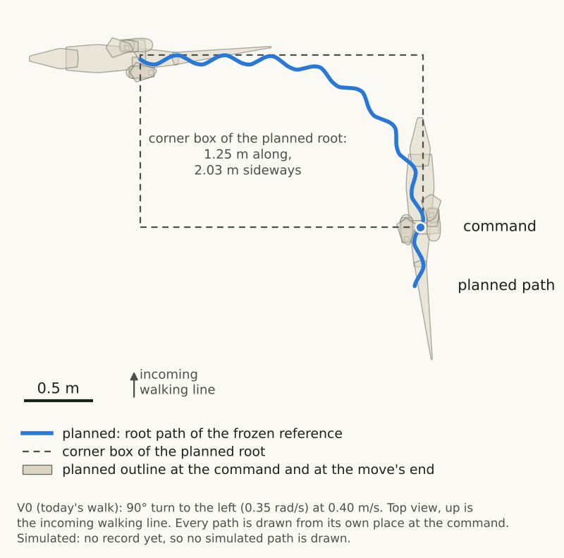
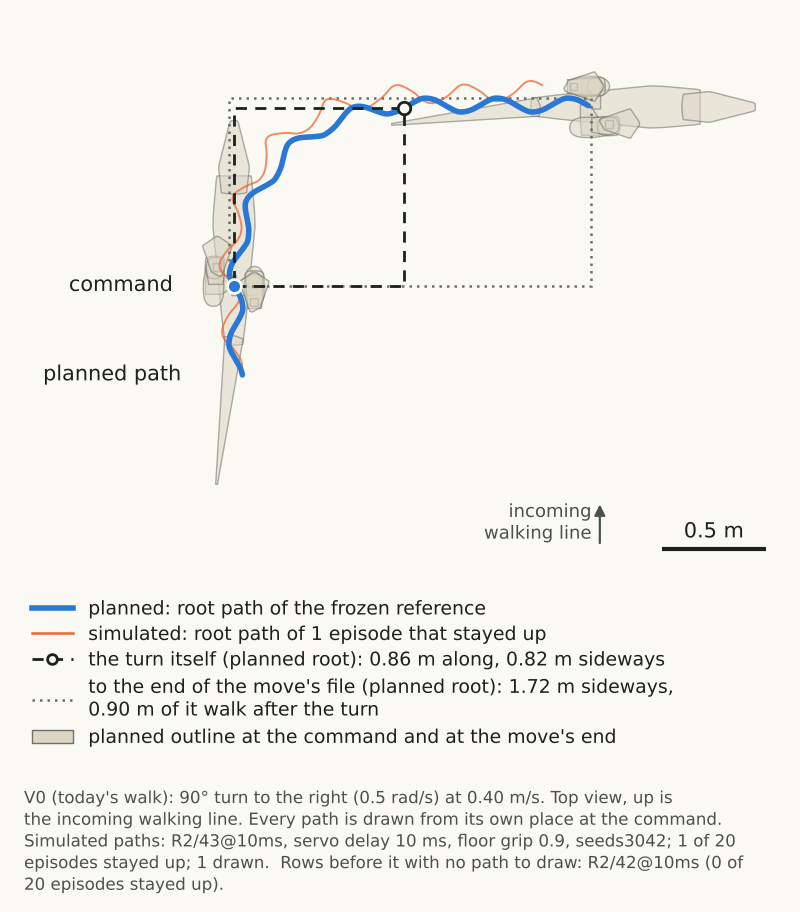

# The room a turn needs: V0 (today's walk) on 75-M-H-10

A view of the frozen reference and of the committed records. It gives no verdict and adopts nothing.

Two words are kept apart. **Planned** is read from the frozen reference, played kinematically at the bar's commanded clock, with no physics. **Simulated** is read from an episode's trace. No number mixes the two.

Lengths are in metres and in body lengths (BL). One body length is 1.759 m: the model's overall length at its home keyframe, from tail: cover_tail_seg_20 (the tail tip) to head: cover_skull (the snout tip).

Records are read from `stage2/runs/2026-11-15-75cm` and cited by their path under it; it held 12 turn records of this set when this file was written (2026-11-15T21:46:58Z). Set freeze 0, manifest `34a820e550b6`.

## turn/q90_left: quick 90° turn to the left at 0.40 m/s

Top view of quick 90° turn to the left at 0.40 m/s on V0 (today's walk); up is the incoming walking line. Blue, thick: the PLANNED path of the root (the frozen reference, kinematic), from 1 s before the command to the end of the move; the grey shapes are the PLANNED outline of the robot at the command and at the end of the move; the dashed box is the corner box of the planned root. Orange, thin: SIMULATED root paths of the 20 episodes that stayed up in `V0/75-M-H-10/seeds3042/eval/R0@10ms/turn/q90_left.json` (the open-loop row R0@10ms, servo delay 10 ms; 20 of 20 episodes stayed up).  Rows before it with no path to draw: R2/42@10ms (0 of 20 episodes stayed up); R2/43@10ms (0 of 20 episodes stayed up). Every path is drawn from its own position at the command. The scale bar is 0.5 m.

### Planned

From `transitions/turn90_pi4_left.npz` (sha256 `e8ad177483b9`), played at 1.05 times its own clock.

| reading (planned) | value |
|---|---|
| path speed commanded | 0.40 m/s on the reference's clock (0.42 m/s in simulated time) |
| turn rate commanded | 45.0 deg/s on the reference's clock (47.2 deg/s in simulated time) |
| path radius commanded (speed over rate) | 0.51 m (0.29 BL) |
| radius fitted to the root's path, steady part | 0.50 m (0.28 BL), RMS 18 mm off the circle (the root sways) |
| corner box, root: advance along the incoming line | largest 0.62 m (0.35 BL), at the move's end 0.59 m (0.34 BL) |
| corner box, root: sideways | largest 1.51 m (0.86 BL), at the move's end 1.51 m (0.86 BL) |
| corner box, whole robot: along | -0.95 m (-0.54 BL) to 1.02 m (0.58 BL) |
| corner box, whole robot: sideways | -0.59 m (-0.34 BL) to 2.30 m (1.31 BL) |
| swept radius | 1.11 m (0.63 BL), set by tail: cover_tail_seg_20 |
| turning circle (twice the swept radius) | 2.22 m (1.26 BL) |
| corridor for the 90° corner | 0.81 m (0.46 BL), inner corner set by left leg: cover_left_thigh_upper |
| turned 2 s after the command | 85.5° |
| turned at the end of the move (4.45 s after the command) | 90.0° |

Farthest point from the turn's centre, by part (planned): tail 1.11 m; head 0.96 m; trunk 0.80 m; right foot 0.68 m; right leg 0.67 m; left leg 0.53 m; left foot 0.51 m.

### Simulated

**`V0/75-M-H-10/seeds3042/eval/R0@10ms/turn/q90_left.json`: controller row R0@10ms, servo delay 10 ms, floor grip 0.9, block seeds3042.**

20 of 20 episodes stayed up; 0 fell.

Of the 20 read (median, then smallest to largest):

| reading (simulated) | median (smallest to largest) | episodes |
|---|---|---|
| radius fitted to the root's path, steady part | 0.50 m (0.47 to 0.51); 0.28 BL (0.27 to 0.29) | 20 |
| corner box, root: largest advance | 0.68 m (0.63 to 0.72); 0.38 BL (0.36 to 0.41) | 20 |
| corner box, root: advance at the move's end | 0.57 m (0.45 to 0.66); 0.33 BL (0.26 to 0.37) | 20 |
| corner box, root: largest sideways | 1.37 m (1.35 to 1.42); 0.78 BL (0.77 to 0.81) | 20 |
| corner box, root: sideways at the move's end | 1.37 m (1.35 to 1.42); 0.78 BL (0.77 to 0.81) | 20 |
| swept radius | 1.13 m (1.09 to 1.14); 0.64 BL (0.62 to 0.65) | 20 |
| turning circle | 2.26 m (2.19 to 2.27); 1.29 BL (1.24 to 1.29) | 20 |
| corridor for the 90° corner | 0.81 m (0.80 to 0.82); 0.46 BL (0.45 to 0.47) | 20 |
| turn rate over the steady part | 45.8 deg/s (44.9 to 47.1) | 20 |
| path speed over the steady part | 0.40 m/s (0.38 to 0.41) | 20 |
| turned at the bar's judged instant | 78.3° (76.1 to 84.8) | 20 |
| turned at the end of the move | 88.9° (83.1 to 94.6) | 20 |
| turned at the end of the trace | 89.1° (82.0 to 96.2) | 20 |

**`V0/75-M-H-10/seeds3042/eval/R0@10ms/turn/q90_left_mu0.54.json`: controller row R0@10ms, servo delay 10 ms, floor grip 0.54, block seeds3042.**

20 of 20 episodes stayed up; 0 fell.

Of the 20 read (median, then smallest to largest):

| reading (simulated) | median (smallest to largest) | episodes |
|---|---|---|
| radius fitted to the root's path, steady part | 0.52 m (0.49 to 0.54); 0.30 BL (0.28 to 0.30) | 20 |
| corner box, root: largest advance | 0.74 m (0.69 to 0.78); 0.42 BL (0.40 to 0.44) | 20 |
| corner box, root: advance at the move's end | 0.67 m (0.56 to 0.74); 0.38 BL (0.32 to 0.42) | 20 |
| corner box, root: largest sideways | 1.32 m (1.29 to 1.34); 0.75 BL (0.74 to 0.76) | 20 |
| corner box, root: sideways at the move's end | 1.32 m (1.30 to 1.35); 0.75 BL (0.74 to 0.77) | 20 |
| swept radius | 1.14 m (1.11 to 1.15); 0.65 BL (0.63 to 0.66) | 20 |
| turning circle | 2.28 m (2.22 to 2.31); 1.30 BL (1.26 to 1.31) | 20 |
| corridor for the 90° corner | 0.80 m (0.79 to 0.81); 0.46 BL (0.45 to 0.46) | 20 |
| turn rate over the steady part | 44.2 deg/s (43.3 to 45.4) | 20 |
| path speed over the steady part | 0.40 m/s (0.39 to 0.41) | 20 |
| turned at the bar's judged instant | 71.4° (69.6 to 74.5) | 20 |
| turned at the end of the move | 85.1° (82.5 to 94.2) | 20 |
| turned at the end of the trace | 87.0° (83.1 to 95.3) | 20 |

**`V0/75-M-H-10/seeds3042/eval/R2/42@10ms/turn/q90_left.json`: controller row R2/42@10ms, servo delay 10 ms, floor grip 0.9, block seeds3042.**

0 of 20 episodes stayed up; 20 fell: 20 before the command (seeds 3042-3061, between 4.33 and 10.50 s).

No episode of this record stayed up with a trace that can be read: nothing is read.

**`V0/75-M-H-10/seeds3042/eval/R2/42@10ms/turn/q90_left_mu0.54.json`: controller row R2/42@10ms, servo delay 10 ms, floor grip 0.54, block seeds3042.**

0 of 20 episodes stayed up; 20 fell: 20 before the command (seeds 3042-3061, between 4.36 and 10.91 s).

No episode of this record stayed up with a trace that can be read: nothing is read.

**`V0/75-M-H-10/seeds3042/eval/R2/43@10ms/turn/q90_left.json`: controller row R2/43@10ms, servo delay 10 ms, floor grip 0.9, block seeds3042.**

0 of 20 episodes stayed up; 20 fell: 19 before the command (seeds 3042-3055, 3057-3061, between 4.37 and 8.17 s); 1 after the command (seed 3056, at 15.62 s).

No episode of this record stayed up with a trace that can be read: nothing is read.

**`V0/75-M-H-10/seeds3042/eval/R2/43@10ms/turn/q90_left_mu0.54.json`: controller row R2/43@10ms, servo delay 10 ms, floor grip 0.54, block seeds3042.**

0 of 20 episodes stayed up; 20 fell: 17 before the command (seeds 3043-3051, 3053-3058, 3060-3061, between 4.34 and 9.51 s); 3 after the command (seeds 3042, 3052, 3059, between 15.43 and 15.69 s).

No episode of this record stayed up with a trace that can be read: nothing is read.

## turn/q90_right: quick 90° turn to the right at 0.40 m/s

Top view of quick 90° turn to the right at 0.40 m/s on V0 (today's walk); up is the incoming walking line. Blue, thick: the PLANNED path of the root (the frozen reference, kinematic), from 1 s before the command to the end of the move; the grey shapes are the PLANNED outline of the robot at the command and at the end of the move; the dashed box is the corner box of the planned root. Orange, thin: SIMULATED root paths of the 20 episodes that stayed up in `V0/75-M-H-10/seeds3042/eval/R0@10ms/turn/q90_right.json` (the open-loop row R0@10ms, servo delay 10 ms; 20 of 20 episodes stayed up).  Rows before it with no path to draw: R2/42@10ms (0 of 20 episodes stayed up); R2/43@10ms (0 of 20 episodes stayed up). Every path is drawn from its own position at the command. The scale bar is 0.5 m.

### Planned

From `transitions/turn90_pi4_right.npz` (sha256 `83762a582d9d`), played at 1.05 times its own clock.

| reading (planned) | value |
|---|---|
| path speed commanded | 0.40 m/s on the reference's clock (0.42 m/s in simulated time) |
| turn rate commanded | -45.0 deg/s on the reference's clock (-47.2 deg/s in simulated time) |
| path radius commanded (speed over rate) | -0.51 m (-0.29 BL) |
| radius fitted to the root's path, steady part | 0.50 m (0.28 BL), RMS 18 mm off the circle (the root sways) |
| corner box, root: advance along the incoming line | largest 0.62 m (0.35 BL), at the move's end 0.58 m (0.33 BL) |
| corner box, root: sideways | largest 1.34 m (0.76 BL), at the move's end 1.34 m (0.76 BL) |
| corner box, whole robot: along | -0.95 m (-0.54 BL) to 1.02 m (0.58 BL) |
| corner box, whole robot: sideways | -0.59 m (-0.34 BL) to 2.13 m (1.21 BL) |
| swept radius | 1.11 m (0.63 BL), set by tail: cover_tail_seg_20 |
| turning circle (twice the swept radius) | 2.22 m (1.26 BL) |
| corridor for the 90° corner | 0.80 m (0.46 BL), inner corner set by right leg: cover_right_thigh_upper |
| turned 2 s after the command | 85.4° |
| turned at the end of the move (4.04 s after the command) | 90.0° |

Farthest point from the turn's centre, by part (planned): tail 1.11 m; head 0.96 m; trunk 0.80 m; left foot 0.68 m; left leg 0.67 m; right leg 0.53 m; right foot 0.51 m.

### Simulated

**`V0/75-M-H-10/seeds3042/eval/R0@10ms/turn/q90_right.json`: controller row R0@10ms, servo delay 10 ms, floor grip 0.9, block seeds3042.**

20 of 20 episodes stayed up; 0 fell.

Of the 20 read (median, then smallest to largest):

| reading (simulated) | median (smallest to largest) | episodes |
|---|---|---|
| radius fitted to the root's path, steady part | 0.50 m (0.47 to 0.52); 0.28 BL (0.27 to 0.30) | 20 |
| corner box, root: largest advance | 0.67 m (0.64 to 0.74); 0.38 BL (0.36 to 0.42) | 20 |
| corner box, root: advance at the move's end | 0.63 m (0.59 to 0.71); 0.36 BL (0.34 to 0.41) | 20 |
| corner box, root: largest sideways | 1.21 m (1.15 to 1.24); 0.69 BL (0.66 to 0.70) | 20 |
| corner box, root: sideways at the move's end | 1.21 m (1.16 to 1.24); 0.69 BL (0.66 to 0.71) | 20 |
| swept radius | 1.13 m (1.11 to 1.15); 0.64 BL (0.63 to 0.65) | 20 |
| turning circle | 2.26 m (2.21 to 2.29); 1.29 BL (1.26 to 1.30) | 20 |
| corridor for the 90° corner | 0.81 m (0.79 to 0.82); 0.46 BL (0.45 to 0.47) | 20 |
| turn rate over the steady part | 45.8 deg/s (44.7 to 46.9) | 20 |
| path speed over the steady part | 0.40 m/s (0.39 to 0.41) | 20 |
| turned at the bar's judged instant | 79.4° (73.9 to 80.8) | 20 |
| turned at the end of the move | 95.8° (91.6 to 100.0) | 20 |
| turned at the end of the trace | 89.2° (85.1 to 96.0) | 20 |

**`V0/75-M-H-10/seeds3042/eval/R0@10ms/turn/q90_right_mu0.54.json`: controller row R0@10ms, servo delay 10 ms, floor grip 0.54, block seeds3042.**

19 of 20 episodes stayed up; 1 fell: 1 after the command (seed 3061, at 18.60 s).

Of the 19 read (median, then smallest to largest):

| reading (simulated) | median (smallest to largest) | episodes |
|---|---|---|
| radius fitted to the root's path, steady part | 0.53 m (0.51 to 0.54); 0.30 BL (0.29 to 0.31) | 19 |
| corner box, root: largest advance | 0.74 m (0.71 to 0.79); 0.42 BL (0.40 to 0.45) | 19 |
| corner box, root: advance at the move's end | 0.72 m (0.68 to 0.78); 0.41 BL (0.38 to 0.44) | 19 |
| corner box, root: largest sideways | 1.15 m (1.12 to 1.17); 0.66 BL (0.64 to 0.67) | 19 |
| corner box, root: sideways at the move's end | 1.16 m (1.12 to 1.18); 0.66 BL (0.64 to 0.67) | 19 |
| swept radius | 1.15 m (1.12 to 1.16); 0.65 BL (0.64 to 0.66) | 19 |
| turning circle | 2.29 m (2.25 to 2.32); 1.30 BL (1.28 to 1.32) | 19 |
| corridor for the 90° corner | 0.80 m (0.80 to 0.81); 0.45 BL (0.45 to 0.46) | 19 |
| turn rate over the steady part | 43.9 deg/s (43.0 to 45.3) | 19 |
| path speed over the steady part | 0.41 m/s (0.40 to 0.41) | 19 |
| turned at the bar's judged instant | 71.6° (68.7 to 72.6) | 19 |
| turned at the end of the move | 91.1° (88.7 to 95.4) | 19 |
| turned at the end of the trace | 85.6° (82.3 to 88.3) | 19 |

**`V0/75-M-H-10/seeds3042/eval/R2/42@10ms/turn/q90_right.json`: controller row R2/42@10ms, servo delay 10 ms, floor grip 0.9, block seeds3042.**

0 of 20 episodes stayed up; 20 fell: 20 before the command (seeds 3042-3061, between 4.33 and 10.50 s).

No episode of this record stayed up with a trace that can be read: nothing is read.

**`V0/75-M-H-10/seeds3042/eval/R2/42@10ms/turn/q90_right_mu0.54.json`: controller row R2/42@10ms, servo delay 10 ms, floor grip 0.54, block seeds3042.**

0 of 20 episodes stayed up; 20 fell: 20 before the command (seeds 3042-3061, between 4.36 and 10.91 s).

No episode of this record stayed up with a trace that can be read: nothing is read.

**`V0/75-M-H-10/seeds3042/eval/R2/43@10ms/turn/q90_right.json`: controller row R2/43@10ms, servo delay 10 ms, floor grip 0.9, block seeds3042.**

0 of 20 episodes stayed up; 20 fell: 19 before the command (seeds 3042-3055, 3057-3061, between 4.37 and 8.17 s); 1 after the command (seed 3056, at 16.12 s).

No episode of this record stayed up with a trace that can be read: nothing is read.

**`V0/75-M-H-10/seeds3042/eval/R2/43@10ms/turn/q90_right_mu0.54.json`: controller row R2/43@10ms, servo delay 10 ms, floor grip 0.54, block seeds3042.**

1 of 20 episodes stayed up; 19 fell: 17 before the command (seeds 3043-3051, 3053-3058, 3060-3061, between 4.34 and 9.51 s); 2 after the command (seeds 3052, 3059, between 15.94 and 16.27 s).

Of the 1 read (median, then smallest to largest):

| reading (simulated) | median (smallest to largest) | episodes |
|---|---|---|
| radius fitted to the root's path, steady part | 0.53 m (0.53 to 0.53); 0.30 BL (0.30 to 0.30) | 1 |
| corner box, root: largest advance | 0.83 m (0.83 to 0.83); 0.47 BL (0.47 to 0.47) | 1 |
| corner box, root: advance at the move's end | 0.82 m (0.82 to 0.82); 0.47 BL (0.47 to 0.47) | 1 |
| corner box, root: largest sideways | 1.11 m (1.11 to 1.11); 0.63 BL (0.63 to 0.63) | 1 |
| corner box, root: sideways at the move's end | 1.11 m (1.11 to 1.11); 0.63 BL (0.63 to 0.63) | 1 |
| swept radius | 1.14 m (1.14 to 1.14); 0.65 BL (0.65 to 0.65) | 1 |
| turning circle | 2.28 m (2.28 to 2.28); 1.29 BL (1.29 to 1.29) | 1 |
| corridor for the 90° corner | 0.79 m (0.79 to 0.79); 0.45 BL (0.45 to 0.45) | 1 |
| turn rate over the steady part | 45.3 deg/s (45.3 to 45.3) | 1 |
| path speed over the steady part | 0.42 m/s (0.42 to 0.42) | 1 |
| turned at the bar's judged instant | 69.3° (69.3 to 69.3) | 1 |
| turned at the end of the move | 84.1° (84.1 to 84.1) | 1 |
| turned at the end of the trace | 78.1° (78.1 to 78.1) | 1 |

## turn/t90_0.35_left: 90° turn to the left (0.35 rad/s) at 0.40 m/s

Top view of 90° turn to the left (0.35 rad/s) at 0.40 m/s on V0 (today's walk); up is the incoming walking line. Blue, thick: the PLANNED path of the root (the frozen reference, kinematic), from 1 s before the command to the end of the move; the grey shapes are the PLANNED outline of the robot at the command and at the end of the move; the dashed box is the corner box of the planned root. SIMULATED: no record yet; no simulated path is drawn. Every path is drawn from its own position at the command. The scale bar is 0.5 m.

### Planned

From `transitions/turn90_0.35_left.npz` (sha256 `fd66de5a0323`), played at 1.05 times its own clock.

| reading (planned) | value |
|---|---|
| path speed commanded | 0.40 m/s on the reference's clock (0.42 m/s in simulated time) |
| turn rate commanded | 20.1 deg/s on the reference's clock (21.1 deg/s in simulated time) |
| path radius commanded (speed over rate) | 1.14 m (0.65 BL) |
| radius fitted to the root's path, steady part | 1.14 m (0.65 BL), RMS 26 mm off the circle (the root sways) |
| corner box, root: advance along the incoming line | largest 1.25 m (0.71 BL), at the move's end 1.22 m (0.70 BL) |
| corner box, root: sideways | largest 2.03 m (1.15 BL), at the move's end 2.04 m (1.16 BL) |
| corner box, whole robot: along | -0.95 m (-0.54 BL) to 1.49 m (0.85 BL) |
| corner box, whole robot: sideways | -0.40 m (-0.23 BL) to 2.83 m (1.61 BL) |
| swept radius | 1.56 m (0.89 BL), set by tail: cover_tail_seg_20 |
| turning circle (twice the swept radius) | 3.13 m (1.78 BL) |
| corridor for the 90° corner | 0.81 m (0.46 BL), inner corner set by left leg: cover_left_thigh_upper |
| turned 4.48799 s after the command | 89.7° |
| turned at the end of the move (6.56 s after the command) | 90.0° |

Farthest point from the turn's centre, by part (planned): tail 1.56 m; head 1.43 m; trunk 1.36 m; right leg 1.32 m; right foot 1.31 m; left leg 1.18 m; left foot 1.14 m.

### Simulated

No record yet: the chain had made no record of this turn when this file was written.

## turn/t90_0.35_right: 90° turn to the right (0.35 rad/s) at 0.40 m/s

Top view of 90° turn to the right (0.35 rad/s) at 0.40 m/s on V0 (today's walk); up is the incoming walking line. Blue, thick: the PLANNED path of the root (the frozen reference, kinematic), from 1 s before the command to the end of the move; the grey shapes are the PLANNED outline of the robot at the command and at the end of the move; the dashed box is the corner box of the planned root. SIMULATED: no record yet; no simulated path is drawn. Every path is drawn from its own position at the command. The scale bar is 0.5 m.

### Planned

From `transitions/turn90_0.35_right.npz` (sha256 `be0b6f674cfc`), played at 1.05 times its own clock.

| reading (planned) | value |
|---|---|
| path speed commanded | 0.40 m/s on the reference's clock (0.42 m/s in simulated time) |
| turn rate commanded | -20.1 deg/s on the reference's clock (-21.1 deg/s in simulated time) |
| path radius commanded (speed over rate) | -1.14 m (-0.65 BL) |
| radius fitted to the root's path, steady part | 1.14 m (0.65 BL), RMS 26 mm off the circle (the root sways) |
| corner box, root: advance along the incoming line | largest 1.25 m (0.71 BL), at the move's end 1.20 m (0.68 BL) |
| corner box, root: sideways | largest 2.20 m (1.25 BL), at the move's end 2.21 m (1.26 BL) |
| corner box, whole robot: along | -0.95 m (-0.54 BL) to 1.49 m (0.85 BL) |
| corner box, whole robot: sideways | -0.40 m (-0.23 BL) to 3.00 m (1.70 BL) |
| swept radius | 1.56 m (0.89 BL), set by tail: cover_tail_seg_20 |
| turning circle (twice the swept radius) | 3.13 m (1.78 BL) |
| corridor for the 90° corner | 0.81 m (0.46 BL), inner corner set by right leg: cover_right_thigh_upper |
| turned 4.48799 s after the command | 89.7° |
| turned at the end of the move (6.97 s after the command) | 90.0° |

Farthest point from the turn's centre, by part (planned): tail 1.56 m; head 1.43 m; trunk 1.36 m; left leg 1.32 m; left foot 1.31 m; right leg 1.18 m; right foot 1.14 m.

### Simulated

No record yet: the chain had made no record of this turn when this file was written.

## turn/t90_0.5_left: 90° turn to the left (0.5 rad/s) at 0.40 m/s

Top view of 90° turn to the left (0.5 rad/s) at 0.40 m/s on V0 (today's walk); up is the incoming walking line. Blue, thick: the PLANNED path of the root (the frozen reference, kinematic), from 1 s before the command to the end of the move; the grey shapes are the PLANNED outline of the robot at the command and at the end of the move; the dashed box is the corner box of the planned root. SIMULATED: no record yet; no simulated path is drawn. Every path is drawn from its own position at the command. The scale bar is 0.5 m.

### Planned

From `transitions/turn90_0.5_left.npz` (sha256 `6228ae4547a5`), played at 1.05 times its own clock.

| reading (planned) | value |
|---|---|
| path speed commanded | 0.40 m/s on the reference's clock (0.42 m/s in simulated time) |
| turn rate commanded | 28.6 deg/s on the reference's clock (30.1 deg/s in simulated time) |
| path radius commanded (speed over rate) | 0.80 m (0.45 BL) |
| radius fitted to the root's path, steady part | 0.79 m (0.45 BL), RMS 27 mm off the circle (the root sways) |
| corner box, root: advance along the incoming line | largest 0.90 m (0.51 BL), at the move's end 0.88 m (0.50 BL) |
| corner box, root: sideways | largest 1.88 m (1.07 BL), at the move's end 1.89 m (1.08 BL) |
| corner box, whole robot: along | -0.95 m (-0.54 BL) to 1.22 m (0.70 BL) |
| corner box, whole robot: sideways | -0.49 m (-0.28 BL) to 2.68 m (1.52 BL) |
| swept radius | 1.31 m (0.74 BL), set by tail: cover_tail_seg_20 |
| turning circle (twice the swept radius) | 2.61 m (1.48 BL) |
| corridor for the 90° corner | 0.80 m (0.46 BL), inner corner set by left leg: cover_left_thigh_upper |
| turned 3.14159 s after the command | 88.7° |
| turned at the end of the move (5.74 s after the command) | 90.0° |

Farthest point from the turn's centre, by part (planned): tail 1.31 m; head 1.16 m; trunk 1.05 m; right leg 0.98 m; right foot 0.97 m; left leg 0.84 m; left foot 0.80 m.

### Simulated

No record yet: the chain had made no record of this turn when this file was written.

## turn/t90_0.5_right: 90° turn to the right (0.5 rad/s) at 0.40 m/s

Top view of 90° turn to the right (0.5 rad/s) at 0.40 m/s on V0 (today's walk); up is the incoming walking line. Blue, thick: the PLANNED path of the root (the frozen reference, kinematic), from 1 s before the command to the end of the move; the grey shapes are the PLANNED outline of the robot at the command and at the end of the move; the dashed box is the corner box of the planned root. SIMULATED: no record yet; no simulated path is drawn. Every path is drawn from its own position at the command. The scale bar is 0.5 m.

### Planned

From `transitions/turn90_0.5_right.npz` (sha256 `2ef5d2c52f26`), played at 1.05 times its own clock.

| reading (planned) | value |
|---|---|
| path speed commanded | 0.40 m/s on the reference's clock (0.42 m/s in simulated time) |
| turn rate commanded | -28.6 deg/s on the reference's clock (-30.1 deg/s in simulated time) |
| path radius commanded (speed over rate) | -0.80 m (-0.45 BL) |
| radius fitted to the root's path, steady part | 0.79 m (0.45 BL), RMS 27 mm off the circle (the root sways) |
| corner box, root: advance along the incoming line | largest 0.90 m (0.51 BL), at the move's end 0.86 m (0.49 BL) |
| corner box, root: sideways | largest 1.71 m (0.97 BL), at the move's end 1.72 m (0.98 BL) |
| corner box, whole robot: along | -0.95 m (-0.54 BL) to 1.22 m (0.70 BL) |
| corner box, whole robot: sideways | -0.49 m (-0.28 BL) to 2.51 m (1.42 BL) |
| swept radius | 1.31 m (0.74 BL), set by tail: cover_tail_seg_20 |
| turning circle (twice the swept radius) | 2.61 m (1.48 BL) |
| corridor for the 90° corner | 0.80 m (0.46 BL), inner corner set by right leg: cover_right_thigh_upper |
| turned 3.14159 s after the command | 88.7° |
| turned at the end of the move (5.33 s after the command) | 90.0° |

Farthest point from the turn's centre, by part (planned): tail 1.31 m; head 1.16 m; trunk 1.05 m; left leg 0.98 m; left foot 0.97 m; right leg 0.84 m; right foot 0.80 m.

### Simulated

No record yet: the chain had made no record of this turn when this file was written.

## Turns without a reference in this set

- turn/t90_1_left (`transitions/turn90_1_left`): no reference within the thigh twist and the leg drives: the built reference is over a leg drive's Stage 0 limit; also outside heading_at_slowest_clock
- turn/t90_1_right (`transitions/turn90_1_right`): no reference within the thigh twist and the leg drives: the built reference is over a leg drive's Stage 0 limit; also outside heading_at_slowest_clock

## How each reading is made

- **words**: planned: read from the frozen reference played kinematically at the bar's commanded clock (no physics). simulated: read from an episode's trace. No number mixes the two..
- **clock**: the bar plays a reference at 1.05 times its own clock (bar.RULES['clocks']); every time here is in simulated seconds, so a planned speed or rate in simulated time is the reference's own times 1.05; lengths and radii do not change with the clock.
- **frame**: the corner frame of a turn: origin at the root (the trunk's origin) at the command instant; 'along' is the commanded heading (the home heading, the bar's psi_cmd), the incoming walking line; 'sideways' is square to it, positive toward the side of the turn.
- **command**: the command instant t_c: planned, the reference clock's time of the move's first frame over the commanded clock rate; simulated, the episode record's command_s (never recomputed).
- **move end**: the end of the move: the simulated time at which the reference clock reaches the end of the turn's own file (the trace's t_ref column); a trace that ends before it is read to its end and says so.
- **heading**: the trunk's heading: the trace's yaw column (control._yaw of the trunk's rotation), unwrapped, as bar's turn reading takes it; 'turned' is its change from the commanded heading, positive toward the side of the turn.
- **steady**: the steady part of the turn: from the first row at which the trunk has turned 0.1667 of the commanded angle to the first row at which it has turned 0.8333 of it (15 to 75 degrees of a 90 degree turn); a path that never gets there 'stops short' and has no fitted radius.
- **radius commanded**: the path radius commanded: the walk's path speed over the turn's rate (v / omega), both from the frozen turn's entry.
- **radius fitted**: the radius fitted: the circle of the root's path over the steady part, with the trunk's heading as the place on the arc: least squares of root = centre + R x n(heading) over the steady rows, n the unit vector square to the heading that points away from the side of the turn; its centre is the turn's centre, and the RMS distance of the rows from that model is given beside it.  A circle fitted to the positions alone (the algebraic fit, recorded as radius_free_fit_m) reads the root's sideways sway of about 3 cm a step as curvature: it gave 0.29 m on V0's planned quick turn, whose commanded radius is 0.51 m, where this fit gives 0.50 m.
- **corner box**: the corner box: over the rows from the command to the end of the move, how far the root gets along its incoming line (advance) and sideways, at the largest and at the move's end; the same box for the whole robot (every surface point).
- **surface**: the robot's surface points: per body of the model, the corners of the convex hull of its pads, covers and hardware (geom groups 0, 1 and 2: mesh vertices, and the corners of a primitive's bounding box), carried on each row's pose; the snout tip is the head's point farthest forward at home, the tail tip the tail's farthest back.
- **swept radius**: the swept radius: the largest distance in plan from the turn's centre to any surface point over the steady part of the turn (where the robot is on its circle; the straight entry and exit are in the corner box and the corridor, not here); the point that sets it is named.
- **turning circle**: the turning circle: twice the swept radius, the diameter of the circle a full turn at that rate would sweep about the same centre.
- **corridor**: the corridor: the narrowest L-shaped corridor, two legs of one width meeting square, that holds every surface point from the command to the end of the move.  Its outer wall along the incoming leg touches the sweep's point farthest to the outside (sideways = Y0), its far wall across the incoming line touches the sweep's point farthest along (along = X); the inner corner is at (X - w, Y0 + w) and the width w is the smallest for which no point lies inside that corner's block: w = the largest, over all points, of min(X - along, sideways - Y0).  It holds the robot up to the end of the move only: a robot that leaves the move off its heading needs more room further on.
- **body length**: lengths are given in metres and in body lengths; a body length is the model's overall length at its home keyframe along the home heading, from the surface's point farthest back to its point farthest forward.
- **simulated**: simulated: every record of the turn under the run directory (each row, delay, floor grip and block) is listed; an episode that stayed up and whose trace is kept and has the record's sha256 is read; an episode that fell is counted and listed, not read; the heading at the bar's judged instant is the record's own (command_s + at_s; the commanded angle + the sign times heading_error_at_deg).
