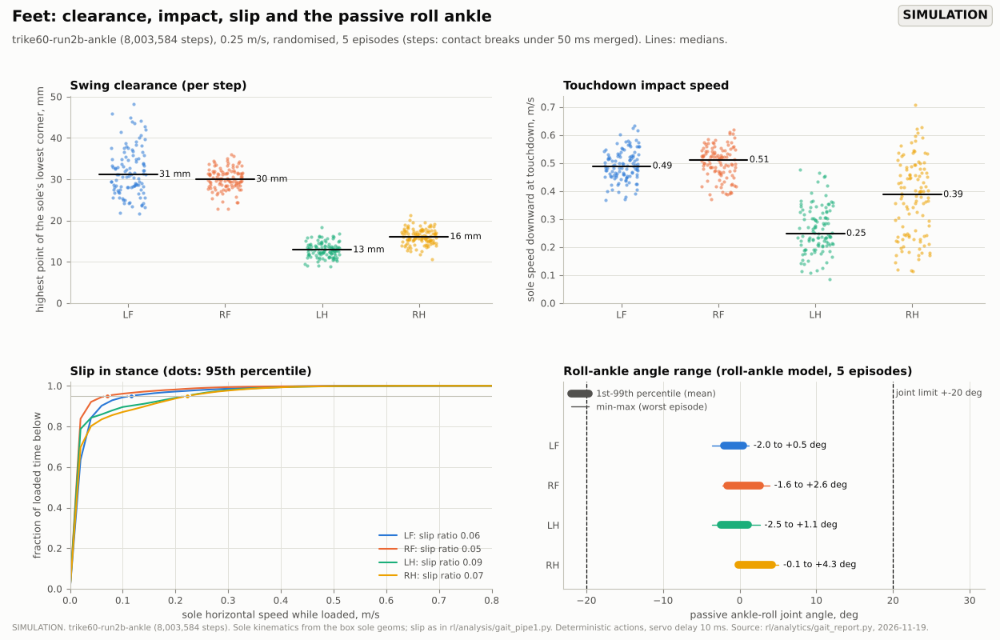
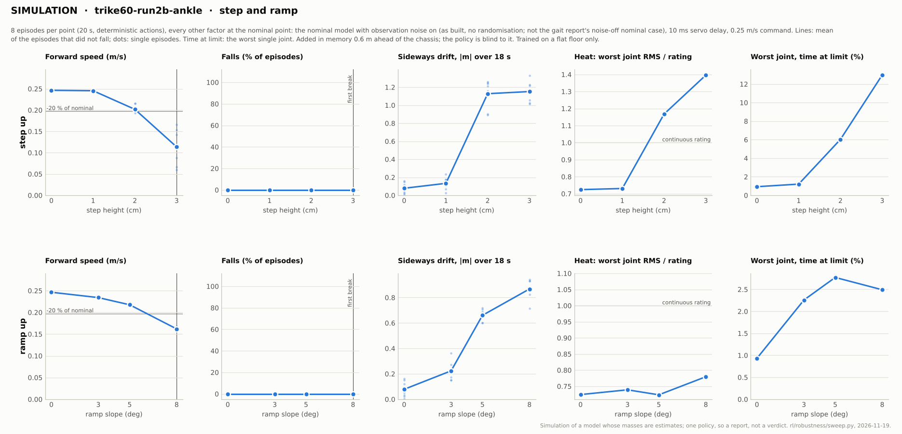
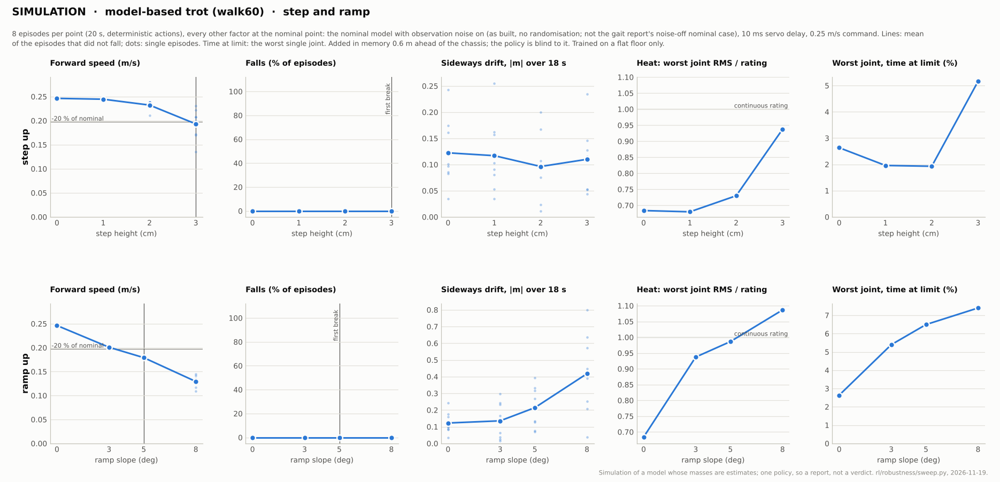
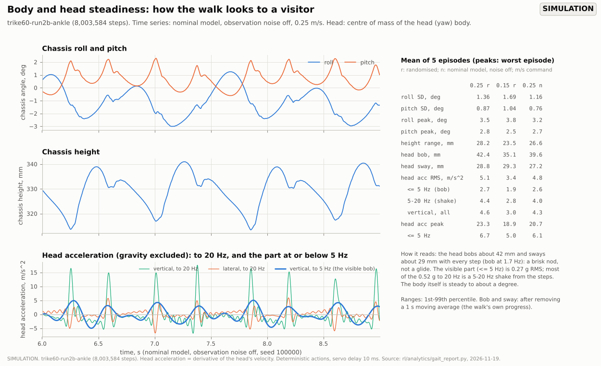
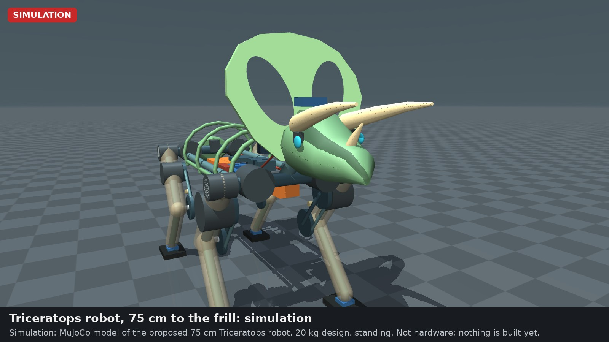
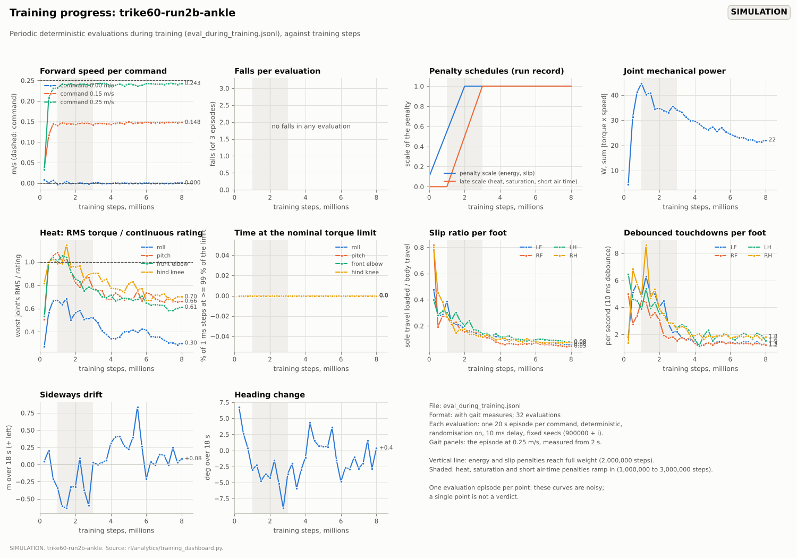
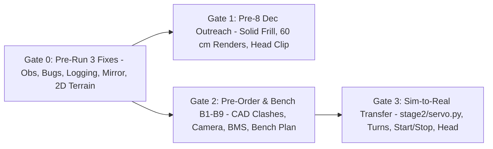

# Full Engineering Review: 60 cm *Triceratops* Robotic Build (Option C)

**Date:** 2026-11-21
**Scope & Provenance:**
- **Branch & Commit Audited:** `claude/pensive-pasteur-o3bqtv` at commit `7bfeef53` (`hardware/triceratops_build/`, 244 files), cross-checked against `main` ([`hardware/triceratops_kickoff/`](../triceratops_kickoff/CONSOLIDATION_PLAN.md), [`environments/shared/`](../../environments/shared/diagnostics.py), [`hardware/trex_form_study/designlab/stage2/servo.py`](../trex_form_study/designlab/stage2/servo.py)), `claude/triceratops-build-clips` (`fc819000`), and the Google Drive `triceratops60` Colab artifacts (`trike60-run2b-ankle`).
- **Evidence Boundary:** **Nothing reviewed here is ordered, weighed, bench-tested, or measured on real hardware.** All masses, prices, torques, and gait metrics are planning estimates and MuJoCo simulations.

> [!IMPORTANT]
> **`main` does not yet contain the 60 cm build.** `main` still holds only the earlier 75 cm T20/T15 kickoff plan ([`PARTS_PREMIUM.md`](../triceratops_kickoff/PARTS_PREMIUM.md)). Everything reviewed below reflects `claude/pensive-pasteur-o3bqtv` (`7bfeef53`).

---

## 1. Executive Summary & Readiness Scorecard

### What Is Already Strong
The 60 cm *Triceratops* effort shows unusually disciplined engineering habits for an early-stage robotic build:
1. **Honest evidence hygiene & pre-registration:** [`PREREG_WALK60.md`](walk/PREREG_WALK60.md) and [`PREREG_RUN3.md`](rl/analysis/PREREG_RUN3.md) separate prospective targets, simulation outputs, and hardware facts cleanly, and explicitly correct post-hoc disclosures rather than hiding them.
2. **Single-source BOM / mass ledger coupling:** [`parts60.py`](design/parts60.py) generates [`PARTS_60CM.md`](design/PARTS_60CM.md) directly from the MuJoCo model's mass ledger and [`size_budget.py`](budget/size_budget.py), preventing spreadsheet drift.
3. **Dual locomotion baselines:** Having both a 100 Hz model-based trot ([`walk60.py`](walk/walk60.py)) and an 8M-step RL policy (`trike60-run2b-ankle`) already exposed complementary failure modes (step toe-catch vs. ramp saturation).
4. **Drive FUSE EIO-hardened checkpointing:** [`trike_checkpoints.py`](rl/trike_checkpoints.py) separates structural file corruption from transient Google Drive `OSError`/EIO faults better than [`environments/shared/curriculum/checkpoints.py`](../../environments/shared/curriculum/checkpoints.py).
5. **Rich single-checkpoint post-hoc gait plots:** [`gait_report.py`](rl/analytics/gait_report.py) and [`sweep.py`](rl/robustness/sweep.py) produce informative visual diagnostics for flat walking and 1D perturbations.

### Readiness Scorecard

| Domain | Status | Core Verdict | Top Blocker(s) |
|---|---|---|---|
| **Gait** | **Early Prototype** | Straight flat-floor 0.25 m/s trot works in sim (both RL & `walk60`), but neither delivers a museum-ready slow walk, turns, start/stop, or clean rough-ground gait. | RL: 27–37% asymmetry, 13–16 mm hind clearance, 2.5 BW stomping, 0.15 m/s collapse. `walk60`: 3–5.9 Hz front bounce, 5° ramp failure, noisy load-cell-dependent odometry. |
| **Balance & Foot Mechanics** | **Blocked (D5 Open)** | Static crawl fails rigid soles and fails passive roll ankles on stiffer contact (`impratio=10`); CoM trim authority is trapped; right-side mass offset biases all runs. | No manufacturable, `impratio=10`-stable foot CAD/budget; `150 g` reserve at `y = -55 mm`; `left_hind` ankle pitch exceeds `±22°` hard stop (`+22.64°` p99). |
| **Parts, CAD, Safety & Packaging** | **Not Order-Ready** | Cost is right on/above the \$20k cliff; multiple physical intersections, floating electronics, blinded OAK-D Lite, and safety downgrades from T20. | 3.9 mm tail-pitch/pelvic clash; 0.75 mm broken elbow axle; blinded chest camera; 0.5–1.0 mm bay clearances; dropped BMS cutoff, PL d e-stop, and foot load cells; stale 75 cm bench/vendor docs. |
| **Expressiveness & Museum Presence** | **Concept Only** | 7-DOF + LED + audio hardware plan is thoughtfully scoped, but **zero** expressive motion is simulated and the frill mesh has a paleontological error. | Open *Torosaurus*-style fenestrae in *Triceratops* frill mesh; 42 mm / 2.38 g (4.05 g raw) head shake; frozen head/tail in sim; TTL EMI run; 75 cm renders ahead of 8 Dec outreach. |
| **RL Training Harness** | **Not Deployable** | Clean unit-tested scaffolding, but **zero trained policies can run on the 60 cm BOM** and actuator/curriculum/PPO fidelity lags behind `environments/shared/` and `stage2/servo.py`. | **11/68 actor obs channels do not exist on BOM**; bare linear servos (no 83 rpm cap, friction, backlash, or `kp<=500, kv<=5` firmware cap); 1D terrain; no `MirrorKLPPO`, `target_kl`, or asymmetric critic. |
| **Analytics & Troubleshooting** | **Active Bugs** | Strong post-hoc flat-floor charts, but **blind during RL training** and distorted by active bugs in saturation reporting and terrain fall detection. | Flat-zero `at_limit_nominal` masks 12.9% real saturation; `sweep.py` never detects body/step collisions or ramp height; zero PPO/reward-decomposition/Monitor telemetry; no regen energy for Bench B7. |

> [!CAUTION]
> **Hold Run 3 (`trike60-run3-s0` / `s1`) before spending ~8–10 hours on Colab.** Run 3 has not started yet on Drive (`triceratops60`), and its committed setup will train 20M steps on 11 phantom/privileged sensor channels, 1D sagittal terrain (that never exercises the passive roll ankles), an off-center `150 g` chassis weight without mirror symmetry, an unbounded `-100 * v_lat_slow^2` penalty active from step 0, zero PPO/reward logging, and flat-only `PeriodicEval`. Fix Gate 0 first.

---

## 2. Gait Review

### Head-to-Head Comparison Across Controllers (Simulation Only)

| Metric (0.25 m/s unless noted) | `crawl.py` (roll-ankle) | `walk60.py` (100 Hz trot) | RL `pipe1` (2M, rigid) | RL `run2b` (8M, roll-ankle) | Planned RL `run3` (10M) |
|---|---|---|---|---|---|
| **Gait pattern** | 4-beat crawl (0.018 m/s) | Dynamic diagonal trot | Asymmetric diagonal trot | Asymmetric diagonal trot (89% 2-foot) | Unconstrained (still no symmetry) |
| **Flat speed (target 0.25)** | 0.018 m/s | **0.247–0.254 m/s** (0 falls) | 0.237 m/s (0 falls) | 0.245 m/s (0 falls) | Not yet run |
| **Flat heat (worst RMS/cont.)** | Low (static) | 0.78–0.86 (LH pitch; hind knee ≤0.78) | 0.90–1.00 | **0.72–0.77** (hind knee) | Same `r_heat` weight |
| **Torque saturation (ep. limit)** | Low | **2.5–3.5%** (fore pitch, grippy) | ~3.0%+ | **1.01% pitch / 0.79% hind knee** (masked as 0% in dashboard!) | Same |
| **Slow walk (`0.15 m/s`)** | N/A | **4.4–4.7 TD/s** avg (5.9 worst) front chatter | Untested | **51% irregular strides**, class `other` | Same `r_air_time` discontinuity |
| **2–3 cm steps** | Untested | **0 falls, -22% speed @ 3 cm** | Untested | 0 falls, **-54% speed, 1.15 m drift, 1.40× heat @ 3 cm** | 4 cm 1D steps in training |
| **5°–8° uphill ramps** | Untested | **-27% @ 5° / -47% @ 8°; 1.09× (1.22× worst) hind knee heat** | Untested | -34% speed, 0.87 m drift @ 8° | 10° 1D ramps (but `w_upright` fights slope) |
| **Sideways push (`±1.25 m/s`)** | Untested | **0/8 falls** both sides | Untested | **7/8 falls left (+), 4/8 right (-)** | ±1.0 m/s pushes in training |
| **Low friction (`μ = 0.15`)** | Untested | **0 falls, 0.13 m drift** | Untested | 0 falls, **0.78 m drift** | `μ ≥ 0.3` in training |
| **Delay tolerance** | Open loop | **Clean to 60 ms** | Untested | **1.12–1.30× heat @ 40–60 ms** | Fixed 0–10 ms |
| **Turning / start-stop / sit** | None | **None** | **None** | **None** | **None** |

### Key Gait Findings

1. **Gait-character mismatch for a museum dinosaur:** PR #669 originally targeted a slow, calm, statically-stable 4-beat lateral-sequence walk (duty factor ~0.75) that looks heavy and reptilian around museum visitors. Both working 60 cm controllers instead execute a **high-cadence dynamic diagonal trot** (`1.2–1.4 Hz`, **89% two-foot support** in `run2b`). A trotting *Triceratops* risks looking like a Boston Dynamics quadruped in a dinosaur shell rather than a heavy ceratopsian—and amplifies impact noise, head shake, and fall risk during sudden stops.
2. **RL `run2b` gait defects (verified in [`run2b/gait_report.json`](rl/analytics/results/run2b/gait_report.json)):**
   - **Persistent diagonal limp (27–37% Robinson SI):** `RF+LH` carries 59% of weight (duty 0.60 / 0.61–0.63) while `LF+RH` carries 41% (duty 0.45 / 0.43). Both `pipe1` and `run2b` converged to the *same* preferred diagonal.
   - **Toe-dragging hind clearance (`13–16 mm`):** Left-hind median swing clearance is only `15.8 mm` (`p10 = 13.3 mm` on `otherfoot`, `13–16 mm` across hind legs), which directly explains why a **2 cm step** catches the hind toes (`1.13 m` sideways drift, `1.17×` fore-pitch heat) and a **3 cm step** cuts speed by **54%** (`1.40×` heat).
   - **Hard forefoot stomping:** Forefeet strike at `0.49–0.51 m/s` vertical speed, generating **2.54 BW (`316 N`)** median impact peaks at `217–236 BW/s` (`pipe1` hit **3.33 BW / `415 N`**, already 93% of a 445 N TE FX29 load cell's full scale on flat ground!).
   - **Slow-speed collapse (`0.15 m/s`):** Stride irregularity jumps to **51%** (`other` gait class) while remaining 86% on two feet, because [`trike_env.py:172-175, 391-392`](rl/trike_env.py#L172-L175) applies a fixed `0.20 s` swing-time reward identically down to `v_cmd = 0.051 m/s`.
   - **Silent ankle-pitch hard-stop collisions:** `run2b/gait_report.json` (`target_0.25`) shows `ankle_pitch_deg_p1_p99` reaching **`[-21.05°, +4.73°]` (`left_fore`) and `[-4.92°, +22.64°]` (`left_hind`)** against the XML's **`±22°` mechanical hard stop** ([`trike60_C_closed_ankleroll.xml`](sim/generated/trike60_C_closed_ankleroll.xml))—yet [`gait_report.md`](rl/analytics/results/run2b/gait_report.md) omits ankle-pitch stop-hit stats entirely!
3. **Model-based trot (`walk60.py`) — four concrete root-cause failure modes:**
   - **Front-foot chatter (`3.0–3.2 TD/s` @ 0.25 m/s; `4.4–4.7` avg / `5.9` worst @ 0.15 m/s) and fore-pitch torque saturation (`2.5–3.5%` grippy):** With `frame="body"`, `swing_ground_from_attitude=False`, `early_touchdown=False` ([`walk60.py:71, 83-84`](walk/walk60.py#L71-L84)), unscaled stiff `kp=598.5` servos, and 55.3% front mass, a `~2°` nose-down pitch drops front shoulders ~9 mm so front swing feet slam early while still moving forward/downward (`2.5–3 BW`). On grippy floors (`μ ≥ 0.8`), horizontal braking snaps `fore_pitch` into its `21 N·m` clamp (`0.0%` at `μ=0.4` → `3.2%` at `μ=1.2`) and bounces the foot.
   - **Uphill ramp failure (5° → `-27%` speed, 53% hind slip; 8° → `-47%` speed, 70% hind slip, `1.09×` avg / `1.22×` worst X4 hind knee thermal overload):** On an uphill ramp (`pitch = -alpha < 0`), [`walk60.py:307-308`](walk/walk60.py#L307-L308) applies `p[2] += -k_pitch * pitch * p[0]` (`k_pitch = 0.6`) **only to stance legs** (`if not self.in_swing[c]`). This retracts front stance legs (+13.6 mm at 5°) while front swing legs still aim at `-0.278 m` (~11 mm *below* the retracted stance plane, stubbing into the rising ramp), while extending hind stance legs and dumping continuous load onto the thermally tight X4 hind knees.
   - **Noisy, non-deployable leg odometry (`0.058 m/s` RMS error):** [`walk60.py:220-245`](walk/walk60.py#L220-L245) relies directly on **dropped foot load cells** (`loads[k] > 0.08`) to gate stance feet, computes Jacobian velocity at the ankle pin (ignoring passive ankle angular velocity across the 36 mm sole offset), rotates with unfiltered noisy `R_lb` (~1°/sample) instead of its own complementary-filtered `(roll, pitch)`, and cannot detect slip.
   - **Unverified 100 Hz control loop:** Unlike RL (50 Hz), `walk60.py` requires 100 Hz control without validating CAN bus bandwidth / Teensy loop budget across 12 drives + IMU + telemetry.
4. **Missing museum locomotion primitives (both controllers):** Zero yaw-rate / turning / 90° turn capability, zero mid-episode start/stop transitions (`two-step stop` from Task 5), zero Cat-1 controlled sit-down / stand-up (required for Bench B8), and Task 6 (0.50–0.60 m/s) remains unsimulated.

---

## 3. Balance, Mass Distribution & Foot Mechanics

1. **Front-heavy CoM (55.3%) with trapped battery trim:** Closed CoM sits at `(+27.6, -0.6, 286.6) mm` over the `520 × 280 mm` stance ([`mass_ledger_trike60_C_closed_ankleroll.json`](sim/generated/mass_ledger_trike60_C_closed_ankleroll.json)). Lifting a forefoot places the CoM **`12.6–13.6 mm` outside** the ankle-pin support triangle (requiring a 14.3–15.5 mm lateral shift just to reach neutral margin). Worse, [`stand_sensitivity60_2026-11-19/RESULTS.md`](sim/results/stand_sensitivity60_2026-11-19/RESULTS.md) proves the battery bay is physically trapped in `[-180, -160] mm` (`-200 mm` collides with `pelvic_crossmember`, `-140 mm` collides with `jetson`) and shifts front load share by only **0.15% per 10 mm**—giving essentially **zero CoM trim authority** if head/frill/shell masses grow during build.
2. **Root cause of the persistent right-leaning diagonal asymmetry:** [`build_model60.py:377`](sim/build_model60.py#L377) places `reserve_small_parts_est` (**150 g**) off-center to the right at `y = -0.055 m` (and `trunk_imu` 5 g at `y = +0.020 m`), biasing static CoM to `y = -0.6 mm` (49.8% L / 50.2% R). Combined with zero symmetry regularization in PPO, `run2b` walks with a permanent **`-0.75°` mean right roll bias** (peaking `-3.53°`) and fails **7/8** on `+1.25 m/s` left pushes vs. **4/8** on `-1.25 m/s` right pushes.
3. **Foot design (Decision D5) remains fundamentally unsolved:**
   - **PR #669 rigid-in-roll sole:** Fails statically stable crawl C4 & C5 on 100% of seeds at both 75 cm and 60 cm (`19.3–19.8 mm` lateral pin travel) because shifting the CoM sideways leans the lower leg and rocks the rigid `88 × 64 mm` box sole onto its inner edge (even while standing, ~95% of forefoot load rides on the inner edge, artificially masking standing roll torque as `0.83 N·m` vs. `2.18 N·m`).
   - **Passive roll-ankle variant (`_ankleroll.xml`):** Adds a zero-mass, zero-cost, frictionless `±20°` roll hinge (`k = 2.032 N·m/rad`). It passes crawl under soft contact (`impratio=1`, `7.4 mm` pin travel), **but fails C4 (and C5 on seed 5, `10.8 mm`) under stiffer contact (`impratio=10`)** ([`sim/REPORT_60CM.md:95-107`](sim/REPORT_60CM.md#L95-L107)). Mechanism: the spring centers the sole to the *leaning lower leg* (~15° tilt during sideways body shift), not gravity; under `impratio=1`, MuJoCo allows 3–11 mm tangential creep so the landing edge slides flat, whereas under `impratio=10` the sharp box edge bites instantly and kicks a lateral impulse into the stance tripod. Cast 60A urethane compliance (~2,000 N·m/rad) is ~1,000× too stiff to substitute. No physical CAD, mass, cost, or dust sealing exists for a 2-DOF passive ankle yet.
4. **Quasi-static margin hides dynamic instability:** With 89% two-foot diagonal support, the reported 40 mm median static CoM margin says nothing about velocity-coupled capture margin (`XCoM`) or time-to-fall.

---

## 4. Parts, BOM, Mechanics, Safety & Packaging Review

### What Was Cut or Downgraded From T20 ([`PARTS_PREMIUM.md`](../triceratops_kickoff/PARTS_PREMIUM.md)) to Hit ~\$20k Option C ([`PARTS_60CM.md`](design/PARTS_60CM.md))

| Subsystem | 75 cm Kickoff (`PARTS_PREMIUM.md`) | 60 cm Option C (`size_budget.py` / `PARTS_60CM.md`) | Consequence |
|---|---|---|---|
| **Foot load cells** | 4× `TE FX29` + 4 spares + diff I2C (\$429) | **Dropped** (+\$254 add-on w/o spares, 21–23 wk lead) | **Breaks sim-to-real parity** for BOTH `rl/trike_env.py` and `walk60.py` leg odometry. |
| **Battery protection (BMS)** | `Orion BMS Jr 2` (\$440) + Hall sensor (\$100) | **Dropped** → T15 `Chargery BS12 + PM08-CAN` (\$124) | **Alarm only — NO automatic hardware cell-V/T discharge cutoff** on two series 6S 60C LiPos! Contradicts [`PARTS_PREMIUM.md:83`](../triceratops_kickoff/PARTS_PREMIUM.md#L83). |
| **Wireless E-stop** | `Cattron Safe-D-Stop` PL d + rx (\$2,700) | **Dropped** → unnamed `\$250 EST` radio rx + custom watchdog + Pilz (D15) | **Not PL d certified.** If a museum safety review demands PL d wireless stop, cost jumps +\$2.9k landed. |
| **IMU** | `Xsens MTi-3` (\$417) + `BNO085` backup | **Single `Adafruit BNO085`** (\$25), no backup | Known fusion drift/resets under 2.4–4.0 g impact shock; mounted **1.0 mm below vibrating blowers**; magnetometer unusable near 12S bus. |
| **Depth camera** | `OAK-D Pro W` (\$529, active IR, wide FOV) | **`OAK-D Lite`** (\$269, passive stereo, narrow FOV) | Poor performance in dim museum halls / low-texture floors — **and currently physically blinded by the neck/skull**. |
| **Head/tail servos** | RS-485 `XM540` / `XM430-R` (~\$2.0k) | **TTL `XC430-W240-T` (×3) + `XL430-W250-T` (×2)** (~\$506) | Single-ended TTL EMI risk beside 48 V BLDC PWM; plastic gears on `XL430`; continuous torque = unverified 1/3 stall EST. |
| **Roll ankles & misc.** | Prop painter (\$1.2k), road case (\$800), NIC | Team paint (\$150), no case, **\$0 / 0 kg for 4 roll ankles** | Unbudgeted hardware if D5 chooses 2-DOF passive ankles. |

### Verified Mechanical, Geometric & Packaging Defects in [`trike60_C_closed_ankleroll.xml`](sim/generated/trike60_C_closed_ankleroll.xml)

Direct coordinate checks on the compiled XML uncovered critical CAD/packaging issues that [`check_layout60.py`](sim/check_layout60.py) missed (because lines 9 and 58 skip child bodies `head`, `head_yaw`, `tail`, and all cranks/pushrods):

1. **Blinded `oak_d_lite` depth camera:** `oak_d_lite_rgb` sits on `chassis` at `(216, 0, 56.8) mm` aiming straight along `+X`. Directly in its boresight sit `neck_cradle` (crosses `z = 56.8 mm` at `x = 299.4 mm`, 83 mm in front of the lens), `xc430_w240_neck_pitch_case` (`x = 310.4 mm, z ∈ [41.5, 88.1] mm`), and `hollow_skull_equivalent` (`x ∈ [329, 498] mm`). This also contradicts `PARTS_PREMIUM.md:290` (head-behind-brow mount for visitor tracking).
2. **3.9 mm solid intersection at the tail root:** `xl430_w250_tail_pitch_case` (`x ∈ [-298.3, -269.7] mm, z ∈ [-23.3, +23.3] mm`) penetrates `pelvic_crossmember` (`x ∈ [-273.6, -246.4] mm, z ∈ [-13.6, +13.6] mm`) by **3.9 mm** at neutral pose.
3. **Tail yaw servo protrudes outside the shell:** `xl430_w250_tail_yaw_case` (`z ∈ [+14.7, +61.3] mm`) sticks **20–26 mm above** the tail fairing root and 34–62 mm aft of the last PA11 shell rib.
4. **Disconnected leg linkage & *higher* pushrod pull than 75 cm:**
   - `elbow_axle` was scaled by `S = 0.8` (`y ∈ [-36, +4] mm`) while crank lane `yb` stayed unscaled (`output_crank` `y ∈ [-46.75, -36.75] mm`) → a **0.75 mm air gap** between axle and crank, while `drive_crank` cantilevers `3.0–6.25 mm` off the X6/X4 housings. Moreover, `drive_crank` and `pushrod` are rigid visual geoms on `upper_link` (no `<equality><connect>` joint — they never articulate!).
   - Shrinking crank radius `rc` from `36 mm` (75 cm) to `28 mm` (60 cm) drops the transmission angle at `-47°` flexion to **`43°`** (`sin 43° = 0.682`, `1.47×` force multiplier). Fore X6 pushrod axial pull hits **1,979 N** at the `37.8 N·m` model clamp and **3,142 N** at `60 N·m` peak — *exceeding* 75 cm T20's `1.59 kN` design pull!
5. **Unbuildable 0.5–1.0 mm bay clearances & floating electronics:**
   - **0.5 mm** between `nvme_and_vibration_tray` and `pilz_relay_contactor_watchdog_radio_rx` (zero room for isolator deflection or cables).
   - **1.0 mm** between the two 6S LiPos (zero room for swelling/straps; only `8 mm` forward / `17.4 mm` aft for EC5 + balance leads).
   - **1.0 mm** vertical gap between `teensy41_can_carriers_x2` and the 48 V / 100 A contactor + Pilz block (zero room for DIN terminals or EMI spacing).
   - **1.0 mm** vertical gap between `trunk_imu` (`BNO085`) and `drive_bay_blowers_and_ducts` (vibrating fans touching the robot's sole IMU!).
   - **Unsupported overhangs:** `removable_service_tray` ends at `x = +92 mm`; Pilz/contactor overhangs **50.5 mm forward** (42% cantilevered), Teensy overhangs 33 mm, batteries overhang 9 mm aft, `power_board` and `dc_dc_rails` sit **100% forward of the tray** with no modeled mount, `io_and_sensor_carriers` floats 4 mm above the batteries (blocking vertical swaps), and `audio_and_servo_bus_adapter` floats **2.5 mm above the Jetson fan**.
6. **Mass, Cost, Thermal & Actuator Uncertainties:**
   - **Mass overrun (+0.49 kg):** Closed model is **`12.694 kg`** vs. `11.8–12.2 kg` budget target — and that *still* excludes 4 roll ankles and $s^2$ vs. $s^3$ head/tail wall-thickness scaling (`+0.15 kg`), while double-counting a spare Teensy (`teensy41_can_carriers_x2`, `+121 g`) and erroneously applying `×1.2088` reserve growth to only the two neck XC430 cases (`65 g → 78.6 g`).
   - **Budget cliff & procurement risk:** `\$20,105` landed assumes `frame_fixed = 0.0` (\$2,460 CNC frame) + duty-free Fremont stock. Under realistic `frame_fixed = 0.5` (\$3,160 frame), landed cost is **\$20,944** (Fremont), **\$22,079** (25% duty), or **\$22,988** (41.5% China tariff + brokerage); US reseller retail jumps drives from `\$4.2k` to `\$9.0k`. Key parts face price/stock risk: Jetson Orin Nano Super (\$249→\$399 OOS), Pololu D42V110F12 rationed, XL330s sold out, BF1 fuse 16-wk lead, RSP-1000-48 12-wk lead. Compute (D3) remains undecided.
   - **Unconfirmed MyActuator specs & enclosed-shell thermal derating:** X4-36-L's **83 rpm cap on 12S** (E1; already 78–95% used in walk/RL!) and **X6-50-L vs. X6-60** (`45` vs. `60 N·m`, F9) remain unconfirmed with MyActuator. Worse, `drives.json` uses **open-air 100 °C** ratings (with X6-60 borrowing X6-50-L's 0 rpm table) while all 12 leg drives sit inside enclosed PA11 limb covers with zero ducting from the torso blowers.
   - **Peak electrical draw & missing Bench B7 regen energy:** `run2b/gait_report.json` shows **`788–980 W` peak electrical draw** (>20 A spikes on 12S) and **5.05%** shared-bus regen surplus steps, yet peak bus current and regen clamp energy (W / ms / J required before Bench Test B7) are never computed.
7. **Stale 75 cm T20 Bench Plan & Vendor Outreach:**
   - [`bench/BENCH_PLAN_FORELEG.md`](bench/BENCH_PLAN_FORELEG.md) still specifies **75 cm T20** parts (X6 roll / X8 elbow / FX29 load cells): B1 checks T20 torques, B3 **never tests the 60 cm X4 hind knee** (the thermally tightest 60 cm axis!), B4 tests 60–69 rpm instead of 67–77 rpm, and B6 uses T20 X8 inertia + 1.3:1 linkage.
   - [`outreach/QUESTIONS_WIM_MYACTUATOR_DRAFT.md`](outreach/QUESTIONS_WIM_MYACTUATOR_DRAFT.md) still pitches WIM a 75 cm / 15–20 kg / 0.30 m/s robot and asks MyActuator M1/M2/M4(1) about dropped X8-150 / X6-80 drives.

---

## 5. Expressiveness & Museum Presence

On paper, Decision D14's **Full Expression Package (~\$976)** is a well-judged allocation of 7% of hardware cost to 7 expressive DOFs (`XC430-W240-T` neck pitch ±20° spring-assisted, neck yaw ±35°, jaw/beak; `XL430-W250-T` tail yaw ±24°, tail pitch ±15°; 2× `XL330-M288-T` eyelids on 5 V rail) plus frill blush RGB LEDs, eye LEDs, chest exciter speaker, I2S amp, and MEMS microphone. In practice, **six critical gaps currently prevent it from reading as a believable museum creature:**

1. **Paleontological error in the *Triceratops* frill mesh (immediate museum credibility risk):** As shown below in [`robot_head.jpg`](renders/stills_2026-11-18/robot_head.jpg), `frill_panel` contains **two huge open oval fenestrae**. Unlike *Torosaurus* or *Chasmosaurus*, ***Triceratops* is paleontologically famous for having a solid parietal-squamosal frill without fenestrae.** Any curator or vertebrate paleontologist at the Field Museum or NHM will flag this on sight.
2. **Visible mechanical artifacts & stale 75 cm renders ahead of 8 Dec outreach:** `frill_lights_and_linkage` protrudes as a blue rectangular box sitting on top of the brow between the horns (`robot_head.jpg`), legs appear as straight mammalian quadruped struts with black brick feet (lacking *Triceratops*'s characteristic semi-sprawling forelimb stance and sculpted toes), and **all stills in `renders/stills_2026-11-18/` are still 75 cm T20 renders**, not the 60 cm Option C build.
3. **Zero locomotion-expression coupling & severe head shake:** Every locomotion controller (`crawl.py`, `walk60.py`, `rl/trike_env.py:669`) **pins neck and tail actuators to `0`**; beak and eyelids have no MJCF joints at all. During `run2b` walking at 0.25 m/s, the rigid head undergoes **`42.4 mm` peak-to-peak vertical bob**, **`28.8 mm` lateral sway**, and **`23.3 m/s²` (`2.38 g`) 20 Hz low-passed / `39.7 m/s²` (`4.05 g`) unfiltered shock spikes** (`steadiness.png`). Without active neck pitch/roll stabilization and softer touchdowns, the head will jitter mechanically and wreck visitor face-tracking from a brow camera. Conversely, no controller has been tested against the shifting CoM of an `0.854 kg` head swinging `±35°` yaw / `±20°` pitch mid-stride!
4. **Eroding neck and tail servo torque margins:**
   - Closed head gravity moment is **`0.3083 N·m`** — already **+71% higher** than `size_budget.py`'s `0.18 N·m` estimate (`0.854 kg` vs. `0.66 kg`, `36.8 mm` vs. `27.9 mm` lever). Adding $s^2$ shell wall scaling (+0.15 kg) or relocating OAK-D Lite behind the brow (+91 g @ ~130 mm → +0.12 N·m) pushes unassisted moment toward ~0.45–0.50 N·m, invalidating the current `0.40 N·m/rad` assist spring. Also, `head_yaw` rotates **48 mm behind** `neck_yaw_bearing`.
   - `tail_pitch` (plastic-gear `XL430-W250-T`, no assist spring) already draws **`0.209 N·m` (42% of its unverified `0.50 N·m` continuous estimate) just standing still**, before dynamic trot inertia or wagging. Moving tail mass (`0.258 kg`) provides 3.5× less static moment than the head and serves no active counterbalance role.
5. **TTL EMI wiring contradiction:** [`PARTS_60CM.md:136`](design/PARTS_60CM.md#L136) explicitly warns to *"keep the bus adapter in the head or add an RS-485 converter for the neck run,"* yet `build_model60.py:356-358` mounts `audio_and_servo_bus_adapter` (U2D2 + 5 V rail) in the rear chassis (`x = -100 mm`)—routing unshielded single-ended 12 V and 5 V TTL ~450 mm past the 48 V / 100 A contactor/BLDC harness and across the 2-DOF neck, with no RS-485 converter in the BOM.
6. **Compromised audio & microphone placement:** Speaker/exciter, amp, and MEMS mic are lumped into one box floating 2.5 mm above the Jetson fan, adjacent to chassis blowers and 12 planetary gearboxes, with no acoustic aperture in the PA11 shell—making visitor voice/sound interaction nearly unusable during locomotion.

---

## 6. Consolidated Concerns & Risk Matrix

| ID | Sev. | Domain | Issue | Consequence | Concrete Mitigation |
|---|---|---|---|---|---|
| **R1** | **P0** | Sim-to-Real | **11/68 RL actor obs channels + `walk60` odometry use non-BOM sensors** (`foot_load`, `ankle_pitch`, privileged `qvel`). | Zero deployability on 60 cm hardware; `walk60` odometry dies without FX29s. | Asymmetric actor-critic removing all 11 channels from actor; add BOM ToFs + accel; decide whether to restore FX29s (+\$254, 21–23 wk) or replace `walk60` contact gating. |
| **R2** | **P0** | Safety | **No automatic BMS cutoff** on 12S 60C LiPos; **uncertified \$250 radio stop**. | Cell over-discharge/thermal runaway risk; museum risk review may reject robot or force +\$2.9k Cattron retro-fit. | Restore automatic BMS cutoff into Pilz stop loop; verify museum PL d requirement before ordering. |
| **R3** | **P0** | CAD / Mech | **Blinded OAK-D Lite**; **3.9 mm tail-pitch/pelvic clash**; **0.75 mm broken elbow axle**; **0.5–1.0 mm bay clearances** & floating electronics. | Physical assembly impossible as modeled; camera sees neck cradle; IMU sits 1 mm from blower. | Relocate OAK-D Lite (brow or recessed lower-chest cutout); resolve tail/pelvic/axle geometry; expand chassis bay & add `check_layout60.py` full-tree + linkage checks. |
| **R4** | **P0** | Analytics | **Active bugs mask failures:** flat-zero `at_limit_nominal` hides 12.9% real saturation; `sweep.py` terrain contacts/height blind; zero PPO/reward/Monitor logging. | Engineers launch 20M-step Run 3 flying blind and misread saturation & step/ramp collisions. | Fix `at_limit_episode` everywhere, fix `sweep.py` terrain termination, wire `DiagnosticsCallback` + `Monitor` + rough-eval track before Run 3. |
| **R5** | **P0** | Actuator | **Unconfirmed MyActuator specs** (X4 83 rpm cap, X6-50-L vs X6-60, `kp<=500/kv<=5` register cap, 33× armature) + **bare linear XML servos**. | Hardware cannot execute simulated `kp=598.5/kv=24.5`, clips velocity/torque, or overheats inside PA11 covers. | Send updated 60 cm questions to MyActuator immediately; port [`stage2/servo.py`](../trex_form_study/designlab/stage2/servo.py) fidelity layer into `TrikeEnv`; update `BENCH_PLAN_FORELEG.md` to include X4 hind knee. |
| **R6** | **P1** | Foot / D5 | **Passive roll-ankle fails `impratio=10` crawl**, has zero mass/cost/CAD; `ankle_pitch` hits `±22°` stop in `run2b` (`+22.64°`). | Unbuilt foot mechanism; real floor friction triggers tipping/edge-bite; mechanical stop pounding. | Widen ankle pitch range (`±28°`), add chamfered/rounded sole perimeter, design & budget real 2-DOF passive ankle (or compliant sole + closed-loop balance) verified at `impratio=10`. |
| **R7** | **P1** | Gait / RL | **27–37% asymmetry** (`reserve` at `y = -55 mm` + no `MirrorKLPPO`); **1D Run 3 terrain**; no turns, start/stop, sit-down, or head motion. | Limping gait; roll ankles untested on camber; cannot navigate museum floor or stop cleanly. | Center chassis mass (`y = 0`), adopt `MirrorKLPPO`, move to 2D heightfield + 360° pushes + `vx/vy/yaw_rate` + stop/start + `HeadScript`. |
| **R8** | **P1** | Museum | **Open fenestrae in *Triceratops* frill**, floating brow box, 75 cm renders, 42 mm / 2.38 g head shake, 8 Dec outreach deadline. | Paleontologists reject visual accuracy; jerky head ruins creature illusion. | Close frill fenestrae, hide LED/linkage electronics, render 60 cm Option C stills/clips before 8 Dec; add head-stabilization & impact-rate penalties. |
| **R9** | **P1** | Power / B7 | **788–980 W electrical peaks**, 5.05% shared-bus regen surplus, **zero regen energy calculation** for Bench B7; **pushrod force hits 1.98–3.14 kN** at `43°`. | Unsized 52.5 V regen clamp resistor blocks B7; undersized M5/M6 rod ends or crank buckling. | Add peak current & regen dump W/ms/J to analytics; size fore pushrod/rod-ends for ≥3.2 kN (or increase `rc` > 28 mm). |
| **R10** | **P2** | Budget | **\$20.1k→\$23.0k tariff/frame cliff**, +0.49 kg mass overrun, Jetson/Pololu/XL330 stockouts, TTL EMI across neck. | Budget breach or 16–23 wk schedule slip; dropped neck servo packets. | Lock Fremont stock quote, decide D3 compute, move U2D2 to head (or add RS-485), update `QUESTIONS_WIM_MYACTUATOR_DRAFT.md`. |

---

## 7. Gaps in the RL Training Harness (`rl/`)

Audited against [`environments/shared/`](../../environments/shared/) and [`hardware/trex_form_study/designlab/stage2/servo.py`](../trex_form_study/designlab/stage2/servo.py). *(Note: [`environments/shared/mjx_env.py:1-18`](../../environments/shared/mjx_env.py#L1-L18) confirms JAX/MJX was retired repo-wide under D-D17, so CPU MuJoCo is aligned with repo policy.)*

### 7.1 Observation Space & Sim-to-Real Parity
- **11/68 actor observation channels are non-deployable ([`trike_env.py:110-111, 523-536, 906-932`](rl/trike_env.py#L906-L932)):**
  - `base_lin_vel_body_PRIVILEGED` (3): ground-truth `R_true.T @ d.qvel[0:3]` directly in the actor (and in pitched/rolled body frame rather than gravity-aligned heading frame as in [`heading_observation.py:95-128`](../../environments/shared/heading_observation.py#L95-L128)).
  - `foot_load_over_weight` (4): **hardcoded with no config off-switch**, despite zero foot load cells in `PARTS_60CM.md` (`+ N(0, 0.02)` noise even produces unphysical negative contact loads).
  - `ankle_pitch_pos` (4): phantom encoders not in the BOM (while passive `ankle_roll` is unobserved).
  - **Fix available in repo:** Implement asymmetric actor-critic following [`stage1/policy.py`](../trex_form_study/designlab/stage1/policy.py) / `stage2/r5core.py` (keep privileged velocity, contacts, height, friction, and push in the critic only).
- **Real BOM sensors already in the XML are completely unused:** [`trike60_C_closed_ankleroll.xml:329-331`](sim/generated/trike60_C_closed_ankleroll.xml#L329-L331) already defines `imu_specific_force` (BNO085 accel) and two forward-downward VL53L8CX ToF rangefinders (`left_tof_distance`, `right_tof_distance`), yet `trike_env.py` never reads them—forcing Run 3 to climb 4 cm steps blind!
- **Missing sensor imperfections & 1 ms phase skew:** Zero feedback delay (`sense_steps`), zero encoder zero-offset (`enc_offset`), zero constant gyro bias (only zero-mean random walk `heading_drift_rw`), zero BNO085 fusion lag or IMU mounting misalignment. Also, reading `d.qpos`/`d.qvel` (`t + 1 ms`) alongside `d.sensordata`/`d.xmat`/`d.xpos` (`t`) without `mj_forward` creates a 1 ms phase skew (and `-5%` velocity bias on step 1).
- **`VecNormalize` z-score clipping trap on `cos(yaw_err_est)`:** During flat walking `cos(yaw_err_est) ≈ 0.999–1.0` (`var ~ 1e-6`); under `VecNormalize(clip_obs=10.0)`, a modest 15° push/step yaw deflection hard-clips at `-10`.

### 7.2 Actuator & Plant Fidelity (vs. [`stage2/servo.py`](../trex_form_study/designlab/stage2/servo.py) on the *Exact Same* X4-36-L & X6-60 Drives)
`stage2/servo.py` already characterizes 39 real-world servo parameters for `myactuator_rmd_x4_p36_36_e_l` and `myactuator_rmd_x6_p20_60_e`, yet `trike60/rl/` models bare linear `<position>` servos with none of them:
- **No torque-speed curve / 83 rpm X4 cap** (`run2b` already hits 65–79 rpm with zero penalty or ceiling).
- **Potentially unachievable firmware PD gains:** XML sets `kp = 598.5`, `kv = 24.48` (roll) / `11.51` (pitch & flexion) — fixed `kv` is never randomized, and [`stage2/servo.py:227-231, 302-304`](../trex_form_study/designlab/stage2/servo.py#L227-L231) explicitly flags a sibling MyActuator register cap of **`kp <= 500 N·m/rad, kv <= 5 N·m·s/rad`** (2.3–4.9× lower `kv`!).
- **Zero Coulomb/load gearbox friction** (`frictionloss=0`, fixed `damping=0.14/0.20` unscaled from 75 cm; vs. `servo.py` `fric_c = 0.2/1.6 N·m`, `fric_load = 8%/5%`).
- **Zero gear & 4-bar pushrod backlash** (`0.25–1.0°` play on planetary gearboxes + rod-end play).
- **Fixed armature despite 33× maker uncertainty** (`servo.py:188-194` log-uniformly draws X4 `[0.00324, 0.106]` and X6 `[0.0043, 0.0254]`).
- **No 12S bus voltage sag** (`49.2 V → 42.0 V`) and **no X6-50-L limit coverage** (`28.35 N·m` elbow clamp sits below DR's `0.85 × 37.8 = 32.13 N·m`).
- **Missing DR axes:** No passive ankle stiffness/damping DR, no contact `solref`/`solimp` stiffness DR (despite `impratio=10` breaking crawl!), no coherent trunk/payload CoM-shift DR (i.i.d. per-body mass DR averages out by CLT).
- **Action interface:** 4 Hz LPF adds **29 ms phase lag** (3× the 10 ms servo delay), initializes at `0.0` instead of seeding step 0, and `action_scale_roll = 0.15 rad` limits the policy to <48% of roll joint range (making `ctrlrange` clipping a no-op).

### 7.3 Reward, Terrain & Task-Space Gaps
- **`slip` sampled ONLY on physics substep 19 of 20 ([`trike_env.py:768-774`](rl/trike_env.py#L768-L774)):** Unlike `energy`, `heat`, `saturated`, and `air_time`, `slip` runs once after the 20-substep loop using raw un-debounced `loads > 2.0 N` and geom-center horizontal speed (ignoring substeps 0–18, 2 ms solver rebounds, pivot scrub, and slope `vz`).
- **Run 3 `w_lateral_drift = 100.0` traps ([`run3_terrain.json:7`](rl/configs/run3_terrain.json#L7), `trike_env.py:393, 756-766, 925`):**
  - Active at 100% from step 0 (not ramped!), penalizing early exploration sway immediately.
  - Scored in **true reset-heading frame** while the actor only sees drifted `yaw_err_est`, creating irreducible unobservable gradient noise.
  - Unbounded quadratic `-100 * v_lat_slow^2` hits **`-9.0/step`** after a `1.0 m/s` push (vs. `+1.8/step` max positive reward), swamping critic targets and clipping under SB3's default `VecNormalize(clip_reward=10.0)`.
- **1D sagittal-only Run 3 terrain ([`trike_env.py:251-314, 868-887`](rl/trike_env.py#L251-L314)):** Boxes only pitch about Y — **Run 3 trains the passive roll-ankle model on terrain that NEVER produces a cross-slope, camber, or unilateral bump!** (Contrast [`environments/shared/terrain.py`](../../environments/shared/terrain.py).)
- **Slope & step reward conflicts:** `r_upright` penalizes matching a 10° ramp; `z = chassis_z - ground_height(xy1)` jumps discontinuously by 4 cm at step risers; `r_air_time` discontinuity at `v_cmd > 0.05` ruins slow walking; zero penalties for touchdown speed / impact load-rate / swing clearance / head shake / leg self-collision.
- **Task-space gaps:** Scalar episode-constant `command_speed` only (no `v_lat`, `yaw_rate`, reverse, or mid-episode start/stop); lateral-only single push per 20 s (contrast 360° multi-push [`shared/perturbation.py`](../../environments/shared/perturbation.py)); frozen neck/tail (no `HeadScript` CoM disturbance).

### 7.4 PPO, Checkpointing, Colab & Concrete Harness Bugs
- **Concrete bugs found in `rl/`:**
  1. **`params_finite()` misses `vecnorm.ret_rms` ([`trike_checkpoints.py:142-151`](rl/trike_checkpoints.py#L142-L151)):** Only checks `policy.parameters()` and `obs_rms` — NaN/Inf `ret_rms` passes as finite and gets resumed!
  2. **Unguarded `bvh_aabb[-1]` mutation ([`trike_env.py:455, 887`](rl/trike_env.py#L887)):** If a MuJoCo build sets `body_bvhadr == -1` for single-geom mocap bodies, `m.bvh_aabb[bvh, 3:] = size` silently corrupts the last BVH node.
  3. **`load_sb3_model` resume contract violation ([`train.py:642-645`](rl/train.py#L642-L645)):** Passes `overrides = {}` on normal resume; [`environments/shared/policy_loading.py:487-498`](../../environments/shared/policy_loading.py#L487-L498) silently substitutes `learning_rate = 0.0` if any schedule member falls back to inference defaults.
  4. **Non-deterministic resume RNG (`train.py:627, 647`):** `session_seed = seed + steps` diverges resumed trajectories from uninterrupted runs (contrast `stage2/train2.py` Boundary Rule K1).
  5. **Missing BLAS thread caps & `SubprocVecEnv` overhead:** Notebook sets only `OMP_NUM_THREADS=1` (leaving `OPENBLAS_NUM_THREADS`/`MKL_NUM_THREADS` unset across 8 workers + learner), and spawns 8 full `torch`+`SB3` processes (~692 steps/s, 4.1 h per 10M steps; contrast torch-free `stage2/vecpool.py`).
  6. **Colab fragility:** Resume on Colab is **still untested**; notebook cell 4 calls `.exists()` / `json.loads()` / `.glob()` without catching `OSError`/EIO before `train.py` retries; direct-to-Drive writes skip `/tmp` staging (`eval_during_training.jsonl` is non-atomic append); stopping & re-running cell 5 bypasses cell 7 `AUTO_DISCONNECT` (idle GPU/CPU billing trap); zero multi-tab lockfile; `rl/tests/` excluded from CI.
- **PPO stability & feature gaps:** No `target_kl` guard (critical with unbounded Run 3 push penalties), coarse `batch_size = 2048` on 8192 rollout (only **20 gradient steps/rollout** vs. 160 in `stage1/policy.py`), no `MirrorKLPPO` (note SB3 pin skew: `2.9.0` in [`mirror_kl_ppo.py`](../../environments/shared/mirror_kl_ppo.py) vs. `2.9.2` in `requirements-colab.txt`), no warm-start from `run2b` (Run 3 restarts from scratch), no `RobustBestModelCallback` or collapse early-stopping.

---

## 8. Gaps in Analytics & Training Troubleshooting

### 8.1 Smoking-Gun Active Bugs Already Distorting Committed Reports

1. **Saturation Masking Bug (Verified on Drive `run2b` JSONL):**
   - `PeriodicEval` runs with `domain_randomization=True` (`force_limit_scale ~ U(0.85, 1.0)`). Whenever an episode's randomized drive limit is `< 0.99 × nominal` (~93% of joint-episodes), `at_limit_nominal` is **mathematically forced to `0.0`** even while the drive slams into its real episode clamp!
   - On `trike60-run2b-ankle`'s real Drive `eval_during_training.jsonl` (32 evals): **`at_limit_nominal` is `0.0%` on all 32 evals**, while **`at_limit_episode` peaked at `12.87%` (at 1M steps) and remained `1.03–1.64%` through 8M steps (31/32 evals non-zero!)**.
   - Yet [`training_dashboard.py:142, 256-265`](rl/analytics/training_dashboard.py#L142), [`gait_metrics.py:197`](rl/gait_metrics.py#L197), [`gait_charts.py:346`](rl/analytics/gait_charts.py#L346), and [`gait_report.py:1159-1164`](rl/analytics/gait_report.py#L1159-L1164) plot/print **only `at_limit_nominal`** — producing the misleading flat-zero saturation curve below.
2. **Terrain Termination & Height Blind Spot in `rl/robustness/sweep.py:155-202`:**
   - `sweep.py` injects `"terrain"` boxes into `worldbody` via `terrain_xml()` while keeping `TrikeEnvConfig.terrain_boxes = 0` (`_tgeom` empty, `_ground = None`).
   - Result: (a) `_non_foot_floor_contact` checks only `self._is_ground` (`floor` + `_tgeom`), so **chassis/head/limb crashes into steps or ramps NEVER trigger `floor_contact` termination** in `sweep.py`! (b) Height termination checks chassis `z` above `z = 0` rather than above the elevated step/ramp surface, weakening fall detection on ramps and multi-step rises!
3. **Additional verified analytics bugs:**
   - [`gait_report.py:185-188`](rl/analytics/gait_report.py#L185-L188) filters contacts against `floor` only → running `gait_report` on any terrain env zeroes all ground forces, CoP, and impacts.
   - [`gait_report.py:267`](rl/analytics/gait_report.py#L267) and `gait_pipe1.py:185` crash with `IndexError` if any episode falls before `t = 2.0 s` (and `gait_charts.py` crashes if nominal seed 100000 falls before `6.0 s`).
   - [`robustness/charts.py:366-367`](rl/robustness/charts.py#L366-L367) runs `json.loads(p.read_text())` and crashes on `.json.gz` outputs produced by `sweep.py:818`.
   - [`robustness/sweep.py:64-65, 658`](rl/robustness/sweep.py#L64-L65) hardcodes Run 1/2 training ranges instead of reading `run_record.json` — so **Run 3 charts will falsely print "Trained on a flat floor only" and "No pushes in training"**.
   - [`gait_report.py:101`](rl/analytics/gait_report.py#L101) contains a tautology (`DEFAULT_MODEL if primary == ANKLEROLL_MODEL else DEFAULT_MODEL`); [`trike_checkpoints.py:57`](rl/trike_checkpoints.py#L57) calls unrestricted `pickle.load`; [`test_analytics_dashboard.py:111`](rl/analytics/tests/test_analytics_dashboard.py#L111) hardcodes an ephemeral `/root/.claude/...` path; `judge_walk60.py` omits `touchdowns_per_s` and per-joint >1% limit counts required by `PREREG_WALK60.md`.

### 8.2 Training-Troubleshooting Blind Spots
When an RL run stalls, collapses, or drifts on a curriculum ramp, the current toolchain provides almost zero diagnostic leverage:
- **Zero PPO/optimizer/normalization telemetry:** [`train.py:631`](rl/train.py#L631) sets `tensorboard_log=None` and `verbose=0`. Every update discards `approx_kl`, `clip_fraction`, `explained_variance`, `entropy_loss`, `value_loss`, `policy_gradient_loss`, `grad_norm`, per-actuator `exp(log_std)`, pre-clip `|mu| > 1` action pressure, and `VecNormalize` `obs_rms`/`ret_rms` drift.
- **All 16 reward terms (`r_*`) computed every step, never aggregated:** `Monitor` logs only `("episode_forward_speed", "command_speed", "termination")`; `terrain_kind` and `push_dv` aren't even in `step()` `info` (`trike_env.py:808-820`), so you cannot tell which terrain or push killed an episode or which penalty suppressed walking.
- **Monitor CSVs ignored & eval data discarded:** `training_dashboard.py` never reads `monitor/session*/env*.monitor.csv` (hiding stochastic-vs-deterministic speed gaps, rollout return, and training fall causes), discards `termination` and `length_s` even from `eval_during_training.jsonl`, drops `0.0` and `0.15 m/s` eval curves, drops per-joint heat/worst-joint identity, and **never parses `terrain_ramp_from/to`** (Run 3's terrain curriculum won't even appear on the schedule panel!).
- **Blind flat-only `PeriodicEval` (`train.py:473`) & `evaluate.py:140`:** Both force `flat_floor(cfg)` (1 episode per speed in `PeriodicEval`), so throughout a 10M-step Run 3, terrain/push/low-friction learning is completely invisible until post-hoc sweeps.

### 8.3 Post-Hoc Gait, Robustness & Hardware-Signoff Analytics Gaps (and Ready-to-Reuse Repo Patterns)
Currently `trike60` reuses only **5 small helpers** from `environments/shared/` while reinventing triplicated, drifting `measures()` functions (`gait_pipe1.py`, `gait_metrics.py`, `gait_report.py`) and coupling production tools to a one-off run-1 script (`gait_pipe1.py` + `TRIKE_ENV_DIR`).

| Gap Category | What Is Missing in `trike60` | Ready-to-Adapt Module in Repo |
|---|---|---|
| **Training Diagnostics** | PPO scalars, `grad_norm`, `obs_rms`/`ret_rms` drift, per-term `r_*` trajectories, per-actuator `log_std` & `|mu|>1` bound share, termination ledger, in-run K3 noise panel, collapse early-stop. | [`diagnostics.py`](../../environments/shared/diagnostics.py), [`policy_probe.py`](../../environments/shared/policy_probe.py), [`rollout_ledger.py`](../../environments/shared/rollout_ledger.py), [`k3_panel.py`](../../environments/shared/k3_panel.py), [`reporting/training_history.py`](../../environments/shared/reporting/training_history.py), [`curriculum/early_stopping.py`](../../environments/shared/curriculum/early_stopping.py) |
| **Dynamic Balance & Foot Physics** | Extrapolated CoM (`XCoM`), Hof CoP-vs-counter-rotation split, `xcom_toe_lead_s` fall lead-time, centroidal angular momentum, per-sole local CoP/edge-rocking/corner-lift, `efc_vel` contact slip + friction-cone utilization `|Ft|/(μFn)`, `ankle_pitch` stop hits. | [`gait/balance_telemetry.py`](../../environments/shared/gait/balance_telemetry.py), [`gait/body_telemetry.py`](../../environments/shared/gait/body_telemetry.py), [`gait/pad_telemetry.py`](../../environments/shared/gait/pad_telemetry.py), [`gait/recorder.py`](../../environments/shared/gait/recorder.py) |
| **Kinematics, Asymmetry & Spectral** | Leg `qpos`/`qvel`/`ctrl` logging (to root-cause L/R DC bias & tracking error), joint-stop torques, stride-phase decomposition of torque/saturation/slip, Welch PSD (replacing unwindowed brick-wall FFT), head angular velocity & camera optical-flow jitter, neck/tail wrenches (`cfrc_int`). | [`eval_diagnostics.py`](../../environments/shared/eval_diagnostics.py), [`gait/posture_telemetry.py`](../../environments/shared/gait/posture_telemetry.py), `scripts/joint_excursion_report.py`, `scripts/action_bound_report.py` |
| **Multi-Factor Robustness & Forensics** | Multi-factor corner + Monte Carlo sweeps (currently 1D-only!); break rules covering drift, heat, saturation, slip, and non-recovery; Wilson/Clopper-Pearson CIs (0/8 only bounds fall rate <36.9%!); step-down, ramp-down, cross-slope, `impratio=10`, phase-swept & head-bump pushes; automated pre-fall trace/video forensics; unified controller API so `walk60` runs through `gait_report.py`. | [`recovery_evaluation.py`](../../environments/shared/recovery_evaluation.py), [`reporting/episode_trace.py`](../../environments/shared/reporting/episode_trace.py), [`curriculum/stance_gate_v2.py`](../../environments/shared/curriculum/stance_gate_v2.py) |
| **Hardware Sign-Off** | Coupled copper+case thermal ODE with `R(T)` drift inside enclosed PA11 shells; 42 V bus peak current + **regen clamp W/ms/J for Bench B7**; diagonal back-EMF torque-speed envelope; FX29 445 N overload/shear check; observation ablation (`lin_vel`, `foot_load`, `ankle`); linkage transmission angle `μ` & pushrod axial force. | `scripts/observation_ablation_report.py`, `scripts/foot_sensor_report.py`, `scripts/actuator_saturation_report.py`, [`stage2/servo.py`](../trex_form_study/designlab/stage2/servo.py) |

---

## 9. Prioritized Action Roadmap (4 Gates)

### Gate 0 — Before Launching Run 3 on Colab (Highest Leverage, ~2–3 Days)
1. **Fix active bugs:** Plot/report `at_limit_episode` everywhere; fix `sweep.py` terrain contacts & ground height; guard `bvh >= 0` (`trike_env.py:887`); check `ret_rms` in `params_finite()`; pass explicit schedules to `load_sb3_model()`; fix `slip` to accumulate across all 20 substeps; fix `charts.py` `.json.gz` crash & `gait_report.py` `<2 s` crash; set `OPENBLAS_NUM_THREADS=1` & `MKL_NUM_THREADS=1`.
2. **Turn on real training diagnostics:** Add `DiagnosticsCallback` (or SB3 TB/NPZ logger for PPO scalars + all 16 `r_*` terms + `terrain_kind`/`push_dv` in `step()` `info`), wire `monitor/` CSVs + `terrain_ramp_*` + termination reasons into `training_dashboard.py`, add a rough-terrain/push eval track to `PeriodicEval` (≥4 episodes/condition), and add `target_kl = 0.03` + `clip_reward = 50.0` (or bounded/ramped `w_lateral_drift`).
3. **Remove non-deployable obs & fix symmetry:** Move `base_lin_vel`, `foot_load`, and `ankle_pitch` to critic-only (asymmetric actor-critic) and expose real BOM `imu_specific_force` + `left/right_tof_distance`; center `reserve_small_parts_est` at `y = 0`; adopt `MirrorKLPPO` (aligning SB3 version pin); upgrade Run 3 terrain from 1D boxes to 2D heightfields with cross-slopes/camber so the roll ankles actually train.

### Gate 1 — Before 8 Dec 2026 Museum Outreach
1. **Fix the *Triceratops* frill mesh:** Close the scientifically incorrect *Torosaurus*-style open fenestrae into a solid *Triceratops* frill, and recess `frill_lights_and_linkage` inside the skull/frill envelope.
2. **Generate 60 cm Option C visuals:** Replace the stale 75 cm T20 stills in `renders/stills_2026-11-18/` with 60 cm Option C stills and a short expressive clip (head gaze + jaw + eyelids + tail + slow walk).

### Gate 2 — Before Placing Phase-1 Orders / Running Bench B1–B9 (Jan)
1. **Send corrected 60 cm vendor queries immediately:** Update `QUESTIONS_WIM_MYACTUATOR_DRAFT.md` to 60 cm Option C and confirm with MyActuator: (a) X4-36-L 83 rpm cap on 12S, (b) X6-50-L vs. X6-60 SKU, (c) `kp/kv` firmware register limits (`kp<=500, kv<=5`?), (d) rotor vs. output inertia, and (e) Fremont duty-free stock pricing.
2. **Rewrite `BENCH_PLAN_FORELEG.md` for 60 cm Option C:** Add **X4 hind knee thermal test** (enclosed PA11 housing), 67–77 rpm speed check, 1:1 28 mm crank pushrod proof test (≥3.2 kN), and compute **regen clamp dump power/duration/energy (J)** from simulation to unblock Bench B7.
3. **Fix verified CAD/packaging blockers:** Move `oak_d_lite` out of the neck's shadow (brow or clear chest cutout); fix the 3.9 mm `tail_pitch`/`pelvic_crossmember` clash and 0.75 mm `elbow_axle`/`output_crank` gap; tuck `tail_yaw` inside the fairing; relocate U2D2 to the head (or budget RS-485) and isolate the MEMS mic + `BNO085` IMU from fans/blowers; expand bay clearances from 0.5–1.0 mm to ≥5 mm with real mounting rails for Pilz, power board, and DC-DC rails.
4. **Close open architecture & safety decisions:** Decide D3 (compute), D5 (manufacturable `impratio=10`-stable foot + widened `±28°` ankle pitch), restore automatic BMS discharge cutoff into the Pilz chain, decide whether to add FX29 load cells back (+21–23 wk lead) or drop them cleanly from `walk60`/RL, and confirm whether target museums mandate PL d wireless e-stop.

### Gate 3 — Before Full-Robot Sim-to-Real Locomotion Transfer
1. **Port [`stage2/servo.py`](../trex_form_study/designlab/stage2/servo.py) fidelity layer** (torque-speed curves, Coulomb/load friction, backlash, armature DR, voltage sag, `kv` DR/cap, X6-50-L corner, `solref` DR) and test both RL and `walk60` on multi-factor worst-case corners + `impratio=10`.
2. **Add museum locomotion & expression behaviors:** `vx / vy / yaw_rate` turning commands, mid-episode start/stop (`two-step stop`), Cat-1 damped sit-down / stand-up (Bench B8), slower/quieter museum walk cadence (lower touchdown velocity & head bob), and active `HeadScript` gaze-stabilization + moving-head CoM robustness.
