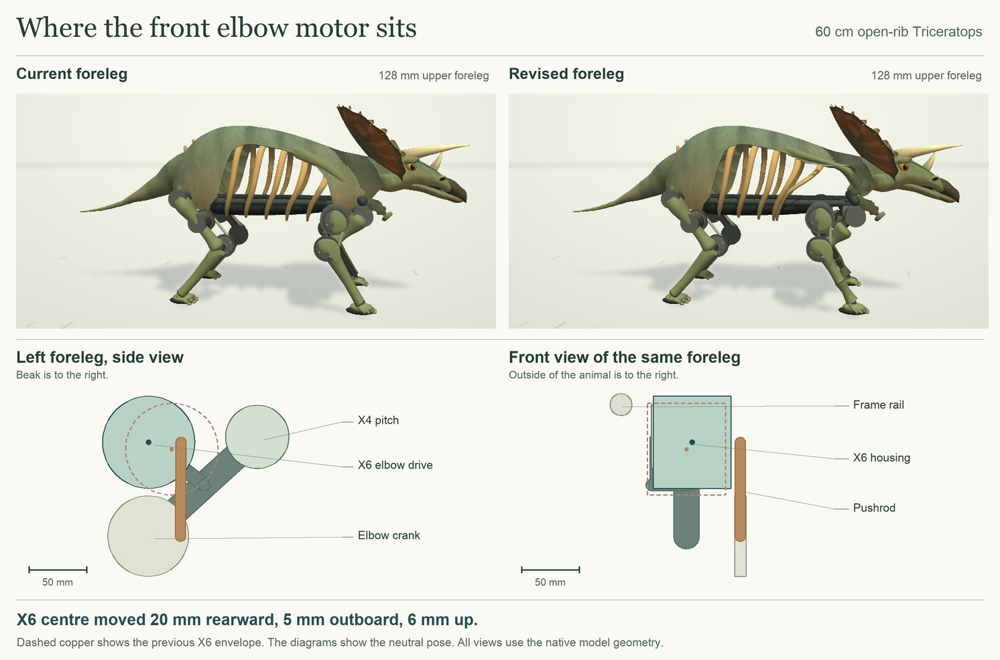

# 60 cm open-rib Triceratops

The 128 mm model below established the gait and shoulder packaging for the 60 cm museum demonstrator. Frill crown height is 600 mm, shoulder and hip pivots are 280 and 320 mm above the floor in the neutral pose, and modeled mass is 12.844 kg. The forelegs use X4 roll, X4 pitch and X6 flexion through a 1:1 linkage. Each hind leg uses three X4 drives.



[Four-beat walk, with four foot loads](media/walk.mp4) · [Moving turns, with requested and actual headings](media/steering.mp4) · [Printable design sheet](media/design-sheet.pdf) · [Foreleg bench plan](../bench/BENCH_PLAN_FORELEG.md)

## Walking speed and six-heading limits

The [speed study](speed_study/README.md) compares both forelegs at higher exhibit cadences and at increasing heading commands. The [straight walk film](speed_study/media/walk.mp4) includes the transition from a regular four-beat walk to rollover. The [diagonal-gait film](speed_study/media/steering.mp4) shows why hitting six directions at speed can coexist with long foot slides. Two further tests measure whether the robot can maintain three planted stance feet during turns. [Live four-beat steering](speed_study/media/fourbeat-turns.mp4) · [Rehearsed six-heading speed comparison](speed_study/media/rehearsed-speeds.mp4)

## Recommended configuration for the first build

Select the **160 mm upper foreleg**, 184 mm lower foreleg, X4/X4/X6 drives and gentle steering within the same 600 mm open-rib envelope. Over twelve matched moving courses the greatest foot impact fell from 424 to 303 N with every requested heading acquired on both lengths. Across six pivots the peak fell from 302 to 224 N. The walk had essentially the same speed and support margin. The 160 mm elbow needed 24% more RMS torque during that walk, and its moving rod clears the guard by 3.30 mm in the ideal geometry. Build and instrument one leg before authorizing a full chassis. The existing 128 mm model is the baseline and thermal fallback.

[Matched walking and turning films, motor close-up and build decision](mid160/README.md) · [160 mm dressed model](models/mid160/triceratops.xml) · [Updated foreleg bench plan](../bench/BENCH_PLAN_FORELEG.md)

## Gentler steering on the same robot

[Side-by-side right pivot](media/gentle-pivot-right.mp4) · [Side-by-side six-command walk](media/gentle-six-headings.mp4) · [Return to straight on the original course](media/gentle-course.mp4) · [128 mm versus 188 mm foreassembly](leg_length/)

The original steering profile remains available for replay. Select `--turn-profile gentle` for the tested alternative. Both use the same physical model, motor limits, relative heading targets and 10 ms leg-command delay. The gentle profile limits yaw rate and acceleration, lowers the swing foot during pivots, and uses the noisy body gyro and gravity estimate to track yaw relative to the starting pose.

| Test on this 128 mm upper foreleg | Original steering | Gentle steering |
|---|---:|---:|
| Seed 102 right pivot, right-fore peak | 580.2 N | 264.7 N |
| Same pivot, largest 10 ms mean on any foot | 399.8 N | 210.2 N |
| Same pivot, time to enter a sustained ±5° band | 1.83 s | 2.47 s |
| Highest single-foot peak across the original six ±40° pivots | 580.2 N | 302.5 N |
| Original moving course, complete trials (nominal and randomized, seeds 101–103) | 4/6 | 6/6 |
| Six distinct moving commands, accepted changes across six trials | 30/36 | 36/36 |

The six-command sequence begins with straight setup, then requests +15°, +35°, +10°, −15°, −35° and 0° over 40 s at a commanded 0.25 m/s. Both controllers had identical time windows. A command counts when actual chassis heading stays within ±5° for one continuous second. The gentle profile finished every command within 1.41° in these six trials, but their largest single-foot peak rose from 336.7 to 416.3 N (largest 10 ms mean 243.8 to 260.8 N). The separate held-out original-course runs also showed higher worst moving impact, 344.7 to 385.3 N. With an added steady gyro bias of ±0.5°/s, all eight bias-stressed 23 s trials missed at least one heading. Keep the 580 N case in the fixture design envelope and measure heading drift on the real machine. [Gentle pivot 1 kHz force samples](evidence/pivot-right-102-gentle.csv) · [Six-command measurements](evidence/six-distinct-headings.json) · [Original-course, holdout and gyro-bias results](motion/gentle-turn-results.json) · [Steering method and repeat commands](motion/README.md)

## Motor, link and silhouette

Each X6 moves 20 mm aft, 5 mm outward and 6 mm upward in neutral upper-link coordinates. The bracket becomes a 3 mm plate. The upper and lower pivot spans remain 128 and 184 mm. Two 28 mm cranks stay coplanar, with 81.50 mm between rod pins at neutral. The forward rib, shoulder panels and edge of the dorsal covering are relieved around the drives. The sculpted forearm covers about 114 mm of the lower link and meets a tapered wrist cuff. The cuff adds no joint.

The robot's upper foreleg to upper hind leg ratio is 0.681. The corresponding humerus and femur measurements for Naturalis specimen RGM.1332500 give 0.682. Its 628 mm ulna scales to 114 mm using the robot’s 188 mm upper hind leg. Individual fossil bones and robot joint centres have different endpoints. The rounded back and short forelimb are also visible in the Minnesota mount. [Naturalis measurements, Table S1](https://repository.naturalis.nl/pub/800493/Jimmy-de-Rooij-2024-Bringing-fossils-back-to-life-A.pdf) · [Science Museum of Minnesota mount](https://assets.ctfassets.net/x2t7lek2vf7h/77vRqtPqnjM1sVlcFhKLRF/2d2bca550c9f2d379549e929cfaedc74/paleontology-publications-mounted-skeleton-of-triceratops-propsus.pdf)

Across 4,913 joint combinations per side the X6-to-upper-strut gap changes from a 9.20 mm overlap to 8.70 mm of clearance. The revised plate clears the rail by 4.68 mm. A separate calculation that moves both crank pins leaves 3.50 mm between the ideal rod and the motor. The housing clears the front sculpted rib by 4.97 mm and the back covering by 7.08 mm in the sampled exterior poses. The elbow is actuated directly in the dynamics model. The film displays a static rod graphic. Verify real rod ends, cable bends, guards, plate deflection and the stop chain under load before selecting production dimensions. [Geometry evidence](evidence/geometry/)

## Walking, balance and direction

Both four-beat walks use a 96 mm stride. The revised walk lowers commanded swing lift from 32 to 26 mm and shortens the interval between successive foot lifts from 1.34 to 1.07 s. It also reduces lateral body travel and removes the rearward offset on the first two setup swings. Tests that changed only the mount or only the gait attribute most of the reduction in sway to gait timing and targets.

| Measure | Previous | Revised |
|---|---:|---:|
| Passing slow walks, eight seeds on each of two contact settings | 16/16 | 16/16 |
| Nominal straight walking speed | 13.8 mm/s | 17.3 mm/s |
| Mean side-to-side body excursion | 145.2 mm | 127.9 mm |
| Greatest planted-foot slide | 9.16 mm | 7.36 mm |
| Minimum geometric support margin | 38.9 mm | 34.2 mm |
| Greatest slow-walk normal load on any foot | 91.4 N | 87.8 N |
| Static front weight share | 55.50% | 54.88% |

The geometric margin measures the horizontal centre of mass against the ankle triangle during a single swing. In the original steering comparison, the separate heading course uses a 0.25 m/s diagonal gait with 10 ms of command delay. All six revised runs finished upright, and four acquired every heading within ±5° for one second. The other two missed the final return to straight. The faster course reached 355 N on one foot in the revised plant. [Matched gait and load results](evidence/gait-comparison.json)

With the original steering profile, both designs acquired all six in-place pivots. A right pivot at seed 102 put **580 N on the right forefoot** of the revised plant versus **572 N** on the reference. This was the largest instantaneous modeled load in the original nominal-speed comparison. The largest 10 ms mean was 400 N versus 404 N. Include the [1 kHz revised pivot trace](evidence/pivot-right-102-refined.csv) in the guarded foreleg test. The simulations covered level ground. The shoulder opening needs physical guarding, and actual heading, traction and stopping require a caught test on the venue floor.

## Run either foreleg model

From this directory, use Python 3.14 and the pinned dependencies. The default runner retains the 128 mm baseline. Pass the physical model path to exercise the recommended 160 mm assembly.

```sh
python -m pip install -r requirements.txt
python verify.py /tmp/triceratops-refinement-check
python motion/run.py walk --model models/mid160/physics.xml --seed 11 --record --out /tmp/160-walk
python motion/run.py pivot-right --model models/mid160/physics.xml --turn-profile gentle --seed 102 --out /tmp/160-pivot
python motion/run.py walk --model models/refined/physics.xml --seed 11 --record --out /tmp/refined-walk
python motion/run.py course --model models/refined/physics.xml --seed 103 --turn-profile gentle --record --out /tmp/refined-course
python motion/run.py six-headings --seed 103 --random --turn-profile gentle --out /tmp/refined-six
```

Load [the refined dressed MJCF](models/refined/triceratops.xml) to inspect the shoulder opening or [the previous dressed MJCF](models/reference/triceratops.xml) for comparison. Keep both model directories together so their shared textures and meshes resolve. The GitHub model check verifies the dressed and physics variants, load balance at rest, two straight walks, both pivot directions, the seed-102 pivot load reduction and the recovered direction changes including the six-command course. Run the [full multi-seed comparison](motion/README.md) or [regenerate the geometry and clearance checks](geometry/README.md) for the broader evaluation.
