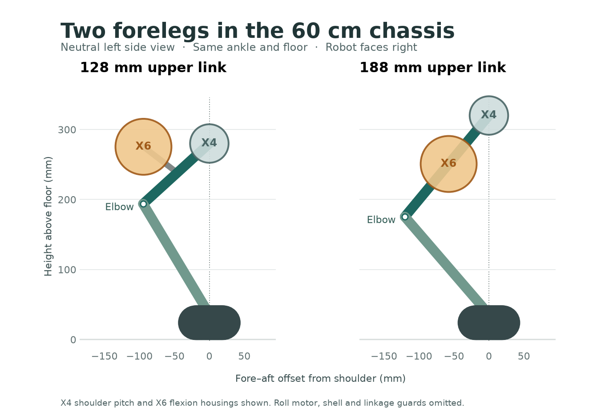

# Which foreleg for the 60 cm Triceratops?

Of the 128 and 188 mm assemblies evaluated here, the 128 mm upper link was the first bench choice. A subsequent [matched 160 mm study](../mid160/README.md) selected the middle length for the first article. It gives the exhibit leg a lower shoulder, matches a measured Triceratops upper-limb proportion, reduces modeled elbow effort on the slow four-beat walk and already has a motor mount with positive modeled clearance. The **188 mm assembly** has two practical advantages on this chassis. It gives the ankle more travel, and all three matched right pivots produced lower peak loads. Those advantages make it worth reconsidering if physical foot-load or reach measurements limit the 128 mm leg.



## What changes on the actual robot

The short and original upper links measure 0.681 and 1.000 times the 188 mm upper hind link. The corresponding humerus and femur of specimen RGM.1332500 measure 708 and 1,038 mm, a ratio of 0.682. This comparison covers one pair of bones. The joint centres have different endpoints from fossil bone measurements, and both robots retain a 184 mm mechanical lower link. The short version’s sculpted forearm covers about 114 mm before the wrist cuff. [Naturalis measurements, Table S1](https://repository.naturalis.nl/pub/800493/Jimmy-de-Rooij-2024-Bringing-fossils-back-to-life-A.pdf)

With neutral ankles 36 mm above the floor in both models, shortening the upper link and lowering its shoulder puts the elbow **18 mm higher**. This changes the visible bend even when the feet land in the same places. Both use X4 roll, X4 pitch and X6 flexion. The 80 mm X6 occupies 62.5% of the short link’s span and 42.6% of the original’s. The apparent increase in motor bulk comes from the proportions and mount position. PLEM introduces no motor change in this comparison.

| Neutral geometry or static calculation | Short, 128 mm | Original, 188 mm |
|---|---:|---:|
| Shoulder / elbow height above floor | 280 / 194 mm | 320 / 175 mm |
| Signed X6 case-to-upper-strut gap | +8.70 mm | −44.95 mm |
| External elbow moment from a 35 N vertical pad-centre load | 3.31 N·m | 4.20 N·m |
| Forward / rearward ankle reach at neutral ankle height | 120 / 176 mm | 152 / 216 mm |

The original X6 lies across the modeled solid upper strut. The negative signed gap flags overlapping solids. A forked strut or a revised motor mount would need its own check. The short leg’s offset mount clears that strut in the model. The reach calculation samples the shoulder and elbow limits at fixed roll and within 1 mm of neutral ankle height. Mechanical interference and load restrict the usable range further. [Kinematic calculation](workspace.py) · [Sampled values](workspace.json) · [Short-leg clearance study](../geometry/README.md)

## Matched motion trials

Both designs use the same open-rib chassis, hind legs, foot pads, contact settings, joint limits, actuator limits and controller settings. The 188 mm comparison restores the original foreassemblies from the 60 cm capsule model, including the shoulder position, motor centre and brackets. Its physical mass model weighs 12.694 kg versus 12.844 kg with the short leg hardware. The four-beat trajectory solves inverse kinematics separately for each geometry, using the same foot targets in neutral-ankle coordinates. The secondary moving and pivot trials use the same heading controller on both models. These differences measure the effects of the assembly as a whole.

| Simulated measure | Short, 128 mm | Original, 188 mm |
|---|---:|---:|
| Standing front weight share | 54.88% | 55.32% |
| Four-beat exhibit walk, seeds 11–13 | 3/3 passed | 3/3 passed |
| Exhibit speed | 17.25–17.26 mm/s | 17.15–17.16 mm/s |
| Smallest geometric support margin | 34.15 mm | 34.92 mm |
| Greatest planted-foot slide | 7.36 mm | 6.62 mm |
| Greatest single-foot walk load | 87.73 N | 89.21 N |
| Front elbow effort, worst peak / worst RMS across both legs and seeds | 7.27 / 3.70 N·m | 8.35 / 4.43 N·m |
| Original right pivot, seed 102, RF peak / largest 10 ms mean | 580.23 / 399.82 N | 293.38 / 280.68 N |
| Gentle right pivot, seed 102, RF peak / largest 10 ms mean | 264.65 / 210.17 N | 193.98 / 178.75 N |
| Gentle right pivot RF peaks, seeds 101 / 102 / 103 | 280 / 265 / 302 N | 193 / 194 / 200 N |
| Gentle moving course, six new headings after initial hold, nominal seed 101 | 6/6 acquired | 6/6 acquired |
| Largest foot load on that six-heading run | 274.28 N (RF) | 260.64 N (LF) |

The longer assembly bought **less than 1 mm** of minimum support margin on this slow walk. Reducing elbow effort by about **16% RMS** is the stronger mechanical case for keeping the short leg. The original assembly reduced the seed-102 gentle-pivot peak by another **71 N**. The original’s lower pivot loads are worth measuring on a buildable assembly before committing the other three legs. The model drives the elbow directly and cannot establish rod-end forces, guard clearance under deflection or public-demo safety. The motor purchases are the same. Any cost difference depends on fabrication and guarding. [Per-seed simulation results](comparison.json)

## Reproduce

From the refinement60 directory with [its dependencies](../requirements.txt) installed:

```sh
python leg_length/compare.py
python leg_length/workspace.py
```

The first command writes the paired [comparison](comparison.json), including foot order LF, RF, LH, RH and the acquisition time of every heading. The second prints the reach and external-moment calculation. To inspect the original foreassembly on the common chassis or redraw the figure, run:

```sh
python leg_length/compare.py --write-original /tmp/trike60-original-forelegs.xml
python leg_length/picture.py
```

The optional figure script uses Matplotlib (generated with 3.11.2). This study used nominal contact, three exhibit-walk seeds, three gentle right-pivot seeds, the known original pivot case and one moving six-command seed per geometry. The [turn study](../README.md) covers the broader controller tests on the selected 128 mm build.
