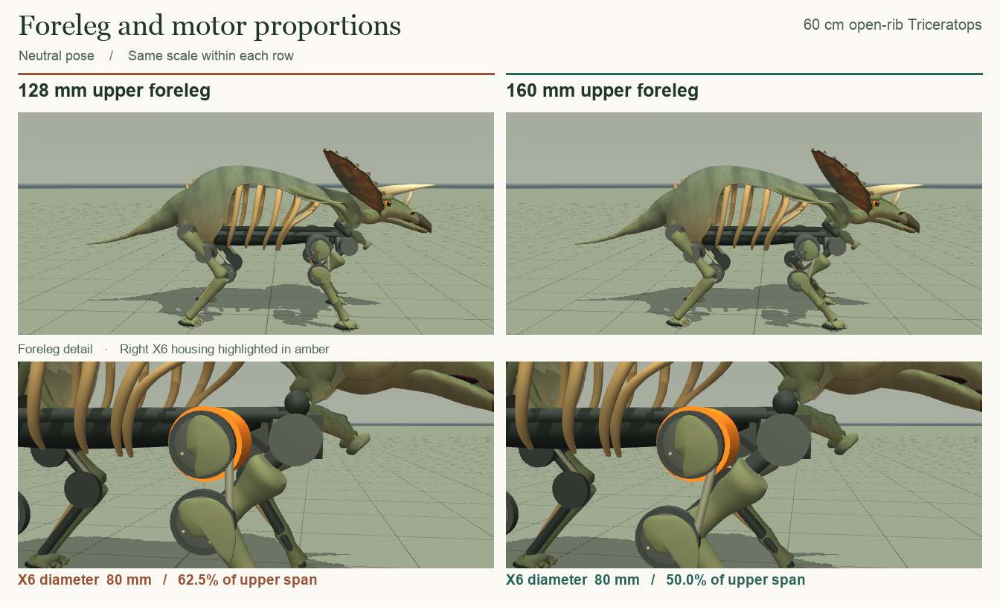

# 128 or 160 mm upper forelegs for the 60 cm demonstrator?

**Build the first instrumented foreleg with the 160 mm upper link, the existing X4/X4/X6 drives, and the revised 1:1 linkage.** For the open-rib museum robot, the smaller impacts during turning and the more legible elbow are worth the extra elbow effort during the slow walk. Qualify repeated walking and turning on the bench before buying the remaining legs. Keep the 128 mm model available for its lower walking effort and closer fossil proportions.

[Exhibit walk](media/walk.mp4) · [Right pivot](media/pivot-right.mp4) · [Six-command walk](media/six-headings.mp4) · [Full-size motor detail](media/detail.png)

## What the longer leg changes



This comparison holds the 600 mm frill height, 280 mm shoulder height, neutral foot locations, 184 mm lower forelegs, 188 mm upper hind legs, feet, actuator positions and torque limits fixed. The longer upper link puts the elbow 26 mm farther aft and 19 mm lower. It adds about 82 g to the robot including both foreassemblies. The same 80 mm X6 case spans 50% of the upper link at 160 mm, down from 62.5% at 128 mm. The housing is still prominent in profile. The elbow and shoulder separate more clearly in the detail view, while the full-body silhouettes and the rhythm of the slow walk look similar.

The upper foreleg to upper hind leg ratios are 0.68 and 0.85 for the 128 and 160 mm assemblies. For comparison, the measured humerus and femur on Naturalis specimen RGM.1332500 are 708 and 1,038 mm, a ratio of 0.68. Robot pivot spans approximate the fossil landmarks. The 128 mm leg is the closer anatomical match on this measure. [Naturalis, Table S1](https://repository.naturalis.nl/pub/800493/Jimmy-de-Rooij-2024-Bringing-fossils-back-to-life-A.pdf)

## Gait, foot loads and steering

The walk film shows seconds 5–17 of seed 11 at real speed. The pivot and moving-course films show the full runs. Both models use the same four-beat exhibit plan with joint angles solved for their individual links. Both use the same gentle steering profile on the separate diagonal walking course and in-place pivots. Foot loads below are normal forces sampled at 1 kHz. Each 10 ms value is the largest average over ten consecutive samples on any one foot.

| Matched measurement | 128 mm | 160 mm |
|---|---:|---:|
| Standing front weight share | 54.88% | 54.97% |
| Slow walks completed, seeds 11–13 | 3/3 | 3/3 |
| Slow-walk speed | 17.25–17.26 mm/s | 17.29–17.30 mm/s |
| Smallest geometric support margin during a swing | 34.15 mm | 34.43 mm |
| Greatest planted-foot slide during the slow walk | 7.36 mm | 6.78 mm |
| Slow walk, highest single-foot raw / 10 ms load | 87.7 / 84.7 N | 89.8 / 86.2 N |
| Worst front elbow RMS torque during the slow walk | 3.70 N·m | 4.58 N·m |
| Filmed −40° pivot, seed 102, right-fore peak / largest 10 ms mean | 264.7 / 210.2 N | 193.4 / 171.1 N |
| Six ±40° pivots, highest single-foot raw / 10 ms load | 302.5 / 210.2 N | 224.2 / 190.3 N |
| Six moving courses, seeds 101–103, highest raw / 10 ms load | 416.3 / 260.8 N | 280.7 / 215.1 N |
| Six additional moving courses, seeds 104–106, highest raw / 10 ms load | 424.0 / 329.6 N | 302.7 / 247.8 N |
| Acquired heading changes, main and additional courses | 72/72 | 72/72 |

The seed-102 right pivot entered the sustained heading band 2.47 s after the command at 128 mm and 2.42 s at 160 mm. Each moving course began straight and then requested +15°, +35°, +10°, −15°, −35° and 0°, at a commanded 0.25 m/s. It used the same 40 s window, gyro-based steering and 10 ms leg-command delay. Acquisition required actual chassis heading inside ±5° for one continuous second. Each seed was run once on the nominal plant and once with randomized plant and floor parameters. Every run finished upright. Each of the 12 moving runs and each of the six pivots had a lower maximum raw foot force with 160 mm links. The largest moving impact over both sets was on the **left forefoot** for both lengths. Worst final heading error across the 72 changes per build was under 1.7°. [Main panel with per-foot loads](results.json) · [Additional seed results](holdout.json)

The longer leg offers little change to the slow walk's balance. Side-to-side excursion stays close to 126–128 mm with either length. On the main moving course, the worst run's 95th-percentile loaded-foot slip speed rose from 0.070 to 0.079 m/s. The longer leg also raised the slow walk's front-elbow RMS effort by 24%. A static 35 N vertical pad-centre force illustrates the lever-arm change, giving 3.31 versus 4.22 N·m of external elbow moment. At neutral ankle height, forward/rearward geometric reach changes from 120/176 to 132/208 mm. These geometric bounds exclude interference and load. [Reach and moment calculation](workspace.json) · [Calculation method](../leg_length/workspace.py)

## First build and bench decision

Use the open-rib exterior, 160 mm upper links, 184 mm mechanical lower links, X4 roll and pitch, X6 elbow, passive rocker feet and gentle steering. The 188 mm alternative gives further reach, but its historical X6 housing overlaps the upper strut and its upper foreleg equals its upper hind leg in length. There is no motor purchase saving from switching among these lengths. The 160 mm rod, mounting plate and guard changes need a fabrication quote. [188 mm comparison](../leg_length/README.md)

Keep the X6 barrel in its current shoulder pocket. The 160 mm leg uses a 103.83 mm neutral pushrod (previously 81.50 mm), the same 28 mm cranks and a revised backing plate. In the sampled geometry, X6-to-upper-strut clearance falls from 8.70 to 7.07 mm. The moving rod clears the barrel by 3.50 mm and the crank guard by 3.30 mm on both versions. The 160 mm rod-to-distal-sculpt clearance reaches 11.89 mm, and output-crank-to-torso clearance reaches 23.47 mm. The dynamics model applies elbow torque directly. A separate linkage sweep moves the rod through its range. [Geometry and clearances](GEOMETRY.md) · [Bilateral sweep results](geometry.json) · [Sweep implementation](check_geometry.py)

Build a single foreleg and measure elbow temperature, current and torque over the planned exhibit duty cycle. Replay the measured impact cases on the guarded fixture, retain the earlier 580 N sizing case, and verify rod-end and cable clearance under load. A caught chassis test on the intended floor is needed for heading drift, traction and stopping. If the 160 mm assembly fails the thermal or clearance checks, the tested 128 mm assembly is the fallback. [Foreleg bench plan](../../bench/BENCH_PLAN_FORELEG.md)

## Reproduce

From the refinement60 directory with its simulation dependencies installed:

```sh
python mid160/build.py
python mid160/trials.py --jobs 4 --records /tmp/trike60-mid160
python verify.py /tmp/trike60-check
python motion/run.py six-headings --model models/mid160/physics.xml --turn-profile gentle --seed 106 --out /tmp/160-holdout
```

For the additional six-heading panel run the last command with both physical models, seeds 104–106, once with default settings and once with `--random` for each seed. Load the [160 mm dressed model](../models/mid160/triceratops.xml) or the [128 mm dressed model](../models/refined/triceratops.xml) to inspect the joint and shell positions. Keep the model directories together for shared assets.
