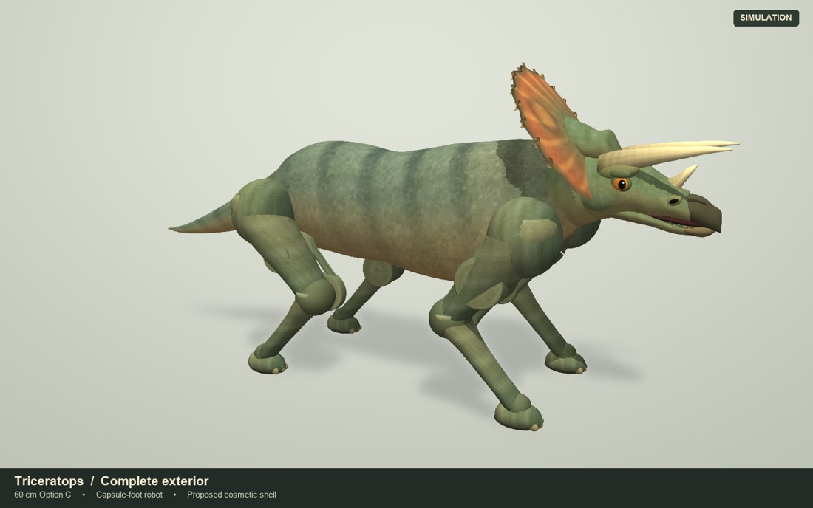

# Full exterior for the 60 cm Option C

This is a **presentation model** of the capsule-foot robot. It shows the solid, swept-back frill, a longer beak, skin over the torso and belly, individual drive fairings, flexible-looking sleeves, feet and tail. Each part follows the corresponding MuJoCo body. The surface pattern is an original color study. Museum mounts informed the head and frill silhouette; the paint and skin thickness are design choices. [Smithsonian Triceratops reference](https://www.si.edu/object/3d/tyrannosaurus-and-triceratops%3Ad8c62d28-4ebc-11ea-b77f-2e728ce88125)



[Side profile with fixed leg axes and the first exterior overlaid](frame-and-profile.png)

The source for the frame, capsule contacts, actuators, joints, and mass ledger is [the selected engineering model](../../sim/generated/trike60_C_closed_capsule.xml). Its shoulder and hip pitch axes stand 320 mm above the floor in the home pose, 520 mm apart. The revised torso is 254 mm wide in that pose, down from 300 mm in the first padded concept. The rigid frill is 299 mm wide, with a 238 mm vertical span and a 179 mm fore–aft span. Beak to tail is 1,186 mm, brow-horn tip to tail is 1,197 mm. The fixed foreleg and hind leg links retain their original proportions.

## Build and view

From this directory, using the build's MuJoCo 3.10.0 / NumPy environment with SciPy and Pillow installed:

```sh
python build_exterior.py --out /tmp/trike-exterior
python -m mujoco.viewer --mjcf=/tmp/trike-exterior/trike60_C_closed_capsule_exterior.xml
python check_exterior.py --model /tmp/trike-exterior/trike60_C_closed_capsule_exterior.xml
python profile_exterior.py --model /tmp/trike-exterior/trike60_C_closed_capsule_exterior.xml --out /tmp/trike-views
```

Keep the generated XML, OBJ meshes and PNG textures together when moving the model. The default MuJoCo view shows group 2 (the outer covering). Enable group 5 to see original engineering geometry alongside the cover. Disable group 2 and enable group 5 to inspect the original geometries. The small reference silhouette and its dimensions reproduce the overlay of the superseded padded concept.

For the gallery, run the two commands below. Rendering requires an OpenGL context, the walking environment's dependencies and, for the MP4, `imageio-ffmpeg`. Both scripts can instead read an existing canonical replay using `--replay` and an NPZ containing simulation time `t` and full positions `qpos`.

```sh
python render_exterior.py --model /tmp/trike-exterior/trike60_C_closed_capsule_exterior.xml --out /tmp/trike-views --video
python check_coverage.py --model /tmp/trike-exterior/trike60_C_closed_capsule_exterior.xml --out /tmp/trike-views/coverage.json
```

The 7.5-second clip uses the recorded states of the original model-based trot at a 0.25 m/s command, seed 101, with a simulated 10 ms delay and sensor noise. The presentation model only replays those states. The skin does not supply synthetic observations to the controller. Actual charge, load and thermal effects of an installed cover require a mass ledger and a physical test.

The independent visual bodies `exterior_jaw`, `exterior_left_lid` and `exterior_right_lid` support the preview expressions implemented in `render_exterior.expression`. These are cosmetic movements. The underlying beak and eyelid servos remain mass proxies. The photos use a MuJoCo segmentation matte, a studio background and softened ground shadows.

## Verification and physical fit

The geometry check compares every original body's mass, inertial frame and pose, every original geom's dimensions and contact parameters, actuator gains/limits, and the coordinate history endpoint of a one-second neutral stand. In this version, the 21 original bodies total 12.693795 kg and the endpoint positions match exactly. The 111 cosmetic surfaces contribute zero mass and contact. The nominal mass therefore represents the original simulation, while the real skin's mass and attachment hardware remain to be established.

The visibility check samples four poses from the canonical trot from five usual viewing angles and two below-belly angles, with the original engineering geometry enabled. Across the 20 usual views, the only exposed engineering pixels were the right low-mounted range sensor (72 pixels across four images) and three right-front drive-crank pixels across the set. The eight underside views showed only the left and right range-sensor carriers. Original provisional skin, horns, rocker soles and other replaced surface proxies are excluded from that count. There were no visible rails, crossmembers, cable looms, pushrods, ankle hubs or open belly in these 28 sampled views. These observations do not establish full-motion clearances, ventilation, access, or either sensor's field of view.

The [mass and area check](area-and-dynamics.json), [profile measurements](profile-metrics.json) and [sampled visibility results](coverage.json) record the regenerated model.

The raw surface areas from `check_exterior.py` sum closed geometry, including overlap, internal end faces, hidden sides of covers, cast rocker outlines and the face details. Derive film or textile demand from actual panel patterns. Rigid fabrication also needs separate mating flanges, attachment details, tolerances and service panels.
