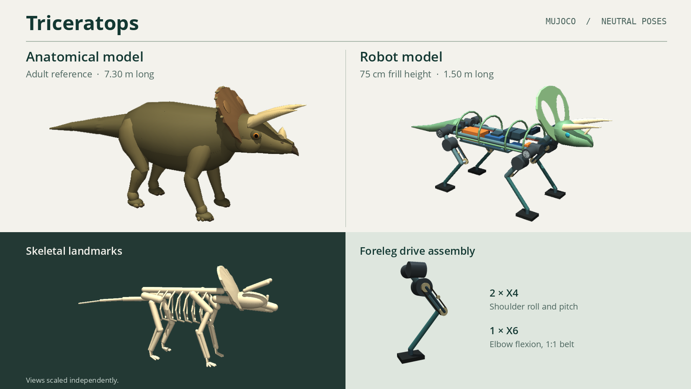

# Triceratops MuJoCo models

[anatomical.xml](anatomical.xml) reconstructs an adult *Triceratops horridus* for articulation and stance studies. [robot.xml](robot.xml) implements the 75 cm quadruped from the [design package](../Triceratops-design-package.pdf). Both XML files are standalone MJCF scenes with embedded geometry, gravity, a floor and a freely moving base. They use metres, kilograms and seconds. The animal faces +X, its left is +Y, and up is +Z.



## Open either model

From this directory, with a desktop display available:

```sh
python -m pip install mujoco==3.10.0
python -m mujoco.viewer --mjcf=anatomical.xml
python -m mujoco.viewer --mjcf=robot.xml
```

Use the viewer's Control panel to adjust a single actuator. Both models start in their standing poses at zero command. The anatomical controls specify normalized net joint effort; the robot controls specify angular targets in radians relative to neutral. To run the headless checks:

```sh
python check_models.py
```

## Anatomical reconstruction

The 7.30 m, 5,936 kg adult reconstruction stands about 3.20 m at the frill. The articulated animal carries a large, solid frill, paired brow horns, a nasal horn and a beak with a separate lower jaw. Shoulders and hips have separate abduction and pitch axes. Elbows, wrists, stifles and ankles flex; three tail sections each bend in yaw and pitch. Five forefoot rays and four hindfoot rays describe the feet. Ground contact is resolved through simplified pads. A linked neck and skull allow head movement independently of the torso. In the viewer's geom-group controls, hide group 2 (surface) and show group 4 (skeletal landmarks) to examine the underlying proportions.

The adult horn and frill outline follows published growth-stage observations. The forelimb posture and digit arrangement draw on forelimb and manus reconstructions. The model uses original surface geometry, estimated segment masses, joint ranges and stabilizing spring-damper terms. Each of the 26 controls approximates the net torque at one anatomical axis. These inputs support posing and motion experiments; reconstructing individual muscles or inferring biological joint strength would require additional data. [Cranial development](https://pmc.ncbi.nlm.nih.gov/articles/PMC1635501/) · [Forelimb posture](https://pmc.ncbi.nlm.nih.gov/articles/PMC3350707/) · [Manus reconstruction](https://doi.org/10.1671/039.029.0406)

## Mechanical model

| Assembly | Representation and command |
| --- | --- |
| Four proximal leg modules | Each has separate X4 roll and upper-leg pitch drives. Named component geoms locate the drive cases and contribute to mass and inertia. Commanded peak joint effort is limited to 21 N·m per axis. |
| Four distal leg drives | Each X6 sits high on the upper link. A rigid 1:1 transmission maps its output to elbow or stifle flexion. The 37.8 N·m joint-side peak clip includes assumed 90% belt efficiency. |
| Neck and tail | An XM540 position servo drives the counterbalanced neck pitch joint; an STS3215 drives tail yaw. Fixed horns and beak move with the head. |
| Feet and structure | Four compliant passive ankle hinges carry rectangular contact soles. Aluminium rails, bulkheads, links, removable tray, ballast and PA11 shell features set the mass distribution. |
| Power and compute | The 6S 5 Ah battery, power distribution, logic converters, wiring, cooling, Pi 5/AI HAT+ enclosure and Teensy/dual-CAN module have named component envelopes. Electrical behavior and firmware are outside this plant. |
| Sensing | Four foot-load channels, body orientation, gyro, accelerometer, joint telemetry, two ideal single-ray chest rangefinders and a forward optical camera. The rays approximate the centre of each ToF field. Use the OAK-D camera view to inspect sightlines. |

Peak actuator clips, servo gains, belt transfer, pad friction and ankle compliance are design estimates. Bench torque–speed curves at 6S, continuous torque and heat, communication delay, belt play and sensor noise are open inputs. Foot and body collisions use simplified shapes. The XML describes the 75 cm, 15 kg prototype; the 60 cm companion remains a separate packaging concept.

## What has been exercised

The regression loads both XMLs, simulates three seconds of free-base stance at zero command, checks for numerical warnings and verifies four distinct loaded feet. It exercises the anatomical jaw, checks a target perturbation on every powered robot joint and moves the robot tail in simulation. Achieving the proposed 0.30 m/s robot walk still requires a four-foot gait controller and separate dynamic tests.
