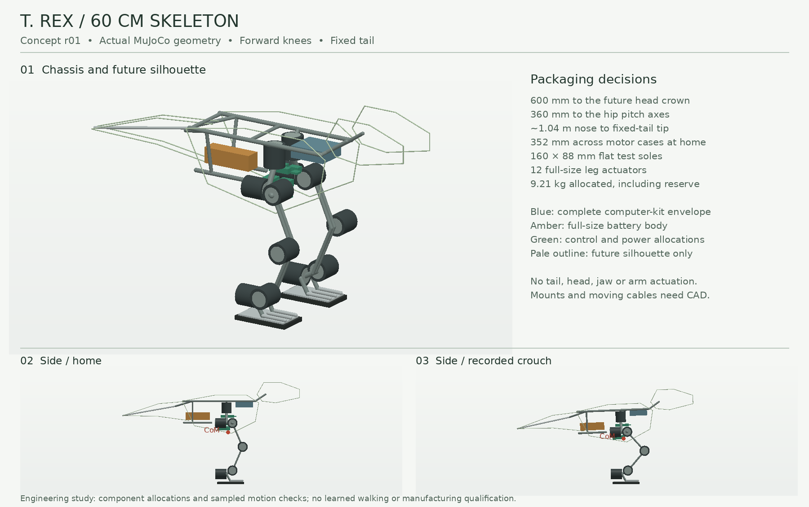
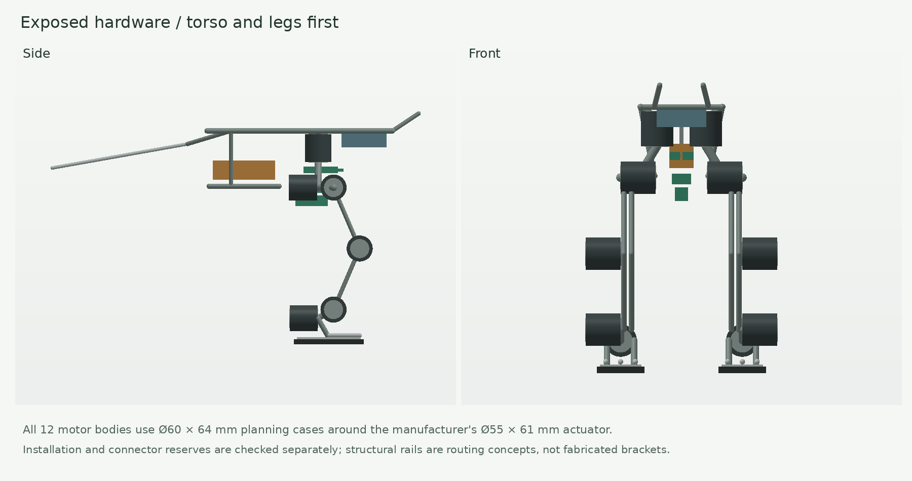

# M1: 60 cm T. rex skeleton, concept r01

This is a first mechanical architecture and MuJoCo study, not a fabrication or
purchase release. It keeps the mini's low-spine direction and forward knees,
but designs a separate larger mechanism around full-size hardware. It does not
enlarge the mini's servos or assume its policy transfers.



## Reference interpretation

The requested Maxtronics reference is interpreted as
[NAO6](https://maxtronics.com/en/nao6/): its manufacturer describes a 58 cm,
25-DOF humanoid. Its [datasheet](https://www.maxtronics.com/wp-content/uploads/nao-v6-datasheet_en_2025.pdf)
gives 574 × 311 × 275 mm and 5.48 kg. It is a useful scale and integrated
robot reference. This design does not copy NAO's leg mechanism or controller.

The WowWee reference is interpreted as
[Roboraptor X](https://wowwee.com/roboraptor-x), which the manufacturer describes
as 32 inches **long**, not tall. Its horizontal body, long tail, forward head
and behavior-driven character are useful visual cues. Toy walking claims do
not establish the balance, autonomy or terrain capability of this model.

The T. rex direction is a substantial forward skull envelope, small future
arms, forward knees, a raised ankle/hock and a long tapered tail. The visible
backward bend lower on the leg is the ankle region, not a reversed knee.
The actual head, jaw, arms and skins are deferred. M1 keeps equivalent fixed
mass and inertia so a bare-torso success does not silently omit future loads.

## Dimensions and architecture

| Item | Current design |
| --- | --- |
| Eventual standing height | 600 mm to head crown reference; thin outline has line thickness |
| Hip pitch axis height | 360 mm |
| Nose to tail | Approximately 1.04 m |
| Motor-case width at home | 352 mm; cosmetic rims add about 2 mm |
| Foot spacing / sole | 224 mm centers; each sole 160 × 88 mm |
| Leg links | 152.3 mm hip-to-knee and knee-to-ankle axis distances |
| Leg actuation | 12 total: hip yaw/roll/pitch, knee pitch, ankle pitch/roll on each leg |
| Other actuation | None; tail fixed |
| Assigned total mass | 9.210 kg, including 600 g integration reserve and 750 g future payload |

The six-joint legs retain foot orientation, lateral weight-transfer and turning
authority for later control work. They add weight and wiring; those capabilities
are design intent, not demonstrated behaviors. Broad, flat test soles sit under
three fixed toe ribs. Passive toe articulation and remote belt/cable drives are
not added in this revision.

The open torso has two longitudinal rails and a central hip structure. The
battery sits aft and below the spine; compute sits above and forward of the
hip bay. Control and power use narrow central bays. There is no separate chest
appendage or camera box sticking out in front. A future head camera belongs in
the head allowance. The rear battery cradle is intended for service access;
tool, connector and removal trajectories still need CAD checks.



## Hardware and honest mass accounting

[design.json](design.json) owns the selected dimensions, source URLs and
installation reservations. [mass_budget.csv](mass_budget.csv) and the
[component ledger](../../../examples/tyrannosaurus_rex_60cm/components.json)
record each assigned mass once. Catalog parts inside an installed assembly
consume its allocation; their visible geometry does not add mass again.

| Category | Allocated mass |
| --- | ---: |
| Twelve leg motors | 4.320 kg |
| Frames, bearings and feet | 1.840 kg |
| Battery, compute, control and power assemblies | 1.480 kg |
| Harness and foot sensing | 0.220 kg |
| Integration reserve | 0.600 kg |
| Future fixed head/neck, tail and arms | 0.750 kg |
| **Total** | **9.210 kg** |

This is heavier than NAO6 and is not a mass-optimized robot. Motors alone are
47% of the budget. Reduce weight through measured structural design and a
joint-by-joint actuator trade study, rather than deleting allowances from the
ledger. A 7–8 kg goal would require real engineering changes.

The leg candidate is **MYACTUATOR RMD-X4-P36-36-E-L, V4.1**. The
[manufacturer page](https://www.myactuator.com/x4-36-l-details) links a
[dimension/performance graphic](https://static.wixstatic.com/media/cab28a_d8a8e0059f92437fa9865849c288f823~mv2.jpg),
inspected on 2026-10-28. It specifies Ø55±0.1 × 61±0.5 mm, 360 g, 36:1,
10.5 N·m rated, 30 N·m peak, 83 rpm rated and 20–55 V input range. These values
belong to the **-E-L** revision, not the older similarly named -E motor.

Each model case reserves **Ø60 × 64 mm**, with an additional estimated
18 × 24 × 18 mm connector/bend box. All shaft lines are coaxial with their
modeled joints. Mounts, flanges, secondary bearing support, cable exits and
full moving cable routes remain unresolved. The centered box inertias are
surrogates; vendor CG/inertia has not been imported.

The simulator uses **6 N·m caps**, below the catalog rated value, and ideal
position servos. The assumed 0.20 N·m friction, 0.10 damping and 0.002 kg·m²
armature are not identified drive parameters. Rated torque does not establish
sustained near-zero-speed duty in a robot. Bench testing must establish torque
tracking, backlash, heating, voltage sag, regeneration and current protection.

| Assembly | Full part body / installation reserve | Allocation and unresolved work |
| --- | --- | --- |
| Battery | Gens ace 6S 3300 mAh: tolerance-max 143 × 44 × 45 mm / 160 × 90 × 65 mm | 650 g including restraint/leads. Nominal 506±20 g pack. Protection, connector routing and usable discharge range remain open. |
| Computer | Complete Jetson Orin Nano Super kit: 103 × 90.5 × 34.77 mm / 120 × 110 × 65 mm | 350 g installed estimate, not a weighed kit. NVMe, cabling and cooling need qualification. |
| Control | Teensy 4.1 plus two CAN transceiver and pelvis-IMU reservations / 110 × 50 × 25 mm | 180 g. Teensy PCB dimensions sourced; populated height and other boards estimated. |
| Power | Two converter and protection/distribution reservations / 100 × 50 × 60 mm | 300 g. Stacked boards fit geometrically; no final components or electrical schematic selected. |

The complete 6S pack is 25.2 V charged; its motor voltage envelope is plausible
for the cited revision, but that is not electrical qualification. Cutoff must
respect the drive's lower voltage limit and pack limits. Fuses, disconnect,
regenerative energy handling and regulator/current ratings must be designed.
There is no supported runtime or battery-life prediction yet.

## Balance and motion evidence

At home, modeled CoM is **8.93 mm forward of the root and 306.5 mm above the
floor**. Its sagittal margin within the flat double-support footprint is
64.9 mm. This is a static support check, not a dynamic balance certificate.

The 450 g head/neck allocation sits forward, the 250 g tail allocation aft,
and the battery is behind the hips. These first moments help balance the
whole assembly. They do not automatically keep CoM over a swinging stance
foot. Adding 300 g at the head shifts home CoM about **8.55 mm** forward;
moving the 650 g battery 40 mm shifts it only **2.82 mm**. That battery
translation is a sensitivity calculation, not an approved alternate mounting.

The [source-bound validation report](validation.json) records:

- Twelve seconds of free-base standing: maximum tilt **2.37°**, planar drift
  **6.27 mm**, maximum joint RMS effort **3.13 N·m**.
- Fourteen seconds of commanded crouch and return: **52.44 mm** held drop,
  maximum tilt **2.39°**, peak effort **4.47 N·m**, maximum joint RMS effort
  **3.70 N·m**. Both feet remain loaded; no cap clipping. The final root height
  is within **2.80 mm** of the initial geometric home height.
- During that crouch, CoM height ranges from **306.5 to 269.5 mm** and its
  forward position from **3.27 to 9.12 mm** relative to the initial root origin.
  The approximate sagittal support margin stays above **60.4 mm**.
- No welds, torso supports, externally applied forces or mid-trial root resets.
  Only motor cases and soles generate contact; rails are visual structural
  routing proxies. This model is not suitable for fall/impact qualification.
- An otherwise identical **0.10 N·m** trial fails the standing checks, providing
  an insufficient-torque negative control.

These are short, ideal-PD demonstrations. They establish neither sustained
thermal capacity nor walking, one-foot balance, push recovery or self-righting.
Single-support loads must be evaluated separately before finalizing the drives
or increasing the current 6 N·m simulation caps for locomotion.

## Clearance: two different scopes

The declared M1 screen covers **647 pairs across 376 poses**, including home,
seven independent samples per joint, 31 coupled crouch poses, and recorded
standing/crouching poses sampled every 100 ms. It performs **233,522 pair
evaluations**. All pass the **3 mm** criterion, with a smallest reported gap
of **5.5 mm** in this set and no inconclusive distance checks.

Pairs cover every motor case, installed electronics reserve, connector reserve
and sole against each other, plus eight thigh/shin rails against that set.
Each connector's own motor and each rail's two attachment motors are explicit
intentional exclusions. The report preserves the exclusion list. Internal
board containment and 2 mm board-to-board spacing also pass.

**Arbitrary combinations of joint angles are not cleared.** A separate probe
adds 512 seeded simultaneous joint-range samples and finds **10 failing
pair/pose evaluations**: soles can cross, and an ankle case approaches the
opposite sole below the required margin. The worst sampled sole penetration
is **27.13 mm**. Those failures remain in the report. Later walking control
needs a coupled collision constraint/action safety layer and further leg/foot
design review; joint limits alone are insufficient. No such controller is
implemented here.

Continuous swept volumes, rail-to-rail pairs, the other frame/yoke proxies,
load-bearing brackets, shaft interfaces, cable harnesses, future payload
modules, service access and strength/fatigue remain unqualified. Passing the
declared screen must not be read as a build-ready assembly.

## Reproduce and next decisions

From the repository root with its MuJoCo/NumPy/Pillow development dependencies:

```bash
python -m examples.tyrannosaurus_rex_60cm.build
python -m examples.tyrannosaurus_rex_60cm.validate
python -m examples.tyrannosaurus_rex_60cm.render
python -m pytest environments/shared/tests/test_trex_60cm_skeleton_study.py
```

The validator gates the declared independent-travel and standing/crouching
scope. It retains the failed combined-range diagnostic without treating it as
a passed gate. Reports bind the model, component ledger, manifest and check
implementations by SHA-256. Render metadata binds the actual model and recorded
motion to the images. Regression tests deliberately overlap electronics and
shrink a motor to check that the validators reject those changes.

Next: review the silhouette at full size; design and weigh the pelvis/hip
brackets; qualify one loaded leg with the selected drive revision; resolve
coupled foot clearance; then promote a supported two-leg torso to training.
Keep the head allowance light and the tail fixed. Do not purchase twelve
motors based only on the short simulation.
