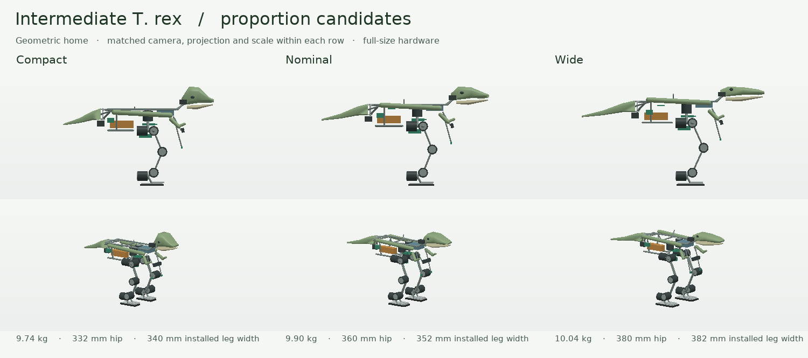

# Intermediate T. rex mechanical downselection

Use the **nominal 9.896 kg candidate for controller development**, and retain compact as the alternative for a smoother carpet gait. Implementing all three layouts on the same chassis exposed a useful compromise. Compact has the lowest swing inertia and its reference gait passed the carpet development panel. Nominal approaches the commanded 0.12 m/s on both surfaces and has enough lateral range for a short single-support transfer. Wide requires more lateral travel, falls with the same reference controller, and carries the largest swing loads. None clears the full installation and motion screen for fabrication.



| At geometric home | Compact | Nominal | Wide |
|---|---:|---:|---:|
| Floor to head crown / tip-to-snout, mm | 600 / 904 | 600 / 1,010 | 600 / 1,100 |
| Core torso L × W × H, mm | 429 × 190 × 198 | 437 × 204 × 213 | 452 × 238 × 225 |
| Width across installed leg cases and plugs, mm | 340 | 352 | 382 |
| Crown height / installed leg width | 1.76 | 1.70 | 1.57 |
| Hip height / left-to-right hip pitch axis spacing, mm | 332 / 212 | 360 / 224 | 380 / 254 |
| Foot-center spacing, mm | 212 | 224 | 254 |
| Hip height / foot-center spacing | 1.57 | 1.61 | 1.50 |
| Thigh / shin axis separation, mm | 136 / 136 | 151 / 151 | 165 / 165 |
| Sole length × width, mm | 144 × 72 | 156 × 80 | 168 × 88 |
| Allocated mass, kg | 9.744 | 9.896 | 10.039 |
| Center of mass X / Y / Z, mm | 6.8 / −0.9 / 299.7 | 4.9 / −0.9 / 318.8 | 3.8 / −0.9 / 331.7 |
| Central inertia about roll / pitch / yaw, kg·m² | .268 / .336 / .201 | .315 / .393 / .228 | .369 / .448 / .271 |
| Minimum home CoM displacement to enter left sole, mm | 70.9 | 72.9 | 83.9 |
| Static flat-foot single-support margin, left / right, mm | −18.6 / −16.8 | +9.2 / +10.9 | −23.2 / −21.5 |
| Peak joint demand in left static transfer, N·m | 8.60 | 9.73 | 11.09 |

Dimensions use a free-base geometric home with both soles tangent to Z=0, X forward and Y left. The torso enclosure figure is the conservative axis-aligned envelope of the core rails, battery/compute/control/power bays, disconnect and removable side covers. Appendage pivots, the camera boom, arms and hip motors have separate installed volumes. The core is intentionally open above the fan. Link mass follows link length and sole structural mass follows plate area. These are component allocations awaiting scales, calipers and CAD inertias. The [measurement file](proportions.json) supplies all nine inertia entries and model, source and ledger hashes.

Moving head mass is 415 g, including its fixed jaw and hub. Moving tail mass is 194, 235 and 264 g respectively. Both mechanisms move about bearings attached to the torso. The direct motor cases remain on the chassis. Lengthening the shell therefore increases yaw inertia even when the motor center stays fixed. The original candidate's 600 g integration allowance is still carried. The mass-equivalent cassette is required when the battery is removed for external power.

## What changed the selection

At the M1 limit of ±0.25 rad hip roll, even nominal missed the near edge of its stance foot by 15.7 mm in the prescribed level-foot quasi-static transfer. Nominal now admits ±0.36 rad hip roll and ±0.40 rad ankle roll. The swing leg folds at the knee; the stance ankle counter-rolls to keep its sole flat. This correction enabled a positive static support margin at ~9.7 N·m but exceeds the 6 N·m continuous simulation estimate. The original calculation and inputs are retained in the [pre-revision screen](../../m02_integrated/nominal_initial_screen.json). Short transients, maintained posture and dynamic walking are separate load cases. The compact and wide controls retain the original lateral limits. The final comparison includes that change as well as different geometry.

The same reference generator and 15 s command sequence drove all candidates before independent evaluation of the learned controller. Compact and nominal finished all eight development episodes. Nominal averaged approximately 0.11 m/s on the straight segment, with excessive transition acceleration. Compact reached ~0.06–0.08 m/s and passed four carpet episodes; its four hard-floor starts and turns missed the acceleration gate. Wide terminated at about 4.2 s on hard ground and 11 s on carpet. The wider support pattern places the body farther from the loaded foot and visibly increases rocking before termination. Wide's flatter, longer head also puts more skin ahead of the camera. The short compact snout rises steeply to the same crown because its hips are 28 mm lower than nominal. The intermediate proportions keep a horizontal jawline and a visible raised hock. Videos, command timings, policy identities and the distinction between reference and learned rollouts are in the [walking evaluation](../gait/README.md).

Retain six leg axes per side for this trial. Hip yaw enables a turning step. Hip and ankle roll share lateral transfer. Sagittal hip, knee and ankle pitch keep the feet level during forward knee flexion. A passive ankle roll or fixed hip yaw would remove placement freedom that this candidate already uses. The smaller ratio X4-P12 and the earlier AK45 mixed allocation remain useful candidates for yaw and lighter subassemblies. Replacing a 360 g motor by a 330 g model on two yaw axes saves just 60 g. The October compact AK45 design's 5.409 kg allocation and 72–78 cm overall length came from a different bill of materials. Installed power, sensing and service volumes must be rebuilt at that geometry. See the [power, actuator and mixed-motor screen](../engineering/engineering_report.json) and [full-resolution contact/load checks](../../m02_integrated/mechanical_report.json).

## Shafts, chassis and manufacture

The nominal load path starts at replaceable rubber sole pads, passes through a bonded or screwed foot plate, twin metatarsal webs and the ankle yoke, continues along paired thigh and shin rails to the knee and hip flanges, then enters two pelvis webs and the longitudinal chassis. Outboard support bearings should take transverse and overturning loads. The gearbox output flange transmits commanded shaft torque. The sketches contain yokes, shafts, bearing positions and straight link centerlines. Motor flange bolt circles, bearing pockets, joint hard stops, axial shimming, cable clips and tolerance stacks need production CAD. The static box inertias and collision proxies do not prove there is metal at every required interface.

A practical initial fabrication quote should separate machined aluminum motor plates and bearing blocks, cut or folded plate link webs with spacers, rubber foot inserts, and non-load-bearing SLS PA12 or thin thermoformed coverings. Use the metal pivot and bearing paths for leg loads. Fasten replaceable covers on captive inserts and keep the battery hatch and fan outlet accessible. Carbon tubes could reduce moving mass, but end inserts, antirotation joints, adhesive bond length, impact damage and alignment jig cost consume the apparent advantage. Metal rails are easier to inspect on the first instrumented fixture.

A drawing-level sizing example shows where detailed design matters. The 12 N·m simulated per-axis peak shared evenly by two 3 mm thick, 25 mm deep leg webs gives 19.2 MPa nominal bending stress about the strong axis, using two rectangular section moduli. A 6 mm hole on the critical section reduces idealized effective depth to 19 mm and raises the same nominal stress to 33.2 MPa before any stress concentration. With no assumed equal load sharing the per-web value doubles. A 6 N·m **overturning** moment across bearings 30 mm apart adds 200 N of opposing radial reactions before impact or preload. These are demand estimates for a proposed plate, not strength checks on the generated round rail proxies. Measure actual force paths; check weak-axis bending, hole bearing, bolt preload and fatigue, gearbox support-bearing loads, and stiffness under a loaded single-leg fixture before releasing drawings.

The combined sweep still finds contacts among cover/fork geometry, the battery hanger and disconnect reserve, and some adverse crossing configurations. Several structural rails and installed keepouts are diagnostic-only in the physics scene, so an unsupported rollout can survive an unrealizable mechanism. Correct the local neck/tail fork cutouts, remount the disconnect outside the hanger and left hatch path, and verify all moving clearance under tolerance, cable flex and a loaded deflection estimate. Lock new geometry as a new plant and re-evaluate any checkpoint against it.

## Head and tail transmission

The [nonideal transmission bench](../engineering/tendon_bench.json) compares fixed-base direct drive with remote differential cable winding on the actual nominal head and tail inertias. The 3:1 horn/drum nominal ratio varies with routing angle. Both ends require two bearing supports, cable terminations, fairleads, guide loss and pretension adjustment. The remote system adds 152 g for two axes. Neck motor RMS torque drops from 0.235 to 0.082 N·m in the 8 s bench test, while tail motor RMS torque changes from 0.019 to 0.023 N·m. Loose cable cases lose tension. The direct arrangement removes four routed runs and their adjustment hardware. Keep this modest pitch/yaw arrangement for the first walking trials. An isolated physical neck bench can establish whether reduction or remote mounting is justified with the actual cover and sensor harness.

Keep the external-power cassette, dual power paths, camera and electronics models in the engineering ledger. Replace design-only motor limits with calibrated torque/speed/load-duration curves at minimum and nominal pack voltages. The numerical drive imposes command delay, reversal play, load-related speed/torque limits, finite PD stiffness and a squared-effort derating budget. It cannot predict winding or gearbox temperature and omits cable forces on the free robot. Measure motor current, casing temperature, case-to-ambient cooling, supply sag and regenerative clamping during a repeatable loaded test.

For the 3–4 ft outreach robot preserve the estimator and command interfaces, temperature/current logging, single-support fixture test, camera calibration, gait criteria and rendering protocol. Rebuild the component ledger, joint geometry, actuator transmissions, inertia tensor, dynamic foot loads and battery/cooling calculation at the new size. Even geometric similarity at constant density would give mass proportional to length cubed and support moments proportional to length to the fourth; selected components and hollow structures break that assumption.

## Reproduce

From the repository root:

```bash
python -m examples.tyrannosaurus_rex_60cm.platform.build
python -m examples.tyrannosaurus_rex_60cm.platform.proportions
python -m pytest -q environments/shared/tests/test_intermediate_mechanics.py
```

The first command generates all three MJCF files and ledgers and copies the nominal MJCF to its registered plant. The second renders actual MuJoCo geometry at common scale from fixed side and oblique directions.
