Standing still sounds like the easiest thing a legged animal, or a legged robot, can learn. In our MuJoCo simulations it was the hardest thing to *verify*. Over eleven weeks, from late July to mid-October 2026, most of our work went into a trustworthy stance for each dinosaur-inspired body, and almost every round taught us something about the bodies, the measurements or the rewards. Here are those lessons, with the figures that made each case.

<!-- truncate -->

:::note[What these models are]

Every body here is an engineering abstraction inspired by dinosaur morphology, not a validated reconstruction of dinosaur anatomy. Hardware transfer is a future research direction; no sim-to-real or physical-robot results are published. Every number is a simulation measurement tied to a specific model revision.

:::

## The lessons at a glance

We train six MuJoCo models, [T. rex](/docs/models/trex), [Velociraptor](/docs/models/velociraptor), [Compsognathus](/docs/models/compsognathus), a [Compsognathus-inspired robot](/docs/models/compsognathus_robot), [Brachiosaurus](/docs/models/brachiosaurus) and the crocodylomorph-inspired [Dibothrosuchus](/docs/models/dibothrosuchus), with PPO through a staged curriculum: stance, recovery from pushes, locomotion, then behaviours such as hunting. Every later stage starts from the stance, so a flawed stance contaminates everything after it.

Two terms recur. The **plant** is the simulated body as a control engineer sees it: geometry, masses, joints, servos, sensors and contacts, versioned by revision (T. rex physics r8, say). The **statue** is the zero-action policy: actions are offsets from a home pose that position servos hold, so zero means "hold still".

[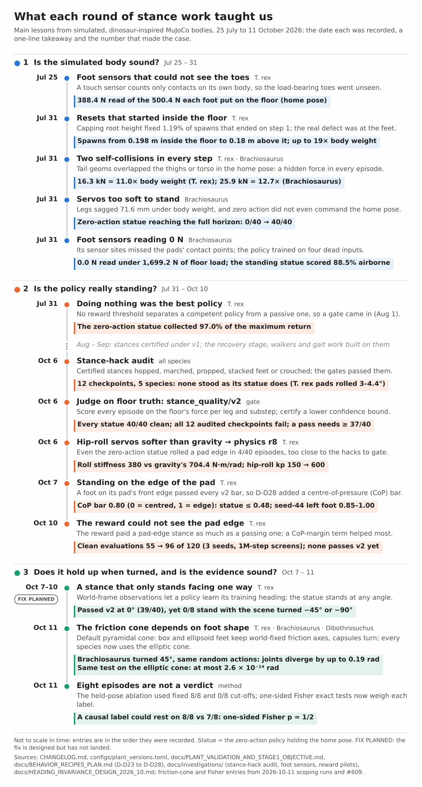](./lessons-timeline.png)

*The lessons in the order they were recorded (time not to scale). FIX PLANNED marks work that has not landed. Select any figure to open it at full size.*

## The do-nothing baseline already stands

Because zero action holds the home pose, the statue already stands. In July, on the T. rex stage-1 reward, it collected **97.0% of the theoretical maximum return** (3,250.27 of 3,350) at zero energy and smoothness cost; in the [plant-validation note](https://github.com/kuds/mesozoic-labs/blob/main/docs/PLANT_VALIDATION_AND_STAGE1_OBJECTIVE.md)'s words, "doing nothing is the *global optimum*". Every species' stage-1 gate was cleared by its own statue.

So a stance policy is worth having only if it stands at least as well as the statue, and a gate (the automated check that certifies a stage) only if the statue passes and the shortcuts fail. Anything the reward and gate do not measure is free for the optimiser to exploit.

## Fix the body before the brain

In late July, reviews of the plants found failures we had blamed on training:

- **Foot sensors that could not see the toes.** A MuJoCo touch sensor sums only contacts on its own body, so the T. rex's metatarsus sensors read 388.4 N of the 500.4 N each foot carried. A [sensor audit](https://github.com/kuds/mesozoic-labs/blob/main/docs/investigations/FOOT_SENSOR_VERIFICATION.md) found the Velociraptor reading 0.553 of its floor force and the Brachiosaurus 0.0 N under 1,699.2 N; its standing statue scored as 88.5% airborne.
- **Resets inside the floor.** Resets started anywhere from 0.198 m inside the floor to 0.18 m above it, and the T. rex met a median 16,990 N (11.5× body weight, up to 19×) at t = 0. Seventy gain settings for a simple feedback (PD) controller and 75 fixed postures all failed to beat zero action: "the signature of a failure occurring where control does not exist". An earlier fix had bounded only root height, and *"a bound expressed in the same variable as a termination rule validates the termination rule, not the physics."* Spawning at the clearance authored in the model's home pose (its keyframe) cut the force to 190 N.
- **Self-collisions on every step**: the T. rex tail against both thighs at 16.3 kN (11× body weight), the Brachiosaurus torso against its tail at 25.9 kN.
- **A Brachiosaurus that could not hold still.** Its "zero" action sat mid-range, dragging the knees up to 0.349 rad off the stance, and its servos sagged 71.6 mm. The statue fell 40 of 40 times; after the fixes it stood 40 of 40.

All but the Velociraptor sensor were fixed by 2026-07-31. Yet a sound body is necessary, not sufficient: on the repaired plant, a T. rex run still ended with 28.4% of steps on no foot.

## Every certified stance was a loophole

By late September, stances for five species had passed their gates. On 2026-10-05/06 a [stance-hack audit](https://github.com/kuds/mesozoic-labs/blob/main/docs/investigations/STANCE_HACK_AUDIT_2026_10.md) replayed twelve checkpoints beside their statues: **"No stance node stands as its statue does."**

On the T. rex (physics r7), all three passing stances pushed off at reset at 2.0–2.4 body weights and replanted their feet 5–7 cm wider, inside a 200-step settle window the v1 gate never scored. Then each stood with one leg splayed as a prop, its pad rolled 3–4.4°.

[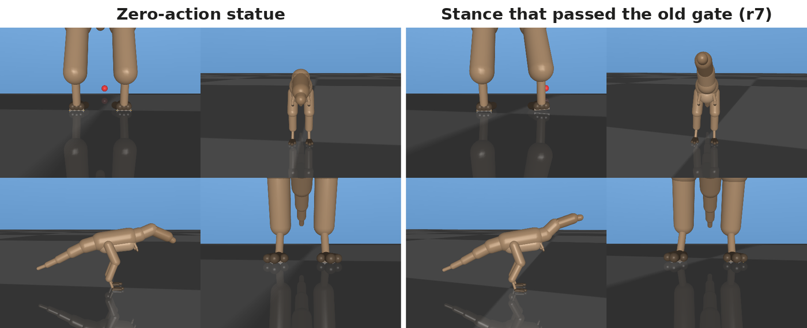](./trex-statue-vs-policy.png)

*T. rex, physics r7 (2026-10-06 audit). Left: the statue. Right: the 2026-09-30 stance that passed the old gate, a leg splayed as a prop and the head raised. The red sphere is a prey marker.*

[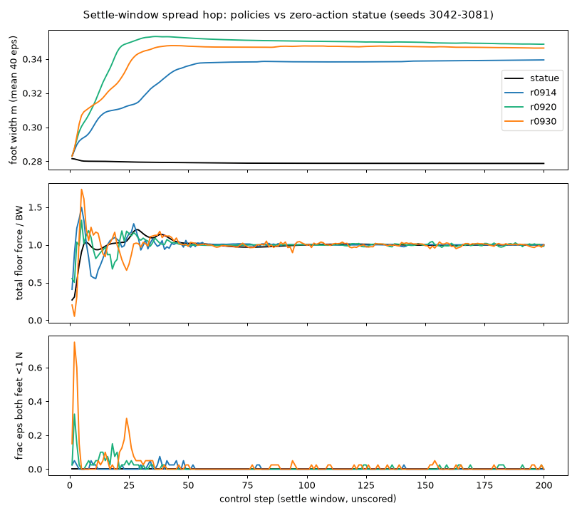](./trex-reset-hop.png)

*The reset hop (r7): the passing stances push off and replant wider; the statue (black) stays at 0.28 m. r0914, r0920 and r0930 are the stances of 14, 20 and 30 September; BW is body weight. Each curve is a mean over 40 episodes, so its peaks sit below the single-episode peaks quoted above.*

The others found their own shortcuts. The **Velociraptor** (r2) held a saturated crouch, knees behind its hips, chattering at about 20 Hz. **Compsognathus** (r1) marched in place at about 3 Hz on the tip of digit III. The **robot** stacked its right sole on its left, and its touch sensors totalled 3.04 body weights against 1.00 on the floor. **Dibothrosuchus** certified an essentially untrained network that stood on three legs in some episodes.

[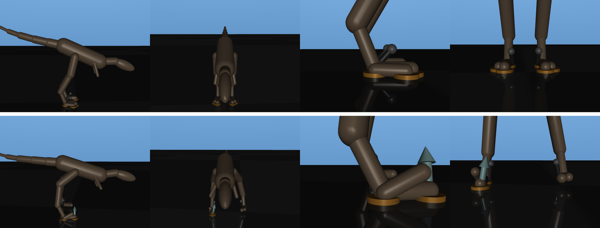](./raptor-statue-vs-crouch.png)

*Velociraptor, physics r2, since replaced. Top: the statue. Bottom: the certified 2026-09-22 crouch, hip pitch at its command limit on about 95% of steps. The orange discs and pale arrows are MuJoCo's contact-point and contact-force overlays.*

[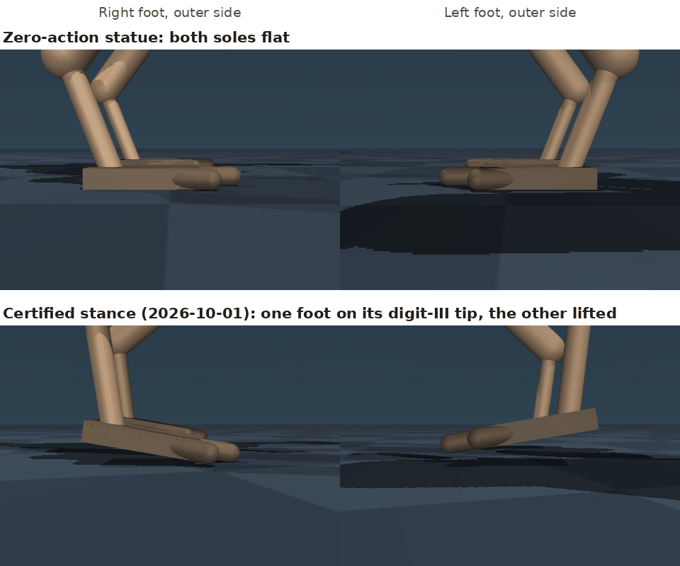](./compso-tiptoe-vs-flat.png)

*Compsognathus, physics r1, at step 300. Top: the statue. Bottom: the certified 2026-10-01 stance, one foot on its digit-III tip and the other in the air.*

[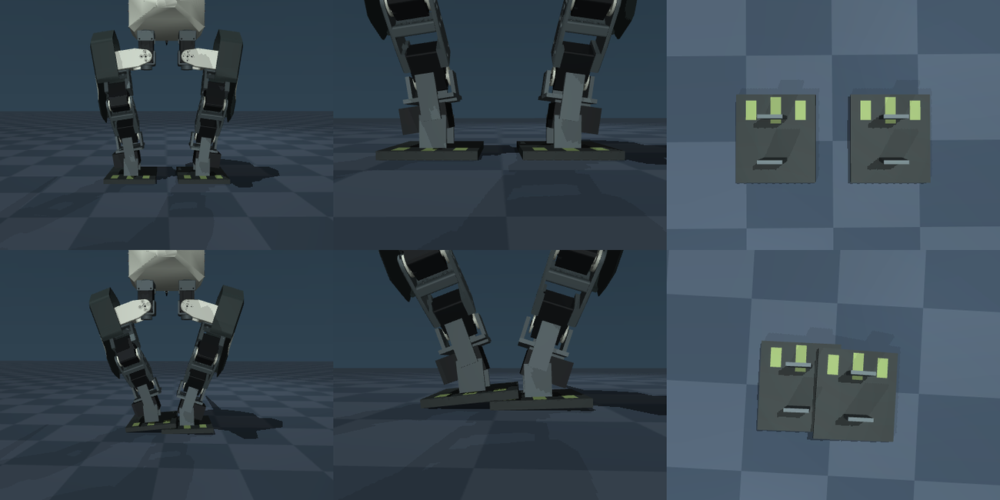](./robot-foot-stacking.png)

*The robot (physics r1, still current), statue above, certified 2026-09-24 stance below. Its stance gate has not moved to v2 yet.*

[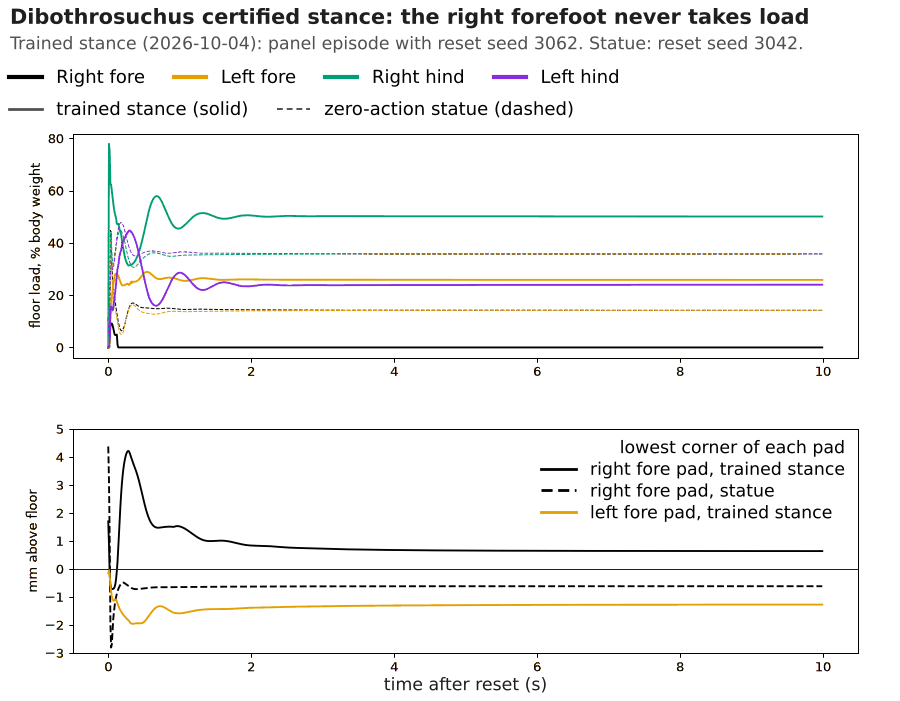](./dibo-three-legged-hover.png)

*Dibothrosuchus, certified 2026-10-04 stance. In panel episode 3062, one of 9 of 40 such episodes, the right forefoot (black) never takes load (top) and hovers about 0.7 mm up (bottom). The dashed statue curves come from a different reset seed, 3042.*

The v1 gate read touch sensors, took the minimum over physics substeps, averaged over the 40-episode panel, skipped the settle window and counted only steps with no foot down. The reward did not object either: the hacks scored 0.80–1.01 of their statue's reward. Each loophole marked a measurement we lacked.

## Measure at the floor

The answer, `stance_quality/v2` (adopted on 2026-10-06 as decision D-D23 of our [behaviour-recipes plan](https://github.com/kuds/mesozoic-labs/blob/main/docs/BEHAVIOR_RECIPES_PLAN.md)), judges every episode on floor truth:

- A leg is **down** when the floor's normal force on it exceeds 0.1 N on at least half of a control step's physics substeps.
- The **settle window is scored**, including peak force and airborne substeps.
- Each of 40 episodes (reset seeds 3042–3081, the certification panel) is **clean** or not, against bars set on the statue: support, touchdown rate, drift, load share, saturation and, for box soles, tilt and corner lift.
- The panel **passes** when the one-sided 95% Clopper–Pearson lower bound on the clean fraction is at least 0.80, which takes 37 of 40 (bound 0.817).

Every statue was clean on 40 of 40, and every audited hack failed. Floor truth then exposed plant flaws, each fixed as a physics revision ([plant notes 13–15](https://github.com/kuds/mesozoic-labs/blob/main/configs/plant_versions.toml)):

- **T. rex r8.** With both feet planted, the two hip-roll joints resist sideways sway with a stiffness of 2 × (kp + 40) N·m/rad, where kp is the servo stiffness and 40 the passive joint spring. That is stable only while it exceeds gravity's toppling term, m·g·h (mass × gravity × height) = 704.4 N·m/rad. At kp 150 the hips gave 380, so reset noise alone left the statue on a rolled pad in 4 of 40 episodes: "the propped-foot signature… on the statue itself." At kp 600 (1,280) the worst roll fell from 3.42° to 1.15°.
- **Velociraptor r3.** Leg springs pulled toward joint zero, and the keyframe put digit III 44.6 mm inside the floor, so resets popped at 2.08 body weights (now 1.34).
- **Compsognathus r2.** The tail tip had been "denser than bone", the right foot was built as a left foot, and a toe servo rang numerically at 68 Hz.

[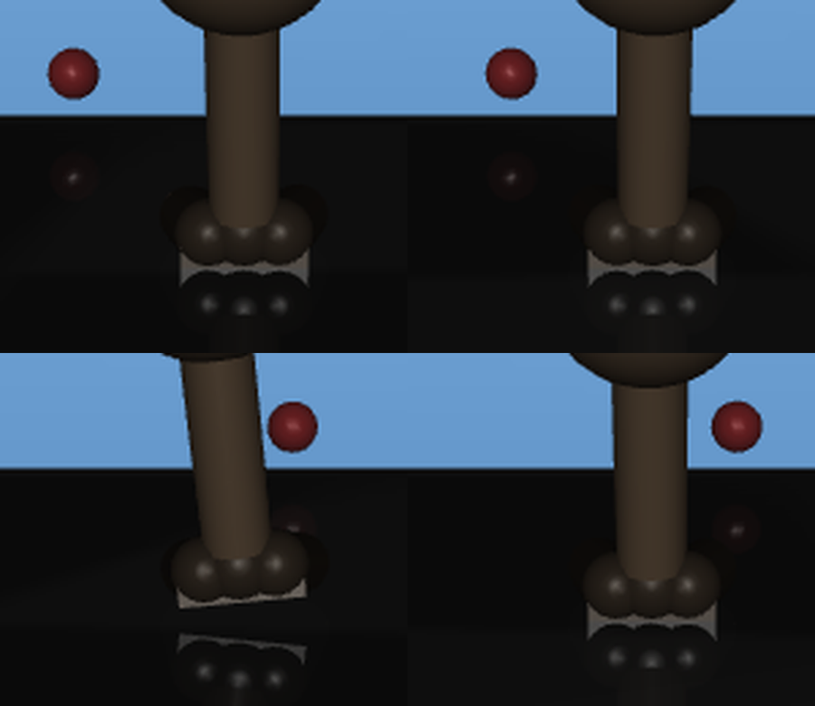](./trex-propped-foot.png)

*T. rex feet at step 600 (r7): the statue's flat pads (top) and the 2026-09-30 policy's propped foot rolled onto its edge (bottom left).*

## When the reward cannot see the problem

The first two T. rex runs on r8 confirmed that "the r7 hacks are gone", yet both failed v2 with hops. A follow-up decision (D-D27) found causes in the reward and in exploration: the width term paid for re-seating the spawn; action penalties priced the *filtered* command, undercharging smoothness 8.8×; and PPO's starting exploration noise, an action standard deviation (σ) of 1.0, kept both feet off the floor on 52–54% of early steps, against about 4.5% at σ 0.22.

Seed 44 had also stood with one foot loaded on its pad's front edge, which no v2 bar caught, so the next decision (D-D28) added a pad **centre-of-pressure (CoP)** bar: 0 is centred, 1 is the edge, the statue reaches at most 0.48, and the bar is 0.80.

Of three D-D27 runs, seed 42 failed the CoP bar on all 40 episodes, seed 48 reached 36/40, and seed 52 passed on 2026-10-10 with 39/40, worst CoP 0.797. Re-judged on 40 fresh reset seeds (7042–7081), seed 52 was clean on 32 of 40.

[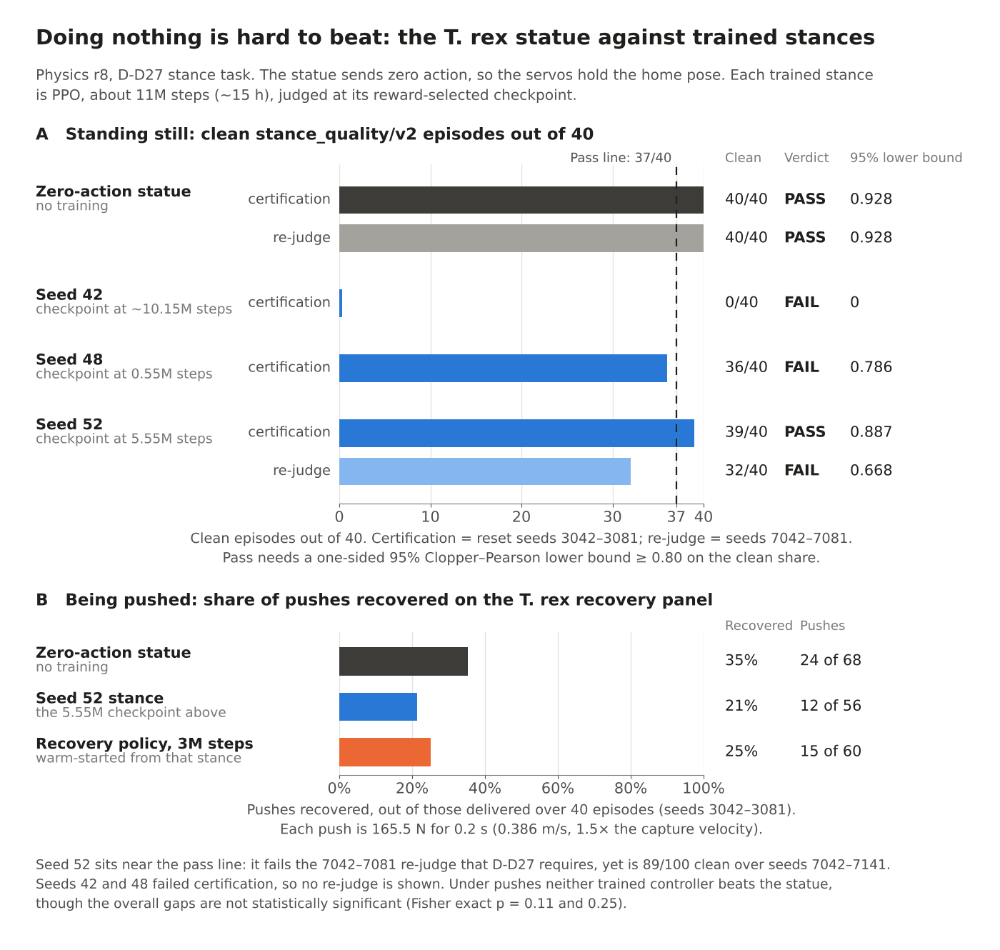](./statue-vs-policies.png)

*A: the statue is clean on 40/40 on both panels; the only trained pass dropped to 32/40. Panel B and the 89/100 footnote are 2026-10-10 review measurements, not yet in the repository's documents.*

Worse, the base reward pays the pad-edge policy and the passing one the same (3,783.4 and 3,782.2), both about 26 above the statue. **The reward was CoP-indifferent**, so the gate refused what training had approved. An audit addendum had already stated the rule: *"A gate bar that the reward does not shape would have refused a trained near-statue policy for a loss its training never priced."*

[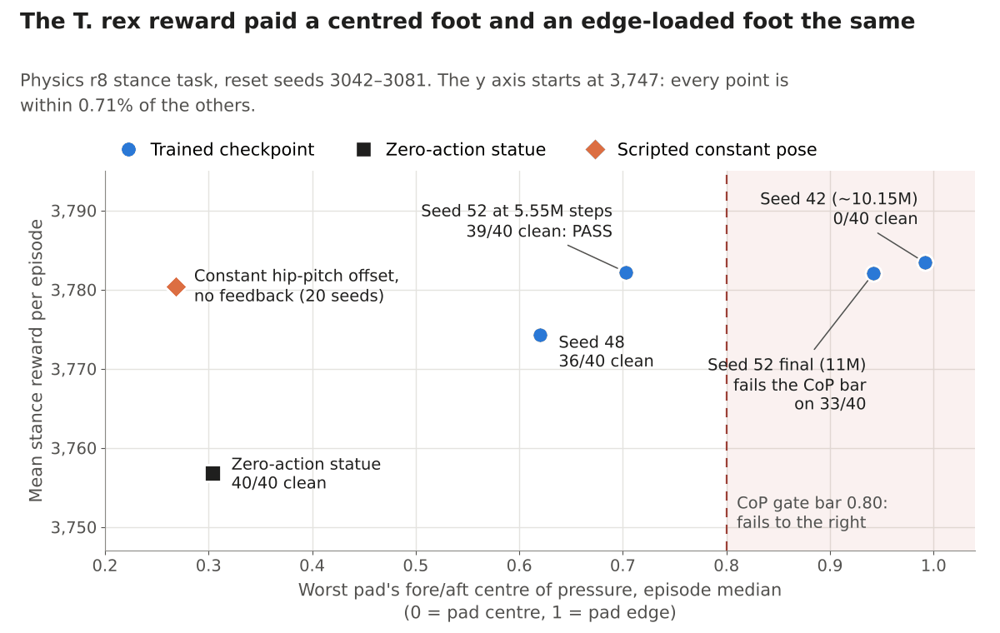](./trex-reward-vs-cop.png)

*Reward against worst-pad CoP (T. rex r8). Even a constant pose with no feedback out-earns the statue. Points not in the pilot findings are 2026-10-10 review measurements.*

The [reward pilots](https://github.com/kuds/mesozoic-labs/blob/main/docs/investigations/STANCE_REWARD_PILOT_FINDINGS_2026_10.md) tried a CoP-margin term. It raised clean T. rex episodes from 55/120 to 96/120, improving every seed, but with three pairs the gain is directional (one-sided paired t p = 0.099), and "none of the 15 pilots passes".

[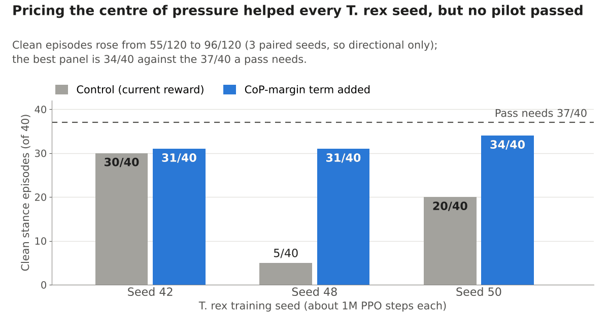](./trex-cop-margin-pilot.png)

*Reward pilots (2026-10-09/10, T. rex r8, about 1M steps each). The best panel reached 34/40 against the 37 a pass needs.*

## Exploration noise has to respect the body

PPO explores by adding noise to its actions. If the body cannot survive that noise near the statue, the optimiser may never sample a quiet stance:

- **Compsognathus r1** fell at PPO's starting σ of 0.135 in a median of 12 steps, so "PPO never sampled the quiet stance". Alongside physics r2, a new policy interface (r3) adopted a soft-cubic leg map, which shapes each leg action a into b = 0.1a + 0.9a³ before it sets the servo target, so the map has a tenth of the slope at home. With that map and more armature (simulated rotor inertia) on the toe joint, which ended a numerical chatter, the statue keeps 39/40 at σ 0.135; without the armature it kept 30/40.
- **Velociraptor r3** runs started at σ 1.0, but its statue survives σ 0.07 and mostly falls by 0.10. In the pilots, 312 of 360 Velociraptor evaluations ended early.
- **T. rex** starts at σ 0.22, where its statue fell in every noise draw we measured, yet PPO learns to stand. Survival at the starting noise is not the whole story, but failing badly is a warning.

*Noise each statue tolerates, against each species' starting σ (dashed). T. rex and Velociraptor curves are 2026-10-10 review measurements. Grey bars span repeated noise draws: the T. rex point at σ 0.10 is partial and depends on the draw (25–67% across three), while the cliff and the 0% at its starting σ held in every draw.*

## Where the weight goes

Because the gate reads floor forces per foot part, we measured what each current plant's statue stands on:

- **T. rex** (r8): a thin box plantar pad carries about 76% and three capsule digits 24%, mostly at their bases. Since r7 the digits are passive springs.
- **Velociraptor** (r3): capsules only, about 54% of each foot on digit III, 28% on the metatarsal head and 17% on digit IV. The sickle claw cannot touch the floor: its collision class never meets the floor's, a modelling choice rather than a learned posture. A known issue: the metatarsus is 78% too long relative to the femur, so the "digitigrade" foot is "functionally part-plantigrade".
- **Compsognathus** (r2): 41% on a small pad and 59% on three digits. The foot is a rigid plate, and 0.05° of toe-down pitch puts all of its load on the digit-III tip, the support the r1 marches used.
- **Brachiosaurus** (r4): ellipsoid pads under legs that the model's notes liken to an elephant's columnar, sub-vertical limbs; the fore pads tilt about 26° toe-up onto one rear contact.
- **Dibothrosuchus** (r1): box feet with 72% on the hind pair; a three-legged stance cost only 0.02–0.13% of return.

*Each statue's floor contacts on today's plants, measured for this post: contact points (blue), normal forces (arrows) and each shape's share of body weight. Arrows are indicative, not a pressure map.*

*The same statues as shares of floor force, with digit contacts split by whether they press at the digit's base or its tip.*

[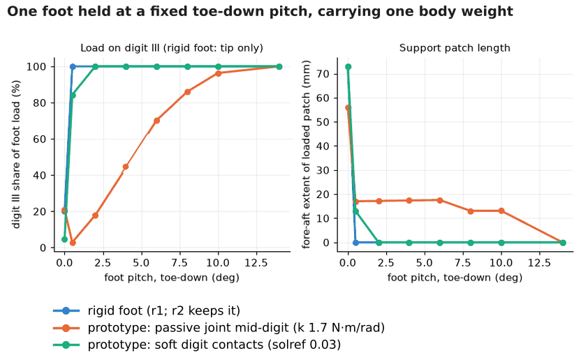](./compso-rigid-foot-pitch-sweep.png)

*A Compsognathus foot at fixed pitch (2026-10-07 review, r1 foot): on the rigid plate (blue), which r2 keeps, a fraction of a degree moves all the load to the digit-III tip. Orange and green are prototypes we did not adopt.*

These are contact shapes in research models, not claims about real feet, and a foot-anatomy review is planned. But they show one standing task resting on very different geometry, which matters next.

## A stance that only works facing one way

T. rex and Compsognathus policies observe a world-frame orientation, velocity and prey direction, and every training spawn faces nearly the same way, so a policy can learn its heading. (Velociraptor observes the same world-frame signals; its change comes later.) An earlier T. rex stance, replayed with the whole scene turned, stood 8/8 at 0° and at most 2/8 at other angles; the statue stood 8/8 everywhere. Then a stance that *passed* v2 failed on one side only.

[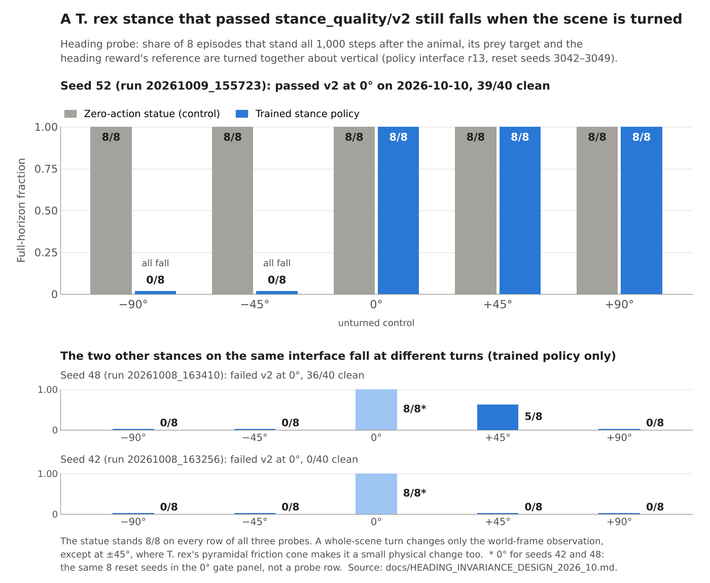](./heading-probe.png)

*Heading probe on T. rex policy interface r13 (the current observation and action definition), 8 episodes per bar. A bar counts episodes that stand all 1,000 steps, not v2-clean episodes. The 0° bars for seeds 42 and 48 come from their gate panels.*

In training, the orientation's yaw component varied by only about ±5°, so a 45° turn sits roughly 9 standard deviations out. The [heading design](https://github.com/kuds/mesozoic-labs/blob/main/docs/HEADING_INVARIANCE_DESIGN_2026_10.md) gives the policy projected gravity, velocity in a gravity-aligned heading frame and the target in the body frame: signals a robot can estimate onboard, whichever way it faces. On rotated test states, the largest observation change fell from about 2.0 to 1.19 × 10⁻⁷.

The planned `stance_quality_heading/v1` certificate runs 40 seeds at six headings and needs 37 seeds clean at *every* heading. Pooling would mislead: one different failing seed per heading looks like 234/240 (bound 0.9513), but only 34 of 40 seeds pass everywhere (0.7253). On 2026-10-11 we decided that, until the heading-free interface and this certificate exist, any T. rex or Compsognathus stance pass is provisional, and that seed 52 is research-only.

## Friction has a heading too

Turning the scene should not change the physics either. MuJoCo's default *pyramidal* friction cone grips only about 0.71 μN along its diagonals instead of μN, and box and ellipsoid contacts keep those axes fixed to the world while capsule contacts turn them with the foot.

*Pyramidal versus elliptic friction limits, and why a box pad's grip changes when the animal turns while a capsule's does not.*

With identical random actions at 0° and 45°, joint angles diverged by up to 0.19 rad on Brachiosaurus and 0.14 rad on Dibothrosuchus; the capsule-footed Velociraptor, and every species under the *elliptic* cone, stayed at rounding error. Statues use on average (force-weighted) only 0.4–3.8% of the available friction, so our working explanation is direction-dependent soft-contact creep, not slipping.

*2026-10-11 scoping (random actions, sd 0.1). The elliptic bars for the four then-pyramidal species were measured with the cone switched in memory, before the change landed.*

T. rex moved to the elliptic cone as physics r9, and Velociraptor, Brachiosaurus and Dibothrosuchus followed for consistency; the Compsognathus models already used it. It is a real physics change: on r9 the T. rex statue is clean on 39/40 rather than 40/40, and its worst out-of-sample pad tilt reached 2.061° against a 2.0° bar.

## Asking why a stance falls

In August the T. rex taught us how to ask *why* a stance fails ([bounce investigation](https://github.com/kuds/mesozoic-labs/blob/main/docs/investigations/TREX_STAGE1_BOUNCE_2026_08.md)). Three seed-42 runs ended as two bounces and one quiet stance, and the 20 Hz bounce scored 450 below the quiet stance under the same reward: "an optimisation failure, not a reward-shaping one."

**Filters belong in training.** A low-pass added after training broke the passing policy at every cutoff, from 351 steps at 35 Hz to 96 at 5 Hz: *"An action low-pass or rate limit cannot be retrofitted. If one is wanted for sim-to-real it must be present during training."*

**Necessity and sufficiency.** Even the passing policy's mean action, held constant, falls. A release ablation holds it on some joint groups and returns the rest to home (8 episodes each):

| Variant | Mean episode length (steps) |
|---|---|
| Hold the whole mean action | 128.6 |
| Hold only the toes | 125.5 |
| Hold everything except the toes | 198.5 |
| Hold only the tail (pinned at its limit) | 1,000 |
| Hold nothing (the statue) | 1,000 |

The toes alone reproduce the fall, the conspicuous tail is a bystander, and no single group is necessary: *"Saturation is conspicuous, not causal."* Physics r7 made the toes passive springs.

**Eight episodes are not a verdict.** The ablation labelled 8/8 as standing and 0/8 as falling. A first fix tightened its preconditions, but a held pose that stood in 7 of 8 episodes still classified, and 8/8 against 7/8 has a one-sided Fisher exact p of 0.5. The ablation now answers each comparison with a one-sided Fisher exact test and says "insufficient episodes" when no outcome could be significant.

## Lessons for robotics

None of this has touched hardware, but most of it should carry over:

1. **Validate the body before training the brain**, and remember that is necessary, not sufficient.
2. **Measure at the ground**, not through a sensor or the reward.
3. **Keep a do-nothing baseline and set bars on it.** A policy that out-earns it while standing worse means the reward is wrong.
4. **Treat each loophole as a missing measurement**, and keep the hack as a test case.
5. **Test the invariances you assume**, the policy's and the simulator's, and observe only what a real robot can.
6. **Size the statistics to the sample**: lower bounds, seed-grouped bounds, exact tests and fresh re-judge panels.
7. **Make exploration respect the plant.**
8. **Train with the filters and delays you will deploy.**

## What's next

As of 2026-10-11 no species has a stance we can build on. The only `stance_quality/v2` pass, T. rex seed 52, is provisional and research-only. The robot's and Dibothrosuchus's older certificates (under v1 and a reward rail) still stand on their unchanged plants, but they are stances the audit flagged. Each species stays open until its stance certifies under v2 ([known issues](https://github.com/kuds/mesozoic-labs/blob/main/docs/KNOWN_ISSUES.md), [next steps](https://github.com/kuds/mesozoic-labs/blob/main/docs/NEXT_STEPS.md)).

**Landed** as this post went up: a warn-only handoff warning when a whole-scene heading-probe row stands below 0.95, with the probe enabled for Velociraptor, Compsognathus and the robot; Fisher exact tests in the release ablation; and the elliptic friction cone on every species (T. rex physics r9, Velociraptor r4, Brachiosaurus r5, Dibothrosuchus r2), which retires every earlier checkpoint of those four species.

**Planned:** heading-free observations for T. rex and Compsognathus with fresh training and the six-heading certificate; a recovery comparison between a certified stance and a statue-equivalent start; a foot-anatomy review of every species; and the pilots' follow-ups, including a full-budget CoP-margin trial and a Velociraptor exploration-noise sweep.

The numbers here come from the repository's [investigations](https://github.com/kuds/mesozoic-labs/tree/main/docs/investigations), plant notes and [changelog](https://github.com/kuds/mesozoic-labs/blob/main/CHANGELOG.md), apart from the 2026-10-10 review measurements and 2026-10-11 scoping runs labelled as such, and the foot-load measurements made for this post. If you have met these failure modes on your own legged systems, tell us in a [GitHub issue](https://github.com/kuds/mesozoic-labs/issues).

*The Mesozoic Labs Team*
