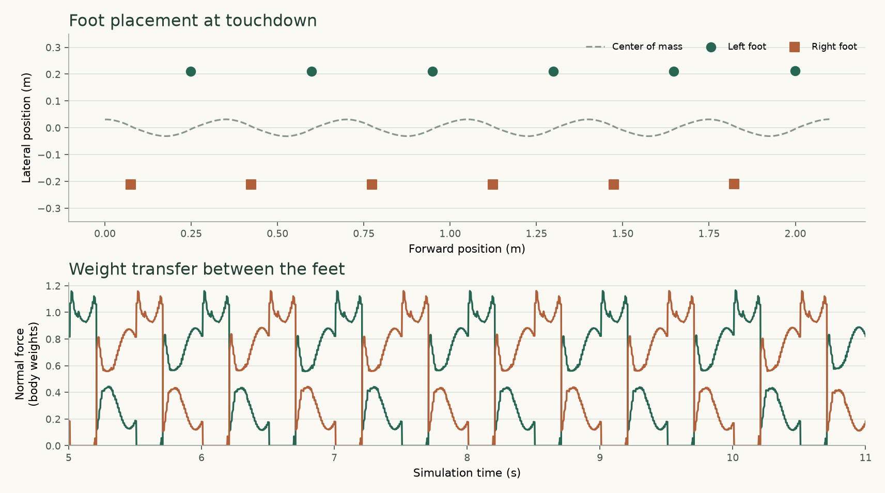

import useBaseUrl from '@docusaurus/useBaseUrl';
import SpeciesCatalog from '@site/src/components/SpeciesCatalog';
import {requireModel} from '@site/src/data/species';

export const MODEL = requireModel('allosaurus_fragilis', 'anatomical');

# Allosaurus fragilis

This Late Jurassic theropod balances a long head and muscular trunk over two digitigrade hind limbs. Its longest toe points forward, flanked by two shorter, spreading toes. A fourth toe sits high on the inner side of each foot. The hands face inward beneath the chest.

The thigh, shin and central metatarsal follow proportions measured in adult-sized fossil material. The color, muscle outlines and shape of the pads are reconstruction choices. [Fossil hind-limb measurements, Table 2](https://www.nature.com/articles/srep19828/tables/2) · [Madsen’s osteology](https://ugspub.nr.utah.gov/publications/bulletins/B-109.pdf)

## Reference walk

<video controls playsInline preload="metadata" width="100%" poster={useBaseUrl('/img/posters/allosaurus_fragilis_anatomical_reference_walk.jpg')} src={useBaseUrl('/videos/allosaurus_fragilis_anatomical_reference_walk.mp4')} aria-label="Allosaurus walking on level ground, with foot placement and measured foot loads" />

The force readings show when each foot takes weight. After startup the model walked at 0.35 m/s, placing one foot about 17.5 cm ahead of the other. The swinging foot cleared the floor by about 6.2 cm. All 54 recorded landings alternated, and at least one foot carried weight throughout. The 42 cm track and nearly level trunk give this walk a broad, cautious stance.



In a separate standing trial the feet shared the load equally. The center of mass stayed at least 9 cm inside the supporting footprint. The [animal collection page](/animals/allosaurus_fragilis) shows the model, and the [anatomical review](https://github.com/kuds/mesozoic-labs/blob/main/docs/reviews/ALLOSAURUS_ANATOMICAL_REFERENCE.md) gives the measurements and limits of the reconstruction.

## Training environment

<SpeciesCatalog species={MODEL} />

Select `allosaurus_fragilis`, the `anatomical` embodiment and either `stance` or `walk` in the training notebook. The recording above uses a deterministic controller. The site lists trained checkpoints separately when they become available.

## Usage

```bash
# From the repository root. View the model (requires a display; on macOS, use mjpython instead of python)
python -m mujoco.viewer --mjcf=environments/allosaurus_fragilis/anatomical/assets/allosaurus_fragilis_anatomical.xml

# Reproduce the reference stand and walk and print their measured loads, touchdowns, slip and trunk motion
python -m environments.allosaurus_fragilis.scripts.audit_motion --mode stand --seconds 20
python -m environments.allosaurus_fragilis.scripts.audit_motion --mode walk --seconds 30

# Train stance, then walk, each stage with its TOML-configured budget
python -m environments.shared.train --species allosaurus_fragilis --embodiment anatomical curriculum --algorithm ppo
```

See [Behavior Recipes](/docs/training/recipes) for the notebook workflow.
