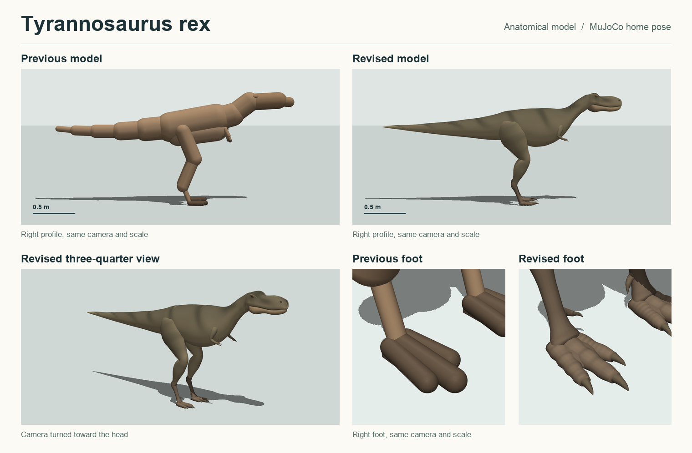
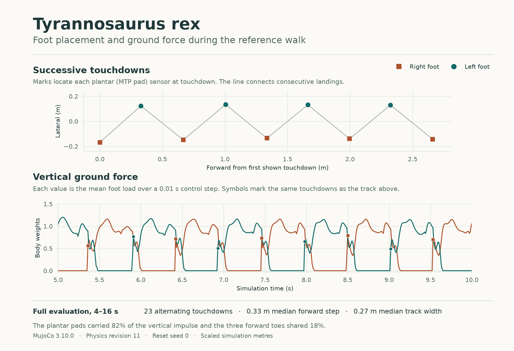

import useBaseUrl from '@docusaurus/useBaseUrl';
import SpeciesCatalog from '@site/src/components/SpeciesCatalog';
import SpeciesVideoSection from '@site/src/components/SpeciesVideoSection';
import {requireModel} from '@site/src/data/species';

export const MODEL = requireModel('tyrannosaurus_rex', 'anatomical');

# T-Rex Model

This 85.5 kg simulation models a scaled adult *Tyrannosaurus rex*. Its hip stands 0.877 m above the floor at home. The tibia measures 91% of femur length. A broad posterior skull, two-fingered forelimbs and tapering tail follow the simulated skeleton. Each foot rests on a plantar pad and three independently hinged toes. The smaller first digit sits above the floor.

Since policy interface r14 the T-Rex's observation reads no world heading: the policy sees the direction of gravity in its own body frame and its velocity relative to the way it faces, so turning the whole scene changes nothing it observes. Since policy interface r17 (decision D-D59) it reads no prey either, as the prey has left the scene. T-Rex trains on Stable-Baselines3 only.

<SpeciesCatalog species={MODEL} />

## Curriculum

The T-Rex manifest (`configs/tyrannosaurus_rex/anatomical/stages.toml`, schema
`mesozoic.stage-manifest/v2`) declares three nodes and three recipes — stance,
recover and walk — every one of them a published deliverable:

1. **`stance`** (recipe `stance`; root, historical stage 1) — settle from a
   randomized spawn and hold a stable upright pose; gated on physical stance
   quality, not reward, because a zero-action "statue" earns nearly all the
   reward the undisturbed task pays. Since physics r8 the gate is `stance_quality/v2`:
   every episode of a 40-episode panel is judged on the floor's force under
   each foot (no hop at reset, both feet planted, pads flat and not stood on
   an edge, no actuator held at its limit, no turning away), and the stance
   certifies when at least 37 of 40 are clean and at most one hops for the
   whole episode or falls. Since 2026-10-11 (decision D-D32) the gate is the
   six-heading certificate `stance_quality_heading/v1`: the same panel is
   rolled with the whole scene turned −90°, −45°, 0°, 45°, 90° and 180°, every
   heading must pass that decision, and at least 37 of the 40 seeds must be
   clean at all six, so a stance that stands only at the heading it trained
   at fails. Since the maintainer's stance-landing decision of 2026-11-06 the
   stance trains the r10 "LTSB" recipe: mirror-symmetric PPO, a standing
   lateral-lean bonus, the leg target centred on the statue's settled pose,
   and penalties on the feet's front-to-back stagger and on each foot's centre
   of pressure leaving a band along the foot
   ([mirror symmetry](/docs/training/mirror-symmetry)).
2. **`recovery`** (recipe `recover`; `warm_start_from = "stance"`; no legacy
   number, addressed by id) — the same task plus scheduled external pushes
   (159.7 N for 0.20 s on the current plant, derived from the plant's own
   mass and stance geometry), warm-started from the certified stance
   checkpoint. Only a disturbance can certify *active* balance control; the
   `recovery_quality/v1` gate judges per-shove recovery against frozen null
   baselines. It was frozen on 2026-08-28 with measured thresholds; the
   verdict comes from the stage directory's `gate_resolution.json`, written
   by `freeze_recovery_gate.py`.
3. **`locomotion`** (recipe `walk`; `warm_start_from = "stance"`, historical
   stage 2) — forward walking/running. Its edge is declared `stance` today;
   the plan is to re-declare it as `recovery` by a manifest edit once a
   recovery run passes the frozen gate (plan assumption A2) — nothing
   re-parents it on its own.

The head-contact "bite" hunt that followed locomotion (`behavior`, recipe
`hunt`, historical stage 3) was removed by decision D-D59, so the chain ends
at walk and `BEHAVIOR = "hunt"` is refused naming `"walk"`. Its reward,
termination and constructor arguments are gone from the environment, and since
physics r12 and policy interface r17 (the same decision) so are the prey
sphere, its observation channels and the 0.2 kg head-contact box the bite
read.

Each recipe label names one node: the notebook's `BEHAVIOR = "stance"` trains
the stance node alone, and `BEHAVIOR = "recover"` trains stance and then
recovery and enforces the recovery verdict. Until decision D-D35 (2026-10-16)
the recovery node was labelled `stand` too, so `"stand"` meant that
stance-then-recovery chain here; since decision D-D38 (2026-10-18) the stance
node's label is `stance`, its own id, and `"stand"` is refused with a pointer
to `"stance"`. Integer stage
references keep their historical meaning everywhere (stage 2 remains
locomotion). The catalog table above shows each node's recipe and warm-start
parent, and the video cards below are keyed by stage id. See
[Behavior Recipes](/docs/training/recipes).

## Anatomy

The 2.88 m surface follows the broad ribcage, neck and five tail bodies as the animal moves. The three proximal tail bodies articulate, while the distal pair moves together. The pelvis settles about 0.7 degrees nose-down. The head and neck servos control carriage and the short arms carry two visible fingers apiece.

The femur and tibia measure 0.368 m and 0.335 m. At home the knee has a 135° interior angle and the ankle stands about 0.228 m above the floor. Digit III projects farthest, digit IV turns slightly farther outward than digit II turns inward, and the small medial hallux sits above the weight-bearing toes. Each foot's load signal combines the plantar pad and three digital touch sensors.



## Diagnostic Metrics

After each training stage the `eval` command reports:

| Metric | Description |
|--------|-------------|
| `mean_forward_velocity` | Average forward speed (m/s) |
| `gait_symmetry` | Left/right stride symmetry ∈ [0, 1] |
| `stride_frequency` | Step frequency (Hz) |
| `cost_of_transport` | Energy efficiency (lower is better) |
| `mean_pelvis_height` | Upright stability (m) |
| `mean_heading_alignment` | cos θ between the body's heading and its spawn heading ∈ [-1, 1] |

## Reference walk

<video controls preload="metadata" width="100%" src={useBaseUrl('/videos/tyrannosaurus_rex_anatomical_reference_walk.mp4')} aria-label="Anatomical T. rex walking on level ground, with a synchronized close-up of its feet and measured foot loads" />

The reference controller uses the model's 15 actuators. The two views show the same 16-second simulation on level ground. The force readouts beneath the feet are in body weights. In the final 12 seconds the animal averaged 0.638 m/s and made 23 alternating touchdowns. Both feet shared support for 21.5% of that interval.



The track is broad for its step length. Successive landings were a median 0.33 m apart forward and 0.27 m across. The plantar pads carried 82% of the vertical impulse and the three forward toes shared 18%.

## Historical training videos

These PPO recordings show earlier model revisions.

<SpeciesVideoSection species={MODEL.name} stages={MODEL.stages} />

## Usage

```bash
# From the repository root. View the model
python environments/tyrannosaurus_rex/scripts/view_model.py --embodiment anatomical

# Reproduce the filmed reference walk and its foot-contact measurements
python -m environments.tyrannosaurus_rex.scripts.audit_motion --mode walk --seconds 16 --warmup 4 --noise 0.05 --seeds 0

# Train the stance node using its current TOML-configured budget
python -m environments.shared.train --species tyrannosaurus_rex --embodiment anatomical train --stage 1

# The advancing stages (stance, locomotion) in manifest order
python -m environments.shared.train --species tyrannosaurus_rex --embodiment anatomical curriculum --algorithm ppo

# Reuse an earlier run's certified stance; train walk in a fresh directory
python -m environments.shared.train --species tyrannosaurus_rex --embodiment anatomical curriculum --algorithm ppo \
  --trunk-from logs/<earlier_run> --output-dir logs/<new_run>

# The recovery node, entering from a certified stance handoff (PPO-only)
python -m environments.shared.train --species tyrannosaurus_rex --embodiment anatomical train --stage recovery \
  --algorithm ppo --load logs/<run>/01_stance/models/robust_best_model.zip \
  --load-mode initialize_next_stage
```

See [Behavior Recipes](/docs/training/recipes) for the notebook workflow.
